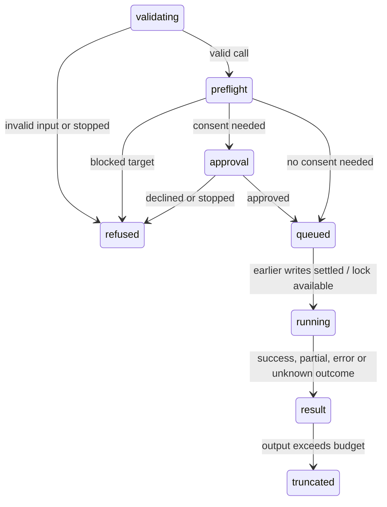

# The tool contract

## Summary

Tools validate inputs, apply connection/consent rules, coordinate workbook work and return content plus an error flag. Content reaches the model; details are stable metadata for the UI, not model-visible data. A result's wording and `isError` both matter: checked mutation failures set the flag, but some read failures still return error-shaped text without it.

## The simple case

An empty-target `write_cells` succeeds with a qualified address, a read-back preview, changed-cell count and a text backup ID when one was saved. A live Excel-web formula write to B4 returned `8`, `Changed cell(s): 1.` and `Backup saved: …`. An independent Office.js read confirmed both formula and value.

## The call, event by event

### Forms the call

Calls from one response can start in parallel; results retain call order. An output-token cutoff refuses incomplete calls rather than executing truncated arguments. Tool schemas and prompt guidance explain supported inputs and safe alternatives.

### Rejected at once

Unknown tools, schema failures, missing connections, explicit declines and aborts are errors. Checked writes also refuse invalid formula syntax, occupied targets without overwrite permission, dangerous merges/spills, protected targets and overwrites too large to back up. A refused call applies nothing. Preflight can refuse before an approval is displayed.

### Touches Excel

Mutations serialize across the taskpane. Reads in the same runtime wait for earlier registered mutations, not later ones or another runtime's writes. Confirm approvals happen before the lock and queue without declining one another. Recovery delete/clear always asks despite being a non-workbook write. Files/extension changes have their own consent rules outside the workbook lock.

### While running

Excel runs time out at 60 seconds, reporting unknown outcome rather than assuming the host did nothing. Cell-edit rejections wait with bounded backoff only if no earlier sync succeeded. Stop cancels waits and unsubmitted chunks; submitted host work cannot be recalled. Checked writes/fills settle their current batch and report their own cancellation outcome.

### The result

Content blocks and `isError` reach the agent. Details hold change samples, verification scope and recovery metadata for the UI. A full card can therefore contain more structure than the model's text. Oversized text passes through generic truncation after tool-specific paging/chunking.

## Result shapes

### Success

Qualified address and actual scope, result/preview, changed count when known, verification limitations and recovery note. A successful host call is not proof that every dependent elsewhere is correct.

### Blocked

Explicit refusal, no write, error flag for checked mutations. Occupied cells can suggest retry with `allow_overwrite` only after the user's intent is established. Structural obstacles need a different target or explicit preparatory action, not blind overwrite.

### Error-shaped results

Some read paths still catch Excel failures into text without `isError`. Do not assume an unflagged result is successful: read its content. Checked mutation failures now set `isError: true`; summaries can distinguish them from successes. Protection, edit-mode, payload and timeout messages provide the relevant state or recovery action where supported.

### Thrown errors

Schema, connection, approval and cancellation failures can throw; the agent loop converts them to failed tool results. An explicit decline is not a generic host error.

### Silent success and false failure

Checked writes preflight merge/spill/protection obstacles, compare expected content, report text conversions and validation issues, calculate written formulas in Manual mode, and chunk large operations. Failures after submission distinguish known-applied work from unknown outcomes. These protections do not prove the entire workbook or every downstream dependent is unchanged.

## Verification

`write_cells`, `fill_formula` and Python transforms use the checked range-write path. Small targets get full read-back; large targets use head/tail samples plus whole-target error/blank checks. Receipts state scope and limitations. Text conversion, invalid entries, table extension/header rename and calculation state are reported rather than silently called exact matches. Merge/spill API limitations are stated when a host cannot inspect them fully.

## Backup notes

Saved snapshots expose their ID in text. Skips state the real reason, including size, and do not conflate it with missing identity. Occupied checked-write targets over the 20,000-cell cap are refused. Saving/reloading never clears backups. Retention is per workbook with a global cap; restoring can save a rollback snapshot and reports if that protection failed.

## Truncation and aging

Generic text limits remain 50 KB / 2,000 lines, scaled for small windows, head or tail according to tool. Full output may be saved to Files. Older results can become model-facing previews while cards keep full output. Compaction additionally shrinks large answered results in its kept tail and labels requests answered/not answered, including a final reply outside the summarized slice. See [limits](limits.md) and [context pressure](../hostility/context-pressure.md).

## Hostility and interrupts

Cell editing waits, submitted work can finish after Stop, and timeout means unknown outcome. Reads/verification are snapshots, not co-authoring locks. Manual calculation and formatting are stated where material; no result guarantees remote changes cannot overwrite it later.

## Interactions with other systems

**What the agent is told.** Schemas describe paging, checked writes and consent. **Verification.** Scope is explicit. **Backups and recovery.** IDs/reasons are model-visible text. **The workbook lock and parallel calls.** Earlier writes order same-runtime reads only. **Execution mode and approvals.** Approvals queue before the lock; destructive recovery always asks. **Truncation and history shaping.** Full UI content can outlive model-facing previews. **Auto-context.** Durable other-edit notes persist; own structure refresh waits until next turn. **Prompt caching.** Stable prefixes, appended notes and trailing selection avoid rewriting prior tool history for selection changes. **Host differences.** API availability can limit checks. **What the user sees.** Cards use details, show failures red and finish individually.

## Edge cases

- A blocked write can still leave an audit entry, not a backup or workbook change.
- A failed read with no error flag remains an agent-facing ambiguity; inspect content.
- Stop/timeout must never be interpreted as proof that a submitted host write failed.

## Open questions and verification

Code reviewed at `1f51cf8`. Live Excel-web probes confirmed a merged-child refusal with `isError: true`, paged displayed-value reads, and a real GPT-6 Luna formula write with backup and independent read-back. Desktop API gaps and real co-author races were not retested.

Verified against pi-for-excel commit `1f51cf8`.
