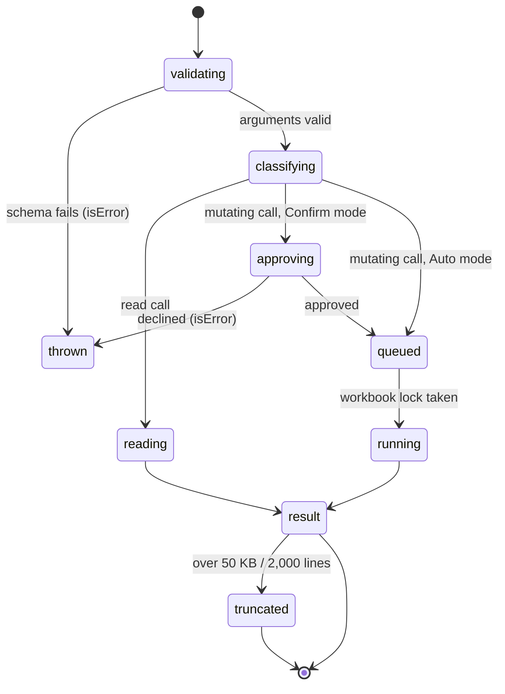

# The tool contract

## Summary

Every tool call passes through the same layers and comes back in the same few shapes. This document covers both. It covers what reaches the agent and what does not, error-shaped results and thrown errors, blocked results, verification, backup notes, truncation, and how a result ages in history. Tool documents link here instead of restating these rules.

## The simple case

The agent calls `write_cells` on an empty range. The call is validated, classified as mutating, queued on the workbook lock, run, backed up, and truncated if needed. The agent receives one text block (confirmed):

```
Written to **Calc!A3** (1×1)

**Verified values:**
| 0.0000e+0 |
| --- |

Changed cell(s): 1.
```

The details object attached to the same result holds `changes` (a sample of before/after values) and `recovery` (`{"status": "checkpoint_created", "snapshotId": "…"}`). None of it reaches the agent.

## The call, event by event



### Forms the call

The model emits a name and JSON arguments. Several calls from one model call form a batch and run in parallel. If the model's output hit its token limit, every call in that message is failed without running: `Tool call "{name}" was not executed: the response hit the output token limit, so its arguments may be truncated. Re-issue the tool call with complete arguments.` Large `write_cells` grids are the likeliest way to hit this.

### Rejected at once

These failures come back with `isError: true` (*thrown errors*). They are the only failures the agent loop recognises as failures:

- Unknown tool: `Tool {name} not found`.
- Schema validation: `Validation failed for tool "{name}":` followed by each path and message, then the arguments the agent sent.
- An abort before the call starts: `Aborted` or `Operation aborted`.
- In Confirm mode, a declined approval: `Mutation cancelled by user (Confirm mode).` (see [the lock and parallel calls](../hostility/the-lock-and-parallel-calls.md#racing-approvals) for approvals that decline themselves).
- A gated tool whose connection is missing (web search, MCP).

Tools also reject some arguments themselves before touching Excel, but as ordinary results (below): `Error: values array is empty.`, `Error: start_cell must be a single cell`, `⛔ **Write blocked** — invalid formula syntax detected:` …

### Touches Excel

Calls are wrapped, outermost first, by truncation, the connection preflight, and the workbook coordinator. The coordinator classifies the call:

- **Read calls** (`get_workbook_overview`, `read_range`, `search_workbook`, `trace_dependencies`, `explain_formula`, `instructions`, `conventions`, `files`, `python_run`, `web_search`, `fetch_page`, `skills`, …; `view_settings get`, `comments read`, `charts list/get_image`, and `workbook_history` for everything but `restore`) run at once.
- **Mutating calls** (`write_cells`, `fill_formula`, `modify_structure`, `format_cells`, `conditional_format`, `python_transform_range`, `execute_office_js`, the other actions above, and any unknown tool) wait for approval in Confirm mode, then wait for the [workbook lock](../hostility/the-lock-and-parallel-calls.md), then run.

`workbook_history` `delete` and `clear` count as reads, so they skip the lock and approval.

### While running

The tool runs its Excel batches. No workbook tool reports progress, has a timeout, or checks the abort signal once it has started.

### The result

What the agent receives is the result's content blocks (text, plus an image for `charts get_image`) and the `isError` flag. Everything else is UI-only.

## Result shapes

### Success

A short heading naming the resolved, sheet-qualified address and size, then the substance. Mutations add `Changed cell(s): N.` when cells changed, and a backup note when no backup was made.

### Blocked

Overwrite protection and formula-syntax checks return `⛔ **Write blocked** — …` or `⛔ **Fill blocked** — …`, then the existing data, then `To overwrite, confirm with the user and retry with \`allow_overwrite: true\`.` Nothing was written.

### Error-shaped results

Every Excel failure inside a workbook tool is caught and returned as text, with `isError` false: `Error reading "…": {message}`, `Error writing cells: {message}`, `Error filling formula: …`, `Error formatting: …`, `Error: {message}` (structure, view, conditional format, history), `Error ({action} on "{range}"): …` (comments), `Error executing Office.js: …`. The message is Office's `message` only. The error code (`AccessDenied`, `ItemNotFound`, `InvalidOperationInCellEditMode`, `RequestPayloadSizeLimitExceeded`) and debug info are dropped. Office messages agents meet (all confirmed on the web):

| Situation | Message |
| --- | --- |
| Protected sheet | `You cannot perform the requested operation.` |
| Missing sheet | `The requested resource doesn't exist.` |
| Bad address | `The argument is invalid or missing or has an incorrect format.` |
| Too much data | `The response payload size has exceeded the limit. Please refer to the documentation: "…"` |
| User typing in a cell | `Excel is in cell-editing mode. Please exit the edit mode by pressing ENTER or TAB or selecting another cell, and then try again.` |

Because the flag is false, the compaction summarizer labels these results as successes (`[Tool result write_cells]`, not `(error)`), and the history shaper treats them like any other result.

### Thrown errors

See [Rejected at once](#rejected-at-once). They are the minority.

### Silent success and false failure

Two shapes that the contract does not admit but Excel produces. A *silent success* says the call worked when it did not (merged areas, spill children, manual calculation, data validation). A *false failure* says it failed when it worked (payload errors after a write). See [writing cells](../tools/writing-cells.md) and [filling a formula](../tools/filling-a-formula.md).

## Verification

`write_cells`, `fill_formula` and `python_transform_range` read the target range back after writing and report formula errors (`⚠️ **N formula error(s):**` with each address, error value and formula), or, if none, a preview of at most 8 rows × 6 columns of the read-back values. Verification:

- reads only the target range, so new errors elsewhere (a spill anchor turned `#SPILL!`, a dependent turned `#REF!`) are not reported;
- does not compare read-back values with the values sent, so dropped or coerced values pass;
- does not recalculate or check the calculation mode, so under Manual it "verifies" stale values;
- treats any string starting with `#` as an error value.

## Backup notes

A mutation that made a backup says nothing about it in text. One that did not appends `ℹ️ Backup not created for this mutation. \`workbook_history\` tracks {list} when backup capture succeeds.` (capture skipped) or `ℹ️ Backup not created. …` (mutation type not covered). The real reason is only in the details, and the skipped reason reads "workbook identity unavailable or snapshot data unsupported" whatever caused it (often the 20,000-cell cap). The snapshot ID is only in details. To restore, the agent must call `workbook_history list` and find the entry.

## Truncation and aging

Each result's text is cut once, when the call finishes, to 50 KB or 2,000 lines (scaled down for windows under 128k). Workbook tools keep the head; `python_run`, `tmux`, `mcp` and `execute_office_js` keep the tail. A notice is appended. See [limits](limits.md#per-result-truncation).

The stored result then ages. Before every model call, results older than the six most recent that are over 1,200 characters (or hold an image) are replaced, for the model only, by `[Compacted tool result] {tool}`, the original size, a 500-character preview, and "Full output remains visible in chat history; this compact version is model-facing only." Later, compaction replaces them with a summary. See [context pressure](../hostility/context-pressure.md).

## Hostility and interrupts

The contract is the same under every hostility family. What changes is which shape comes back. Cell-edit mode, protection and payload limits produce error-shaped results. Merges, spills, manual calculation and validation produce silent successes. Oversized writes produce false failures. Stop before the call produces a thrown `Aborted`. Stop during the call produces the tool's normal result after Excel finishes.

## Interactions with other systems

**What the agent is told.** The prompt says `write_cells` "auto-verifies and reports errors" and that it "blocks if the target has data". It says nothing about error-shaped results.

**Verification.** See [Verification](#verification).

**Backups and recovery.** See [Backup notes](#backup-notes) and [backups](../tools/backups.md).

**The workbook lock and parallel calls.** Mutating calls are serialized across tabs; reads are not. See [the lock and parallel calls](../hostility/the-lock-and-parallel-calls.md).

**Execution mode and approvals.** Confirm mode adds an approval before the lock for every mutating call, and for `execute_office_js` in any mode when the code uses browser globals.

**Truncation and history shaping.** See [Truncation and aging](#truncation-and-aging).

**Auto-context.** After a structural mutation, the next model call's blueprint is rebuilt.

**Prompt caching.** Results are appended to the tail, so they do not disturb the cached prefix. History shaping rewrites an older result on each call, which does.

**Host differences.** On WPS most workbook tools throw `unsupported_host_tool` (out of scope).

**What the user sees.** Tool cards render details (changes tables, backup links), which the agent never sees. See [product-description/workbook/writing.md](../../product-description/workbook/writing.md).

## Edge cases

- A tool that returns both text and an image (`charts get_image`) is always shaped once it ages, because images count as large.
- An empty text result is never truncated or shaped.
- A blocked write still writes an audit entry (`blocked: true`), but no backup.

## Open questions and verification

- Confirmed: the result shapes and Office messages above, from probe calls on Excel on the web (CONTRACT-01 to CONTRACT-05).
- Read from code: the wrapper order, the length-stop message, the compaction summarizer's use of `isError`.
- Looks like a bug: error-shaped results ([B-10](../bug-triage.md#b-10-excel-failures-arrive-as-generic-text-in-results-marked-successful)), verification scope ([B-03](../bug-triage.md#b-03-verification-checks-only-the-written-cells-so-broken-spills-stale-formulas-and-invalid-entries-pass)), backup reasons ([B-19](../bug-triage.md#b-19-backup-notes-give-the-wrong-reason-when-a-backup-is-skipped)), the shaping preview ([B-16](../bug-triage.md#b-16-history-shaping-hides-earlier-results-behind-a-preview-that-points-nowhere)).

Verified against pi-for-excel commit `ec453df`.
