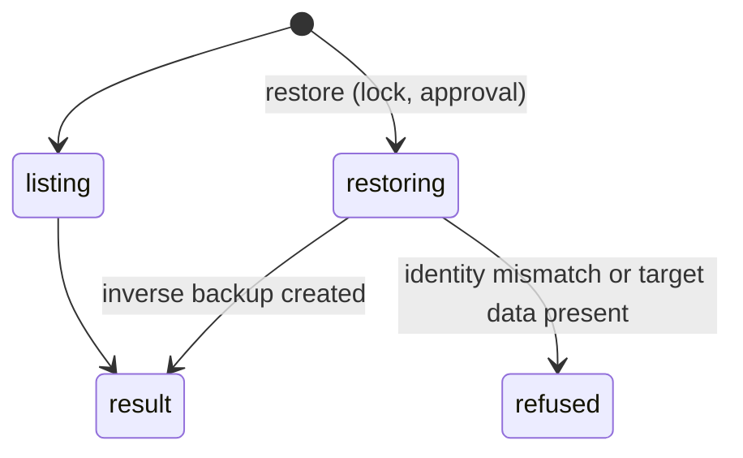

# `workbook_history`

## Summary

Lists, restores, deletes and clears the automatic backups taken before Pi's supported mutations. `restore` is a mutation (and makes its own inverse backup); `list`, `delete` and `clear` are classified as reads, so they skip the lock and Confirm-mode approval.

## The simple case

`{"action": "list"}` (confirmed, abridged):

```
Recent backups (current workbook):

| ID | Time | Tool | Range | Changed |
| --- | --- | --- | --- | ---: |
| `f812598c-…` | 10/26/2026, 6:03:34 PM | write_cells | Calc!B1 | 1 |
...
Use `workbook_history` with `action: "restore"` and `snapshot_id` to revert a specific backup.
```

The agent has to map its own earlier writes to rows by tool, range and time; mutation results never told it the IDs.

## The call, event by event



### Forms the call

The agent needs a snapshot ID, available only from `list`.

### Rejected at once

Unknown IDs; restores across workbook identities; structure restores over present data.

### Touches Excel

Restore writes the saved values, formats or structure back.

### While running

One mutation under the lock.

### The result

A table or a receipt. Backups cover mutations up to 20,000 cells; larger ones say "ℹ️ Backup not created for this mutation…" at the time, with the misleading reason in details.

## Workbook and host state

| State | True before the call | Changes while running |
| --- | --- | --- |
| Sheet protection | Restore fails on locked cells. | — |
| Calculation mode | Restored formulas stale. | — |
| Merged cells | Merge state restored for `format_cells` backups. | — |
| Tables, filters and hidden rows | Not part of backups. | — |
| Data validation | Not part of backups. | — |
| Dynamic arrays and spills | Restoring a child value re-breaks a spill. | — |
| External links | No effect. | — |
| Very large used range | Large mutations have no backup. | — |
| Number formats and locale | Number formats restored for format backups. | — |
| Host and API set | Identity on web anonymous links is unknown; backups still listed in this session. | — |
| Execution mode | Restore approved in Confirm; delete/clear never approved. | — |

## Hostility and interrupts

| Event | Before Excel is touched | While running |
| --- | --- | --- |
| The user is editing a cell | List works (no Excel call); restore fails. | — |
| The user changes the selection or the active sheet | No effect. | — |
| The user changes data the call depends on | Restore overwrites the user's newer edits. | — |
| Another tab's write holds the workbook lock | Restore waits; delete/clear do not. | — |
| Excel throttles, times out or rejects the payload | Rare. | — |
| Recalculation is pending | No effect. | — |
| The workbook is co-authored | Restore overwrites co-authors' edits. | — |
| Autosave or a save boundary | Backups are cleared when the workbook goes from unsaved to saved; on the web the save state is unreliable (see [co-authoring and autosave](../hostility/co-authoring-and-autosave.md)). | — |
| The user presses Stop | `Aborted`. | Completes. |
| The context fills | Lists are short. | — |

## Interactions with other systems

**What the agent is told.** The prompt line lists covered tools. **Verification.** None after restore. **Backups and recovery.** This tool. **The workbook lock and parallel calls.** Delete/clear bypass the lock. **Execution mode and approvals.** See above. **Truncation and history shaping.** No interaction. **Auto-context.** Restores appear in the change list as user changes. **Prompt caching.** No interaction. **Host differences.** Save boundary on the web. **What the user sees.** The Backups dialog; see [product-description/workbook/backups-and-revert.md](../../product-description/workbook/backups-and-revert.md).

## Open questions and verification

- Confirmed: HIST-01 (list), backup creation and the >20,000-cell skip.
- Read from code: restore paths; delete/clear as reads (`src/tools/execution-policy.ts:71-74`).
- Looks like a bug: [B-19](../bug-triage.md#b-19-backup-notes-give-the-wrong-reason-when-a-backup-is-skipped); snapshot IDs only in details.

Verified against pi-for-excel commit `ec453df`.
