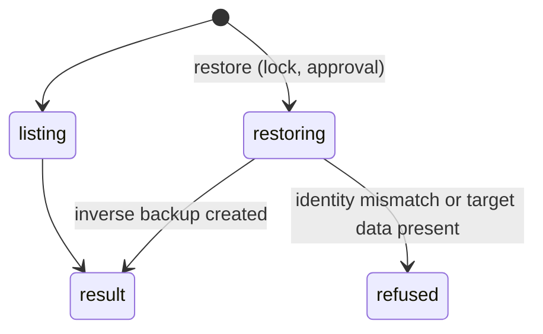

# `workbook_history`

## Summary

Lists, restores, deletes and clears automatic backups. List is read-only; restore/delete/clear serialize with workbook operations. Restore makes a rollback backup when possible. Delete/clear always ask for approval, even in Auto; Confirm also gates restores. User-initiated restore has its own preview/confirmation path.

## The simple case

`{"action": "list"}` (confirmed, abridged):

```
Recent backups (current workbook):

| ID | Time | Tool | Range | Changed |
| --- | --- | --- | --- | ---: |
| `f812598c-…` | 10/26/2026, 6:03:34 PM | write_cells | Calc!B1 | 1 |
...
Use `workbook_history` with `action: "restore"` and `snapshot_id` to revert a specific backup.
```

Mutation results now include their snapshot IDs in readable text. Listing also maps IDs to tool/range/time.

## The call, event by event



### Forms the call

Restore/delete needs a snapshot ID from a mutation receipt or `list`.

### Rejected at once

Unknown IDs; restores across workbook identities; structure restores over present data.

### Touches Excel

Restore writes the saved values, formats or structure back.

### While running

One mutation under the lock.

### The result

A table or receipt, with truthful capture/storage limitations. Snapshot size is capped at 20,000 cells. Checked writes refuse occupied larger targets rather than silently skipping overwrite protection. History has a shared 512 MiB compressed-payload-plus-metadata ceiling across all workbooks, evicting oldest first with no count/age limit or protected minimum. Lists page 50 metadata entries at a time; save/reload does not clear backups. Failed rollback capture/storage is reported. See the current [storage and migration contract](../../product-description/workbook/backups-and-revert.md).

## Workbook and host state

| State | True before the call | Changes while running |
| --- | --- | --- |
| Sheet protection | Restore fails on locked cells. | — |
| Calculation mode | Restored formulas stale. | — |
| Merged cells | Merge state restored for `format_cells` backups. | — |
| Tables, filters and hidden rows | Not part of backups. | — |
| Data validation | Not part of backups. | — |
| Dynamic arrays and spills | Restoring a child value re-breaks a spill. | — |
| External links | No effect. | — |
| Very large used range | Large mutations have no backup. | — |
| Number formats and locale | Number formats restored for format backups. | — |
| Host and API set | Identity on web anonymous links is unknown; backups still listed in this session. | — |
| Execution mode | Restore approved in Confirm; delete/clear always approved. | Queued approvals are withdrawn by Stop. |

## Hostility and interrupts

| Event | Before Excel is touched | While running |
| --- | --- | --- |
| The user is editing a cell | List works (no Excel call); restore fails. | — |
| The user changes the selection or the active sheet | No effect. | — |
| The user changes data the call depends on | Restore overwrites the user's newer edits. | — |
| Another tab's write holds the workbook lock | Restore/delete/clear wait. | — |
| Excel throttles, times out or rejects the payload | Rare. | — |
| Recalculation is pending | No effect. | — |
| The workbook is co-authored | Restore overwrites co-authors' edits. | — |
| Autosave or a save boundary | Never clears automatic backups. | — |
| The user presses Stop | `Aborted`. | Completes. |
| The context fills | Lists are short. | — |

## Interactions with other systems

**What the agent is told.** Covered tools and readable backup receipts. **Verification.** Restore is not a global correctness check. **Backups and recovery.** Durable per-workbook retention. **The workbook lock and parallel calls.** Restore/delete/clear serialize. **Execution mode and approvals.** Destructive backup actions always ask. **Truncation and history shaping.** Lists can be bounded. **Auto-context.** Own restores are not user edits. **Prompt caching.** No interaction. **Host differences.** Save state no longer clears entries. **What the user sees.** [Backups dialog](../../product-description/workbook/backups-and-revert.md).

## Open questions and verification

- Merged recovery, execution-policy and coordinator source inspected. Live Luna write in this pass returned a saved backup ID. Restore/deletion, retention and multi-pane acceptance were not all rerun; old HIST observations are historical.

Verified against pi-for-excel commit `1f51cf8`.
