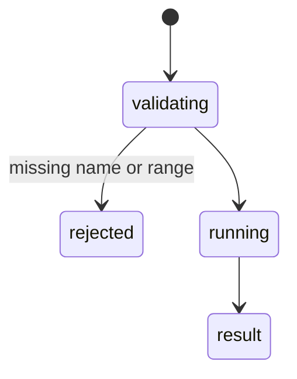

# `charts` and `comments`

## Summary

`charts` lists, creates, updates and deletes charts and captures a chart as an image (`get_image`) so the agent can check it visually. `comments` reads, adds, updates, replies to, deletes, resolves and reopens cell comments. `list`, `get_image` and `read` are reads; the rest mutate. Chart create/update and comment mutations are backed up; chart delete is not.

## The simple case

`charts {"action": "create", "sheet": "Tbl", "source_range": "Tbl!A1:B7", "chart_type": "column", "title": "Amounts"}` (confirmed): `Chart 'Chart 1' created — Tbl!A1:B7`. The chart is named `Chart 1`, not the title; `get_image` needs `name`, and `{"chart_name": …}` returned `Error (get_image): name is required for get_image`. With the right name: `Captured chart 'Chart 1' (600×360 px).` plus an image block (3.2 s).

`comments {"action": "add", "range": "Dates!A2", "content": "check this"}` (confirmed): `Added comment to **Dates!A2**: "check this"`; `read` on `Dates!A1:D4`: `**Dates!A1:D4** — 1 comment` and `- **A2**: "check this" — *Guest User*`.

## The call, event by event

### Forms the call

Chart actions take `name`; comments take `range`. A wrong parameter name is not a schema error when the parameter is optional: the call runs and fails inside (`Error (add on "undefined"): Cannot read properties of undefined (reading 'includes')` when `cell` was sent instead of `range` — a JavaScript error, not a hint).

### Rejected at once

`Error ({action}): …` / `Error ({action} on "{range}"): …`.

### Touches Excel

One or two batches; `get_image` renders the chart.

### While running

`get_image` takes seconds on the web.

### The result

Receipts as above. The image block is large and is always [shaped](../hostility/context-pressure.md) away once it is not among the six most recent results.

## Workbook and host state

| State | True before the call | Changes while running |
| --- | --- | --- |
| Sheet protection | Chart and comment edits fail with the generic message (read from code). | — |
| Calculation mode | Charts show stale data. | — |
| Merged cells | No effect. | — |
| Tables, filters and hidden rows | Charts on filtered data hide filtered points by default; not reported. | — |
| Data validation | No effect. | — |
| Dynamic arrays and spills | A chart on a spill range does not grow with it. | — |
| External links | No effect. | — |
| Very large used range | No effect. | — |
| Number formats and locale | No effect. | — |
| Host and API set | Modern threaded comments need ExcelApi 1.10. | — |
| Execution mode | Mutations approved per call. | — |

## Hostility and interrupts

| Event | Before Excel is touched | While running |
| --- | --- | --- |
| The user is editing a cell | Edit-mode error. | — |
| The user changes the selection or the active sheet | Unqualified ranges follow it. | — |
| The user changes data the call depends on | Chart reflects it. | — |
| Another tab's write holds the workbook lock | Mutations wait. | — |
| Excel throttles, times out or rejects the payload | Image capture could be slow; no timeout. | — |
| Recalculation is pending | Stale chart. | — |
| The workbook is co-authored | Comments by others are listed with authors. | — |
| Autosave or a save boundary | Clears backups. | — |
| The user presses Stop | `Aborted`. | Completes. |
| The context fills | Images are shaped early. | — |

## Interactions with other systems

**What the agent is told.** "After creating or updating a chart … call `charts` with `action: "get_image"` when visual verification would help." **Verification.** Visual, on request. **Backups and recovery.** Chart delete not backed up; update cannot restore a changed source range (said in the result). **The workbook lock and parallel calls.** As mutations. **Execution mode and approvals.** Per call. **Truncation and history shaping.** Images shaped. **Auto-context.** Create/delete refresh the blueprint. **Prompt caching.** No interaction. **Host differences.** None observed. **What the user sees.** Chart image in the card.

## Open questions and verification

- Confirmed: CHART-01 to CHART-03, COMMENT-01, COMMENT-02.
- Looks like a bug: unhelpful internal errors for wrong parameters ([B-21](../bug-triage.md#b-21-small-result-format-slips)).

Verified against pi-for-excel commit `ec453df`.
