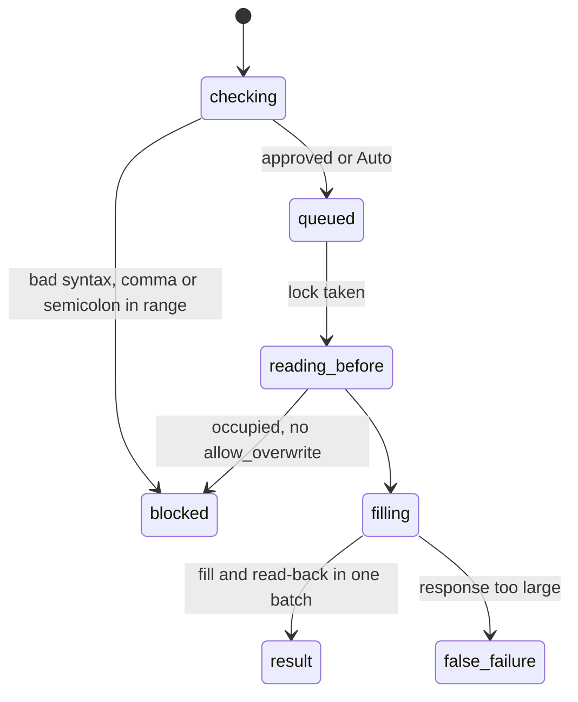

# `fill_formula`

## Summary

`fill_formula` writes one formula into the top-left cell of a range and autofills it across the range, so relative references adjust. It exists so the agent does not have to send a large 2D array of formulas. Overwrite protection, formula syntax checks, verification and backups work as for [`write_cells`](writing-cells.md). It is a mutating call.

Prompt line: "**fill_formula** — fill a single formula across a range (AutoFill with relative refs)". Schema: `range` ("Single contiguous range only"), `formula`, `allow_overwrite`.

## The simple case

`{"range": "Tbl!D2:D7", "formula": "=B2*2"}` returned (confirmed):

```
Filled formula across **Tbl!D2:D7** (6×1)
**Formula pattern:** `=B2*2`
**Example formulas:** top-left `=B2*2`, bottom-right `=B7*2`

Changed cell(s): 6.
```

Column D was next to a table, so the table grew to include it and Excel named the new header `Column1` — not mentioned in the result (confirmed).

## The call, event by event



### Forms the call

The agent picks a range and writes the formula as it should appear in the top-left cell.

### Rejected at once

`Error: invalid formula (…).`; `Error: fill_formula only supports a single contiguous range.` (any `,` or `;` in the range, including inside a sheet name). Confirm-mode decline is thrown.

### Touches Excel

The pre-read loads values and formulas of the whole range for the overwrite check and backup. `⛔ **Fill blocked** — {address} contains N non-empty cell(s).` does not list the existing data (unlike `write_cells`).

### While running

The formula, the autofill and the read-back of the whole range's values and formulas go in **one** batch. Excel executes the fill before it builds the response, so a response that is too large fails after the fill is done.

### The result

The heading, the pattern, the top-left and bottom-right formulas, any formula errors (one line each, unlimited), `Changed cell(s): N.`, and a backup note. Confirmed outcomes:

- 50,000 × 1: success in 1.6 s with "ℹ️ Backup not created for this mutation…" (over the 20,000-cell cap).
- 200,000 × 1: `Error filling formula: The response payload size has exceeded the limit…` in 3.7 s; all 200,000 formulas were present afterwards. No backup, no audit. A *false failure*.

On Excel on the web at `ec453df`, autofill from one cell fills only below and to the right, so a 2D target leaves its first row and column partly blank, and a single-cell target fails with "invalid argument". `origin/main` (`e74e2ea`) fixes both; the verification reads back the target, so at `ec453df` the blanks would at least show as missing in the change count.

## Workbook and host state

| State | True before the call | Changes while running |
| --- | --- | --- |
| Sheet protection | `Error filling formula: You cannot perform the requested operation.` (read from code; same path as write). | Same. |
| Calculation mode | Manual: filled values read back stale; not reported. | Not reported. |
| Merged cells | Autofill across merges fails or skips cells; not observed. | No effect. |
| Tables, filters and hidden rows | A fill adjacent to a table extends the table (confirmed). Inside a table column Excel may create a calculated column for the whole column. Hidden rows are filled. | No effect. |
| Data validation | Not enforced. | No effect. |
| Dynamic arrays and spills | Filling a spilling formula down makes each copy spill into the next; errors reported as `#SPILL!` lines. | No effect. |
| External links | Not observed. | No effect. |
| Very large used range | Response too large above ~50,000–200,000 cells: false failure (confirmed). | No effect. |
| Number formats and locale | English formula syntax. | No effect. |
| Host and API set | Web autofill shape differs (above). | No effect. |
| Execution mode | Confirm: one approval per call. | Next call. |

## Hostility and interrupts

| Event | Before Excel is touched | While running |
| --- | --- | --- |
| The user is editing a cell | Edit-mode error; nothing filled. | One batch; cannot be caught mid-way. |
| The user changes the selection or the active sheet | Unqualified range lands on the new active sheet. | — |
| The user changes data the call depends on | Overwrite check sees current data. | Edits between pre-read and fill are overwritten. |
| Another tab's write holds the workbook lock | Waits without limit. | — |
| Excel throttles, times out or rejects the payload | Request side is small (one formula). | Response too large → false failure (confirmed). |
| Recalculation is pending | Values stale. | Same. |
| The workbook is co-authored | Not observed. | Not observed. |
| Autosave or a save boundary | No effect. | No effect. |
| The user presses Stop | Thrown `Aborted`. | Completes. |
| The context fills | Results are small. | — |

## Interactions with other systems

**What the agent is told.** The prompt line only. Nothing about table extension or size.

**Verification.** Errors in the filled range only.

**Backups and recovery.** Up to 20,000 cells; reason misreported above.

**The workbook lock and parallel calls.** As `write_cells`.

**Execution mode and approvals.** As `write_cells`.

**Truncation and history shaping.** A fill producing thousands of errors lists every one and can be truncated.

**Auto-context.** Change list reports the range as user changes.

**Prompt caching.** No interaction.

**Host differences.** See the autofill note.

**What the user sees.** See [product-description/workbook/writing.md](../../product-description/workbook/writing.md).

## Edge cases

- A sheet name containing a comma cannot be used.
- Absolute references (`$B$2`) are copied unchanged, as in Excel.

## Open questions and verification

- Confirmed: simple fill, table extension, 50k success, 200k false failure (FILL-01 to FILL-06).
- Read from code: protection, merges.
- Looks like a bug: [B-02](../bug-triage.md#b-02-large-writes-and-fills-report-failure-after-the-change-is-applied), [B-19](../bug-triage.md#b-19-backup-notes-give-the-wrong-reason-when-a-backup-is-skipped), [B-21](../bug-triage.md#b-21-small-result-format-slips).

Verified against pi-for-excel commit `ec453df`.
