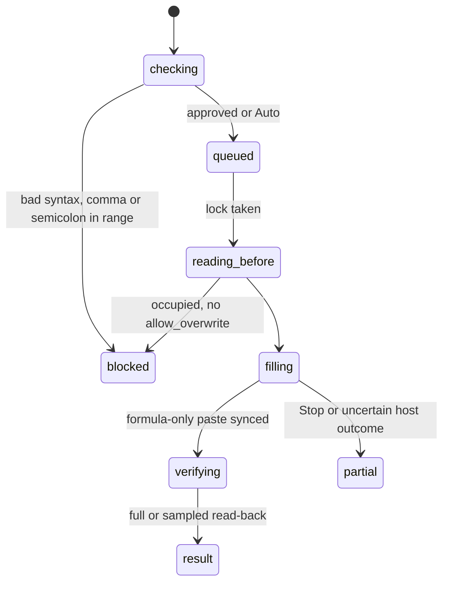

# `fill_formula`

## Summary

`fill_formula` writes one top-left formula and copies formulas only across a rectangle, adjusting relative references without copying formats. It avoids a large formula grid in model output. Target inspection, overwrite protection, full/sampled verification and backup policy are shared with [`write_cells`](writing-cells.md). It is a mutating call.

Prompt line: "**fill_formula** — fill a single formula across a range (AutoFill with relative refs)". Schema: `range` ("Single contiguous range only"), `formula`, `allow_overwrite`.

## The simple case

`{"range": "Tbl!D2:D7", "formula": "=B2*2"}` returned (confirmed):

```
Filled formula across **Tbl!D2:D7** (6×1)
**Formula pattern:** `=B2*2`
**Example formulas:** top-left `=B2*2`, bottom-right `=B7*2`

Changed cell(s): 6.
```

Excel can extend an adjacent table or create a calculated column. The checked result now reports detected table/header effects as well as formula outcomes.

## The call, event by event



### Forms the call

The agent picks a range and writes the formula as it should appear in the top-left cell.

### Rejected at once

`Error: invalid formula (…).`; `Error: fill_formula only supports a single contiguous range.` (any `,` or `;` in the range, including inside a sheet name). Confirm-mode decline is thrown.

### Touches Excel

Bounded inspection checks occupancy, protection, merges and spills. Occupied targets over the 20,000-cell backup cap are refused; split them into backed-up blocks. A preflight can refuse before approval, then locked inspection rechecks before writing.

### While running

The formula-only copy syncs separately from read-back, so a large verification response does not misreport the fill as unwritten. A single-cell range writes directly; two-dimensional rectangles fill both axes. Stop waits for the submitted fill to settle and reports what is known, never undoes it.

### The result

Heading, formula pattern, example endpoints, changes, formula/validation problems, calculation/table notes and backup ID or truthful absence reason. Up to 20,000 cells get complete read-back; larger fills use head/tail samples plus whole-target error/blank checks. Mismatches are errors, and failed read-back is distinguished from failure to apply. Manual mode calculates written formulas but does not promise fresh dependents elsewhere. Large empty fills can proceed without a snapshot; large occupied targets cannot.

## Workbook and host state

| State | True before the call | Changes while running |
| --- | --- | --- |
| Sheet protection | Detected locked targets refused with a reason. | Later protection can fail submission. |
| Calculation mode | Written formulas calculate; dependent-staleness limitation disclosed. | Snapshot only. |
| Merged cells | Unsafe merge/spill targets refused. | Concurrent changes still possible. |
| Tables, filters and hidden rows | A fill adjacent to a table extends the table (confirmed). Inside a table column Excel may create a calculated column for the whole column. Hidden rows are filled. | No effect. |
| Data validation | Violations reported, not necessarily prevented by Excel. | No effect. |
| Dynamic arrays and spills | Filling a spilling formula down makes each copy spill into the next; errors reported as `#SPILL!` lines. | No effect. |
| External links | Not observed. | No effect. |
| Very large used range | Verification bounded/sampled; occupied target backup cap still applies. | Host timeout can leave an unknown outcome. |
| Number formats and locale | English formula syntax. | No effect. |
| Host and API set | Formula-only copy handles single-cell and 2D ranges; keeps formatting. | Inspection depends on APIs. |
| Execution mode | Confirm: one approval per call. | Next call. |

## Hostility and interrupts

| Event | Before Excel is touched | While running |
| --- | --- | --- |
| The user is editing a cell | Bounded wait before a successful sync. | No unsafe retry after work may have applied. |
| The user changes the selection or the active sheet | Unqualified range lands on the new active sheet. | — |
| The user changes data the call depends on | Overwrite check sees current data. | Edits between pre-read and fill are overwritten. |
| Another tab's write holds the workbook lock | Waits without limit. | — |
| Excel throttles, times out or rejects the payload | Request is one formula/copy. | Failure reports known applied/unknown state; read-back separate. |
| Recalculation is pending | Values stale. | Same. |
| The workbook is co-authored | Not observed. | Not observed. |
| Autosave or a save boundary | No effect. | No effect. |
| The user presses Stop | Nothing submitted. | Submitted fill settles, stopped receipt describes outcome. |
| The context fills | Results are small. | — |

## Interactions with other systems

**What the agent is told.** The prompt line only. Nothing about table extension or size.

**Verification.** Complete or named sampled scope; no global dependent guarantee.

**Backups and recovery.** Up to 20,000 cells; IDs and accurate limitations in text.

**The workbook lock and parallel calls.** As `write_cells`.

**Execution mode and approvals.** As `write_cells`.

**Truncation and history shaping.** Error/change lists are capped with an omitted count; verification scope is stated separately from the displayed examples.

**Auto-context.** Own changes are excluded from external edit notes.

**Prompt caching.** No interaction.

**Host differences.** See the autofill note.

**What the user sees.** See [product-description/workbook/writing.md](../../product-description/workbook/writing.md).

## Edge cases

- A sheet name containing a comma cannot be used.
- Absolute references (`$B$2`) are copied unchanged, as in Excel.

## Open questions and verification

- Merged fill/inspection/verification source read. FILL-01–06 are historical runs; large fill and all host variants were not rerun in this pass.

Verified against pi-for-excel commit `1f51cf8` (source inspection).
