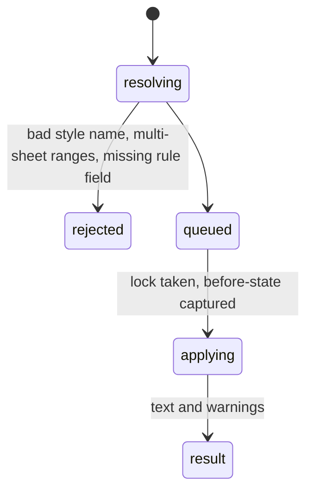

# `format_cells` and `conditional_format`

## Summary

`format_cells` applies fonts, fills, number formats (named presets or raw strings), alignment, wrap, borders, column widths, row heights and merges to one range or a comma-separated list of ranges on one sheet. `conditional_format` adds or clears rules of eight families. Both are mutating calls with automatic backups (formats, dimensions, merge state; rules).

## The simple case

`format_cells {"range": "Dates!A1,Dates!C1", "bold": true}` (confirmed): `Formatted **Dates!A1,Dates!C1**: bold.` `conditional_format {"action": "add", "range": "Tbl!B2:B6", "type": "cell_value", "operator": "GreaterThan", "value": "25", "fill_color": "#FFFF00"}` (confirmed): `Added conditional format to **Tbl!B2:B6** — cell value rule (GreaterThan 25).`

## The call, event by event

### Forms the call

The agent chooses named styles (`"currency"`, `["currency","total-row"]`) or raw parameters. The `format_cells` schema is the largest workbook schema after `conventions` (4,072 characters).

### Rejected at once

Rule fields are checked before Excel: `Error: value is required for type="cell_value".` (confirmed with a wrong parameter name). Multi-sheet ranges are rejected.

### Touches Excel

Before-state is read (for the backup) under the lock, then formats are set and synced; column widths are read back and compared.

### While running

Formatting is several batches for large multi-property calls.

### The result

`Formatted **{range}**: {summary}.` plus warnings (non-Arial fonts affect widths; dp on text) and the backup note. Formats are not verified except column width. The agent cannot see the result: no tool returns fonts or fills (only `read_range detailed` shows number formats).

## Workbook and host state

| State | True before the call | Changes while running |
| --- | --- | --- |
| Sheet protection | `Error formatting: You cannot perform the requested operation.` (confirmed), unless the protection allows formatting. | — |
| Calculation mode | No effect. | No effect. |
| Merged cells | Formatting a cell inside a merge formats the merge (confirmed for `Merged!B1`); `merge` on overlapping merges fails. | No effect. |
| Tables, filters and hidden rows | Table styles override fills visually; not reported. Hidden rows are formatted. | No effect. |
| Data validation | No effect. | No effect. |
| Dynamic arrays and spills | Formats apply; spill growth does not carry formats. | No effect. |
| External links | No effect. | No effect. |
| Very large used range | Whole-column formats are cheap; backups skip above 20,000 cells. | No effect. |
| Number formats and locale | Raw format strings are in the en-US format code language. | No effect. |
| Host and API set | Same. | No effect. |
| Execution mode | Confirm: approval per call. | Next call. |

## Hostility and interrupts

| Event | Before Excel is touched | While running |
| --- | --- | --- |
| The user is editing a cell | Edit-mode error. | Later batches fail after earlier ones applied: partial formatting, error result (read from code). |
| The user changes the selection or the active sheet | Unqualified ranges follow the active sheet. | — |
| The user changes data the call depends on | No effect. | No effect. |
| Another tab's write holds the workbook lock | Waits. | — |
| Excel throttles, times out or rejects the payload | Rare. | Rare. |
| Recalculation is pending | No effect. | No effect. |
| The workbook is co-authored | Not observed. | — |
| Autosave or a save boundary | Clears backups. | — |
| The user presses Stop | `Aborted`. | Completes. |
| The context fills | Small results; large schema in every request. | — |

## Interactions with other systems

**What the agent is told.** The prompt's Conventions section is mostly about `format_cells` styles. **Verification.** Column width only. **Backups and recovery.** Both tools back up. **The workbook lock and parallel calls.** Mutations; parallel formatting calls in Confirm mode race their approvals ([B-09](../bug-triage.md#b-09-parallel-confirm-mode-approvals-decline-each-other)). **Execution mode and approvals.** Per call. **Truncation and history shaping.** No interaction. **Auto-context.** Formatting changes appear in the change list as user changes (read from code: `onChanged` fires for format changes on the web only for some properties; not observed). **Prompt caching.** Conventions overrides alter the prompt. **Host differences.** None observed. **What the user sees.** A format card with colour chips.

## Open questions and verification

- Confirmed: FMT-01 to FMT-04.
- Looks like a bug: [B-10](../bug-triage.md#b-10-excel-failures-arrive-as-generic-text-in-results-marked-successful); no way to read formats back ([B-11](../bug-triage.md#b-11-the-agent-cannot-see-workbook-state-that-changes-what-its-calls-do)).

Verified against pi-for-excel commit `ec453df`.
