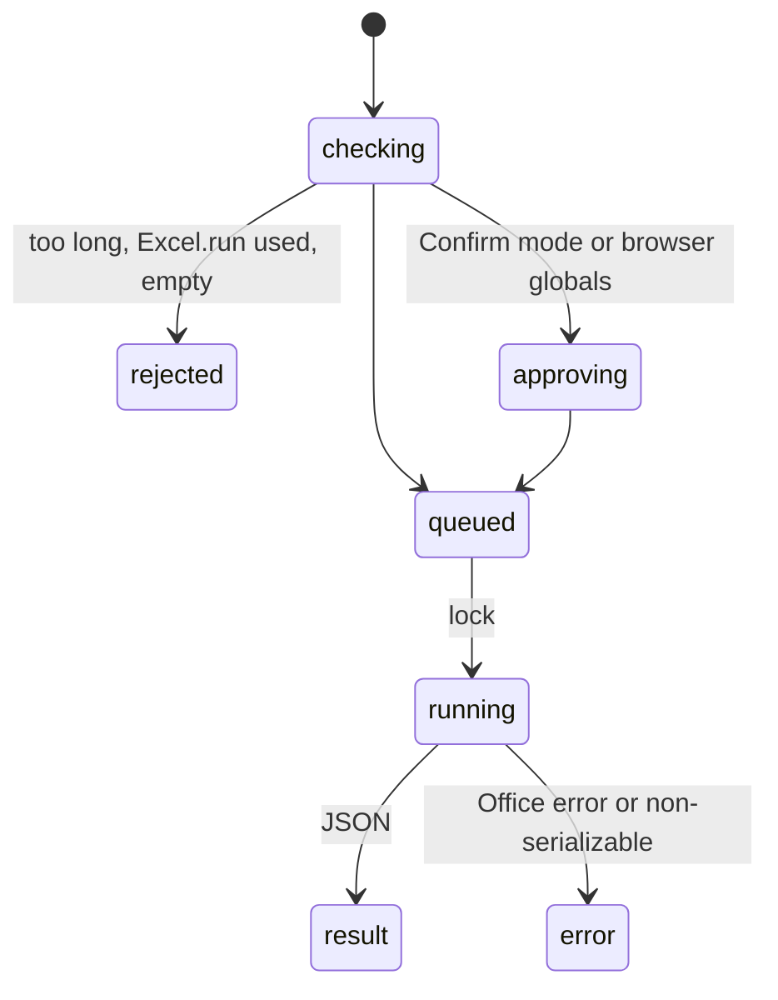

# `execute_office_js`

## Summary

The escape hatch: the agent sends the body of an async function that receives an `Excel.RequestContext`, and gets back its JSON-serialized return value. It can do anything Office.js can. It is classified as a structural mutation (lock, Confirm-mode approval, blueprint refresh) but makes no backup. In any mode, code that mentions browser globals (`fetch`, `window`, `document`, …) triggers an approval.

The prompt tells the agent to use it "when structured tools cannot express the operation", especially "Excel tables with filters and PivotTables", to "keep code minimal, call `context.sync()` after `load()`, and return JSON-serializable results".

## The simple case

In a real turn asked for dates "exactly as they appear", the agent sent (confirmed):

```
const s = context.workbook.worksheets.getItem('Dates'); const r = s.getRange('A1:D4'); r.load('text,values,numberFormat'); await context.sync(); return {address:'Dates!A1:D4',text:r.text,values:r.values,numberFormat:r.numberFormat};
```

and received `Executed Office.js: Read exact displayed text in selected cells`, `Result:`, and the JSON in a fenced block.

## Why the agent uses it

In eleven real turns the agent called it in six, each time to learn something no structured tool reports: displayed text; merge areas (`getMergedAreas`); calculation mode, then `range.calculate()`; protection state; visible rows of a filtered table (`getVisibleView`); and an aggregation over 200,000 rows that `read_range` could not read. Each use is a symptom listed in [B-11](../bug-triage.md#b-11-the-agent-cannot-see-workbook-state-that-changes-what-its-calls-do). In Confirm mode each costs the user an approval.

## The call, event by event



### Forms the call

Code up to 20,000 characters and an explanation up to 50.

### Rejected at once

`Do not call Excel.run() in code; context is provided automatically.`; length errors; `Invalid Office.js code: …` for syntax errors. All as `Error executing Office.js: …`.

### Touches Excel

Whatever the code does, in as many syncs as it makes.

### While running

No timeout; the lock is held for the whole run.

### The result

JSON pretty-printed with two-space indentation, cut at 8,000 characters (`…` and "ℹ️ Result truncated to 8,000 characters."), which holds about 130 rows of a 5-column range (confirmed). Then the 50 KB tail truncation. Errors: `Error executing Office.js: The property 'values' is not available. Before reading the property's value, call the load method …` (confirmed for a missing load); protection: `You cannot perform the requested operation.`

## Workbook and host state

| State | True before the call | Changes while running |
| --- | --- | --- |
| Sheet protection | Generic error on writes (confirmed); the agent can read `worksheet.protection.protected` itself. | — |
| Calculation mode | Readable and settable. | — |
| Merged cells | Readable. | — |
| Tables, filters and hidden rows | Readable (`getVisibleView`). | — |
| Data validation | Readable. | — |
| Dynamic arrays and spills | Readable (`getSpillingToRange`). | — |
| External links | Readable where the API set allows. | — |
| Very large used range | Same payload limits; the agent must page itself. | — |
| Number formats and locale | `text`, `numberFormatLocal` available. | — |
| Host and API set | Code must match the host's API set; unsupported members throw. | — |
| Execution mode | Confirm: always approved; Auto: approved only for browser globals. | Next call. |

## Hostility and interrupts

| Event | Before Excel is touched | While running |
| --- | --- | --- |
| The user is editing a cell | Edit-mode error. | A later sync fails after earlier syncs applied; no backup. |
| The user changes the selection or the active sheet | `getActiveWorksheet` follows the user. | Same. |
| The user changes data the call depends on | Reflected. | Between syncs. |
| Another tab's write holds the workbook lock | Waits (it is a mutation even for reads). | — |
| Excel throttles, times out or rejects the payload | — | Payload error; no timeout. |
| Recalculation is pending | The agent can calculate. | — |
| The workbook is co-authored | Not observed. | — |
| Autosave or a save boundary | No backup either way. | — |
| The user presses Stop | `Aborted`. | Runs to completion. |
| The context fills | Tail truncation keeps the end of the JSON. | — |

## Interactions with other systems

**What the agent is told.** See Summary. **Verification.** Whatever the code returns. **Backups and recovery.** None, unannounced in the result. **The workbook lock and parallel calls.** Read-only code still takes the lock and serializes behind other tabs' writes. **Execution mode and approvals.** See above. **Truncation and history shaping.** 8,000-character cut plus tail truncation. **Auto-context.** Every call invalidates the blueprint, even reads, so the next model call rebuilds it. **Prompt caching.** No interaction. **Host differences.** API sets. **What the user sees.** "Run Office.js {explanation}" card.

## Open questions and verification

- Confirmed: OJS-01 to OJS-04; six of eleven real turns used it.
- Looks like a bug: no backup note; read-only use treated as structural mutation (lock, approval, blueprint rebuild) ([B-11](../bug-triage.md#b-11-the-agent-cannot-see-workbook-state-that-changes-what-its-calls-do)); JSON indentation wastes the 8,000 characters ([B-21](../bug-triage.md#b-21-small-result-format-slips)).

Verified against pi-for-excel commit `ec453df`.
