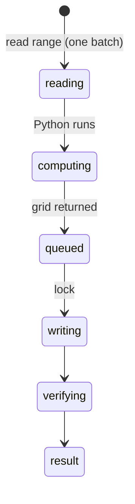

# `python_run` and `python_transform_range`

## Summary

`python_run` executes a Python snippet (in-browser Pyodide by default, the native bridge if one is reachable) and returns stdout, stderr and a result; it never touches the workbook and is a read call. `python_transform_range` reads a range into Python as `input_data`, runs the code, and writes the returned grid back: read, compute and write in one call. It is a content mutation with overwrite protection, verification and a backup, like [`write_cells`](writing-cells.md).

The second pass ran both tools, plus `libreoffice_convert`, in the taskpane wrapped by Pi's real gates, against the repo's bridge in real mode (`PORT=3340 PYTHON_BRIDGE_MODE=real node scripts/python-bridge-server.mjs --https`, Python 3.11 without pandas, LibreOffice 7.4 installed for the convert tool) and, with the bridge stopped, against in-browser Pyodide. Ordinary runs work and are fast (48 ms on the bridge, under 30 ms in a warm Pyodide). The agent is hurt by the error paths: a missing module comes back as `Error: ` with nothing after it ([B-22](../bug-triage.md#b-22-a-missing-python-module-on-the-native-bridge-falls-back-to-pyodide-and-returns-error--with-no-message)), and the transform hides output and inherits the write problems ([B-25](../bug-triage.md#b-25-the-python-transform-hides-stdout-pads-ragged-output-and-hits-bridge-size-limits)).

## The simple case

`python_transform_range {"range": "Big!C2:C1000", "code": "result = [[v[0]*2] for v in input_data['values']]", "output_start_cell": "Big!H2"}` reads 999 values, runs, and writes 999 values at H2. `input_data` is `{range, values}` (the result says so: `Python input payload shape: \`{ range, values }\``). The result is `✅ Transformed **…** and wrote results to **…**.`, the size, and `Changed cell(s): N.`; unlike `write_cells` it has no verified-values preview (confirmed).

## The call, event by event

### Forms the call

The agent writes Python against raw values: dates are serial numbers, percentages fractions, as in [the workbook as the agent sees it](../foundations/the-workbook-as-the-agent-sees-it.md).

### Rejected at once

Gate results (bridge approval on first native use), Python errors. On the bridge, a Python exception returns the traceback (`Error: Python bridge request failed (400): Traceback … ZeroDivisionError: division by zero`, printed twice) and stdout over 256 KB returns `(413): Process output exceeded 262144 bytes.` A missing module or a bridge timeout instead re-runs the code in Pyodide, and a Pyodide failure returns `Error: ` with an empty message ([B-22](../bug-triage.md#b-22-a-missing-python-module-on-the-native-bridge-falls-back-to-pyodide-and-returns-error--with-no-message)). With no bridge, `python_run` silently uses Pyodide (stdout `emscripten`) and the result does not say which backend ran; `libreoffice_convert` says `Native Python is not available right now. Pi could not reach the Python bridge at the default URL (https://localhost:3340) …` (all confirmed).

### Touches Excel

The read happens before the lock; the write under it. Between them, the user or another tab can change the source.

### While running

Pyodide cold start can take tens of seconds; no progress is reported to the agent.

### The result

Like `write_cells`, without the verified-values preview. Code's `print()` output is not shown for the transform. A ragged result is padded with blanks (`[[1,2,3],[4]]` written as 2 × 3). Input over 512 KB of JSON fails with `(413): Request body too large (max 524288 bytes).` (`Big!A1:E20000`); output over 256 KB fails with `(413): Process output exceeded 262144 bytes.` (50,000 rows). Output truncation keeps the **tail** for `python_run` (all confirmed).

## Workbook and host state

| State | True before the call | Changes while running |
| --- | --- | --- |
| Sheet protection | Write fails with the generic message. | — |
| Calculation mode | Input values stale; output formulas stale. | — |
| Merged cells | Same silent drop as `write_cells`: 2 × 2 into a merged `F1:G1` reported `Changed cell(s): 3.` (confirmed). | — |
| Tables, filters and hidden rows | Hidden rows included in `input_data`. | — |
| Data validation | Not enforced. | — |
| Dynamic arrays and spills | Same as `write_cells`. | — |
| External links | No effect. | — |
| Very large used range | Read and write hit payload limits; large overwrites skip pre-read and backup. | — |
| Number formats and locale | Raw values in, coerced values out: formatted dates, percentages and text codes echoed back as `45292`, `0.05` and `123` in General format (confirmed). | — |
| Host and API set | Pyodide needs WebAssembly and workers. | — |
| Execution mode | Transform approved in Confirm mode. | — |

## Hostility and interrupts

| Event | Before Excel is touched | While running |
| --- | --- | --- |
| The user is editing a cell | Edit-mode error. | Write fails after compute. |
| The user changes the selection or the active sheet | Unqualified ranges follow it. | Read and write may resolve different sheets. |
| The user changes data the call depends on | — | Output computed from stale input overwrites newer data. |
| Another tab's write holds the workbook lock | Read proceeds; write waits. | — |
| Excel throttles, times out or rejects the payload | As read/write. | As write (false failure possible). |
| Recalculation is pending | Stale input. | — |
| The workbook is co-authored | Not observed. | — |
| Autosave or a save boundary | Clears backups. | — |
| The user presses Stop | `Aborted`. | Python may run on; result arrives. |
| The context fills | Tail truncation for `python_run`. | — |

## Interactions with other systems

**What the agent is told.** The prompt's Python section. **Verification.** As `write_cells`. **Backups and recovery.** Transform only. **The workbook lock and parallel calls.** Read outside, write inside. **Execution mode and approvals.** Transform per call; native bridge first use. **Truncation and history shaping.** Tail for `python_run`. **Auto-context.** Change list as user changes. **Prompt caching.** No interaction. **Host differences.** Native bridge vs Pyodide. **What the user sees.** Python cards.

## Open questions and verification

- Confirmed: PY-01 to PY-10 (native bridge in real mode, and Pyodide).
- `import pandas` failed in Pyodide too ("included in the Pyodide distribution, but it is not installed"), although the tool description says pandas works automatically; whether the worker's micropip auto-install ran was not traced.
- Inherits [B-01](../bug-triage.md#b-01-writes-into-merged-areas-report-success-while-values-are-dropped) to [B-03](../bug-triage.md#b-03-verification-checks-only-the-written-cells-so-broken-spills-stale-formulas-and-invalid-entries-pass).

Verified against pi-for-excel commit `ec453df`.
