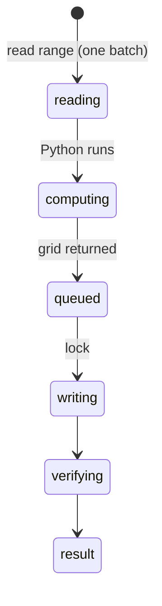

# `python_run` and `python_transform_range`

## Summary

`python_run` executes a Python snippet (in-browser Pyodide by default, the native bridge if one is reachable) and returns stdout, stderr and a result; it never touches the workbook and is a read call. `python_transform_range` reads a range into Python as `input_data`, runs the code, and writes the returned grid back: read, compute and write in one call. It is a content mutation with overwrite protection, verification and a backup, like [`write_cells`](writing-cells.md).

The merged tools name the backend and preserve execution failures. A native missing module or timeout does not rerun code in Pyodide; only an unreachable default bridge can fall back. Historical PY probes are retained in the verification logs, not treated as the current error contract.

## The simple case

`python_transform_range {"range": "Big!C2:C1000", "code": "result = [[v[0]*2] for v in input_data['values']]", "output_start_cell": "Big!H2"}` computes from 999 values. Input includes `{range, values, text}` so code can choose raw or displayed data. The receipt includes backend, output streams, checked-write verification, change count and backup status.

## The call, event by event

### Forms the call

The agent writes Python against raw values: dates are serial numbers, percentages fractions, as in [the workbook as the agent sees it](../foundations/the-workbook-as-the-agent-sees-it.md).

### Rejected at once

Bridge consent, invalid input and oversized input can reject before execution. Execution failures retain backend, exception and available stdout/stderr. Missing modules/timeouts are failures, not permission to repeat side effects on another backend. Bridge input/output size failures give block-processing guidance; the transform preflights serialized input size.

### Touches Excel

The read happens before the lock; the write under it. Between them, the user or another tab can change the source.

### While running

Pyodide cold start can take tens of seconds; no progress is reported to the agent.

### The result

Transform stdout/stderr are included. Ragged output is padded to a rectangle with a warning naming the extra blank cells. Shared checked-write inspection refuses unsafe merge/spill/protection targets and occupied targets too large to back up; chunking, full/sampled read-back, conversion/validation notes, partial Stop receipts and backup IDs match `write_cells`. `python_run` retains tail truncation.

## Workbook and host state

| State | True before the call | Changes while running |
| --- | --- | --- |
| Sheet protection | Checked target refusal names protection. | Later protection can fail a submitted write. |
| Calculation mode | Input may be stale; result discloses state. | Written formulas calculate; dependents may remain stale. |
| Merged cells | Unsafe merge-child writes refused. | No co-author isolation. |
| Tables, filters and hidden rows | Hidden rows included in `input_data`. | — |
| Data validation | Not enforced. | — |
| Dynamic arrays and spills | Same as `write_cells`. | — |
| External links | No effect. | — |
| Very large used range | Input size preflight; split work into blocks. | Checked writes chunk; large occupied targets refused. |
| Number formats and locale | Raw values in, coerced values out: formatted dates, percentages and text codes echoed back as `45292`, `0.05` and `123` in General format (confirmed). | — |
| Host and API set | Pyodide needs WebAssembly and workers. | — |
| Execution mode | Transform approved in Confirm mode. | — |

## Hostility and interrupts

| Event | Before Excel is touched | While running |
| --- | --- | --- |
| The user is editing a cell | Shared bounded Excel wait. | No unsafe whole-run retry after work may have applied. |
| The user changes the selection or the active sheet | Unqualified ranges follow it. | Read and write may resolve different sheets. |
| The user changes data the call depends on | — | Output computed from stale input overwrites newer data. |
| Another tab's write holds the workbook lock | Read proceeds; write waits. | — |
| Excel throttles, times out or rejects the payload | As read/write. | Receipt distinguishes applied, unverified and unknown outcomes. |
| Recalculation is pending | Stale input. | — |
| The workbook is co-authored | Not observed. | — |
| Autosave or a save boundary | Never clears automatic backups. | — |
| The user presses Stop | `Aborted`. | Python may run on; result arrives. |
| The context fills | Tail truncation for `python_run`. | — |

## Interactions with other systems

**What the agent is told.** The prompt's Python section. **Verification.** As `write_cells`. **Backups and recovery.** Transform only. **The workbook lock and parallel calls.** Checked write lock; same-runtime earlier-write barrier. **Execution mode and approvals.** Transform per call; native bridge first use. **Truncation and history shaping.** Tail for `python_run`. **Auto-context.** Own writes excluded from external edit notes. **Prompt caching.** No interaction. **Host differences.** Native bridge vs Pyodide is named. **What the user sees.** Python cards.

## Open questions and verification

- Confirmed: PY-01 to PY-10 (native bridge in real mode, and Pyodide).
- `import pandas` failed in Pyodide too ("included in the Pyodide distribution, but it is not installed"), although the tool description says pandas works automatically; whether the worker's micropip auto-install ran was not traced.
- Merged Python backend and transform source inspected. Old B-22/B-25 and unchecked-write findings are superseded by the contracts above; native bridge and Pyodide were not rerun in this pass.

Verified against pi-for-excel commit `1f51cf8` (source inspection).
