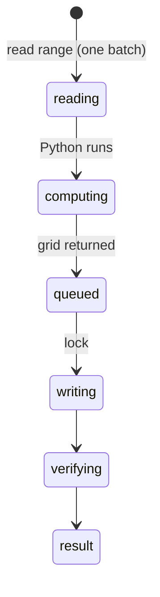

# `python_run` and `python_transform_range`

## Summary

`python_run` executes a Python snippet (in-browser Pyodide by default, the native bridge if one is reachable) and returns stdout, stderr and a result; it never touches the workbook and is a read call. `python_transform_range` reads a range into Python as `input_data`, runs the code, and writes the returned grid back: read, compute and write in one call. It is a content mutation with overwrite protection, verification and a backup, like [`write_cells`](writing-cells.md).

This document is read from code; neither tool was run in this pass (Pyodide's first load is about 15 MB and was not attempted on the shared orb).

## The simple case

`python_transform_range {"range": "Big!C2:C1000", "code": "result = [[v[0]*2] for v in input_data]", "output_start_cell": "Big!H2"}` reads 999 values, runs, and writes 999 values at H2 with a verification preview.

## The call, event by event

### Forms the call

The agent writes Python against raw values: dates are serial numbers, percentages fractions, as in [the workbook as the agent sees it](../foundations/the-workbook-as-the-agent-sees-it.md).

### Rejected at once

Gate results (bridge approval on first native use), Python errors (stderr returned as text).

### Touches Excel

The read happens before the lock; the write under it. Between them, the user or another tab can change the source.

### While running

Pyodide cold start can take tens of seconds; no progress is reported to the agent.

### The result

Like `write_cells`. Output truncation keeps the **tail** for `python_run`.

## Workbook and host state

| State | True before the call | Changes while running |
| --- | --- | --- |
| Sheet protection | Write fails with the generic message. | — |
| Calculation mode | Input values stale; output formulas stale. | — |
| Merged cells | Same silent drop as `write_cells`. | — |
| Tables, filters and hidden rows | Hidden rows included in `input_data`. | — |
| Data validation | Not enforced. | — |
| Dynamic arrays and spills | Same as `write_cells`. | — |
| External links | No effect. | — |
| Very large used range | Read and write hit payload limits; large overwrites skip pre-read and backup. | — |
| Number formats and locale | Raw values in, coerced values out. | — |
| Host and API set | Pyodide needs WebAssembly and workers. | — |
| Execution mode | Transform approved in Confirm mode. | — |

## Hostility and interrupts

| Event | Before Excel is touched | While running |
| --- | --- | --- |
| The user is editing a cell | Edit-mode error. | Write fails after compute. |
| The user changes the selection or the active sheet | Unqualified ranges follow it. | Read and write may resolve different sheets. |
| The user changes data the call depends on | — | Output computed from stale input overwrites newer data. |
| Another tab's write holds the workbook lock | Read proceeds; write waits. | — |
| Excel throttles, times out or rejects the payload | As read/write. | As write (false failure possible). |
| Recalculation is pending | Stale input. | — |
| The workbook is co-authored | Not observed. | — |
| Autosave or a save boundary | Clears backups. | — |
| The user presses Stop | `Aborted`. | Python may run on; result arrives. |
| The context fills | Tail truncation for `python_run`. | — |

## Interactions with other systems

**What the agent is told.** The prompt's Python section. **Verification.** As `write_cells`. **Backups and recovery.** Transform only. **The workbook lock and parallel calls.** Read outside, write inside. **Execution mode and approvals.** Transform per call; native bridge first use. **Truncation and history shaping.** Tail for `python_run`. **Auto-context.** Change list as user changes. **Prompt caching.** No interaction. **Host differences.** Native bridge vs Pyodide. **What the user sees.** Python cards.

## Open questions and verification

- Not run in this pass; all read from code.
- Inherits [B-01](../bug-triage.md#b-01-writes-into-merged-areas-report-success-while-values-are-dropped) to [B-03](../bug-triage.md#b-03-verification-checks-only-the-written-cells-so-broken-spills-stale-formulas-and-invalid-entries-pass).

Verified against pi-for-excel commit `ec453df`.
