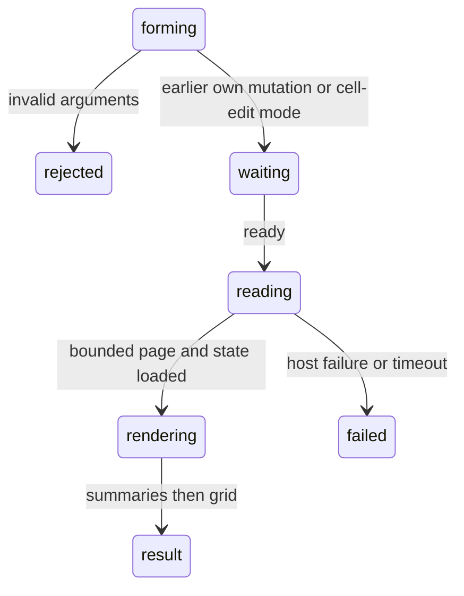

# `read_range`

## Summary

`read_range` reads a bounded page of cells. `compact` (default) and `detailed` show Excel's displayed text; `csv` keeps raw analysis values. The description tells the agent to qualify sheet names, follow exact next-page ranges, distinguish page summaries from whole-range totals and read before modifying. It never asks for approval or makes a backup. Same-runtime reads wait for earlier registered mutations, not another tab's writes.

## The simple case

`{"range":"Sheet1!H1"}` for stored 0.125 formatted `0.0%` shows `12.5%`, not `0.125`. Dates or rounded displays that hide stored values can include a bracketed raw value. General numbers, including zero, use ordinary JavaScript number text. Pipes, backslashes and line breaks are escaped so they cannot split the markdown grid. CSV remains raw.

## The call, event by event

### Forms the call

The schema takes `range` and optional `mode` (`compact`, `csv`, `detailed`). The agent can request a rectangle, whole columns or whole rows. An omitted sheet means the active sheet resolved for this call; the result explicitly says that the address named no sheet. Unknown sheets fail with the available sheet list. Use qualified addresses to avoid selection-driven changes between calls.

### Rejected at once

Missing arguments or unknown modes fail schema validation. Stop before execution prevents the call. Malformed addresses and host failures are described in the result; not every read-side error-text result carries `isError` (see [the tool contract](../foundations/the-tool-contract.md#error-shaped-results)).

### Touches Excel

Whole-line addresses and requests over 2,500 cells intersect the sheet's values-only used range. A page holds at most 500 rows, 2,500 cells and 100 columns. Response-payload failure halves the row count and retries. Empty intersections report no data. Detailed mode additionally reads formats and comments; comments can require sheet-wide loading.

### While running

No data streams. Excel batches have the bounded waits and Stop semantics in [throttling and timeouts](../hostility/throttling-and-timeouts.md). Cell-edit retries apply only before a successful sync. A read waits for earlier mutations in its own runtime; a later registered mutation or a different tab's write is not a read barrier.

### The result

The heading names the actual page address and dimensions. Clipping is named. Page and column continuation hints give exact ranges to read next. Page numeric sums and text-number warnings are not whole-request totals.

Workbook-state notes, grouped formulas and errors precede the grid so head truncation preserves them. Repeated filled formulas collapse into runs; formula/error lists are capped at 40, format areas at 20. Compact has a row-number/column-letter grid; detailed adds number formats and comments. CSV has raw values and page metadata, not a display grid. Full current results later follow [context pressure](../hostility/context-pressure.md), whose previews now name the call and target.

## Workbook and host state

| State | True before the call | Changes while running |
| --- | --- | --- |
| Sheet protection | Reports protection and locked/unlocked state when available; reads still work. | State is a snapshot. |
| Calculation mode | Manual/pending calculation warns that values may be stale. | Later recalculation can change them. |
| Merged cells | Reports merged areas; value lives only at top-left. | Snapshot only. |
| Tables, filters and hidden rows | Reports table/filter boundaries and hidden rows; values still include hidden rows. | No co-author lock. |
| Data validation | Describes supported validation rules. | Snapshot only. |
| Dynamic arrays and spills | Reports detected anchor/child ranges and errors. | Detection depends on host APIs. |
| External links | Formula text/cache can be read, not guaranteed refreshed. | External updates remain outside verification. |
| Very large used range | Pages instead of loading the whole data grid. | Continuations observe later workbook state. |
| Number formats and locale | Displayed text in table modes; raw CSV. | Excel determines display. |
| Host and API set | Unsupported state APIs yield a limitation note. | No stronger desktop guarantee. |
| Execution mode | Read-only, no approval. | No effect. |

## Hostility and interrupts

Cell-edit mode can wait up to 60 seconds; Stop cancels waiting. An in-flight read has a short Stop grace, after which the host may still finish it. Timeout means an unknown host outcome, not a guarantee of cancellation. User/co-author edits can make any returned page stale. Autosave does not affect reads or clear backups. A large page can still be text-truncated at 50 KB / 2,000 lines; summaries and continuation hints come first. See [the user moves or edits](../hostility/the-user-moves-or-edits.md) and [Stop](../hostility/stop.md).

## Interactions with other systems

**What the agent is told.** Tool description explains display, state and paging. **Verification.** Useful for downstream checks, but not a global recalculation or concurrency guarantee. **Backups and recovery.** None. **The workbook lock and parallel calls.** Own earlier mutations form a barrier; other runtimes do not. **Execution mode and approvals.** Read-only. **Truncation and history shaping.** Bounded pages and summary-first layout; older results get attributed previews. **Auto-context.** Selection itself is bounded and may need this tool for further data. **Prompt caching.** Results add history without changing schemas each turn. **Host differences.** State detection is API-dependent. **What the user sees.** A Read card with a table; see [reading](../../product-description/workbook/reading.md).

## Edge cases

Multi-area ranges are not supported. Large requests can clip away empty/formatted-only cells; a small explicit range still reads those cells. Following the row continuation is not enough for a request wider than the page: follow the column hint too. A page sum excludes later pages and is not a filtered visible-only sum.

## Open questions and verification

Source: merged `read-range.ts`, sheet-state collection and formatting helpers. In real Excel on the web this pass, `H1` showed `12.5%`; `J1:J800` returned `J1:J500`, next `J501:J800`, and independent expected page sum 125,250. Earlier raw-value and unbounded-read failures are historical, not current expectations. Desktop limits and every optional state API were not rerun.

Verified against pi-for-excel commit `1f51cf8`.
