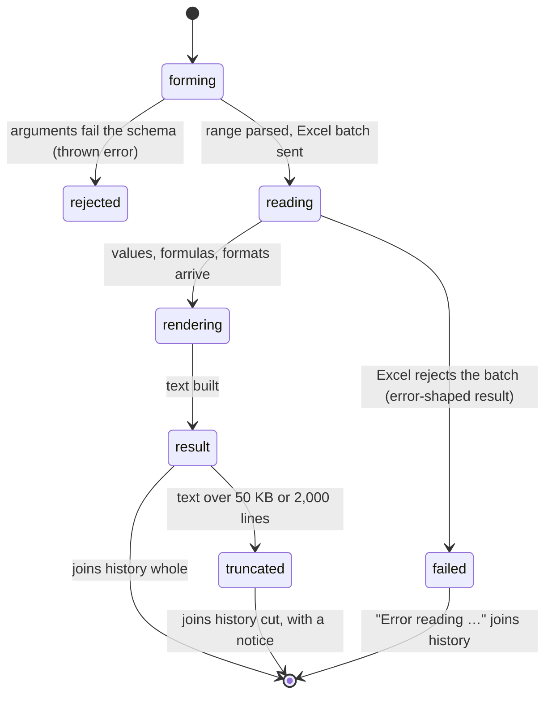

# `read_range`

## Summary

`read_range` is how the agent looks at cells. It takes one range address and returns the cells' raw values as text, in one of three shapes: a markdown grid with column letters and row numbers (`compact`, the default), a CSV block (`csv`), or the grid plus every formula, every non-General number format and any comments (`detailed`). It is a read call: it never waits for the workbook lock, never asks for approval in Confirm mode, and makes no backup.

The agent is told about it in three places. The system prompt's tool list says "**read_range** — read cell values/formulas in three formats: compact (markdown), csv (values-only), or detailed (with formatting + comments)". The schema says the range is "Cell range in A1 notation, e.g. "A1:D10", "Sheet2!A1:B5". If no sheet is specified, uses the active sheet." And the tool description ends "Always read before modifying — never guess what's in the spreadsheet." The workflow section of the prompt repeats "**Read first.**" and the conventions section adds "For large ranges, read a sample first to understand the structure." Nothing tells the agent how large is too large, that values are raw, or that merged cells, filters and hidden rows are invisible.

## The simple case

The agent calls `read_range` with `{"range": "Dates!A1:D4"}`. Excel reads the block and the agent receives (confirmed):

```
**Dates!A1:D4** (4×4)

|  | A | B | C | D |
| --- | --- | --- | --- | --- |
| 1 | Date | Growth | Price | Code |
| 2 | 45292 | 0.05 | 1234.5 | 00123 |
| 3 | 45323 | 0.125 | 99 | 00456 |
| 4 | 45352 | -0.02 | 0.5 | 00789 |
```

The user sees `01/01/2024`, `5.0%`, `£1,234.50` and `00123` in those cells. The agent sees the serial date 45292, the fraction 0.05 and the bare number 1234.5. If the range holds formulas, a line `**Formulas:** A1: =SEQUENCE(5)` follows the grid; if it holds error values, a line `⚠️ **Errors:** A1=#SPILL!`. An empty range returns only `_All cells are empty._` under the heading.

Nothing in the workbook changes. The result joins the history and stays whole for the next six tool results, after which the model sees only its first 500 characters (see [context pressure](../hostility/context-pressure.md)).

## The call, event by event



### Forms the call

The agent decides what to read from what it already has: the [blueprint](../foundations/auto-context.md#the-blueprint) gives each sheet's used-range size ("Big — 200001 rows × 5 cols") but not where the used range starts, and the [selection context](../foundations/auto-context.md#the-selection-context) shows a window around the user's selection. The agent must name a rectangle. The schema accepts any string for `range` and one of `compact`, `csv`, `detailed` for `mode`; anything else is a validation error.

Three choices made here decide the outcome:

- **Qualified or not.** `B2` is read from whatever sheet is active when the batch runs, not the sheet the agent was thinking of. See [the user moves or edits](../hostility/the-user-moves-or-edits.md).
- **Size.** Nothing warns the agent before it asks for too much. A whole column (`A:A`) fails on every sheet, even a four-row one, because Excel loads a million rows of values, formulas and number formats. See [Very large used range](#workbook-and-host-state).
- **Mode.** Only `detailed` reveals number formats, so only `detailed` lets the agent tell a date from a number. No mode reveals displayed text.

### Rejected at once

- A missing `range`, or a `mode` outside the three, fails schema validation before any Excel call. The agent receives a thrown error: "Validation failed for tool "read_range": …" followed by the arguments it sent.
- An abort before the call starts (the user pressed Stop) returns "Aborted".

There is no size check, no sheet-existence check and no address-syntax check before Excel is asked. Every other problem comes back from Excel.

### Touches Excel

One Excel batch loads `values`, `formulas`, `numberFormat`, `address`, `rowCount` and `columnCount` for the whole range; in `detailed` mode it also loads every comment on the sheet, then each comment's location, content, author, resolved flag and reply count, in a second sync. The three grids are loaded in every mode, even `compact`, which uses only values and formulas. That triples the response size and brings the [payload limit](../hostility/payload-limits-and-large-ranges.md) closer.

If Excel refuses, the agent receives one line and no data (all confirmed):

| Cause | What the agent receives |
| --- | --- |
| Sheet does not exist | `Error reading "Nope!A1": The requested resource doesn't exist.` |
| Malformed address | `Error reading "A1:B": The argument is invalid or missing or has an incorrect format.` |
| Response too big | `Error reading "Big!A1:E50000": The response payload size has exceeded the limit. Please refer to the documentation: "https://docs.microsoft.com/office/dev/add-ins/concepts/resource-limits-and-performance-optimization#excel-add-ins".` |
| The user is typing in a cell | `Error reading "Dates!A1:B2": Excel is in cell-editing mode. Please exit the edit mode by pressing ENTER or TAB or selecting another cell, and then try again.` |

Each of these is an [error-shaped result](../foundations/the-tool-contract.md#error-shaped-results): to the agent loop the call succeeded.

### While running

The read is one round trip; on Excel on the web it took 150–350 ms for small ranges and about 650 ms for 10,000 × 5. Nothing is streamed. The call cannot be cancelled once the batch is sent, and it has no timeout: if Excel never answers, the call never returns (read from code; see [throttling and timeouts](../hostility/throttling-and-timeouts.md)).

Because it is a read call, it runs alongside any other calls from the same model call, including writes. A `read_range` issued in the same batch as a `write_cells` to the same cell returned the old value (confirmed: `old`, not `new`).

### The result

The agent receives text only; `compact` and `detailed` results carry no details, and `csv` results carry the values grid in details for the UI's table, which the agent never sees.

- **Heading.** `**{Sheet}!{address}** ({rows}×{cols})`, with the sheet quoted when its name has a space (`**'My Sheet'!A1**`). The address is the one Excel resolved, so an unqualified call learns here which sheet it read.
- **Compact.** A markdown grid with a header row of column letters and a first column of row numbers, then `**Formulas:**` listing every formula cell on one line, then `⚠️ **Errors:**` listing every error cell on one line.
- **CSV.** The heading, then a fenced `csv` block of raw values with no row numbers or column letters. Formulas and errors are not listed.
- **Detailed.** `### Values` (the same grid), `### Formulas` (one per line), `### Number Formats` (each distinct non-General format with the cells that use it, labelled when it matches a known preset, for example `**text** (`@`)`), `### ⚠️ Errors`, and `### Comments` when any comment's cell lies in the range.

How values are written (all confirmed):

- Numbers are written plainly between 1e-6 and 1e15 in magnitude, otherwise in exponent form with four decimals. Zero is outside that band, so **every zero is written `0.0000e+0`**; 0.0000001 is `1.0000e-7`.
- Booleans are `true` and `false`; Excel's display is `TRUE`/`FALSE`.
- Text is written as is, without escaping. A `|` in a cell splits it into two columns of the grid; a line break in a cell ends the row early and starts a new line that is not a row.
- Empty cells are empty strings. The grid does not distinguish an empty cell from a cell covered by a merge, a cell in a hidden row, or a spill child.

Then the result passes through [truncation](../foundations/limits.md#per-result-truncation). The first 50 KB (or 2,000 lines) is kept and a notice is appended, for example `[Output truncated: showing first 1,121 of 10,004 lines (50.0KB limit); limits: 2,000 lines / 50.0KB]`. In compact mode the row numbers let the agent see where the cut fell (row 1117 for 10,000 × 5). The `**Formulas:**` and `⚠️ **Errors:**` lines come after the grid, so a truncated result loses them entirely: the agent is not told that formulas or errors exist past, or even before, the cut. In CSV mode there are no row numbers; the agent has to count lines. The runtime saves the full text to the Files workspace when it is at most 512 KB and says so in the notice ("full output saved to Files workspace: …").

## Workbook and host state

| State | True before the call | Changes while running |
| --- | --- | --- |
| Sheet protection | No effect: protected sheets read normally. The agent is not told the sheet is protected. | No effect. |
| Calculation mode | Manual mode: formula cells return their last calculated value, which can be stale or 0 for a formula just written. Nothing in the result says so (confirmed on the web: a just-written `=A1+A2` read back as `0.0000e+0`). | A recalculation between the agent's read and its next call changes the values it would see; it is not told. |
| Merged cells | The merged area's top-left cell holds the value; every other cell of the area reads as empty. No marker (confirmed: `Merged!A1:D6` showed the title in A1 and B1:D1 blank). | No effect. |
| Tables, filters and hidden rows | Filtered-out and hidden rows are returned like any other row. Nothing marks them (confirmed: a table filtered to "North" returned all six rows). Table boundaries and names are not shown. | No effect within the call. |
| Data validation | Not reported. | No effect. |
| Dynamic arrays and spills | The anchor's formula is listed; the children read as values with no formula and nothing ties them to the anchor (confirmed for `=SEQUENCE(5)`). A blocked spill shows `#SPILL!` in the error list. | No effect. |
| External links | Formulas that reference other workbooks are listed as text; their values are the cached values. Not observed (no external link could be created on the web). | No effect. |
| Very large used range | Fails once the values, formulas and formats of the range together exceed the response payload limit: 10,000 × 5 succeeded, 50,000 × 5 failed, any whole column failed (confirmed). There is no paging parameter. | No effect. |
| Number formats and locale | Values are raw in every mode. Only `detailed` lists formats, as format strings, separately from the values. Locale affects formats (`dd/mm/yyyy`) but not values; formulas are returned in English (US) syntax. | No effect. |
| Host and API set | Same tool on desktop and web. The payload limit is specific to the web; desktop limits are not documented here (read from Office documentation, not observed). | No effect. |
| Execution mode | No effect: reads are never approved. | No effect. |

The agent is not told any of these states. It finds them only by noticing something odd and reaching for `execute_office_js` (see [office-js](office-js.md)).

## Hostility and interrupts

| Event | Before Excel is touched | While running |
| --- | --- | --- |
| The user is editing a cell | On the web the batch fails in milliseconds: "Error reading …: Excel is in cell-editing mode…" (confirmed). The tool does not wait or retry. | The single batch either completes or fails as above; it cannot be caught mid-way. |
| The user changes the selection or the active sheet | An unqualified range is read from the newly active sheet. The heading names the sheet, so the agent can notice. | No effect; the sheet is resolved when the batch runs. |
| The user changes data the call depends on | The read returns the new data. The agent is not told it changed; the [change list](../foundations/auto-context.md#the-change-list) reports it only at the next model call, and only for sheets that existed when the taskpane opened. | The read returns whichever state Excel had when it executed the batch. |
| Another tab's write holds the workbook lock | No effect: reads never wait for the lock. The read can see a half-finished multi-batch write by another tab. | Same. |
| Excel throttles, times out or rejects the payload | — | Payload rejection returns "Error reading …: The response payload size has exceeded the limit…". A throttled or hung batch has no timeout: the call waits as long as Excel does (read from code). |
| Recalculation is pending | Values are the last calculated ones; nothing says calculation is pending. | Same. |
| The workbook is co-authored | Another person's edits are included once Excel has merged them; nothing marks them. Not observed. | Same. |
| Autosave or a save boundary | No effect. | No effect. |
| The user presses Stop | The call is not started and returns "Aborted" (a thrown error). | The batch runs to completion; Stop ends the turn after the call returns. See [stop](../hostility/stop.md). |
| The context fills | A large result costs up to 50 KB of context at once. After six more tool results it is replaced, for the model, by a 500-character preview; after compaction only the summary's mention of it survives. | — |

After any of these the agent is left with text that may be stale, partial or an error string. It is never told why a value might be misleading, only, in the error cases, that the read failed.

## Interactions with other systems

**What the agent is told.** The system prompt tells it to read before writing and to sample large ranges. It does not say how large is too large, that values are raw, or that the grid hides merges, filters and spills. See [what the agent is told](../foundations/what-the-agent-is-told.md).

**Verification.** `read_range` is the tool the prompt tells the agent to use to verify writes ("re-read the key downstream outputs"). Under manual calculation that verification reads stale values; issued in the same batch as the write, it reads the old values. See [recalculation](../hostility/recalculation.md) and [the lock and parallel calls](../hostility/the-lock-and-parallel-calls.md).

**Backups and recovery.** No interaction; reads are never backed up.

**The workbook lock and parallel calls.** Reads bypass the lock and run in parallel with everything else in the batch. Ordering between a read and a write in the same batch is not guaranteed.

**Execution mode and approvals.** No interaction.

**Truncation and history shaping.** The result is cut at 50 KB / 2,000 lines (head), losing the formula and error summaries; after six newer tool results it becomes a 500-character `[Compacted tool result]` preview for the model. See [context pressure](../hostility/context-pressure.md).

**Auto-context.** The selection context already shows a window around the user's selection, so the agent often does not need to read it. The blueprint's sizes are the agent's only guide to how big a range is.

**Prompt caching.** No direct effect; a large result enlarges every later request until it is shaped away.

**Host differences.** The payload limit applies on Excel on the web. Desktop Excel was not observed.

**What the user sees.** A tool card "Read {range}" with the grid rendered as a table; see [product-description/workbook/reading.md](../../product-description/workbook/reading.md).

## Edge cases

- A range on a sheet whose name contains `!` or `'` is parsed at the last `!`; quoted names are accepted with or without quotes (confirmed for `My Sheet!A1` and `'My Sheet'!A1`).
- A multi-area range (`A1:B2,D1:E2`) is not supported by Excel's `getRange` and returns an "argument is invalid" error (read from code).
- A one-row range renders a grid whose only data row is row 1; the column-letter header keeps it from being mistaken for a header row.
- A range that is entirely empty returns `_All cells are empty._` in compact and detailed modes and `(empty)` in csv mode, even when the cells are formatted or merged.
- A cell holding the text `0.0000e+0` and a cell holding zero read the same.
- `detailed` mode on a sheet with many comments loads every comment on the sheet, not just those in the range.
- The truncation notice in csv mode counts lines, including the heading, blank line and fence.

## Open questions and verification

- Confirmed on Excel on the web (probe workbook, 2026-10-26): every example result in this document; raw values for dates, percentages and currency; zero as `0.0000e+0`; unescaped `|` and line breaks; merged areas and filtered rows invisible; spill children unmarked; payload failures at 50,000 × 5 and for `A:A`; cell-edit mode failure; parallel read seeing the pre-write value; manual-calculation staleness.
- Read from code only: comment loading cost; multi-area rejection; no timeout; the Files-workspace save of truncated output (the probe harness did not pass a saver).
- Looks like a bug: zero and small numbers in exponent form ([B-07](../bug-triage.md#b-07-values-reach-the-agent-raw-and-mis-rendered-and-writes-coerce-text)); unescaped markdown ([B-07](../bug-triage.md#b-07-values-reach-the-agent-raw-and-mis-rendered-and-writes-coerce-text)); no size guard or paging, and loading formats in compact mode ([B-05](../bug-triage.md#b-05-large-sheets-break-reads-search-and-sheet-overviews-with-a-raw-payload-error)); merges, filters, hidden rows and spills unmarked ([B-11](../bug-triage.md#b-11-the-agent-cannot-see-workbook-state-that-changes-what-its-calls-do)); the formula and error summaries lost to truncation ([B-15](../bug-triage.md#b-15-truncation-drops-the-summaries-that-matter-and-csv-has-no-row-numbers)).
- Whether desktop Excel has a comparable payload ceiling for `read_range` was not checked.

Verified against pi-for-excel commit `ec453df`.
