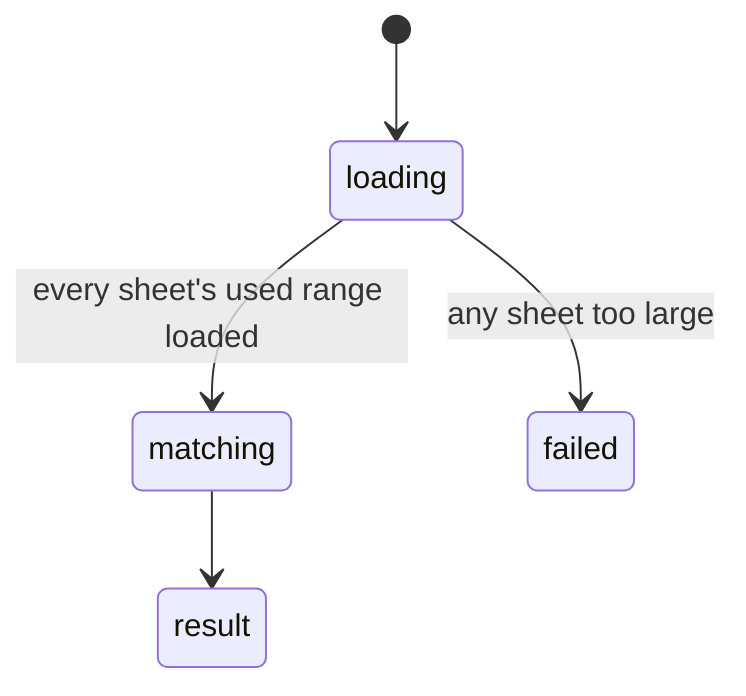

# `search_workbook`

## Summary

Finds text, values or formula references across sheets, with optional regex, pagination (`offset`, `max_results`, default 20), a `sheet` filter and `context_rows` for surrounding data. A read call.

Prompt line: "find text, values, or formula references across all sheets; context_rows for surrounding data".

## The simple case

`{"query": "North", "sheet": "Tbl"}` (confirmed):

```
**3 match(es)** for "North":

- **Tbl!A2**: North
- **Tbl!A3**: North
- **Tbl!A5**: North
```

## The call, event by event



### Forms the call

The agent searches when it does not know where a label is. With no `sheet`, every visible sheet is searched.

### Rejected at once

Schema errors; an invalid regex.

### Touches Excel

For each sheet in scope, the tool loads the **entire used range's values and formulas** and matches in the taskpane.

### While running

All sheets are queued into one batch, so one oversized sheet fails the whole search.

### The result

Match count, then one line per match. With a 200,001 × 5 sheet in the workbook, `{"query": "Item 199999"}` returned `Error searching: The response payload size has exceeded the limit…` (confirmed) — for every query, on every sheet, until the agent passes a `sheet` that is small.

## Workbook and host state

| State | True before the call | Changes while running |
| --- | --- | --- |
| Sheet protection | No effect. | No effect. |
| Calculation mode | Matches against stale values. | No effect. |
| Merged cells | Only the top-left value can match. | No effect. |
| Tables, filters and hidden rows | Hidden and filtered rows match, unmarked. | No effect. |
| Data validation | No effect. | No effect. |
| Dynamic arrays and spills | Children match by value; only the anchor matches by formula. | No effect. |
| External links | Formula search can find `[Book]` references. | No effect. |
| Very large used range | Whole search fails (confirmed). | No effect. |
| Number formats and locale | Matches raw values: searching "01/01/2024" finds nothing in a date column. | No effect. |
| Host and API set | Same. | No effect. |
| Execution mode | No effect. | No effect. |

## Hostility and interrupts

| Event | Before Excel is touched | While running |
| --- | --- | --- |
| The user is editing a cell | Edit-mode error. | — |
| The user changes the selection or the active sheet | No effect. | No effect. |
| The user changes data the call depends on | Reflected. | Reflected at batch time. |
| Another tab's write holds the workbook lock | No wait. | — |
| Excel throttles, times out or rejects the payload | — | Fails for the workbook (confirmed). |
| Recalculation is pending | Stale values. | — |
| The workbook is co-authored | Not observed. | — |
| Autosave or a save boundary | No effect. | — |
| The user presses Stop | `Aborted`. | Completes. |
| The context fills | Results are bounded by `max_results`. | — |

## Interactions with other systems

**What the agent is told.** The prompt line; nothing about raw-value matching or size.

**Verification.** No interaction. **Backups and recovery.** No interaction. **The workbook lock and parallel calls.** Read call. **Execution mode and approvals.** No interaction. **Truncation and history shaping.** `context_rows` can make results large. **Auto-context.** No interaction. **Prompt caching.** No interaction. **Host differences.** None observed. **What the user sees.** A search card.

## Edge cases

- Searching displayed text (dates, currency) fails silently: zero matches.

## Open questions and verification

- Confirmed: SEARCH-01, SEARCH-02.
- Looks like a bug: [B-05](../bug-triage.md#b-05-large-sheets-break-reads-search-and-sheet-overviews-with-a-raw-payload-error), [B-07](../bug-triage.md#b-07-values-reach-the-agent-raw-and-mis-rendered-and-writes-coerce-text).

Verified against pi-for-excel commit `ec453df`.
