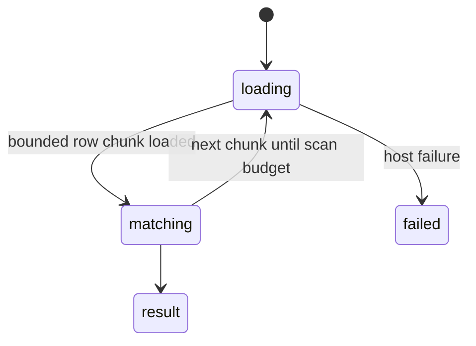

# `search_workbook`

## Summary

Finds text, values or formula references across sheets, with optional regex, pagination (`offset`, `max_results`, default 20), a `sheet` filter and `context_rows` for surrounding data. A read call.

Prompt line: "find text, values, or formula references across all sheets; context_rows for surrounding data".

## The simple case

`{"query": "North", "sheet": "Tbl"}` (confirmed):

```
**3 match(es)** for "North":

- **Tbl!A2**: North
- **Tbl!A3**: North
- **Tbl!A5**: North
```

## The call, event by event



### Forms the call

The agent searches when it does not know where a label is. With no `sheet`, every visible sheet is searched.

### Rejected at once

Schema errors; an invalid regex.

### Touches Excel

Each visible sheet in scope is scanned in bounded row chunks, loading the searched grid and fetching the other grid only for matching chunks. Response-payload failure halves the chunk rows and retries. Unknown sheet names report the available sheets.

### While running

Sheets and chunks are processed incrementally. Scanning stops at a five-million-cell budget and names where it stopped; match count and pagination cover the scanned portion, not necessarily the whole workbook.

### The result

Match count and one line per match, with optional bounded context. Large sheets no longer force a whole-used-range payload load. The result discloses a scan-budget stop when applicable; follow its scope rather than interpreting partial matches as an exhaustive search.

## Workbook and host state

| State | True before the call | Changes while running |
| --- | --- | --- |
| Sheet protection | No effect. | No effect. |
| Calculation mode | Matches against stale values. | No effect. |
| Merged cells | Only the top-left value can match. | No effect. |
| Tables, filters and hidden rows | Hidden and filtered rows match, unmarked. | No effect. |
| Data validation | No effect. | No effect. |
| Dynamic arrays and spills | Children match by value; only the anchor matches by formula. | No effect. |
| External links | Formula search can find `[Book]` references. | No effect. |
| Very large used range | Row-chunked scan, up to five million cells. | Later chunks can see later edits. |
| Number formats and locale | Matches raw values: searching "01/01/2024" finds nothing in a date column. | No effect. |
| Host and API set | Same. | No effect. |
| Execution mode | No effect. | No effect. |

## Hostility and interrupts

| Event | Before Excel is touched | While running |
| --- | --- | --- |
| The user is editing a cell | Bounded wait under the shared Excel policy. | Retry only before a successful sync. |
| The user changes the selection or the active sheet | No effect. | No effect. |
| The user changes data the call depends on | Reflected. | Reflected at batch time. |
| Another tab's write holds the workbook lock | No wait. | — |
| Excel throttles, times out or rejects the payload | — | Response-payload rejection shrinks a chunk; other failures use the bounded host policy. |
| Recalculation is pending | Stale values. | — |
| The workbook is co-authored | Not observed. | — |
| Autosave or a save boundary | No effect. | — |
| The user presses Stop | `Aborted`; waits are cancelled. | Read grace is 500 ms, then a stopped error if unanswered. |
| The context fills | Results are bounded by `max_results`. | — |

## Interactions with other systems

**What the agent is told.** The prompt line; nothing about raw-value matching or size.

**Verification.** No interaction. **Backups and recovery.** No interaction. **The workbook lock and parallel calls.** Read call; waits for earlier registered mutations in this runtime, not another tab's lock. **Execution mode and approvals.** No interaction. **Truncation and history shaping.** `context_rows` can make results large. **Auto-context.** No interaction. **Prompt caching.** No interaction. **Host differences.** None observed. **What the user sees.** A search card.

## Edge cases

- Searching displayed text (dates, currency) fails silently: zero matches.

## Open questions and verification

- Code inspection: merged chunking, scan budget and unknown-sheet handling. Historical SEARCH-01/02 observations predate this fix. Raw-value searching remains intentional in this implementation; displayed date/currency strings need not match.

Verified against pi-for-excel commit `1f51cf8` (source inspection, no new large-search live run).
