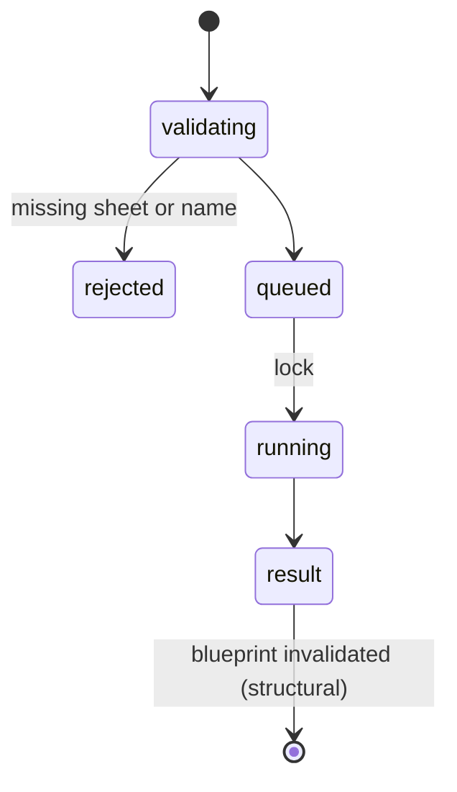

# `modify_structure` and `view_settings`

## Summary

`modify_structure` inserts and deletes rows and columns and adds, deletes, renames, duplicates, hides and unhides sheets. `view_settings` reads (`get`) and changes gridlines, headings, freeze panes, tab colour, sheet visibility, the active sheet and standard width. `modify_structure` is always a structural mutation (it refreshes the blueprint and is backed up, deletes with their data up to 20,000 cells). `view_settings` mutating actions are not backed up; sheet hide/show is structural.

## The simple case

`{"action": "delete_rows", "sheet": "Tbl", "position": 3, "count": 1}` (confirmed): `Deleted 1 row(s) starting at row 3 in "Tbl".` — on a sheet whose rows 1–7 are a filtered table; the row was deleted from the table, unremarked.

`view_settings {"action": "freeze_rows", "sheet": "Dates", "count": 1}` (confirmed): `Froze top 1 row(s) on "Dates".` and `ℹ️ Backup not created. …`.

## The call, event by event

### Forms the call

Positions are 1-indexed rows or columns; `add_sheet` position is 0-indexed. Structure mutations other than `add_sheet`, and mutating view actions, require an explicit `sheet`. Deleting is by position, not by content: nothing checks that row 3 is still the row the agent read.

### Rejected at once

`sheet name is required for …` and similar as `Error: …`.

### Touches Excel

Before-state captured, then the change.

### While running

One or two batches.

### The result

A one-line receipt; no listing of what was deleted.

## Workbook and host state

| State | True before the call | Changes while running |
| --- | --- | --- |
| Sheet protection | Insert/delete rows: `Error: You cannot perform the requested operation.` (confirmed). Rename sheet on a protected sheet succeeds (confirmed): sheet protection does not cover the name. | — |
| Calculation mode | No effect. | No effect. |
| Merged cells | Deleting through a merge can fail or unmerge; not observed. | — |
| Tables, filters and hidden rows | Rows inside a filtered table are deleted by position whether visible or not (confirmed in a filtered table). | — |
| Data validation | Moves with cells. | — |
| Dynamic arrays and spills | Inserting into a spill range makes `#SPILL!`; not reported. | — |
| External links | References adjust. | — |
| Very large used range | Delete backups skipped above 20,000 cells. | — |
| Number formats and locale | No effect. | — |
| Host and API set | Same. | — |
| Execution mode | Confirm: approval; the prompt asks for re-confirmation of destructive operations. | Next call. |

## Hostility and interrupts

| Event | Before Excel is touched | While running |
| --- | --- | --- |
| The user is editing a cell | Waits up to 60 seconds before a precise failure. | Does not replay earlier successful mutation syncs. |
| The user changes the selection or the active sheet | Mutations require an explicit sheet, except `add_sheet`. | Selection changes do not retarget the call. |
| The user changes data the call depends on | Positions computed from an earlier read now point elsewhere. | — |
| Another tab's write holds the workbook lock | Waits. | — |
| Excel throttles, times out or rejects the payload | Rare. | — |
| Recalculation is pending | No effect. | — |
| The workbook is co-authored | Structural edits during co-authoring are restricted by Excel; not observed. | — |
| Autosave or a save boundary | Keeps backups. | Retention/deletion, not saving, removes them. |
| The user presses Stop | `Aborted`. | Submitted work can land; abandoned runs send no later syncs. |
| The context fills | Small results. | — |

## Interactions with other systems

**What the agent is told.** Prompt lines; Confirm mode asks to reconfirm destructive actions. **Verification.** None. **Backups and recovery.** `modify_structure` yes; `view_settings` no. **The workbook lock and parallel calls.** Mutations. **Execution mode and approvals.** Per call. **Truncation and history shaping.** No interaction. **Auto-context.** The next blueprint is rebuilt. **Prompt caching.** No interaction. **Host differences.** None observed. **What the user sees.** Receipts on cards.

## Open questions and verification

- Confirmed: STRUCT-01 to STRUCT-04.
- Merged failures carry `isError` and distinguish definite refusal from possibly applied work. Shared reads report table/filter state, but positional deletion still requires the agent to choose the right rows; it is not a visible-rows-only operation. Historical STRUCT results are not a fresh acceptance pass.

Verified against pi-for-excel commit `1f51cf8` (source inspection).
