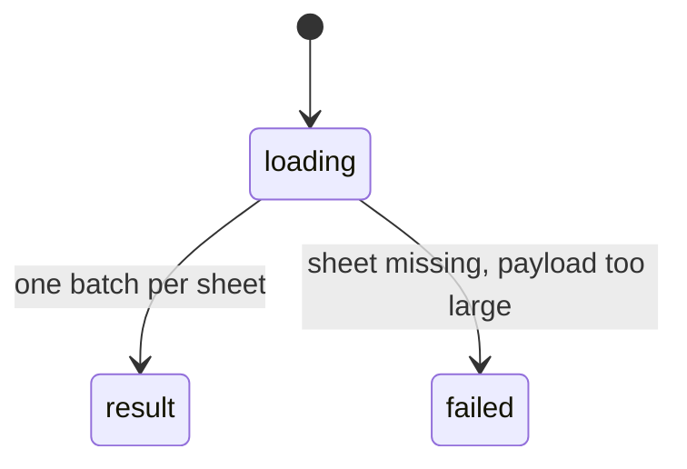

# `get_workbook_overview`

## Summary

Returns the workbook's structure: without `sheet`, the same text as the [blueprint](../foundations/auto-context.md#the-blueprint); with `sheet`, a sheet detail with headers, tables, named ranges on that sheet, object names and a five-row preview. A read call.

Prompt line: "structural blueprint (sheets, headers, named ranges, tables); optional sheet-level detail for charts, pivots, shapes".

## The simple case

Without arguments (confirmed, abridged):

```
## Workbook: orb-98fb59459bd2-20261026175207.xlsx

### Sheets (9)
1. **Sheet1** — empty
2. **Dates** — 4 rows × 4 cols
   Headers: Date, Growth, Price, Code
...
6. **Spill** — 3 rows × 3 cols
   Headers: #SPILL!, #SPILL!
9. **Big** — 200001 rows × 5 cols
   Headers: Id, Name, Qty, Region, Value
```

With `{"sheet": "Dates"}` the agent got dimensions, headers and `### Preview (first 4 rows)` with column letters and row numbers.

## The call, event by event



### Forms the call

The agent usually already has the blueprint in its auto-context, so the workbook-level call is redundant; it is useful after the agent suspects the blueprint is stale. The sheet-level call is how it previews a sheet.

### Rejected at once

Only schema errors.

### Touches Excel

Workbook level: one sync per sheet loading the used range's size, row 1's used values, tables, chart count, pivot count and shapes. Sheet level: one batch that loads **the whole used range's values** to show five rows.

### While running

Several batches for the workbook level; time grows with sheet count (1.6 s for 9 sheets).

### The result

Text as above. "Headers" are row 1's non-empty values, whatever row 1 is: a title, numbers, a spill error (confirmed: `Headers: Locked, 1`; `Headers: 100, pi wrote this, row 0, 0, …`). The used range's position is not given. A sheet preview labels columns from A and rows from 1 even when the used range starts elsewhere (read from code). `{"sheet": "Big"}` failed with `Error getting workbook overview: The response payload size has exceeded the limit…` (confirmed).

## Workbook and host state

| State | True before the call | Changes while running |
| --- | --- | --- |
| Sheet protection | Not reported. | No effect. |
| Calculation mode | Not reported. | No effect. |
| Merged cells | Not reported; a merged title in row 1 becomes the only "header". | No effect. |
| Tables, filters and hidden rows | Tables listed with size, not position or header row; filters and hidden rows not reported. | No effect. |
| Data validation | Not reported. | No effect. |
| Dynamic arrays and spills | Spill errors in row 1 show as headers. | No effect. |
| External links | Not reported. | No effect. |
| Very large used range | Workbook level fine; sheet level fails (confirmed). | No effect. |
| Number formats and locale | Header values raw. | No effect. |
| Host and API set | Same. | No effect. |
| Execution mode | No effect. | No effect. |

## Hostility and interrupts

| Event | Before Excel is touched | While running |
| --- | --- | --- |
| The user is editing a cell | Edit-mode error. | Fails at the next batch. |
| The user changes the selection or the active sheet | No effect. | No effect. |
| The user changes data the call depends on | Reflected. | Sheets processed later reflect later state. |
| Another tab's write holds the workbook lock | No wait. | Sees partial writes. |
| Excel throttles, times out or rejects the payload | — | Sheet level fails on big sheets. |
| Recalculation is pending | Header formulas stale. | Same. |
| The workbook is co-authored | Not observed. | Not observed. |
| Autosave or a save boundary | No effect. | No effect. |
| The user presses Stop | `Aborted`. | Completes. |
| The context fills | Results are small. | — |

## Interactions with other systems

**What the agent is told.** The prompt line.

**Verification.** No interaction.

**Backups and recovery.** No interaction.

**The workbook lock and parallel calls.** Read call.

**Execution mode and approvals.** No interaction.

**Truncation and history shaping.** Rarely truncated; shaped when old and over 1,200 characters.

**Auto-context.** Calling it does not refresh the cached blueprint.

**Prompt caching.** No interaction.

**Host differences.** None observed.

**What the user sees.** An "Overview" card.

## Edge cases

- More than eight headers end with `… (+N more)`.
- Named ranges are listed only if visible.

## Open questions and verification

- Confirmed: OVER-01 to OVER-05.
- Looks like a bug: [B-05](../bug-triage.md#b-05-large-sheets-break-reads-search-and-sheet-overviews-with-a-raw-payload-error), [B-11](../bug-triage.md#b-11-the-agent-cannot-see-workbook-state-that-changes-what-its-calls-do), [B-21](../bug-triage.md#b-21-small-result-format-slips).

Verified against pi-for-excel commit `ec453df`.
