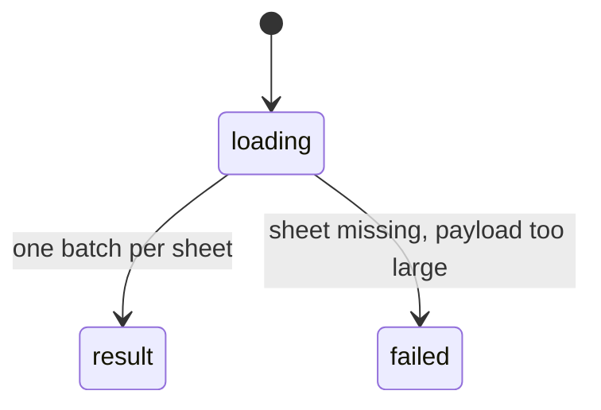

# `get_workbook_overview`

## Summary

Returns the workbook's structure: without `sheet`, the same text as the [blueprint](../foundations/auto-context.md#the-blueprint); with `sheet`, a sheet detail with headers, tables, named ranges on that sheet, object names and a five-row preview. A read call.

Prompt line: "structural blueprint (sheets, headers, named ranges, tables); optional sheet-level detail for charts, pivots, shapes".

## The simple case

Without arguments (confirmed, abridged):

```
## Workbook: orb-98fb59459bd2-20261026175207.xlsx

### Sheets (9)
1. **Sheet1** — empty
2. **Dates** — 4 rows × 4 cols
   Headers: Date, Growth, Price, Code
...
6. **Spill** — 3 rows × 3 cols
   Headers: #SPILL!, #SPILL!
9. **Big** — 200001 rows × 5 cols
   Headers: Id, Name, Qty, Region, Value
```

With `{"sheet": "Dates"}` the agent got dimensions, headers and `### Preview (first 4 rows)` with column letters and row numbers.

## The call, event by event



### Forms the call

The agent usually already has the blueprint in its auto-context, so the workbook-level call is redundant; it is useful after the agent suspects the blueprint is stale. The sheet-level call is how it previews a sheet.

### Rejected at once

Only schema errors.

### Touches Excel

Workbook level reads structure and appends current calculation/protection state. Sheet level loads metadata, a bounded state sample and only the first five rows and bounded columns of displayed data, not the whole used grid.

### While running

Several batches for the workbook level; time grows with sheet count (1.6 s for 9 sheets).

### The result

"Headers" are still heuristic nonempty header values, not guaranteed table headers. Sheet previews now use actual used-range row/column offsets and displayed values, and name any column limit. Sheet-state notes describe detected protection, merges, filters, hidden rows, validation, spills and calculation mode for their bounded sample. Workbook-level current state names protected sheets and nonautomatic calculation. Unknown sheets report available names.

## Workbook and host state

| State | True before the call | Changes while running |
| --- | --- | --- |
| Sheet protection | Reported; sheet sample can identify locked state. | Snapshot only. |
| Calculation mode | Nonautomatic/pending state warns about stale values. | Snapshot only. |
| Merged cells | Detected areas reported in sheet state. Headers remain heuristic. | No effect. |
| Tables, filters and hidden rows | Sheet state reports detected boundaries/filter/hidden state. | Snapshot only. |
| Data validation | Supported rules in the sheet sample are reported. | No effect. |
| Dynamic arrays and spills | Spill errors in row 1 show as headers. | No effect. |
| External links | Not reported. | No effect. |
| Very large used range | Bounded previews avoid full-grid payloads. | Later sheets may observe later state. |
| Number formats and locale | Preview uses displayed text with raw values when display hides them. | No effect. |
| Host and API set | Same. | No effect. |
| Execution mode | No effect. | No effect. |

## Hostility and interrupts

| Event | Before Excel is touched | While running |
| --- | --- | --- |
| The user is editing a cell | Bounded Excel wait before any successful sync. | No unsafe whole-run retry after sync. |
| The user changes the selection or the active sheet | No effect. | No effect. |
| The user changes data the call depends on | Reflected. | Sheets processed later reflect later state. |
| Another tab's write holds the workbook lock | No wait. | Sees partial writes. |
| Excel throttles, times out or rejects the payload | — | Bounded host timeout; preview is not a full-sheet grid load. |
| Recalculation is pending | Header formulas stale. | Same. |
| The workbook is co-authored | Not observed. | Not observed. |
| Autosave or a save boundary | No effect. | No effect. |
| The user presses Stop | `Aborted`; waits cancelled. | Read grace is 500 ms, then stopped if unanswered. |
| The context fills | Results are small. | — |

## Interactions with other systems

**What the agent is told.** The prompt line.

**Verification.** No interaction.

**Backups and recovery.** No interaction.

**The workbook lock and parallel calls.** Read call; waits for earlier registered mutations in this runtime, not another tab's lock.

**Execution mode and approvals.** No interaction.

**Truncation and history shaping.** Rarely truncated; shaped when old and over 1,200 characters.

**Auto-context.** Calling it does not refresh the cached blueprint.

**Prompt caching.** No interaction.

**Host differences.** None observed.

**What the user sees.** An "Overview" card.

## Edge cases

- More than eight headers end with `… (+N more)`.
- Named ranges are listed only if visible.

## Open questions and verification

- Merged source inspection: bounded displayed preview, offsets and current-state notes. OVER-01–05 record earlier behavior; the old big-sheet failure is not the current expectation. Every optional host state API and desktop host was not rerun.

Verified against pi-for-excel commit `1f51cf8` (source inspection).
