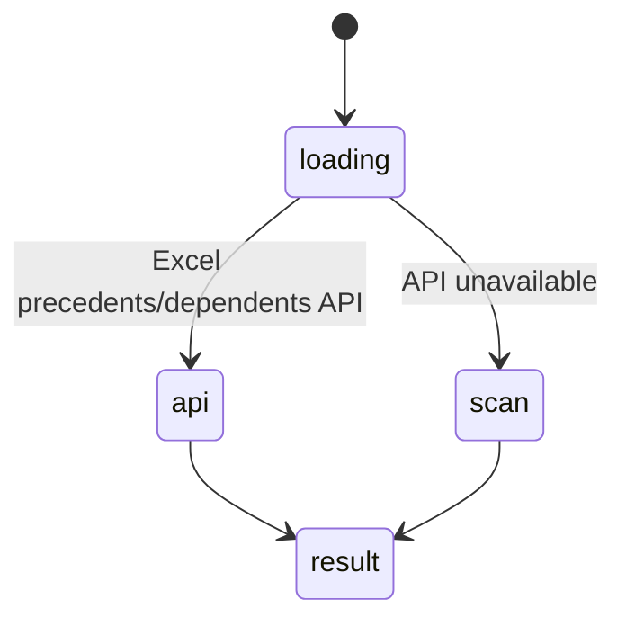

# `trace_dependencies` and `explain_formula`

## Summary

`trace_dependencies` returns a tree of a cell's precedents or dependents (`mode`), using Excel's direct-precedent/dependent APIs with a formula-parsing fallback. `explain_formula` returns one formula cell's value, formula and up to 8 (max 20) direct references with values. Both are read calls.

## The simple case

`Calc!B1` holds `=A1+A2`. `trace_dependencies {"cell": "Calc!B1", "mode": "precedents"}` (confirmed):

```
**Precedents tree for Calc!B1:**

└── **Calc!B1** = 102 (=A1+A2)
    └── **Calc!A1** = 100
```

A2 is missing. `explain_formula {"cell": "Calc!B1"}` correctly lists both A1 and A2.

## The call, event by event



### Forms the call

The agent names one cell.

### Rejected at once

Schema errors.

### Touches Excel

One or more batches per tree level. The API returns coalesced areas (`Calc!A1:A2`, confirmed); the tool converts each area to its first cell, so a range precedent becomes one cell. Dependents fall back to scanning formulas across sheets, which loads used ranges and can hit the payload limit on big sheets (read from code).

### While running

Depth and children per node are capped; truncation is noted in the tree.

### The result

An ASCII tree with values and formulas, or the explanation text.

## Workbook and host state

| State | True before the call | Changes while running |
| --- | --- | --- |
| Sheet protection | No effect. | No effect. |
| Calculation mode | Values stale. | No effect. |
| Merged cells | No effect. | No effect. |
| Tables, filters and hidden rows | Structured references are not parsed by the fallback. | No effect. |
| Data validation | No effect. | No effect. |
| Dynamic arrays and spills | Spill references (`A1#`) not parsed by the fallback. | No effect. |
| External links | API omits other-workbook precedents. | No effect. |
| Very large used range | Dependent scan may fail with payload error. | No effect. |
| Number formats and locale | Values raw. | No effect. |
| Host and API set | Direct-precedent API needs ExcelApi 1.12; otherwise fallback. | No effect. |
| Execution mode | No effect. | No effect. |

## Hostility and interrupts

| Event | Before Excel is touched | While running |
| --- | --- | --- |
| The user is editing a cell | Edit-mode error. | Next batch fails. |
| The user changes the selection or the active sheet | Unqualified cell follows the active sheet. | — |
| The user changes data the call depends on | Reflected. | Levels may disagree. |
| Another tab's write holds the workbook lock | No wait. | — |
| Excel throttles, times out or rejects the payload | — | Scan may fail. |
| Recalculation is pending | Stale values. | — |
| The workbook is co-authored | Not observed. | — |
| Autosave or a save boundary | No effect. | — |
| The user presses Stop | `Aborted`. | Completes. |
| The context fills | Trees are capped. | — |

## Interactions with other systems

**What the agent is told.** Prompt lines only. **Verification.** No interaction. **Backups and recovery.** No interaction. **The workbook lock and parallel calls.** Read calls. **Execution mode and approvals.** No interaction. **Truncation and history shaping.** Rarely large. **Auto-context.** No interaction. **Prompt caching.** No interaction. **Host differences.** API availability. **What the user sees.** A clickable tree card.

## Open questions and verification

- Confirmed: TRACE-01, TRACE-02.
- Looks like a bug: [B-13](../bug-triage.md#b-13-dependency-traces-show-a-precedent-range-as-its-first-cell).

Verified against pi-for-excel commit `ec453df`.
