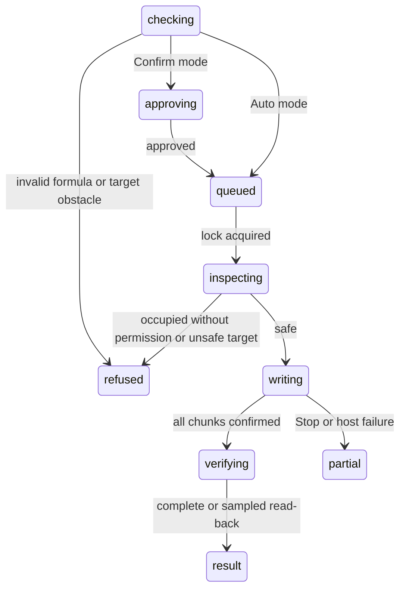

# `write_cells`

## Summary

`write_cells` writes a rectangular grid from a top-left cell; strings beginning `=` are formulas. It checks overwrite protection and workbook obstacles, submits bounded chunks and reports what read-back established, including partial or unknown outcomes. It serializes mutations, asks before a Confirm-mode change and backs up up to 20,000 cells. This is checked writing, not a transaction or a promise that every dependent formula is correct.

## The simple case

`{"start_cell":"Sheet1!B4","values":[["=SUM(B2:B3)"]]}` on an empty cell with B2=3 and B3=5 writes the formula. The result reports verified value 8, one changed cell and a backup ID. The agent's own write is not then described as a user edit in auto-context. A separate read can check downstream outputs.

## The call, event by event

### Forms the call

The agent emits a sheet-qualified `start_cell`, a 2D `values` grid and optional `allow_overwrite`. Ragged rows are padded with empty strings, which can clear cells. Large JSON can exceed model output limits before a tool runs. An omitted sheet is refused: "Name the sheet, e.g. Sheet1!B2. Mutating tools do not use the active sheet." The shallow formula syntax check catches unmatched quotes/parentheses and trailing operators, not every Excel error.

### Rejected at once

Empty grids, invalid starts and invalid formula syntax are tool errors. Preflight can refuse merges, spills, protection or overwrite issues before asking for approval. A valid approval does not bypass the later locked recheck. Approval dialogs queue and Stop withdraws them.

### Touches Excel

The target is inspected under the workbook lock. Nonempty cells need `allow_overwrite:true`; the prompt still tells the agent to ask first. Occupied targets larger than 20,000 cells are refused because they cannot be backed up: split into backed-up blocks. Empty large targets can proceed without a full before-snapshot.

Writes into merged cells outside their top-left, spill children and detected locked protected cells are refused with reasons before data is submitted. Inspection depends on host APIs; exhaustive per-cell spill inspection is capped at 500 cells. This is not a co-author lock: data can still change after inspection.

### While running

Values are submitted in bounded chunks. Stop is honored between chunks; a submitted chunk settles before the tool reports how far it got. Confirmed rows and an in-flight unknown portion are distinguished. Reads registered later in this runtime wait for the mutation; other tabs' reads do not.

### The result

Success names the address, preview, changes and backup. Verification checks submitted values/formulas, conversion of text, formula errors, validation violations and detected table/header changes. It explicitly reports mismatches or a failed read-back rather than claiming that nothing was written.

At most 20,000 cells get complete value read-back; larger writes use head/tail samples plus whole-target error/blank inspection. The result names the sampled scope, not full verification. Manual calculation calculates written formulas and warns that dependents elsewhere may remain stale. Validation is reported, not a guarantee that Excel rejected invalid entries. Excel conversion of strings such as `00123` is reported rather than silently treated as exact preservation.

Stopped results say nothing written or count confirmed written cells; Stop does not undo. Host timeouts distinguish known applied work from unknown in-flight work. Mutation failures carry `isError:true`. Backup-capture/storage limitations are named.

## Workbook and host state

| State | True before the call | Changes while running |
| --- | --- | --- |
| Sheet protection | Detectable locked cells are refused with a protection reason. | Later protection can fail a chunk. |
| Calculation mode | Written formulas can be calculated; dependent results may remain stale. | No global recalculation guarantee. |
| Merged cells | Unsafe non-top-left targets refused. | Concurrent changes remain possible. |
| Tables, filters and hidden rows | Hidden rows remain targets; table/header changes are reported. | Snapshot is not a transaction. |
| Data validation | Violations reported after write. | Does not force Excel UI enforcement. |
| Dynamic arrays and spills | Detected spill children refused; anchor errors reported. | API limits are disclosed. |
| External links | Cached/external dependencies not verified globally. | External changes remain possible. |
| Very large used range | Target size controls chunking, backup and sampling. | Stop can leave partial work. |
| Number formats and locale | Excel conversions are compared and reported. | English formula syntax required. |
| Host and API set | Unsupported inspection is a limitation, not invented assurance. | Timeout can mean unknown outcome. |
| Execution mode | Confirm approvals queue before the lock. | Mode changes affect subsequent calls. |

## Hostility and interrupts

Cell-edit mode waits under the shared bounded Excel policy only before a successful sync. Stop before submission writes nothing; during submission it waits for the current chunk and reports partial work. Co-authors can overwrite or move cells even after verification. Saves never clear backups. See [Stop](../hostility/stop.md), [recalculation](../hostility/recalculation.md) and [co-authoring](../hostility/co-authoring-and-autosave.md).

## Interactions with other systems

**What the agent is told.** Read first, protect overwrites and verify downstream outputs. **Verification.** Full or explicitly sampled, not an atomic/global correctness guarantee. **Backups and recovery.** Before-values/formulas up to 20,000 cells; snapshot ID or truthful limitation in text. **The workbook lock and parallel calls.** Mutations serialize; own later reads wait. **Execution mode and approvals.** Queued, attributed approval before lock. **Truncation and history shaping.** Short result previews; arguments can still be large. **Auto-context.** Own writes excluded from external edit notes; structure changes refresh later. **Prompt caching.** Stable schema. **Host differences.** Host API limitations disclosed. **What the user sees.** Changes and stopped/failed receipts; see [writing](../../product-description/workbook/writing.md).

## Edge cases

Empty strings clear and `null` follows Office.js leave-unchanged semantics. A space counts as occupied. The explicit overwrite confirmation prompt rule remains; its separate product decision is not changed here. A successfully written formula may still produce `#SPILL!` or break a downstream output that was not checked.

## Open questions and verification

Read merged write, inspection, verification, recovery and coordinator code. Real Excel on the web: a GPT-6 Luna turn wrote `=SUM(B2:B3)` and independent Office.js read-back confirmed formula/value 8; a write into F1 inside merged E1:F1 was refused with `isError:true` and the top-left explanation. Large, protected, spill and interrupted cases were read from code, not all rerun in this pass.

Verified against pi-for-excel commit `1f51cf8`.
