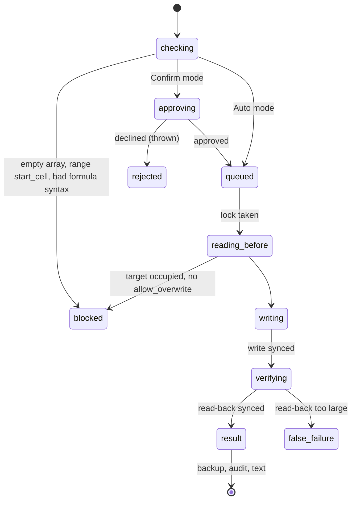

# `write_cells`

## Summary

`write_cells` is how the agent puts values and formulas into the workbook. It takes a top-left cell and a 2D array; strings starting with `=` are formulas. By default it refuses to overwrite cells that hold values or formulas. After writing it reads the block back and reports formula errors or a preview of the values. It is a mutating call: it waits for the workbook lock, asks for approval in Confirm mode, and makes an automatic backup of up to 20,000 cells.

The prompt line is "**write_cells** — write values/formulas with overwrite protection and auto-verification". The workflow rules add "**Verify writes.** write_cells auto-verifies and reports errors. If errors occur, diagnose and fix." and "**Overwrite protection.** write_cells blocks if the target has data. Ask the user before setting allow_overwrite=true." The schema says `start_cell` defaults to the active sheet when unqualified.

## The simple case

`{"start_cell": "Calc!C1", "values": [["pi wrote this"]]}` on an empty cell returns (confirmed):

```
Written to **Calc!C1** (1×1)

**Verified values:**
| pi wrote this |
| --- |

Changed cell(s): 1.
```

A backup was made; the agent is not told its ID. The next model call's change list will report `Calc: C1` as a *user* change (see [auto-context](../foundations/auto-context.md#the-change-list)).

## The call, event by event



### Forms the call

The agent sends the whole grid as JSON in its output. Rows are padded to the longest row with empty strings. A very large grid can hit the model's output-token limit, in which case the call is not executed and the agent is told to re-issue it ([the tool contract](../foundations/the-tool-contract.md#forms-the-call)).

### Rejected at once

Without touching Excel: `Error: values array is empty.`; `Error: start_cell must be a single cell (e.g. "A1").`; `Error: invalid start_cell "…".`; and `⛔ **Write blocked** — invalid formula syntax detected:` with each cell and reason (unbalanced quotes or parentheses, a trailing operator, an empty formula). The syntax check is shallow: unknown functions and bad references pass and come back as `#NAME?` or `#REF!`.

In Confirm mode a declined approval is the thrown error `Mutation cancelled by user (Confirm mode).`

### Touches Excel

Under the lock, one batch reads the target's values and formulas. If any cell holds a value or formula and `allow_overwrite` is not true, the agent receives (confirmed):

```
⛔ **Write blocked** — Spill!A3:A3 contains 1 non-empty cell(s).

**Existing data:**
| 3 |
| --- |

To overwrite, confirm with the user and retry with `allow_overwrite: true`.
```

Formatting, data validation and conditional formats do not block. Spill children do block (they hold values), but the message does not say the cell belongs to a spill.

### While running

The write is one sync; the read-back is a second batch of the same size. Nothing else can mutate the workbook through Pi meanwhile, but the user and other add-ins can. Reads by other calls in the same model call run alongside and may see the old values.

### The result

`Written to **{address}** ({rows}×{cols})`, then either `⚠️ **N formula error(s):**` with `- C1: #SPILL! (formula: =SEQUENCE(4))` lines and "Review and fix with another write_cells call.", or `**Verified values:**` with at most 8 × 6 cells and `_Showing preview only (…)._ _Use \`read_range\` for full verification if needed._`, then `Changed cell(s): N.` when N > 0, then a backup note if no backup was made.

The verification is narrow; see [the tool contract](../foundations/the-tool-contract.md#verification). Confirmed failures of it:

- **Merged areas.** `hello` into `Merged!B1` (inside merged `A1:D1`) returned `Written to **Merged!B1** (1×1)`, an empty preview and no change line. A 2×2 block over merged `B4:C6` returned `Written to **Merged!B4:C5** (2×2)` and `Changed cell(s): 1.`: three values lost. A *silent success*.
- **Spill children.** Overwriting `Spill!A3` with `allow_overwrite` returned a clean result; the anchor A1 became `#SPILL!`, unreported.
- **Manual calculation.** `=A1+A2` was verified as `0.0000e+0`.
- **Data validation.** `Maybe` into a Yes/No list cell was accepted and verified.
- **Coercion.** `["00123","1/2","TRUE","1e5","3-4","50%","'007"]` was verified as `123 | 46024 | true | 100000 | 46085 | 0.5` with the rest beyond the preview.
- **Large writes.** 60,000 × 4 returned `Error writing cells: The response payload size has exceeded the limit…` after the data was written; no backup. A *false failure*.

## Workbook and host state

| State | True before the call | Changes while running |
| --- | --- | --- |
| Sheet protection | Locked cells: `Error writing cells: You cannot perform the requested operation.`, no mention of protection (confirmed). Unlocked cells write normally. | A write between the pre-read and the write fails as above. |
| Calculation mode | Manual: formulas are written but read back stale (often 0) and "verified" (confirmed). | Not reported. |
| Merged cells | Values outside each merge's top-left are dropped; result claims success (confirmed). | No effect. |
| Tables, filters and hidden rows | Values are written into hidden and filtered rows like any other; writing below a table does not extend it (read from code); writing a header cell renames the column. | No effect. |
| Data validation | Not enforced; invalid values accepted silently (confirmed). | No effect. |
| Dynamic arrays and spills | Writing a spilling formula where it is blocked reports `#SPILL!` as a formula error (confirmed). Overwriting a child is blocked unless `allow_overwrite`; with it, the anchor breaks silently (confirmed). | No effect. |
| External links | Formulas referencing closed workbooks are written; their values depend on Excel's link cache. Not observed. | No effect. |
| Very large used range | Not relevant to the write; a large *target* fails after writing above roughly 30,000–60,000 cells × columns (confirmed). | No effect. |
| Number formats and locale | Strings are parsed as typed input (coercion, confirmed). Formulas must use English syntax. | No effect. |
| Host and API set | Same on desktop and web; payload numbers measured on web. | No effect. |
| Execution mode | Confirm: approval dialog before the lock; parallel approvals decline each other ([B-09](../bug-triage.md#b-09-parallel-confirm-mode-approvals-decline-each-other)). | A mode change applies to the next call. |

## Hostility and interrupts

| Event | Before Excel is touched | While running |
| --- | --- | --- |
| The user is editing a cell | `Error writing cells: Excel is in cell-editing mode…` in ~12 ms (confirmed); nothing written. | If edit mode starts between the write and the read-back, the write landed and the result is the edit-mode error: a false failure (read from code). |
| The user changes the selection or the active sheet | An unqualified `start_cell` lands on the new active sheet (confirmed). | Resolved per batch; the pre-read and the write could hit different sheets if the user switches between them (read from code). |
| The user changes data the call depends on | The overwrite check sees the current data. | An edit between pre-read and write is overwritten without a block. |
| Another tab's write holds the workbook lock | The call waits, with no time limit. | — |
| Excel throttles, times out or rejects the payload | Request too large: nothing written, payload error. | Response too large: written, then payload error (confirmed). No timeout. |
| Recalculation is pending | Formulas read back stale. | Same. |
| The workbook is co-authored | Not observed. | A co-author's edit to the target between pre-read and write is overwritten. |
| Autosave or a save boundary | No effect on the call; a save clears automatic backups. | Same. |
| The user presses Stop | Thrown `Aborted`; nothing written. | The write completes; the result is returned. |
| The context fills | The grid in the call's arguments is part of history until compacted. | — |

The agent is left trusting a result that may be a silent success or a false failure. Only a separate read reveals either.

## Interactions with other systems

**What the agent is told.** Prompt rules 3 and 4; the schema descriptions. Nothing about merges, spills, validation, coercion or manual calculation.

**Verification.** Built in, narrow. See above.

**Backups and recovery.** A backup of before-values and formulas is made when the target is at most 20,000 cells; otherwise the note says capture was skipped, with the wrong reason ([B-19](../bug-triage.md#b-19-backup-notes-give-the-wrong-reason-when-a-backup-is-skipped)). No backup on the false-failure path.

**The workbook lock and parallel calls.** Serialized with other mutations; not with reads.

**Execution mode and approvals.** Confirm mode asks once per call, showing tool and range.

**Truncation and history shaping.** Results are short; the preview cap keeps them under 2 KB. The arguments (the grid) are not shaped.

**Auto-context.** The write shows up in the next change list as a user change. It does not refresh the blueprint, so a new sheet header or a grown sheet is not reflected.

**Prompt caching.** No interaction.

**Host differences.** Edit-mode failure is immediate on the web.

**What the user sees.** A tool card with a Changes table; see [product-description/workbook/writing.md](../../product-description/workbook/writing.md).

## Edge cases

- Ragged rows are padded with `""`, which overwrites (blanks) cells when `allow_overwrite` is true.
- `null` in the grid clears nothing in Office.js (it leaves the cell), while `""` clears it (read from Office documentation).
- A formula that spills into occupied cells writes and reports `#SPILL!`.
- A cell holding only a space counts as occupied.
- An explicit user request to overwrite still makes the agent ask first (observed in a real turn; [B-18](../bug-triage.md#b-18-overwrite-protection-forces-a-confirmation-round-trip-on-explicit-requests)).

## Open questions and verification

- Confirmed on Excel on the web, 2026-10-26: every quoted result above (WRITE-01 to WRITE-15).
- Read from code: the race windows between pre-read, write and read-back; table extension behavior.
- Looks like a bug: [B-01](../bug-triage.md#b-01-writes-into-merged-areas-report-success-while-values-are-dropped), [B-02](../bug-triage.md#b-02-large-writes-and-fills-report-failure-after-the-change-is-applied), [B-03](../bug-triage.md#b-03-verification-checks-only-the-written-cells-so-broken-spills-stale-formulas-and-invalid-entries-pass), [B-07](../bug-triage.md#b-07-values-reach-the-agent-raw-and-mis-rendered-and-writes-coerce-text), [B-10](../bug-triage.md#b-10-excel-failures-arrive-as-generic-text-in-results-marked-successful).

Verified against pi-for-excel commit `ec453df`.
