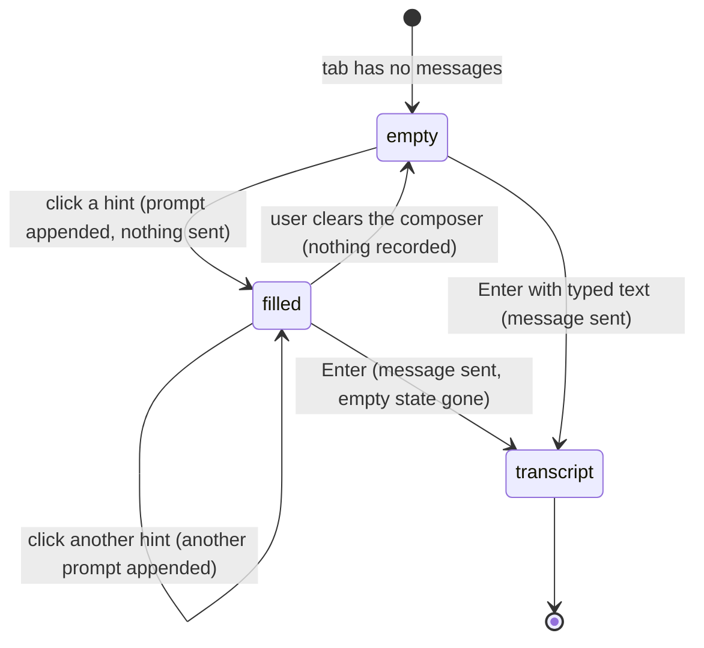

# The empty state and starter hints

## Summary

The empty state fills a tab with no visible conversation: a π mark, the tagline "Understand and operate Excel. Remember your preferences. Build your own tools." and four starter hints, in order: Explain, Quality check, Build my financial model and Format this sheet. Clicking appends the full prompt to that tab's [composer](../turn/the-composer.md), without sending or discarding its existing draft. A visible note says "A hint fills the message box so you can edit it before sending." The empty state disappears when the first message joins the transcript. Hints need no provider and work across hosts.

## The simple case

The user opens a new tab. Under the header, centred in the transcript area, are a large faint π, the tagline, and four cards. Each card has a bold label and, under it, the first line or so of its prompt in grey, cut off with "…".

The user clicks "Explain this workbook". The composer fills with the whole prompt, several lines long ("Read through the entire workbook — every sheet, its structure, formulas, and named ranges. Then write a clear overview and user manual for this workbook. …"), grows to show it, and takes focus with the caret at the end. Nothing has been sent. The empty state is still there.

The user adds "Keep it short." at the end and presses Enter. The message joins the transcript as an ordinary [user message](../glossary.md#the-turn), the empty state is replaced by the transcript, and Pi starts working. From here on it is an ordinary [turn](../foundations/turns.md).

## The interaction, event by event

### Showing the empty state

The empty state is shown whenever the active tab has no messages to show. Pi's own background entries in a session (the system instructions it keeps alongside the conversation) do not count, so a tab whose only content is those still shows the empty state. It is shown, per tab, in these cases:

- the first tab when the taskpane starts with no session to restore (see [the taskpane](../foundations/the-taskpane.md#the-interaction-event-by-event));
- a tab created with "+", Ctrl/Cmd+T or `/new` (see [tabs](../sessions/tabs.md));
- a blank tab restored from the [tab layout](../glossary.md#sessions-and-tabs) after a reload;
- switching to any tab that has no messages.

The empty state is centred vertically in the transcript area and at most 260 px wide. If the pane is too short for it, it scrolls on its own. The [disclosure bar](../foundations/the-taskpane.md#the-disclosure-bar) and [proxy banner](../foundations/the-taskpane.md#the-proxy-banner), when shown, sit above it and take height from it.

Each hint card shows its label and a preview of its prompt: the prompt with its line breaks turned into spaces, and, if longer than 120 characters, its first 117 characters followed by "…". All four prompts are longer than that, so every preview ends in "…". The full prompts are:

| Label | What the prompt asks |
| --- | --- |
| "Explain this workbook" | Read every sheet, its structure, formulas and named ranges, then write an overview and user manual: what the workbook does, how it is organised, where inputs and outputs are, and, for a model, its assumptions and logic, or, for data, its fields and gaps. |
| "Quality check this workbook" | Review logic, assumptions and formatting for errors (broken or circular references, hardcoded numbers in formulas, inconsistent patterns, #REF or #VALUE errors, unlabelled inputs, inconsistent formats), and summarise findings as a prioritised list grouped by severity. |
| "Build my financial model" | Read the whole workbook first; if it is blank, ask what kind of model is needed (DCF, LBO, three-statement, budget, forecast, comparison) and build it step by step; if a model is partly there, explain it and offer to finish it; if there is only data, suggest what could be modelled. |
| "Format this sheet" | Infer each cell's format from context and apply number formats, font colour coding (blue inputs, black formulas), cell styles and consistent headers, keep formats consistent within columns and rows, then read the sheet back to check. |

The exact wording is in `src/language/locales/en.json` under `hint.explain.prompt`, `hint.quality.prompt`, `hint.financial.prompt` and `hint.format.prompt`.

### Clicking a hint ends at once

Clicking a hint edits a draft, not the conversation:

- The full prompt is appended, with a blank line after a non-empty draft. The native insertion path preserves undo; a host that refuses it uses an append fallback rather than discarding the draft.
- Focus moves to the composer, with the caret at the end of the prompt. The composer grows to fit, up to its maximum height, and the send button becomes active.
- Nothing is sent and the tab does not become busy. Normal draft persistence applies. The [command menu](the-command-menu.md) does not open; no hint starts with `/`.
- The empty state stays on screen. Clicking another hint appends again.

The user can now edit the text freely, clear it (and be back where they started), or leave it there and do something else.

### Sending the prompt

The hint's text is sent like any other text: Enter or the send button. There is nothing special about it once it is in the composer: Pi does not know it came from a hint, and an edited prompt is sent as edited. See [turns](../foundations/turns.md#sent) for what is committed when.

### While Pi is busy

The empty state is replaced by the transcript when the first user message joins it. Until then, any visible hint still appends editable text without sending. Once the transcript appears, hints are gone for this tab.

### After the first message

The empty state does not come back for that tab. No command empties a tab's conversation: a stopped or failed first turn still leaves the user's message in the transcript, and compaction replaces old messages with a summary rather than removing them. To see the hints again the user opens a new tab with "+" or `/new`.

## Modifiers

| Modifier | Set before | Changed while busy |
| --- | --- | --- |
| Model and provider | No effect on the hints. With no provider connected the hints still fill the composer; sending then asks for a connection, as for any message (see [models and providers](../foundations/models-and-providers.md)). | Not applicable: the empty state is gone once the tab is responding. |
| Thinking level | No effect. The prompt is sent at the tab's current level. | Not applicable. |
| Execution mode | No effect on the hints. "Build my financial model" and "Format this sheet" lead Pi to change the workbook, so in Confirm mode the resulting turn stops for [approvals](../workbook/confirm-mode-and-approvals.md). | Not applicable. |
| Files in the workspace, or an overlay open | Files have no effect; the prompts do not mention them. An overlay's backdrop covers the hints, so they cannot be clicked until it closes. A menu does not have a backdrop, but in a short taskpane the utilities menu sits over the hints: in a pane about 340 px tall it covered all four, and a click where a hint showed chose the menu item under it ("Resume session") instead. Where a hint is not under the menu, the click closes the menu and inserts the hint (read from code). | Not applicable. |
| Tab state (new, restored, another tab busy) | Shown in new and blank tabs only; a restored tab with history shows its transcript. Another tab being busy does not matter. | Not applicable for this tab. Another tab being busy does not affect the hints. |
| Host (desktop or web) | No difference. Outside Excel the hints still insert, but the prompts ask about a workbook Pi cannot reach. | No effect. |

Nothing set before a hint is clicked changes what it inserts; the text is fixed for the whole time the taskpane is open.

## Cancel and interrupt

For hints, "before sent" is the time between clicking a hint and sending its text; "while busy" is the time after sending, which belongs to [turns](../foundations/turns.md).

| Event | Before sent | While busy |
| --- | --- | --- |
| Stop (button or Escape) | There is nothing to stop. Escape with focus in the composer moves focus to the tab strip; the inserted text stays. | The turn stops as described in [stopping](../turn/stopping.md); the user's message stays in the transcript, so the empty state does not return. |
| The user sends something else | Another hint appends; typing edits the draft. A slash command deliberately typed over it runs instead. | Enter steers and Alt/Option+Enter follows up as usual. |
| Tab switched, created, closed or reopened | The inserted prompt stays in its originating tab's draft; the destination tab restores its own draft. | The turn keeps running in its tab. |
| An overlay or menu opens | The inserted text stays in the composer behind the overlay. | No effect on the empty state, which is already gone. |
| Model or thinking level changes | Applies to the turn the prompt will start. | As for any turn. |
| The provider fails | Not applicable; nothing has been sent. | The turn fails; the message stays and the empty state does not return. |
| The taskpane goes away | Saved composer draft restores, including hint text. | First user message persists before its answer; streaming itself does not resume. |
| The workbook changes underneath | No effect. The prompt is text and reads the workbook only once sent. | As for any turn. |
| Focus moves to the grid or another window | The inserted text stays in the composer. | No effect. |
| The context window fills | Not applicable. An empty tab uses almost no context. | As for any turn. |

After any interrupt before sending, the user still has the empty state on screen and whatever is in the composer.

## Interactions with other systems

**Persistence.** The empty-state display is derived from visible messages. Hint text becomes that tab's saved draft, not shared text following tab switches; normal debounce/storage limitations apply. See [persistence and restore](../cross-cutting/persistence-and-restore.md).

**Workbook changes and recovery.** Clicking a hint does not touch the workbook. Sending "Build my financial model" or "Format this sheet" usually leads to changes, each with its [automatic backup](../foundations/the-workbook.md).

**Other tabs and sessions.** Each tab shows the empty state independently, based on its own messages. A hint changes only the active tab's draft; switching tabs restores the destination tab's own draft.

**Execution mode and approvals.** No interaction until the prompt is sent.

**Models and providers.** No interaction. The hints do not pick a model and are the same for every model.

**Offline and provider errors.** No interaction until the prompt is sent.

**Notifications.** None. Clicking a hint shows no toast.

**Settings and preferences.** None. The hints cannot be changed, hidden or added to.

**Host differences.** None.

**Language.** The tagline, hint labels, prompts and visible explanation are translated; a Chinese hint inserts its Chinese prompt. Hints are read at startup; the language-change reload refreshes them.

**Accessibility and keyboard.** Each hint is a Tab-reachable button activated with Enter/Space. A visible shared note explains that it fills the message box before sending and is associated with each button through its accessible description. The π mark is plain text. There is no dedicated hint shortcut.

## Edge cases

- **Short pane (520 px tall or less).** The π mark and the grey previews are hidden and the cards shrink to their labels. Confirmed in Excel on the web with a taskpane about 340 px tall.
- **Very long existing draft.** The hint appends; existing text remains.
- **Same hint twice.** Two copies are appended; edited text is not replaced.
- **A hint, then `/new`.** The prompt remains in the originating tab's saved draft; the new tab has its own composer state.
- **Empty tab while another tab is busy.** The hints work normally; sending starts a turn in this tab, independent of the other.

## Open questions and verification

Replacement, missing undo, hover-only explanation and shared-draft observations below are historical, superseded by #789/#803. Current append and visible-note behavior was inspected in merged source; this is not a new live hint acceptance run.

- Clicking a hint replaces the composer text instead of inserting into it (`src/ui/pi-sidebar.ts:1205`, `input.value = prompt`), and the replaced text cannot be recovered with Ctrl/Cmd+Z. Confirmed in Excel on the web: a draft "my draft" was replaced by the whole Explain prompt, the caret was at the end, and Ctrl+Z left the prompt in place. [turns](../foundations/turns.md) now agrees. Losing a draft without warning may be worth treating as a bug.
- The order of the hints in the product is Explain, Quality check, Build my financial model, Format this sheet (`src/taskpane/init.ts:341-358`); the glossary lists "Format this sheet" before "Build my financial model". Confirmed in Excel on the web.
- Each tab owns its draft; switching restores the target tab's text instead of carrying hint text into it.
- "Inserts into input — editable before sending." is only a `title` tooltip (`src/ui/pi-sidebar.ts:1225`); on touch devices and for keyboard users it is never seen. A product call.
- With a provider connected, the empty state was already gone 150 ms after Enter, even with the model request held (confirmed in Excel on the web). The window in which hints stay clickable after Enter only matters while a login is being asked for; that case was not run.
- Checked in Excel on the web on 2026-10-26; see [the checklist](../verification/sessions-and-commands.md#commandsempty-state-and-hintsmd).

Baseline source inspected at `1f51cf8`, reconciled to merged #803. Older hint-click observations remain historical.
