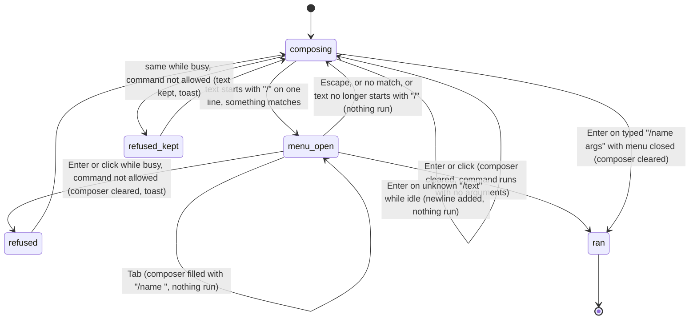

# The command menu

## Summary

Slash commands are the local actions of Pi for Excel: opening settings, the model picker, the resume picker or the Backups dialog, naming a tab, compacting the conversation, and so on. A slash command never reaches the model. The command menu is the pop-up list that helps the user find and run them. It opens above the [composer](../turn/the-composer.md) the moment the composer's text starts with `/` and is a single line, filters as the user types, and runs or fills in the highlighted command. A command can also be run without the menu by typing its full name (and any arguments) and pressing Enter. Both paths go through the same busy policy: twelve commands run while the tab is [busy](../glossary.md#busy), every other built-in command is refused with "Can't run /{command} while Pi is busy". The menu works with no provider connected and on every host. Its accessible name is "Slash commands" (hard-coded English).

## The simple case

The user types `/` in the composer. A list opens just above the composer card, as wide as it, showing every command in a fixed order: the command name in monospace on the left, a short description on the right, the first row highlighted. The user keeps typing, `/res`, and the list narrows to the commands whose name or description contains "res": `/resume`, `/resume-here`, and any command whose description mentions it.

The user presses Enter. The menu closes, the composer clears, and the highlighted command runs: here the resume picker opens. Arguments are never passed when a command is chosen from the menu.

To run a command with arguments, the user types the whole thing, `/name Q3 budget`, and presses Enter. As soon as the text after `/` stops matching any command, the menu disappears, and Enter runs the command with everything after the first space as its arguments. Focus stays in the composer either way; where the user lands afterwards is whatever the command opened.

## The interaction, event by event

### Opening and filtering

The menu opens on any edit that leaves the composer text starting with `/` and containing no line break. The text after the `/` is the filter. Matching is case-insensitive and looks for the filter anywhere in the command's name or its description, so `/tab` lists `/new` ("New chat session tab"), `/resume-here` and `/reopen` by description. An empty filter (just `/`) lists every command.

The order is fixed by registration, not alphabetical. With no filter, the built-in commands appear in the order listed in [the built-in commands](#the-built-in-commands), followed by commands registered by extensions. With a filter, matches keep that order, except that a command whose name equals the filter exactly is moved to the top: `/new` puts `/new` first even though other commands mention "new". Commands from extensions carry a small "ext" badge; built-ins carry none.

The highlight starts on the first row. It stays at the same position while the user keeps typing, clamped to the end of the shorter list, and returns to the first row whenever the menu closes.

The menu is positioned when it opens or the filter changes, anchored to the top edge of the composer card. It does not move when the taskpane is resized.

### Ends at once

Nothing runs and nothing is recorded when:

- **Escape.** The menu closes; the text stays in the composer. Typing again reopens it.
- **No match.** The filter matches nothing; the menu disappears. It comes back if the user deletes back to a matching prefix.
- **The text stops being a command.** Deleting the `/`, or adding a line break with Shift+Enter, closes the menu.
- **Tab.** Tab replaces the composer text with `/{highlighted name} ` (with a trailing space) and moves the caret to the end. It does not run anything. Because the new filter now ends in a space, the menu usually closes at once, unless the name followed by a space happens to occur in a description (`/name ` still matches "Name the current chat session", `/new ` matches "New chat session tab").
- **An unknown command typed with the menu closed.** Enter on `/foo` while the tab is idle does nothing as a command. The composer does not swallow the key, so a line break is added after the text (`/foo` becomes `/foo` plus a new line), which also keeps the menu closed. Confirmed in the standalone taskpane. While the tab is [responding](../glossary.md#responding), the same Enter steers `/foo` to Pi as ordinary text; see [turns](../foundations/turns.md#composing-the-message).

### Running the command

A command runs the moment the user presses Enter or clicks a row with the menu open, or presses Enter on a typed command with the menu closed. The two paths differ in two ways:

| | Chosen from the menu (Enter or click) | Typed, menu closed (Enter) |
| --- | --- | --- |
| Which command | The highlighted row, whatever was typed | The text from `/` to the first space |
| Arguments | Always none | Everything after the first space, trimmed |
| Composer | Cleared before the busy check | Cleared only if the command is allowed to run |
| Busy refusal toast | "Can't run /{command} while Pi is busy" | "Can't run /{command} while Pi is busy" |

The busy check happens first on both paths. The tab counts as busy while it is responding or while a queued action such as `/compact` runs. If busy and the command is not one of `/compact`, `/new`, `/rules`, `/resume`, `/history`, `/reopen`, `/yolo`, `/extensions`, `/plugins`, `/skills`, `/files` or `/tools` (or an extension command that did not opt out), the command does not run and the toast appears.

`/compact` is special: it is never run directly. It is always added to the tab's action queue, even when the tab is idle, and runs as soon as nothing is ahead of it. While it waits behind a turn, it shows in the [queue strip](../glossary.md#the-taskpane) as "/compact"; see [steering and the queue](../turn/steering-and-the-queue.md).

Every other allowed command runs at once. From here on the command owns what happens: it opens an overlay, shows a toast, changes a setting or creates a tab. Nothing is added to the transcript and nothing is saved by the menu itself.

> Technical note: choosing from the menu dispatches a `pi:command-run` event that the taskpane handles (`src/taskpane/init.ts`); typing and pressing Enter calls the same dispatcher directly from the keyboard handler. Both apply the policy in `src/commands/busy-command-policy.ts`, so they cannot drift on which commands are busy-allowed. The popover buttons on the [context meter](../ui/the-status-bar.md#the-context-meter) use the same event.

### While the command runs

The menu has no busy phase. It is closed by the time the command starts. Commands that do asynchronous work (opening an overlay, creating a backup) run in the background; the composer stays usable.

### After the command

If a command throws, the toast "Could not run that command." appears. Otherwise its own toast or overlay is the only feedback. The composer is empty, focus is wherever the command put it (usually inside the overlay it opened), and the menu stays closed until the user types `/` again.

## The built-in commands

In menu order. Each line gives the description shown in the menu, quoted from the product, and the document that owns the behaviour. "Busy" marks the commands that run while the tab is busy.

| Command | Menu description | Busy | Owner |
| --- | --- | --- | --- |
| `/model` | "Switch AI model" | | [the model picker](../setup/the-model-picker.md) |
| `/default-models` | "Switch models with Ctrl+P" | | [the model picker](../setup/the-model-picker.md) |
| `/settings` | "Settings (providers and advanced options)" | | [settings](../setup/settings.md) |
| `/login` | "Open provider settings" | | [welcome and login](../setup/welcome-and-login.md) |
| `/yolo` | "Toggle execution mode (Auto vs Confirm)" | Busy | [confirm mode and approvals](../workbook/confirm-mode-and-approvals.md) |
| `/rules` | "Edit Pi's rules" | Busy | [rules](../guidance/rules.md) |
| `/extensions` | "Open Extensions (connections, plugins, skills)" | Busy | [the extensions hub](../extensions/the-extensions-hub.md) |
| `/tools` | "Manage tools & MCP (alias for /extensions connections)" | Busy | [web search and MCP](../extensions/web-search-and-mcp.md) |
| `/skills` | "Browse available skills (alias for /extensions skills)" | Busy | [skills](../guidance/skills.md) |
| `/files` | "Browse workspace files" | Busy | [the Files workspace](../files/the-files-workspace.md) |
| `/experimental` | "Manage experimental features" | | [experimental](../extensions/experimental.md) |
| `/debug` | "Toggle debug UI (usage breakdown, extra diagnostics)" | | [experimental](../extensions/experimental.md) |
| `/copy` | "Copy last agent message to clipboard" | | [export and copy](../sessions/export-and-copy.md) |
| `/export` | "Export JSON (session transcript or audit log)" | | [export and copy](../sessions/export-and-copy.md) |
| `/name` | "Name the current chat session" | | [renaming a tab](../sessions/renaming-a-tab.md) |
| `/share-session` | "Share session as a link" | | [export and copy](../sessions/export-and-copy.md) |
| `/shortcuts` | "Show keyboard shortcuts" | | [keyboard shortcuts](../ui/keyboard-shortcuts.md) |
| `/plugins` | "Manage installed plugins (alias for /extensions plugins)" | Busy | [the extensions hub](../extensions/the-extensions-hub.md) |
| `/new` | "New chat session tab" | Busy | [tabs](../sessions/tabs.md) |
| `/resume` | "Resume a previous session" | Busy | [resuming a session](../sessions/resuming-a-session.md) |
| `/resume-here` | "Resume a previous session into the current tab" | | [resuming a session](../sessions/resuming-a-session.md) |
| `/history` | "Open backups" | Busy | [backups and revert](../workbook/backups-and-revert.md) |
| `/backup` | "Manual full-workbook backup" | | [manual backups](../workbook/manual-backups.md) |
| `/reopen` | "Reopen the most recently closed session tab" | Busy | [reopening closed tabs](../sessions/reopening-closed-tabs.md) |
| `/revert` | "Revert the latest workbook backup" | | [backups and revert](../workbook/backups-and-revert.md) |
| `/compact` | "Summarize older messages to free context" | Busy, always queued | [context and compaction](../turn/context-and-compaction.md) |

Two of these do less than their description says. `/default-models` opens the ordinary model picker (it is a placeholder), and no Ctrl+P shortcut exists. `/share-session` only shows the toast "Session sharing coming soon". `/experimental` and `/debug` are listed even though the features they manage are off by default.

### Extension commands

Extensions can register commands. They appear after the built-ins, in the order the extensions registered them, with the "ext" badge. They run while the tab is busy unless the extension opted out. A command name can be registered once: an extension that tries to reuse an existing name fails to load that command. Disabling or removing the extension removes its commands from the menu.

A fresh installation already has one: the bundled Snake extension is enabled by default and registers `/snake` ("Play Snake! 🐍"), which opens a game widget above the composer and runs while busy. Its description is not translated. See [the extensions hub](../extensions/the-extensions-hub.md).

## Modifiers

| Modifier | Set before | Changed while busy |
| --- | --- | --- |
| Model and provider | No effect on the menu. Every command is listed with no provider connected. | No effect on the menu. `/model` is refused while busy. |
| Thinking level | No effect. | No effect. |
| Execution mode | No effect on the menu. `/yolo` changes it. | `/yolo` runs while busy; the new mode applies from the next mutation. |
| Files in the workspace, or an overlay open | No effect from files. An overlay normally holds focus, so the user cannot type in the composer behind it. | A menu left open behind a newly opened overlay keeps capturing Enter, Tab and the arrow keys; see [Open questions](#open-questions-and-verification). |
| Tab state (new, restored, another tab busy) | The menu and commands act on the active tab. Another tab being busy does not block commands here. | Only the twelve busy-allowed commands run; others show "Can't run /{command} while Pi is busy". |
| Host (desktop or web) | No difference in the menu. Commands that use native dialogs differ by host (see the owning documents). | No effect. |

A variant cannot change mid-interaction in a way that matters: commands run instantly or hand off to their own overlay.

## Cancel and interrupt

| Event | Before sent | While busy |
| --- | --- | --- |
| Stop (button or Escape) | Escape closes the menu and leaves the text. With the menu open while Pi is responding, Escape closes the menu instead of stopping; a second Escape stops. The Stop button stops the turn and leaves the menu open. | Not applicable to the menu. A command that already opened an overlay is not affected by Stop. |
| The user sends something else | With the menu open, Enter runs the highlighted command, not a send, steer or follow-up; Alt/Option+Enter and Shift+Enter also run it. Clicking a starter hint replaces the composer text without an edit event, so an open menu does not react and stays open. | Not applicable. |
| Tab switched, created, closed or reopened | Switching tabs replaces the composer text but does not close the menu, which keeps showing the old list; Enter in the new tab then runs the highlighted command there. See [Open questions](#open-questions-and-verification). | Commands act on whichever tab is active when they run. |
| An overlay or menu opens | The command menu does not close when the user clicks elsewhere, opens the utilities menu or a status popover. Escape goes to the popover first. | Not applicable. |
| Model or thinking level changes | No effect. Shift+Tab with the menu open fills the composer like Tab instead of cycling the thinking level. | No effect. |
| The provider fails | No effect. | No effect. |
| The taskpane goes away | The typed text is lost like any draft. | A command that was opening an overlay is abandoned. |
| The workbook changes underneath | No effect. | Commands that touch the workbook (`/revert`, `/backup`) see it as it is when they run. |
| Focus moves to the grid or another window | The menu stays visible; keys pressed in Excel's grid do not reach it. | No effect. |
| The context window fills | No effect on the menu. `/compact` is the response; it is queued. | `/compact` waits in the queue strip until the turn ends. |

After any interrupt the composer keeps its text unless a command ran from the menu, which always clears it.

## Interactions with other systems

**Persistence.** The menu saves nothing. Each command persists what it changes; see the owning documents and [persistence and restore](../cross-cutting/persistence-and-restore.md).

**Workbook changes and recovery.** No interaction from the menu. `/revert`, `/history` and `/backup` act on backups; see [backups and revert](../workbook/backups-and-revert.md) and [manual backups](../workbook/manual-backups.md).

**Other tabs and sessions.** Commands act on the active tab only. The busy check looks at the active tab, not at others.

**Execution mode and approvals.** `/yolo` is the command path to the execution mode and is allowed while busy. See [confirm mode and approvals](../workbook/confirm-mode-and-approvals.md).

**Models and providers.** No interaction from the menu itself.

**Offline and provider errors.** None. Commands run locally; the menu works offline.

**Notifications.** The menu's own toasts are "Can't run /{command} while Pi is busy", "Could not run that command." and "No active session" (when no tab exists, only during startup or teardown). Each command adds its own.

**Settings and preferences.** None. The command list cannot be customised.

**Host differences.** None in the menu.

**Language.** Built-in descriptions are translated in the Chinese UI; command names are not. The menu's accessible name "Slash commands" and extension descriptions stay in English. The descriptions are fixed when the taskpane starts, which matches the language because changing the language reloads the taskpane; see [language and theme](../ui/language-and-theme.md).

**Accessibility and keyboard.** The menu is a listbox of option buttons with `aria-selected` on the highlighted one, but focus stays in the composer and the listbox is not linked to it, so screen readers are not told the highlight moved. ↑ and ↓ move the highlight without wrapping; mouse hover moves it too. See [keyboard shortcuts](../ui/keyboard-shortcuts.md).

## Edge cases

- Typing `/` in the middle of existing text does not open the menu; only text that starts with `/`.
- `/ name` (space after the slash) opens the menu with filter " name", matching descriptions that contain " name". Typed and run with the menu closed, it looks for a command with an empty name and is treated as unknown.
- A filter that matches only by description still runs the highlighted command on Enter: typing `/name the current` and pressing Enter runs `/name` with no arguments and shows "Usage: /name My Session Name", because the menu is still open.
- Up and Down with any modifier held are not handled by the menu.
- Hovering a row moves the highlight; moving the mouse off the menu does not move it back.
- A long list scrolls inside the menu; the highlighted row is scrolled into view.
- `/compact` with arguments typed (`/compact focus on Q3`) queues them as the focus for the summary; chosen from the menu it queues with none.

## Open questions and verification

- Enter on an unknown `/text` while idle inserts a line break into the composer rather than doing nothing (confirmed in the standalone taskpane). The keyboard handler returns without claiming the key for unknown commands (`src/taskpane/keyboard-shortcuts/editor-actions.ts:177`), and the composer declines to send text starting with `/` without preventing the default either. [Turns](../foundations/turns.md#composing-the-message) says "nothing happens and the text stays"; the text does stay, plus a newline. Probably a bug.
- While the menu is open, Enter runs the highlighted command with no arguments, ignoring what was typed after the name and ignoring Shift and Alt (`src/commands/command-menu.ts:102`). Normally the menu has closed by the time arguments are typed, because the filter stops matching, but when the arguments happen to occur in some description the arguments are dropped silently. May be worth treating as a bug.
- The menu's key handling is global: while it is visible, Enter, Tab, Escape and the arrow keys are captured wherever focus is in the taskpane (`src/taskpane/keyboard-shortcuts.ts:406`), and the menu closes only on composer input, Escape or running a command (`src/commands/command-menu.ts:196`). Confirmed that clicking elsewhere leaves it open. Read from code: after switching tabs, or with an overlay opened on top, Enter runs the highlighted command. Looks like a bug.
- Choosing a busy-refused command from the menu clears the composer first (`src/commands/command-menu.ts:37`); typing the same command keeps the text. Inconsistent; probably unintentional.
- Shift+Tab with the menu open fills the composer like Tab, because the menu does not check Shift (`src/commands/command-menu.ts:117`).
- `/default-models` is a placeholder for an unimplemented "scoped models" dialog and its description advertises a Ctrl+P shortcut that does not exist (`src/commands/builtins/model.ts`, `src/language/locales/en.json:45`).
- Whether the Snake extension is meant to be on by default in production (it is seeded enabled when extension storage is empty, `src/extensions/store.ts:263`) is a product call; it puts `/snake` in every user's menu.
- Screen-reader behaviour of the menu has not been checked.

Verified against pi-for-excel commit `ec453df`.
