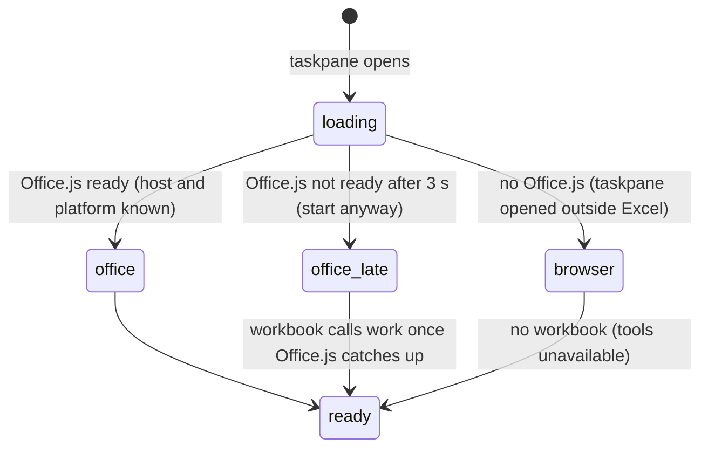

# Host differences

## Summary

Pi for Excel is one web page that runs inside three different hosts: Excel desktop on macOS, where the taskpane is a WKWebView (Safari's engine); Excel desktop on Windows, where it is a WebView2 (Edge's engine); and Excel on the web, where it is an iframe inside the user's browser tab. The same code runs everywhere, and Pi almost never asks which host it is on. The differences the user meets come from the host instead: which Office.js features Excel provides, which browser features the webview allows (native dialogs, clipboard, downloads, popups, requests to `localhost`), which keys reach the taskpane before Excel or the browser takes them, how the workbook's location is reported, and whether Excel reports unsaved changes. This document lists those differences. macOS desktop is the reference host: it is the one the release checklist requires, Windows needs one pass, and Excel on the web is an optional sanity pass (`docs/release-smoke-test-checklist.md`). Installing the add-in on each host is covered by [docs/install.md](../../docs/install.md).

## The simple case

The user opens Pi in Excel on the web. The taskpane looks and behaves as it does on the desktop: tabs, the composer, the status bar, tool cards, Stop. A turn that reads and writes cells works the same way (confirmed in Excel on the web, where Office.js reports host "Excel", platform "OfficeOnline", and supports ExcelApi up to 1.20 but not 1.21).

The differences show at the edges. Double-clicking a tab to rename it does nothing, because the browser dialog Pi uses is disabled there; `/name` works. Ctrl/Cmd+W closes the browser tab running Excel rather than Pi's tab (confirmed). Reopening the taskpane in another workbook brings back the same tabs, because Excel on the web did not tell Pi where the workbook lives. And the automatic backups list is emptied each time the taskpane opens.

## The interaction, event by event

There is no interaction of its own; the host is fixed for the life of the taskpane. What matters is the moment the taskpane starts:

If Office.js is slow, Pi starts after 3 seconds anyway and keeps treating the host as Excel. If startup takes more than 60 seconds, the taskpane shows "Initialization failed: taskpane timeout". Outside Excel (the taskpane URL opened in a browser), Pi starts with no workbook; that mode is for development and UI testing.

## What differs, host by host

| Area | Excel desktop, macOS | Excel desktop, Windows | Excel on the web |
| --- | --- | --- | --- |
| Engine | WKWebView (Safari) | WebView2 (Edge) | The user's browser, in a cross-origin iframe |
| `window.prompt`, `alert`, `confirm` | `window.prompt` shows nothing and never returns, freezing the taskpane until it is reopened (confirmed in Excel for Mac; `alert` and `confirm` not tried) | Not confirmed | Replaced by Office.js with functions that throw "Function window.prompt is not supported." (and the same for `alert` and `confirm`). Confirmed in Excel on the web. |
| Network error text | "Load failed" | "Failed to fetch" | "Failed to fetch" (Chromium) |
| Plain `http://` requests to other machines | Blocked (mixed content); Excel for Mac also blocks `http://localhost` | Blocked to other machines | Blocked (mixed content) |
| Workbook identity | From the file path; updated after Save As | From the file path or URL | Not available for a workbook opened through an anonymous link (confirmed); signed-in not checked |
| Unsaved-changes signal (`isDirty`) | Reported | Reported | Always "saved", even immediately after a write (confirmed) |
| Add-in storage | The Office webview's data folder for this user | The WebView2 data folder | The browser profile |
| Opening Pi | **Open Pi** on the Home ribbon, or the Add-ins button | **Open Pi** on the Home ribbon | Home → `⋯` (More Options) → Open Pi; the uploaded add-in may disappear after some days |

### Office.js features

The manifest declares no minimum Office.js version and Pi does not check which API sets the host supports. A workbook tool that needs a feature the host lacks fails as a tool call, with Excel's error in its tool card, and the turn continues. Save detection reads `isDirty`; where that is unavailable, automatic backups are simply never cleared by a save.

### Native browser dialogs

Pi uses the browser's own prompt in two places: renaming a tab by double-click or "Rename tab…" (see [renaming a tab](../sessions/renaming-a-tab.md)), and installing a plugin from a URL ("Extension name:"). On Excel on the web the first does nothing and the second fails with "Install failed: Function window.prompt is not supported.". On Excel for Mac both freeze the taskpane with no visible prompt until it is closed and Pi is opened again (confirmed in Excel for Mac). Every other dialog in Pi is drawn inside the taskpane and works on every host.

### Keyboard

Excel and the browser see keys before the taskpane does, and keep some of them.

- **Tab switching.** Left and Right arrows switch tabs when focus is not in a text field (confirmed on the web). For hosts that swallow plain arrows, Pi also accepts Cmd+Shift+[ and Cmd+Shift+] (macOS) and Ctrl+PageUp and Ctrl+PageDown (Windows). On Excel on the web, these fallback chords are the browser's own tab-switching shortcuts: Ctrl+PageUp/PageDown switched browser tabs and never reached Pi (confirmed in Chrome on Linux).
- **Restore queued.** Some webviews turn Alt/Option+Up into PageUp; Pi accepts Alt/Option+PageUp for the same action.
- **Browser-reserved chords.** On Excel on the web, Ctrl/Cmd+T, Ctrl/Cmd+W and Ctrl/Cmd+Shift+T are browser shortcuts that pages normally never receive: they open a browser tab, close the browser tab running Excel (and with it the taskpane), and reopen a closed browser tab. Confirmed with real key input in Chrome on Linux; the one exception seen was Ctrl+Shift+T reaching Pi when Chrome had no closed browser tab to reopen. A browser tab reopened after Ctrl+W comes back with Excel but without the taskpane. Pi's "+" button, the tab's close button, `/reopen` and the undo toast are the reliable paths there. Ctrl/Cmd+O does reach Pi. See [keyboard shortcuts](../ui/keyboard-shortcuts.md#what-excel-on-the-web-does-with-the-keys).
- **Shift+Tab.** On Excel on the web, Office.js's own key handler in the taskpane frame moves focus on Tab and Shift+Tab even when Pi has cancelled the key, so Shift+Tab both changes the thinking level and moves focus backwards (confirmed). On desktop (read from code) it only changes the level.
- **F6 and Shift+F6** move focus between the grid and the taskpane in Excel desktop; that is Excel's behavior, listed on Pi's shortcuts page. On Excel on the web F6 moved focus out of the page to the browser, not to the grid (confirmed).
- **Labels.** The shortcuts page shows macOS symbols (⌘, ⌥, ⇧) when the computer is a Mac, including Excel on the web in a Mac browser, and Windows names otherwise.

See [keyboard shortcuts](../ui/keyboard-shortcuts.md) for the full list.

### Clipboard, downloads and popups

- **Clipboard.** Copy actions use the browser clipboard. On Excel on the web the taskpane frame does not have the clipboard-write permission (confirmed: `writeText` fails with "The Clipboard API has been blocked because of a permissions policy applied to the current document"). There `/copy` shows nothing at all (no toast, no error; confirmed), the proxy banner's "Copy command" selects the command text instead so the user can copy it by hand (confirmed), and a code block's "Copy" still says "Copied!" because its older fallback copy method reports success (confirmed; what reached the clipboard was not checked).
- **Downloads** (manual backups, `/export`, downloading from the Files workspace) first open the file in a new window, because WKWebView ignores the usual download link, and fall back to a download link when the window is blocked. What the user then sees (a new browser tab, a save dialog, or the file in the default browser) is decided by the host. On Excel for Mac nothing happens at all: no window, no save dialog, no file, with Excel in front or not, while the success toast still shows (confirmed in Excel for Mac for `/export download`, `/backup`, `/backup restore` and the Files preview's "Download" and "Open ↗").
- **OAuth popups.** Logging in with an account opens the provider's page in a new window, without a link back to Pi. The login is completed either by the local proxy catching the redirect or by the user pasting the final URL into Pi; see [welcome and login](../setup/welcome-and-login.md).

### The CORS proxy and local network access

The taskpane is an HTTPS page, so every host blocks it from calling plain `http://` addresses on other machines, and some providers block requests from any web page (CORS). The [CORS proxy](../setup/the-proxy.md) on `https://localhost:3003` solves both, and is needed on every host for ChatGPT, Anthropic account logins and Google Code Assist. On Excel on the web, the taskpane is served from a public address and calls `localhost`; Chrome's Local Network Access rules can block or ask permission for that (the orb's test browser disables those checks, so this was not observed; see [Open questions](#open-questions-and-verification)). The same applies to MCP servers and local services on the user's network.

### Workbook identity and saving

Pi recognises a workbook by its location (see [workbook identity](persistence-and-restore.md#workbook-identity)) and detects saves by polling Excel's unsaved-changes flag every 4 seconds.

- **macOS desktop.** Office's own record of the document URL stays empty for a new workbook even after it is saved, until the file is closed and reopened, so Pi asks Excel for the current location each time. If Excel is stalled by a modal sheet, Pi waits up to 3 seconds and then uses the last location it saw, so the identity never flips back to "unsaved".
- **Windows desktop.** Same mechanism; not separately verified.
- **Desktop with AutoSave on** (files in OneDrive or SharePoint). Every AutoSave is a save, so Pi clears the workbook's automatic backups every few seconds while AutoSave is running. Read from code; see [backups and revert](../workbook/backups-and-revert.md).
- **Excel on the web.** For a workbook opened through an anonymous sharing link, Excel reported no location at all (confirmed), so every workbook behaves like a new, unsaved one: one shared tab layout, no workbook links, no workbook rules ("Can't identify this workbook right now — try saving the file first."), no manual backups, and automatic backups kept under a token stored in the file. Excel also reports the workbook as saved at all times (confirmed: `isDirty` stayed false for 10 seconds after a cell write). Pi therefore treats each opening of the taskpane as "already saved" and clears the workbook's backups, and backups are never cleared by a save after that.

## Modifiers

| Modifier | Set before | Changed while busy |
| --- | --- | --- |
| Model and provider | Providers that need the proxy need it on every host; on Excel on the web the proxy is also a local-network request. Error texts differ by engine. | Refused while busy, on every host. |
| Thinking level | No host difference. | No host difference. |
| Execution mode | No host difference. | No host difference. |
| Files in the workspace, or an overlay open | The Files workspace's private storage and folder access depend on the engine; downloads open differently per host. Overlays are drawn inside the taskpane and behave the same everywhere. | No host difference. |
| Tab state (new, restored, another tab busy) | On Excel on the web every workbook without an identity restores the same shared tab layout. | No host difference. |
| Host (desktop or web) | This document. | The host cannot change while the taskpane is open. |

## Cancel and interrupt

| Event | Before sent | While busy |
| --- | --- | --- |
| Stop (button or Escape) | Escape reaches the taskpane on every host when the taskpane has focus. | Same on every host. |
| The user sends something else | Enter, Shift+Enter and Alt/Option+Enter work on every host. | Same. |
| Tab switched, created, closed or reopened | On Excel on the web, Ctrl/Cmd+T, Ctrl/Cmd+W and Ctrl/Cmd+Shift+T act on the browser, not on Pi; double-click rename does nothing. | Ctrl/Cmd+W on the web closes Excel's browser tab, which ends the turn as if the taskpane went away. |
| An overlay or menu opens | Same everywhere; native prompts throw on the web. | Same. |
| Model or thinking level changes | No host difference. | No host difference. |
| The provider fails | The network error text differs by engine, which changes whether the CORS banner or "LLM error: …" is shown; see [provider errors and offline](provider-errors-and-offline.md). | Same. |
| The taskpane goes away | Closing the taskpane, the workbook window or Excel ends Pi on every host; on the web, so does closing or reloading the browser tab. | Same: completed messages are saved, the rest is lost. |
| The workbook changes underneath | On Excel on the web, co-authors can change the workbook during a turn; see [several taskpanes](several-taskpanes.md#excel-on-the-web-and-co-authoring). A save on the web is never detected. | Same. |
| Focus moves to the grid or another window | F6 moves focus between grid and taskpane on desktop. On the web, focus can also leave for other browser tabs. | The turn keeps running on every host. |
| The context window fills | No host difference. | No host difference. |

## Interactions with other systems

**Persistence.** Storage belongs to the host: the desktop webview's data folder or the browser profile. Desktop and web never share sessions, settings or logins, even on the same computer. See [persistence and restore](persistence-and-restore.md).

**Workbook changes and recovery.** Save detection and workbook identity differ by host as described above; on Excel on the web automatic backups do not survive reopening the taskpane.

**Other tabs and sessions.** On the web, two browser tabs on Excel share the same storage and behave like two taskpanes; see [several taskpanes](several-taskpanes.md).

**Execution mode and approvals.** No host difference. Approval dialogs are drawn inside the taskpane.

**Models and providers.** OAuth logins open a new window on every host; whether the redirect is caught automatically depends on the local proxy, not the host.

**Offline and provider errors.** The browser's network error text differs ("Load failed" in WKWebView, "Failed to fetch" elsewhere); both trigger the CORS banner.

**Notifications.** No host difference; Pi uses no system notifications.

**Settings and preferences.** No host difference, except that the proxy and local services are local-network requests on the web.

**Host differences.** This document.

**Language.** Pi's language is its own setting, not Excel's display language. Dark or light follows the Office theme where the host reports one; see [language and theme](../ui/language-and-theme.md).

**Accessibility and keyboard.** See [Keyboard](#keyboard).

## Edge cases

- Older webviews that cannot draw the product's modern colors (OKLCH) get a fallback palette in sRGB (`src/ui/theme/legacy-webview.css`). It exists mainly for WPS; current Excel hosts use the normal palette.
- The taskpane opened directly in a browser (not inside Excel) starts after 3 seconds without a workbook; workbook tools cannot run there.
- Excel on the web in a Mac browser shows macOS key symbols on the shortcuts page, because the label choice follows the computer, not the host.
- A custom gateway on `http://localhost` is allowed by Pi on every host, but macOS desktop blocks it; the gateway settings say so ("… Excel for Mac also blocks http://localhost."). Read from code and that hint; not tried.
- On Excel on the web, the uploaded add-in lives in the browser profile; a different browser or profile has neither the add-in nor any of Pi's data.

## Open questions and verification

- Confirmed in Excel on the web: platform "OfficeOnline"; ExcelApi 1.16, 1.19 and 1.20 supported; `window.prompt`, `window.alert` and `window.confirm` all replaced by functions that throw; no workbook URL from either `Office.context.document.url` or `getFilePropertiesAsync` (anonymous edit link); `isDirty` false before and after a cell write; clipboard-write not allowed by the frame's permissions policy; storage not persisted. Desktop macOS and Windows were not available for this pass.
- Backups on Excel on the web: because `isDirty` is always false, the save monitor's "first observation is already saved" rule (`src/workbook/save-boundary-monitor.ts:74-77`) clears a workbook's backups every time a taskpane opens on it. Confirmed: a backup Pi made for a one-cell write was removed from storage when a second taskpane on the workbook was reloaded, and backups from three earlier writes were gone after a language-change reload. In a workbook without an identity it may also clear the very first backup within 4 seconds (the document token only appears when that backup is taken); confirmed in Excel on the web with the document token removed: the first backup appeared in storage at 9.6 s after sending and was cleared at 12.6 s. With the token present the backup stayed for more than a minute. Looks like a bug.
- AutoSave on desktop clearing backups every few seconds is read from code, not observed.
- `/copy` on a host that refuses clipboard writes shows no toast at all, because the failure is not handled (`src/commands/builtins/clipboard.ts:43`). Confirmed in Excel on the web with real input: no toast, and an unhandled rejection "NotAllowedError: … The Clipboard API has been blocked because of a permissions policy…". Looks like a bug.
- Confirmed in Excel for Mac: `window.prompt` shows nothing and never returns, so tab renaming by dialog and install from URL freeze the taskpane. WebView2 (Windows) is not confirmed; if it fails too, tab renaming by double-click is dead on every host.
- Browser-reserved shortcuts on Excel on the web: Ctrl+T, Ctrl+W, Ctrl+Shift+T and Ctrl+PageUp/PageDown confirmed in Chrome on Linux with operating-system key events (`wtype`), which the browser sees before the page. Cmd chords on a Mac browser and Edge were not tried.
- Chrome Local Network Access and the hosted add-in: in an ordinary Chromium (not the orb's Excel Chrome, which disables the checks), the production page `https://pi-for-excel.vercel.app/src/taskpane.html` could not reach the running proxy at `https://localhost:3003` ("Failed to fetch"), showed the proxy banner, and showed no permission prompt. Seen outside Excel; the probable cause is Local Network Access blocking, not confirmed. If so, users of the hosted add-in in current Chrome or Edge cannot use the proxy at all without a site permission.
- Whether workbooks opened signed in to OneDrive or SharePoint on Excel on the web report a URL, and so get an identity, has not been checked.
- Whether all desktop taskpanes share one storage area, and whether Excel on the web partitions storage by the Office site that frames it, are assumptions.

Verified against pi-for-excel commit `ec453df`.
