# Provider errors and offline

## Summary

Every model response is a request from the taskpane to the tab's [provider](../glossary.md#models-and-providers), and that request can fail: there is no credential, the credential is wrong or expired, the provider is rate-limiting or down, the network is gone, the browser blocks the request (CORS), the conversation no longer fits the model, or the answer is cut off. This document lists each failure and what the user sees. In almost every case the outcome is the same shape: the turn ends as [failed](../glossary.md#endings), everything up to the failure stays in the transcript, the model response that failed is marked "Error:" with the provider's reason, and, if the failing tab is the active tab when the turn ends, the [error banner](../glossary.md#the-taskpane) above the transcript explains it. Pi never retries a failed request by itself, with one exception: a context overflow is compacted and retried once. There is no Retry button; the user sends again. Provider failures can happen in any tab, at any model response of a turn, with any provider, on every host.

## The simple case

The user's laptop loses Wi-Fi. They type "Summarize Sheet1" and press Enter. The message joins the transcript, the working indicator starts, and a moment later it stops: Pi's model response appears empty with "Error:" and the reason under it, and the error banner shows the reason too. Which reason depends on the provider: for most API-key providers it reads "LLM error: Connection error."; for providers whose requests Pi sends directly, it is the CORS banner described below.

The user's message is kept and saved. Once the network is back, the user types "try again" (or the same request) and sends; the turn starts normally and the banner disappears as soon as the new message joins the transcript.

## The interaction, event by event

```mermaid
stateDiagram-v2
    [*] --> requesting : model request starts (credential read)
    requesting --> connect_dialog : no credential (turn waits)
    connect_dialog --> requesting : provider connected (banner cleared)
    connect_dialog --> failed : dialog dismissed ("API key required for {provider}.")
    requesting --> streaming : provider accepts
    requesting --> failed : 401/403/429/5xx, network, CORS, proxy (no retry)
    streaming --> failed : connection drops (partial text kept)
    streaming --> overflow : context window exceeded
    overflow --> requesting : compacted once, retried
    overflow --> failed : compaction freed nothing, or second overflow
    streaming --> done : answer complete
    failed --> [*] : banner if active tab; message saved
    done --> [*]
```

### Before the request

Before every model response, not only the first one in a turn, Pi reads the tab's credential for its provider from storage.

- **No credential.** Pi opens the connection dialog, "Connect {label}", with the subtitle "This model needs a login or API key to continue." and the provider's login row already expanded. The turn waits while it is open. If the user connects (API key or OAuth), the banner is cleared and the request goes out. If the user closes the dialog, the banner shows "API key required for {provider}." and the request fails; read from code, the banner is then replaced when the turn ends by "LLM error: …" with the runtime's own message (see [Open questions](#open-questions-and-verification)).
- **Pi's own checks.** Some requests fail before anything is sent, with a reason written by Pi, shown as "LLM error: {reason}": a custom gateway on a plain `http://` address on another machine ("… Excel blocks http:// requests from the add-in to other machines, so Pi cannot reach it directly. …"), an OpenRouter Anthropic model without the proxy, a ChatGPT model that needs the newer proxy ("GPT-5.6 Luna currently requires the latest Pi for Excel proxy for ChatGPT WebSocket transport. Enable Proxy in Settings and run: npx -y pi-for-excel-proxy@latest"), or a proxy URL that is not `https://`.

### The request fails

Pi sets no retries for any provider, so the first failure ends the turn. The provider's own retry delay cap (`maxRetryDelayMs`, 60 seconds by default) only applies to retries and therefore never comes into play.

| Failure | Banner | Notes |
| --- | --- | --- |
| Wrong or revoked API key (401), no access to the model (403), unknown model (404), bad request (400) | "LLM error: {reason}", where the reason is the provider's message, usually starting with the status code | No dialog opens: the credential exists, it is just rejected. Fix it in `/login` or `/settings`. |
| OAuth access token expired while the taskpane was open | "LLM error: {reason}" (a 401) | Pi refreshes OAuth tokens only when the taskpane opens. Reloading the taskpane refreshes it; if that refresh fails, the provider is treated as not connected and the next send opens the connection dialog. A ChatGPT login whose grant can no longer be refreshed is deleted at startup. |
| Rate limit or quota (429) | "LLM error: {reason}" | Not retried, whatever delay the provider asks for. |
| Provider error or overload (5xx, 408, 409) | "LLM error: {reason}" | Not retried. |
| Network unavailable, for providers reached through the provider SDKs (Anthropic, OpenAI, OpenAI-compatible gateways) | "LLM error: Connection error." | |
| Network unavailable or request blocked by CORS, where the browser's own message reaches Pi ("Failed to fetch", "Load failed", "NetworkError", or any mention of CORS) | "Network error (likely CORS). If you're using OAuth, enable /settings → Proxy with https://localhost:3003 and retry. Guide: https://github.com/tmustier/pi-for-excel/blob/main/docs/install.md#oauth-logins-and-cors-proxy" | The same banner for a dropped connection, a real CORS block, and a proxy that is enabled but not running. The URL is the build's default proxy URL. |
| Proxy enabled but not running | Usually the CORS banner above | The [proxy banner](../setup/the-proxy.md), "Proxy not running · Some features won't work.", appears within 30 seconds of the proxy becoming unreachable. |
| An error whose text contains "abort" or "cancel" (for example a timeout reported as "The operation was aborted") | None | Treated as if the user had pressed Stop. The transcript still shows "Error:" with the reason. |

### The connection drops while streaming

The model response that was streaming stops where it was. Its text so far stays in the transcript, followed by "Error:" and the reason; a tool card whose call was still being written stays without a result. The banner follows the table above. Tools that had already run keep their effects in the workbook.

While a request hangs without failing (a half-open connection), Pi shows the working indicator indefinitely; Pi sets no timeout of its own. Stop ends it.

### The context window overflows

If the provider rejects the request because the conversation is too long for the model, the banner reads "Context window exceeded — Pi will try compacting older history and retrying once. If this error persists, run /compact, scope your request to a smaller range, or use a larger-context model." Pi then removes the failed response, compacts the conversation once (the working indicator shows "Compacting context…"), and continues the turn. If the retry succeeds the banner is cleared. If compaction frees nothing, or the retry overflows again, the failure stays in the transcript and the banner keeps the same text, although no further retry will happen. With auto-compaction turned off the banner reads "Context window exceeded. Run /compact to free up context, scope your request to a smaller range, or use a larger-context model." and nothing is retried. Only a failure from the tab's current model counts as an overflow. See [context and compaction](../turn/context-and-compaction.md).

### The answer is cut off

When a model response reaches the model's output limit:

- **If it was calling tools,** none of those tools run. Each tool card fails with "Tool call "{name}" was not executed: the response hit the output token limit, so its arguments may be truncated. Re-issue the tool call with complete arguments." The turn continues and the model usually tries again.
- **If it was only text,** the text simply ends. There is no banner and no marker that it was cut off.

### What is kept

The user's message, every completed model response and tool result, and the failed model response with its "Error:" line stay in the transcript and are saved (a failed response counts as Pi's first answer in a new session; see [persistence and restore](persistence-and-restore.md#when-a-session-is-saved)). Workbook changes made before the failure stay made, each with its [automatic backup](../workbook/backups-and-revert.md). Anything queued in the tab's action queue runs next, and may fail the same way.

### The error banner

- There is one error banner for the whole taskpane.
- It is set when a turn ends with an error, **only if the failing tab is the active tab at that moment**. A turn that fails in a background tab never shows a banner, not when it fails and not when the user switches to that tab.
- It is cleared when a user message joins the active tab's transcript (sending, or a steer or follow-up being delivered), when the active tab's turn ends without error, when the user sends from the composer (even if the prompt is only queued), and when the connection dialog succeeds.
- It is **not** cleared on tab switch: a banner from one tab stays over another tab's transcript.
- Failures of `/compact` are toasts, not banners: "Compact failed: {msg}", or "No API key available for {provider}. Use /login or /settings."

## Modifiers

| Modifier | Set before | Changed while busy |
| --- | --- | --- |
| Model and provider | Decides which failures are possible: OAuth providers expire, ChatGPT and Anthropic OAuth logins and Google Code Assist need the [CORS proxy](../setup/the-proxy.md), SDK-based providers report network loss as "Connection error.". | Changing the model is refused while busy. After a failure the tab is idle, so switching to another provider's model is the usual recovery from an outage. |
| Thinking level | No effect on failures, except that higher levels use more of the output limit. | Applies from the next model request. |
| Execution mode | No effect. In Confirm, a failure can come after some approved mutations already ran. | No effect. |
| Files in the workspace, or an overlay open | No effect on the request. The connection dialog is itself an overlay; another overlay open at that moment is closed only if it is a previous connection dialog. | No effect. |
| Tab state (new, restored, another tab busy) | A failure in a new tab still saves the session. A restored tab's long history is the usual cause of overflow. | A failure in a background tab shows no banner. |
| Host (desktop or web) | Browser network messages differ: "Load failed" in WKWebView (macOS), "Failed to fetch" in WebView2 and browsers. See [host differences](host-differences.md). | No effect. |

## Cancel and interrupt

| Event | Before sent | While busy |
| --- | --- | --- |
| Stop (button or Escape) | Not applicable. | Ends a hanging or streaming request; the turn ends as aborted, not failed, and no banner is shown. The Stop button while the connection dialog is open stops the turn but leaves the dialog open (Escape closes the dialog instead, because the dialog claims it); read from code, connecting afterwards saves the credential but does not resume the stopped turn. |
| The user sends something else | Sending clears the banner. | A steer or follow-up sent before the failure is not delivered by the failed turn; see [steering and the queue](../turn/steering-and-the-queue.md). Queued prompts run after the failure. |
| Tab switched, created, closed or reopened | The banner stays. | Switching away before the failure means no banner for it. |
| An overlay or menu opens | No effect. | The failure happens behind the overlay; the banner is visible once it closes. |
| Model or thinking level changes | Choosing another provider's model is the usual recovery from a provider outage. | Refused while busy. |
| The provider fails | Not applicable. | This document. |
| The taskpane goes away | Not applicable. | A failure that had not been reported yet is lost with the streaming response. Reloading is also how an expired OAuth token gets refreshed. |
| The workbook changes underneath | No effect. | No effect on the failure. |
| Focus moves to the grid or another window | No effect. | No effect; the banner is there on return. |
| The context window fills | Auto-compaction before sending reduces the chance of an overflow. | See [The context window overflows](#the-context-window-overflows). |

After a failure the user stays in the same tab with an empty composer and can send again at once.

## Interactions with other systems

**Persistence.** Failed responses are saved with their error text and restored after a reload, without the banner. Storage is local, so a reload while offline restores everything. See [persistence and restore](persistence-and-restore.md).

**Workbook changes and recovery.** A failure never undoes a change Pi already made. Revert from [the Backups dialog](../workbook/backups-and-revert.md) if needed.

**Other tabs and sessions.** Failures are per tab; the banner is per taskpane. Two tabs or taskpanes on one account share its rate limits.

**Execution mode and approvals.** No interaction.

**Models and providers.** Credentials are read before every model request, so a login completed in Settings, or in another taskpane, fixes the next request without a reload. See [models and providers](../foundations/models-and-providers.md) and [welcome and login](../setup/welcome-and-login.md) for login failures.

**Offline and provider errors.** This document.

**Notifications.** The banner and the "Error:" line in the transcript. No toast, no sound, nothing for background tabs.

**Settings and preferences.** The proxy setting decides how ChatGPT and OAuth logins are routed. Auto-compaction, on by default with no control in Settings, decides whether an overflow is retried.

**Host differences.** Which network message reaches Pi, and whether a CORS block happens at all, depends on the webview; see [host differences](host-differences.md).

**Language.** "LLM error: {error}" and the connection dialog are translated. "API key required for {provider}.", both overflow banners and the CORS banner are hard-coded in English. The provider's reason is shown as the provider wrote it.

**Accessibility and keyboard.** The banner is not announced to screen readers and takes no focus.

## Web tools and connections

Failures of web search, fetch page and MCP servers are tool-call failures, not turn failures: the tool card shows "Error: …" and Pi continues the turn with that result. A web search provider that rejects its key or is rate-limited falls back to Jina search and says so in the result. See [web search and MCP](../extensions/web-search-and-mcp.md).

## Edge cases

- A turn that fails in its first model response in a new tab still saves the session, so the failed exchange appears in the resume picker.
- The CORS banner tells the user to enable the proxy even when the proxy is already enabled and the real problem is that it stopped, or that the network is down.
- An overflow on the retry shows the same "will try compacting … and retrying once" banner as the first overflow, though nothing more will be tried.
- An error from a background tab can leave no trace except the "Error:" line, and the banner from the last failure in the active tab can still be showing over a different tab.
- GitHub Copilot's own token exchange retries a rate limit up to twice within 5 seconds before failing; that is the only retry in the request path (read from pi-ai's `github-copilot.js`).
- A provider message that happens to contain "cancel" is shown in the transcript but not in the banner.

## Open questions and verification

- No failure was triggered by hand: model turns were out of scope for this pass. Everything above is read from code and `tests/overflow-recovery.test.ts`, `tests/agent-overflow-recovery.test.ts`, `tests/agent-overflow-leftovers.test.ts` and `tests/error-path-matrix.test.ts` (which covers web tools, not model requests).
- No retries: Pi passes no `maxRetries` to the provider runtime (`src/taskpane/init.ts:904-922`), and pi-ai's retry helper defaults to none (`node_modules/@earendil-works/pi-ai/dist/utils/provider-retry.js:77`). A momentary 429 or 503 therefore fails the turn. This contradicts [turns](../foundations/turns.md#interactions-with-other-systems), which says rate-limit retries happen inside the model request. Probably worth a product decision; the infrastructure for bounded retries exists.
- The banner after dismissing the connection dialog: `src/taskpane/init.ts:986` shows "API key required for {provider}.", but the failed request then ends the turn with an error, and the turn-end handler (`src/taskpane/init.ts:1043-1060`) replaces it with "LLM error: …" (likely "Provider is not configured: {provider}"). Not confirmed by hand.
- Network loss shows the CORS banner whenever the browser's message reaches Pi (`src/taskpane/runtime-utils.ts:107-109` treats "failed to fetch" and "load failed" as CORS). Misleading when the proxy is enabled or the network is simply down. Looks like a bug.
- Errors mentioning "abort" or "cancel" are treated as user aborts (`src/taskpane/init.ts:1043`), hiding real timeouts and provider errors from the banner. Looks like a bug.
- The second-overflow banner repeats the "retrying once" text (`src/taskpane/init.ts:1050`). Minor bug.
- OAuth tokens are refreshed only at taskpane startup (`src/auth/restore.ts`); nothing refreshes them during a long session. Read from code.
- The proxy banner depends only on whether the proxy URL answers (`src/taskpane/proxy-status.ts`, `src/ui/proxy-banner.ts:142-148`), not on whether the selected provider needs it or the proxy is enabled. The [glossary](../glossary.md#the-taskpane) says it is shown only when the selected provider needs the proxy. Read from code; one of the two should change.
- What a mid-stream connection drop reports as its reason in each webview was not tested.

Verified against pi-for-excel commit `ec453df`.
