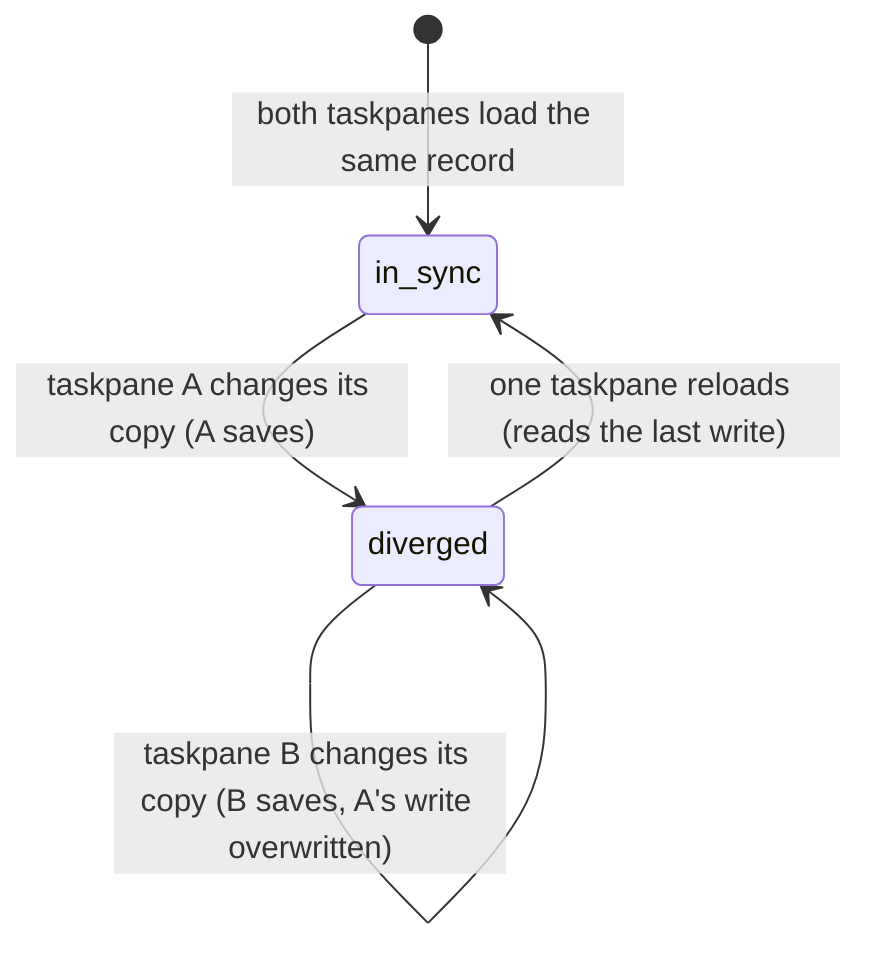

# Several taskpanes

## Summary

Each Pi taskpane is a separate copy of Pi. When the user has two workbooks open, each workbook window has its own taskpane, with its own tabs, its own turns, its own [workbook lock](../glossary.md#the-workbook), its own error banner, its own recently closed list and its own copy of most settings. What the taskpanes share is the add-in's storage on this computer: saved sessions, tab layouts, settings, logins, automatic backups and the Files workspace (see [persistence and restore](persistence-and-restore.md)). They do not talk to each other. Nothing locks a session, a tab layout or a workbook across taskpanes, nothing tells one taskpane that another changed something, and when two taskpanes write the same record, the later write wins whole. This document describes what the user sees in each arrangement: two workbooks at once, two taskpanes on the same workbook, the same session open twice, and co-authoring on Excel on the web. There is no control for any of it; it is how the product behaves whenever more than one taskpane is open.

## The simple case

The user has `Budget.xlsx` and `Forecast.xlsx` open in Excel desktop and opens Pi in both. Each taskpane restores the tabs last open in its own workbook. The user asks Pi to fill a column in Budget and, at the same time, to build a chart in Forecast. Both turns run at full speed: each taskpane has its own workbook lock, and they are changing different workbooks.

Each conversation is saved to the shared storage as its messages complete. When the user later opens the resume picker in Forecast, the Budget conversation is not in the default list; it appears under "Show sessions from all workbooks".

A setting changed in one taskpane, for example switching the execution mode to Confirm, is saved for both, but the other taskpane keeps showing and using its old value until it is reopened.

## The interaction, event by event

There is no interaction of its own. The states below are what a shared record (a session or a tab layout) goes through when two taskpanes hold copies of it.

### Opening a second taskpane

When a taskpane opens it reads, once, the tab layout for its workbook, the execution mode, the language, the automatic backups and the Files workspace tags into memory, and restores its tabs (see [restoring when the taskpane opens](persistence-and-restore.md#restoring-when-the-taskpane-opens)). From then on it works from that copy. What another taskpane writes later is not picked up, with these exceptions:

- **Logins.** The credential for a provider is read from storage before every model request, so a provider logged in or out in one taskpane takes effect at the other's next request.
- **Rules and conventions.** They are re-read whenever the taskpane regains focus.
- **Proxy URL.** The proxy check, every 30 seconds, reads the stored URL each time.
- **Saved sessions.** The resume picker lists what is in storage when it opens.

### Two workbooks open at once

Two workbooks with different [workbook identities](persistence-and-restore.md#workbook-identity) use different tab-layout records, so each taskpane restores and saves its own tabs. Their turns, queues and Stop are independent. Their workbook locks are independent, which is correct because each lock protects a different workbook.

One record still collides: all workbooks' automatic backups are stored as a single list, and each taskpane writes back the list it loaded when it opened plus its own new backups. Backups Pi takes in Budget can therefore erase the backups taken in Forecast since Budget's taskpane opened, and the other way round (see [Concurrent saves](#concurrent-saves)). Each taskpane's Backups dialog keeps listing what that taskpane holds in memory, so the loss shows only after the taskpane is reloaded.

Two workbooks *without* an identity (two new, unsaved workbooks, or any two workbooks on Excel on the web where no identity is available) share one tab-layout record. Each taskpane rewrites it whenever its own tabs change, so the next unsaved workbook to open Pi restores whichever taskpane changed its tabs last.

### Two taskpanes on the same workbook

This happens when one workbook is shown in two taskpanes at once, for example in two windows of the same workbook, if Excel lets each window open Pi (not verified; see [Open questions](#open-questions-and-verification)), or the same workbook open in two browser tabs on Excel on the web.

- **Tabs.** Both taskpanes read the same tab layout and restore the same sessions, so each conversation is open twice. After that, each taskpane rewrites the shared layout whenever its own tabs change: the last change wins, and reopening the workbook restores that taskpane's tabs.
- **The workbook lock does not cross taskpanes.** Each taskpane serializes its own mutations, but a mutation from one taskpane can run in the middle of a turn in the other, including on the same cells. Neither shows "Locking…" because of the other.
- **Auto-context.** Each Pi is told about the other Pi's writes as "user changes" before its next request, because Excel reports them the same way as the user's edits.
- **Backups.** Each taskpane keeps its own in-memory list of automatic backups, loaded when it opened, and writes that whole list back after every new backup. The other taskpane's newer backups are overwritten and disappear from storage; each taskpane's Backups dialog shows only what it loaded plus its own. Reverting a backup restores its cells as they were, overwriting anything the other Pi wrote there since.

### The same session open in two taskpanes

A session can be open in two taskpanes: on the same workbook as above, or because the user resumed in one workbook a session that is open in another (the resume picker asks "Resume session from another workbook?"). Nothing prevents it and nothing marks it.

Each taskpane holds the whole conversation in memory and rewrites the whole saved session every time one of its own messages completes. The two copies never merge:

- Each taskpane shows only its own turns. A message sent in one does not appear in the other.
- In storage, the session is whatever the last taskpane to complete a message wrote. Turns that existed only in the other taskpane's copy are gone from storage, and from both taskpanes after a reload. The saved title, model and thinking level follow the same rule.
- Closing the tab in either taskpane force-saves that taskpane's copy, which also overwrites the other's.

### Concurrent saves

Each save is a single storage transaction that writes the session together with its summary, so two taskpanes saving at the same moment cannot corrupt a session or leave half of one; one write simply lands after the other. The same holds for every settings record: tab layouts, the backups list, the change audit log and the Files workspace tags are each one record, rewritten whole, and the later write wins. Sessions and tab layouts are written from the taskpane's own current state, so a write replaces the other taskpane's version of that session or layout entirely. The backups list, the audit log and the Files tags are lists loaded once when the taskpane opened, so a write also drops every entry the other taskpane added since then, including entries for other workbooks.

## Modifiers

| Modifier | Set before | Changed while busy |
| --- | --- | --- |
| Model and provider | Each tab's model is its own. Logging in or out of a provider in one taskpane applies to the other's next request; the other's model picker and status bar may not reflect it until it reloads. | No cross-taskpane effect on a running turn until its next model request reads the credential. |
| Thinking level | Per tab; no cross-taskpane effect. | No cross-taskpane effect. |
| Execution mode | Saved for all taskpanes, but each taskpane reads it once at startup and keeps its own value. One taskpane can be in Auto while another is in Confirm. | A change in one taskpane does not affect a turn in another. |
| Files in the workspace, or an overlay open | The Files workspace is shared: a file imported in one taskpane is on disk for the other, but the other's file list and workbook tags are from when it last loaded them. Overlays are per taskpane. | Same. |
| Tab state (new, restored, another tab busy) | A tab busy in one taskpane has no effect on another taskpane: no busy dot, no "Locking…", no refusal. | Same. |
| Host (desktop or web) | Desktop taskpanes on one computer share storage. Excel on the web shares storage between browser tabs of the same profile, never with desktop. | No effect. |

What one taskpane changes mid-turn reaches another taskpane only through storage, and only where that taskpane reads storage again.

## Cancel and interrupt

| Event | Before sent | While busy |
| --- | --- | --- |
| Stop (button or Escape) | Acts only on the taskpane that has focus. | Stops only that taskpane's active tab. A turn in another taskpane keeps running. |
| The user sends something else | Per taskpane. | Per taskpane. |
| Tab switched, created, closed or reopened | Rewrites this taskpane's tab layout, overwriting another taskpane's if both show the same workbook or both lack an identity. Recently closed is per taskpane: a tab closed in one cannot be reopened with Ctrl/Cmd+Shift+T in another. | Same. |
| An overlay or menu opens | Per taskpane. | Per taskpane. |
| Model or thinking level changes | Per tab. | Per tab. |
| The provider fails | Each taskpane shows its own error banner, and only for its own active tab. A rate limit hit by one taskpane can make the other's next request fail too, since both use the same account. | Same. |
| The taskpane goes away | The other taskpane is unaffected. Its own saves continue and may overwrite what the closed taskpane saved last. | Same. |
| The workbook changes underneath | In two taskpanes on the same workbook, the other Pi's writes are the workbook changing underneath. | The other Pi's mutation can land between this turn's tool calls, or on the same cells; nothing serializes them. |
| Focus moves to the grid or another window | Moving focus to the other taskpane is moving to another window. Returning re-reads the workbook identity and rules. | Turns in both keep running. |
| The context window fills | Per tab. | Per tab. |

After any of these, each taskpane carries on from its own memory; nothing is reconciled until a taskpane is reloaded.

## Interactions with other systems

**Persistence.** Shared storage, no coordination, last write wins; see [persistence and restore](persistence-and-restore.md).

**Workbook changes and recovery.** The workbook lock is per taskpane. Automatic backups written by two taskpanes overwrite each other's list; see [Two taskpanes on the same workbook](#two-taskpanes-on-the-same-workbook). Each taskpane checks every 4 seconds whether its workbook was saved and clears that workbook's backups when it was; a taskpane on another workbook clears only its own.

**Other tabs and sessions.** Tabs in different taskpanes are unrelated, even when they show the same session.

**Execution mode and approvals.** Each taskpane has its own execution mode in memory and its own approval dialogs.

**Models and providers.** Logins are shared. An OAuth login whose access token has expired is refreshed when a taskpane opens; two taskpanes opening at the same moment both try to refresh it (see [Open questions](#open-questions-and-verification)).

**Offline and provider errors.** Per taskpane. Two taskpanes on the same subscription share its rate limits.

**Notifications.** Toasts, banners and the working indicator appear only in the taskpane they belong to. A turn finishing in another taskpane gives no sign here.

**Settings and preferences.** Saved for all taskpanes, read by each when it opens; see [Opening a second taskpane](#opening-a-second-taskpane) for the exceptions.

**Host differences.** On Excel on the web, storage belongs to the browser profile, so two browser tabs of Excel share it, while desktop Excel and Excel on the web never do.

**Language.** Read once per taskpane; two taskpanes can show different languages until reopened.

**Accessibility and keyboard.** Keyboard shortcuts act on the taskpane with focus only.

## Excel on the web and co-authoring

When two people edit the same workbook on Excel on the web, each has their own Pi in their own browser, with their own storage. Nothing is shared between them: not sessions, not tabs, not backups. Pi's workbook lock does not know about the other person or their Pi. A co-author's edits, and their Pi's edits, reach Pi as user changes in [auto-context](../turn/auto-context.md), and can land in the middle of a turn. Reverting one of Pi's backups writes the saved cells back regardless of what the co-author has written there since.

The document token Pi writes into a workbook without an identity is stored in the file, so co-authors' taskpanes see the same token; since each keeps its backups in its own browser, this has no visible effect.

## Edge cases

- The same session open in two taskpanes and closed in both ends up saved as whichever was closed last.
- A tab closed in one taskpane is still open in another taskpane on the same workbook; reopening the workbook restores whichever taskpane changed its tabs last.
- Duplicating or forking a tab creates a new session, so it is only in the taskpane that made it.
- Two taskpanes can each show "Chat 1" for different sessions, or for the same session: default titles are numbered per taskpane.
- The resume picker in one taskpane lists sessions the other taskpane saved, including ones it is still working on, as of their last completed message.
- Disabling the proxy in one taskpane stops the other from using it at its next request, but the other's proxy banner reflects only reachability, not the setting.

## Open questions and verification

- Whether Excel desktop (macOS or Windows) lets two windows of the same workbook each open their own Pi taskpane has not been checked. Everything under "Two taskpanes on the same workbook" is read from code and applies to any arrangement that puts two taskpanes on one workbook identity, including two browser tabs on Excel on the web.
- Whether all Excel desktop taskpanes on one computer share one storage area was assumed from the single cache location in the repo's AGENTS.md; not tested.
- Lost backups across taskpanes: `WorkbookRecoveryLog` loads the stored list once (`src/workbook/recovery-log.ts:375`) and writes its whole in-memory list on every new backup (`src/workbook/recovery-log.ts:420`), so two taskpanes erase each other's backups, even for different workbooks. The change audit log (`src/audit/workbook-change-audit.ts`) and the Files workspace tags (`src/files/workspace.ts:615-655`) follow the same pattern. Read from code. Looks like a bug.
- Same session in two taskpanes: whole-record overwrite (`src/storage/local/sessions-store.ts:36`) loses the other taskpane's turns from storage. Read from code; no lock or warning exists. May be worth treating as a bug.
- OAuth refresh race: two taskpanes opening with an expired ChatGPT login both refresh it at startup (`src/auth/restore.ts:146-170`). Refreshing rotates the refresh token (see `docs/orb-excel-web.md`), so the second refresh fails, and that failure deletes the stored login (`src/auth/restore.ts:167`), logging out both taskpanes. Read from code; not reproduced. Looks like a bug.
- Execution mode is read once per taskpane (`src/execution/controller.ts:28`), so two taskpanes can run in different modes. Read from code.
- The storage connection has no handler for a newer version of the add-in upgrading the database while an older taskpane is open (`src/storage/local/indexeddb-storage-backend.ts:36-58`). If a future release bumps the database version, a new taskpane could wait on the old one until "Initialization failed: taskpane timeout". Latent; read from code.
- Co-authoring was not tried; the description is read from code (`src/context/change-tracker.ts` does not distinguish who made a change).

Verified against pi-for-excel commit `ec453df`.
