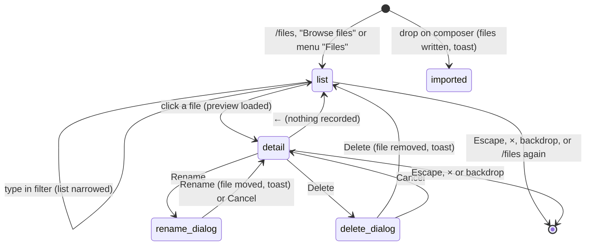

# The Files workspace

## Summary

The Files workspace is a small file store that belongs to Pi rather than to the workbook: documents, data and reference material the user gives Pi, notes and artifacts Pi writes for itself, external [skills](../guidance/skills.md), and Pi's own built-in documentation. Files in it are available to Pi in every session and every workbook on this computer, but they are never attached to a message: Pi reads them with its `files` tool when it decides to. The user sees it in the Files overlay, titled "Files" ("Documents available to Pi"), opened with `/files`, the "Browse files" button at the left of the [composer](../turn/the-composer.md), or "Files" in the [utilities menu](../ui/the-utilities-menu.md). Files get in by dropping them on the composer, with "Upload" in the overlay, by connecting a local folder, or by Pi writing them. The overlay opens while a tab is [busy](../glossary.md#the-turn) (`/files` is busy-allowed), with no provider connected, and on Excel on the web. Running `/files` while the overlay is open closes it.

## The simple case

The user drags `budget.csv` from their desktop onto the composer. While it hovers, the composer shows "Drop files to import to file workspace". On drop, a toast says "Imported 1 file into Files." Nothing is sent and the composer text is untouched.

The user then types "compare budget.csv with Sheet1" and sends. Pi calls its `files` tool; a [tool card](../turn/tool-calls.md) "Read file budget.csv" appears, and Pi answers using the file.

Clicking "Browse files" opens the overlay. Under "YOUR FILES" is `budget.csv` with "3.20 KB · Uploaded · just now" and, when Pi can identify the workbook, a "Workbook" badge; below it, "BUILT-IN DOCS" lists Pi's documentation, each marked "Read only". Clicking the file opens its preview with "Open ↗", "Download", "Rename" and "Delete". Escape closes the overlay and returns focus to the composer. The overlay does not take focus: if focus is still in the composer, the first Escape only moves it out of the composer (to the tab strip) and the second closes the overlay.

## The interaction, event by event

### Opening the list

The overlay reads the file list and the storage status once on opening and then follows changes live: a file Pi writes, or a drop on the composer behind it, appears without reopening. At the top are "Upload" and, where the browser supports it, "Connect folder". Below:

- **Empty state.** When there are no files other than built-in docs, the list starts with "Give Pi more context", "Upload documents, data, or reference material to help Pi give better answers.", an "Upload files" button and "Files are stored locally in your browser." The built-in docs are listed under it, so the overlay is never fully empty.
- **Filter.** With five or more files (built-in docs count) a "Filter files…" box appears. It matches any part of the path, ignoring case; nothing matching shows "No matching files" / "Try a different filter term."
- **Sections**, each with a count and collapsible: "YOUR FILES" (uploads and anything else), "PI'S NOTES" (`notes/`), "SKILLS" (`skills/`), "FROM {FOLDER NAME}" for a connected folder, and "BUILT-IN DOCS". Files in sub-folders are grouped under collapsible folder rows. Newest first, except built-in docs, which are alphabetical by path.
- **Rows** show the name (full path on hover), a line such as "3.20 KB · Uploaded · 2h ago", and a badge: "Read only" (built-in docs), "Workbook" (tagged to a workbook; hover shows "Tagged to {workbook}"), "Agent" (Pi's notes) or "Folder" (connected folder). The source word is "Uploaded", "Written by agent", "Local file" or "Pi documentation".
- **Footer**: "{count} files · {total size} · {storage}", where storage is "Sandboxed workspace" (the normal case), "Local folder: {name}" once a folder is connected, "Session memory" if browser storage is unavailable, or "Storage unavailable". The count includes the built-in docs.

### Ends at once

Opening and browsing records nothing (reads are logged in an internal audit list the user never sees). Closing from the list or the preview, clicking ←, cancelling the file picker, cancelling a rename or delete, and a drop that carries no files all leave the workspace as it was. A drop that yields nothing says "No files were imported."

### Importing

A drop on the composer or files chosen with "Upload" / "Upload files" are written one by one, by file name, into the top of the workspace, and each is tagged to the current workbook if Pi can identify it. When it cannot (a never-saved workbook, or a workbook opened signed out through a link on Excel on the web), files are imported untagged and show no badge (confirmed). A file with the same name as an existing one replaces it without asking. When all are written the toast says "Imported {N} file(s) into Files." (drop) or "Imported {N} file(s)." (Upload). A failure stops at that file, keeps the files already written, and shows "Import failed: {error}" or "Upload failed: {error}". There is no size limit other than the browser's storage quota. Dropping on any part of the taskpane other than the composer card does nothing (confirmed in Excel on the web for a drop on the transcript).

"Connect folder" opens the operating system's folder picker and asks for read and write permission. On Excel on the web the button is shown but always fails, because the taskpane is a cross-origin frame: "Connect folder failed: Failed to execute 'showDirectoryPicker' on 'Window': Cross origin sub frames aren't allowed to show a file picker." (confirmed). Once granted, the button becomes "Connected ✓" (disabled) and the folder's files appear under "FROM {FOLDER NAME}". The link is remembered across reloads while the browser keeps the permission. A refusal shows "Connect folder failed: {error}". There is no way to disconnect from the overlay.

### The preview

Clicking a row replaces the list with the file: the name as title, a line such as "CSV · 3.20 KB · Uploaded · 2h ago" or "Text · 7.00 KB · Pi documentation" (built-in docs have no date; "(preview truncated)" is added only when the file was too large to read in full, not when it merely has more than 50 lines), then:

- a callout "Tagged to {workbook} — included when that workbook is open." for workbook-tagged files, or "Built-in documentation — read only. Pi references this automatically." for built-in docs;
- the preview: the first 50 lines of a text file (markdown rendered, other text wrapped), the image itself, or a placeholder "PDF document", "Binary file", "Image preview unavailable" or "Preview unavailable: {error}";
- actions. Built-in docs have "Copy content" ("Copied {name} to clipboard."; on Excel on the web it always fails with "Copy failed: … The Clipboard API has been blocked because of a permissions policy …", confirmed) and "Download". Other files have "Open ↗" (a new browser window), "Download", "Rename" and a red "Delete".

"Rename" opens an in-taskpane dialog "Rename file" with "{path} — leave off the extension to keep it.", the path prefilled, and "Cancel" / "Rename". The new path may include folders. Success says "Renamed to {path}." and shows the file under its new path. "Delete" asks "Delete file?" with the path and "Cancel" / "Delete"; success says "Deleted {name}." and returns to the list. Failures say "Rename failed: {error}" / "Delete failed: {error}". If the file disappears while previewed (Pi deleted it), the toast is "That file is no longer available." and the list returns.

### Finishes

Files are stored in the browser's private storage for the add-in, on this computer only: not in the workbook, not synced, shared by every session, tab and workbook, and kept across reloads (confirmed in Excel on the web). A connected folder's files stay on disk; renaming or deleting them changes the real files. Nothing in the workspace is a [backup](../workbook/backups-and-revert.md) and nothing can be undone.

## What Pi can do with files

Pi's `files` tool lists, reads, writes and deletes. Its cards read "Files list", "Read file {path}", "Write file {path}" and "Delete file {path}". Reads return 20,000 characters by default (up to 200,000), with a note when truncated. Built-in docs live under `assistant-docs/` and cannot be written, renamed or deleted. All four actions are always available and none asks for approval: the tool is not a workbook [mutation](../glossary.md#the-workbook), so it runs in Confirm mode without a dialog (confirmed in Excel on the web: a write and a delete of `scratch/pd.txt` asked nothing) and does not wait for the workbook lock.

Pi is told to keep durable notes in `notes/` (with `notes/index.md` as the catalogue), workbook artifacts in `workbooks/{name}/`, temporary files in `scratch/`, and uploads in `imports/`. Files in `scratch/` older than 24 hours are deleted automatically the first time the workspace is used after a reload. When a tool's output is too long for the conversation, Pi saves the full text (up to 512 KB) as `.tool-output/{time}-{tool}-{id}.txt`, which shows up under "YOUR FILES".

Before each request Pi is given a short summary of the workspace as part of [auto-context](../turn/auto-context.md): how many notes exist, files in `imports/`, and files tagged to the current workbook. It is not told the contents and never sees `scratch/` or built-in docs in that summary.

## Modifiers

| Modifier | Set before | Changed while busy |
| --- | --- | --- |
| Model and provider | No effect on the overlay. Whether Pi reads a file is the model's choice; images and PDFs reach Pi as encoded data it may not interpret. | No effect. |
| Thinking level | No effect. | No effect. |
| Execution mode | No effect. Pi's file writes and deletes never ask, in Auto or Confirm. | No effect. |
| Files in the workspace, or an overlay open | This is the workspace. The overlay is itself an overlay; it cannot be opened from the composer button while another overlay covers the composer. | A drop or upload during a turn is available to tool calls that start afterwards. |
| Tab state (new, restored, another tab busy) | The workspace is the same for every tab. | A responding tab keeps running behind the overlay. |
| Host (desktop or web) | "Connect folder" appears only where the browser offers a folder picker: Chromium-based Excel on the web, some Windows desktop builds; not on macOS desktop, Firefox or Safari. On Excel on the web it appears but always fails (cross-origin frame). "Copy content" fails on the web. "Open ↗" opens the file in a new browser window on the web; "Download" depends on the host allowing downloads. | No effect. |

## Cancel and interrupt

| Event | Before sent | While busy |
| --- | --- | --- |
| Stop (button or Escape) | Escape closes the whole overlay, from the list or the preview (the first Escape in the filter box or the composer only leaves it). It never stops a responding tab while the overlay is open. | A running import cannot be stopped; files written so far stay. Stopping a turn during a `files` call ends the call like any [tool call](../turn/stopping.md). |
| The user sends something else | Behind the overlay. A drop on the composer works only with the overlay closed. | The composer accepts drops while Pi is responding; the import does not interrupt the turn. |
| Tab switched, created, closed or reopened | Behind the overlay. The workspace does not depend on the tab. | No effect on an import. |
| An overlay or menu opens | Rename and Delete open dialogs over the overlay; an approval from a background tab can too. | No effect. |
| Model or thinking level changes | No effect. | No effect. |
| The provider fails | No effect; the workspace makes no network request. | No effect. |
| The taskpane goes away | Nothing is lost except an import in progress, which keeps the files already written. | Same. |
| The workbook changes underneath | No effect. Saving a new workbook for the first time does not re-tag files imported before. | No effect. |
| Focus moves to the grid or another window | No effect. | No effect. |
| The context window fills | No effect on the workspace. A file Pi read sits in the conversation and is summarized away by [compaction](../turn/context-and-compaction.md); the file itself stays. | Same. |

## Interactions with other systems

**Persistence.** The workspace is browser storage for the add-in's origin, separate from sessions. Clearing the add-in's storage (or the WebView cache) deletes it. See [persistence and restore](../cross-cutting/persistence-and-restore.md).

**Workbook changes and recovery.** Files are not part of the workbook and are not covered by backups or revert.

**Other tabs and sessions.** One workspace for everything on this computer; files tagged to one workbook are still visible and readable from another.

**Execution mode and approvals.** None of the file actions, by the user or by Pi, asks for approval.

**Models and providers.** No interaction beyond what the model chooses to read.

**Offline and provider errors.** Works offline.

**Notifications.** Toasts for import, upload, rename, delete, copy and failures. Pi's file writes show only as tool cards; the overlay updates live if open.

**Settings and preferences.** None. Skills stored in the workspace are managed on the [Skills page](../guidance/skills.md).

**Host differences.** See the Host row above, and [host differences](../cross-cutting/host-differences.md).

**Language.** Titles, buttons, section headings, badges and most toasts are translated. The source words ("Uploaded", "Written by agent", "Local file", "Pi documentation"), the preview type names, "(preview truncated)", both callouts and the rename dialog's message are English in every language, and so is the import toast's "{N} file(s)" part.

**Accessibility and keyboard.** Every row, section head and button is a button reachable with Tab. Section and folder heads expose whether they are expanded. The back arrow is labelled "Back to file list".

## Edge cases

- The footer count includes the built-in docs, so a workspace with no user files still reads "47 files · 356 KB · Sandboxed workspace".
- Two built-in docs are both named "README.md"; only the path on hover tells them apart.
- Dropping a file named like a built-in doc path is refused with "'{path}' is reserved for a built-in doc."
- A file present both in the workspace and in the connected folder under the same path cannot be written or deleted by Pi without saying which; Pi gets an error.
- Uploading files of the same name twice keeps only the second.
- Files dropped on the composer go to the top level, not to `imports/` as Pi's instructions suggest, so the auto-context summary counts them as current-workbook files rather than imports.

## Open questions and verification

- Confirmed in Excel on the web (FILES checklist): the drop hint "Drop files to import to file workspace", "Imported 1 file into Files." and "Imported 2 files into Files." with the draft left untouched; a drop during a running turn importing without interrupting it; "Upload" opening a multi-file picker and "Imported 2 files."; the sections "YOUR FILES", "SKILLS" (with a folder row) and "BUILT-IN DOCS" (47, "Read only"); the footer "{N} files · 356 KB · Sandboxed workspace" counting the built-in docs; the filter appearing, matching "BUD" case-insensitively, "No matching files" / "Try a different filter term.", and the first Escape in it only leaving the box; the preview line, rendered markdown, the CSV shown as text, the built-in-doc callout; "Open ↗" opening a new window; Rename ("Rename file", "notes.md — leave off the extension to keep it.", focus in the prefilled field, "Renamed to docs/renamed.md."); Delete ("Delete file?" with the path, "Deleted renamed.md.", back to the list); `/files` closing the overlay when run again; focus back in the composer after closing.
- **Import silently overwrites a same-named file.** Confirmed in Excel on the web (FILES-14): dropping a second `budget.csv` replaced the first with no question, and an Upload replaced it again (`src/files/workspace.ts:1371-1423`). A product call.
- **Escape from the preview closes the whole overlay** rather than going back to the list (confirmed in Excel on the web, FILES-20). Probably unintended, since the settings pages go back one level.
- **"Connect folder" is offered on Excel on the web but cannot work** (confirmed, FILES-25): the folder picker is refused in the cross-origin add-in frame. The button should probably be hidden there (`src/files/workspace.ts:88` offers it whenever `showDirectoryPicker` exists; the call at line 1017 then throws).
- **"Copy content" fails on Excel on the web** with the clipboard permissions-policy error (confirmed, FILES-22), like every clipboard write in the add-in frame.
- No disconnect for a connected folder: `disconnectNativeDirectory` (`src/files/workspace.ts:1041`) is never called. Read from code; could not be tried because connecting fails on the web.
- No write/delete gate for Pi's `files` tool: `src/tools/experimental-tool-gates/wrappers.ts:451` states "`files` has no gate". A product call.
- Also confirmed in Excel on the web: a drop on the transcript imports nothing (FILES-31); Pi's `files` write and delete ask nothing in Confirm mode (FILES-32); files survive a reload (FILES-33).
- "Download" showed no toast and no visible result in the orb's Chrome; whether a file was saved could not be observed. Confirmed in Excel for Mac: "Download" and "Open ↗" in the preview do nothing at all (no file, no window, no browser tab) (FILES-24). Looks like a bug.
- Drops were made with a synthetic drop event in the taskpane frame; a real drag from the desktop through Excel's frame was not possible in the orb (needs desktop or a visible session). The empty state was not seen because a skill file already existed.

Verified against pi-for-excel commit `ec453df`.
