# Models and providers

Provider prerequisites, empty connection state and swap/billing notices revised for SE-01/02/06 in [PR #811](https://github.com/tmustier/pi-for-excel/pull/811).

## Summary

A provider is the service that runs the model Pi talks to; a model is the engine a tab uses. Each tab keeps its own model and thinking level. Connecting, disconnecting and picking models need no turn. With no provider connected, the status bar says "Connect a provider", never the internal bootstrap model. The user-facing setup belongs to [welcome and login](../setup/welcome-and-login.md), [the model picker](../setup/the-model-picker.md), [settings](../setup/settings.md), [custom gateways](../setup/custom-gateways.md) and [the proxy](../setup/the-proxy.md).

## The simple case

The user opens Pi for the first time. No provider is connected, so the [welcome overlay](../setup/welcome-and-login.md) asks them to "Select provider". They choose "OpenAI (ChatGPT)" and log in. A toast says "OpenAI (ChatGPT) connected — try "Explain this workbook"", the overlay closes, and the status bar's model control now names a ChatGPT model, for example "GPT-6.1 Sol", with the thinking level "High" beside it.

Every tab they open from now on starts on the model of the tab they were in. When they want a different model they click the model control, pick one in "Select model", and the active tab switches to it. Other tabs keep their own models.

Months later they disconnect ChatGPT in Settings and connect Anthropic. Idle tabs that were on a ChatGPT model move by themselves to the newest Claude Opus model, because a tab whose provider has no credential cannot answer.

## The interaction, event by event

```mermaid
stateDiagram-v2
    [*] --> no_provider : first run (Connect a provider)
    no_provider --> connected : login or API key saved (credential stored)
    no_provider --> asking : send or model control (welcome choices; draft kept)
    asking --> connected : connect (credential stored; draft waits for send)
    asking --> no_provider : dismiss (nothing sent)
    connected --> connected : pick a model (tab model changed or forked)
    connected --> swapped : tab's provider disconnected while tab idle (default model applied)
    swapped --> connected : status bar and swap toast
    connected --> no_provider : last provider disconnected (tab keeps its model)
```

### How a tab gets its model

A tab's model is decided at four moments:

- **A new tab** (the "+" button, Ctrl/Cmd+T, `/new`, a forked or duplicated tab) starts on the model of the tab that was active when it was created. Only the very first tab of a taskpane with no saved tabs starts on the *default model* (see [The default model](#the-default-model)). A new tab's thinking level is "High" if its model reasons and "Off" if it does not; it is not copied from the active tab, except for duplicated and forked tabs, which copy it.
- **A restored tab** (reopened with the workbook, from `/resume`, or from recently closed) gets the model and thinking level saved with its session. If the provider still knows that model, its current details (context window, thinking levels) are used; otherwise the saved copy is used as is.
- **The user picks a model** in "Select model". See [Changing the model](#changing-the-model).
- **Pi swaps it** because the tab's provider is no longer connected. See [When a provider is disconnected](#when-a-provider-is-disconnected).

### Connecting a provider

A provider becomes *connected* when Pi holds a credential it can use for it: an OAuth login, a saved API key, or a configured custom gateway (a gateway without an API key counts as connected). Connecting happens in three places that share one row design (a "set up →" row that expands to "Login with {label}", "or enter API key", a key field and "Save"): the [welcome overlay](../setup/welcome-and-login.md), Settings → "Model providers" ([settings](../setup/settings.md)), and the *connection dialog* "Connect {label}" that appears when a turn needs a credential that is missing. Nothing is checked against the provider when a key is saved: the button says "Testing…" for a moment, but the key is stored as typed, and a wrong key only shows up as an error on the next turn (confirmed: a made-up OpenAI key was accepted and the next turn failed with "LLM error: OpenAI API error (401): …").

The providers offered, in the order shown:

| Label in the UI | How it connects | Notes |
| --- | --- | --- |
| OpenAI (API) ("API key") | API key | "Paste an API key: no setup". |
| Google Gemini (API) ("API key") | API key | "Paste an API key: no setup". |
| DeepSeek, Mistral, Groq, xAI / Grok | API key | "Paste an API key: no setup". |
| Anthropic ("Claude Pro/Max") | OAuth or API key | Sign-in needs the local helper; subscription billing warning is described in [welcome and login](../setup/welcome-and-login.md#committing-a-credential). |
| OpenAI (ChatGPT) ("Plus/Pro subscription") | OAuth, or a pasted access token | Called OpenAI Codex in the code (`openai-codex`). Login needs the proxy. Model requests go through it when it is on; in Excel on the web they also worked with it off. |
| Google Code Assist ("Gemini via Google account") | OAuth, or pasted credential JSON | Always needs the proxy. |
| Google Antigravity ("Gemini/Claude/GPT-OSS") | OAuth, or pasted credential JSON | Always needs the proxy. |
| GitHub Copilot | Device-code login, or a token | Login needs the proxy; model requests go direct. |
| Amazon Bedrock | AWS credentials | "Needs AWS credentials and setup". |

Two more kinds of provider are not in that list. **Custom gateways** are OpenAI-compatible endpoints the user adds in Settings → "Custom gateway"; each appears as its own provider named "Gateway · {name}" with exactly one model ([custom gateways](../setup/custom-gateways.md)). **Extension providers** are added by an installed extension; their credentials are entered in the extension's own connection card, never in the connection dialog. Both are out of the default configuration except gateways, which any user can add.

> Technical note: an organisation build can restrict the list with `VITE_PI_ALLOWED_PROVIDERS`. It only hides rows; if the list matches no provider, every provider is shown. See [docs/central-proxy.md](../../docs/central-proxy.md).

### Where credentials live

Credentials are stored in the add-in's browser storage on this machine, scoped to the add-in's origin, alongside sessions and settings (see [persistence and restore](../cross-cutting/persistence-and-restore.md)). They are not synced to other machines or to other Office hosts, and they are not in the workbook, so sharing a workbook never shares a login. API keys and OAuth access tokens are kept in one store; for OAuth providers the refresh token is kept as well, so that a login survives restarts.

When the taskpane opens, Pi restores stored OAuth logins. A login whose access token has expired is refreshed at that moment; if the refresh fails, the provider is simply not connected this time and the user must log in again. Opening the taskpane waits about six seconds for this before showing the welcome overlay (it appeared 6–8 s after load when the restore was held back for 18 s) to a user who appears to have no provider; a restore that finishes later still connects the provider, and closes the welcome overlay if it was showing.

"Disconnect {label}" (shown inside a connected provider's row in Settings) deletes the stored key and OAuth record at once. It does not revoke anything at the provider. The toast says "{label} disconnected".

### The default model

The default model is what Pi chooses when it has to choose for the user: for the first tab of a fresh taskpane, and as the replacement when a tab's provider is disconnected. It is recomputed every time the set of connected providers changes. Pi walks this list and takes the first match among connected providers:

1. **OpenAI (API)**, then **OpenAI (ChatGPT)**: the newest general GPT model, unless the newest Codex model is a newer version, in which case that Codex model. Within one GPT version the tiers rank Sol, Astra, Terra, Luna.
2. **Anthropic**: the newest Opus, else the newest Sonnet, else the newest Fable.
3. **Google Gemini (API)**: the newest Gemini Pro, else the newest Gemini.
4. **Google Code Assist**, then **Google Antigravity**: the newest stable Gemini Pro, else any stable Gemini, else a preview Pro, else any Gemini (Antigravity then accepts any model).
5. **Any other connected provider**, including GitHub Copilot and custom gateways: that provider's model with the highest version number.
6. **No provider connected**: GPT-6.1 Sol from OpenAI (API), purely so the status bar has something to show.

"Newest" means the highest version number in the model's name, then the latest date suffix.

Two consequences are surprising. With both OpenAI (API) and OpenAI (ChatGPT) connected, the default is the API-key model, which bills the API account rather than the subscription. And with no provider connected, the status bar names an OpenAI model the user has not connected, so the first send asks for an OpenAI API key specifically.

### Changing the model

Choosing a model in "Select model" (from the status-bar model control, `/model` or `/default-models`) changes only the tab that was active when the picker opened. What happens depends on the *model-switch behavior*, set by "Fork model switch into new tab" in Settings (off by default):

- **In place** (default). The tab's model changes at once; the conversation, title and thinking level stay. The status bar shows the new model, and the session is saved immediately, even if it has no messages yet. The next model request uses the new model.
- **Fork** (setting on). Pi leaves the tab untouched and opens a copy in a new active tab, with the same messages and thinking level, the chosen model, and the title "{source title} ({model id})". The toast says "Opened {title} in a new tab". The setting's description says this is "For non-empty chats", but an empty tab forks too (see [Open questions](#open-questions-and-verification)).

Choosing the model the tab already has does nothing. Choosing a different model while the tab is busy is refused with "Wait for this tab to finish before changing models".

The thinking level is not adjusted when the model changes in place. If the new model does not support the tab's level, the status bar keeps showing the old level until the user changes it; Shift+Tab then starts from the new model's first level. Confirmed in Excel on the web: switching a "High" tab to a custom gateway model that does not reason left "High" in the status bar.

### When a provider is disconnected

Whenever the set of connected providers changes (a login, a disconnect, a gateway saved, edited or deleted, an extension loaded or unloaded, credentials restored at startup), Pi re-checks every tab:

- A tab whose provider is still connected keeps its model. If the provider's catalogue now describes that model differently (a new context window, new thinking levels), the tab picks up the new description silently.
- An idle tab whose provider is no longer connected is moved to the new default model, with its thinking level reset ("High" for a reasoning model, "Off" otherwise). A toast says "This chat now uses {model} ({provider} disconnected)".
- A busy tab is never changed; it is re-checked when its turn or queued action ends.
- If no provider is connected at all, tabs retain an internal model for restoration, but it is not presented as usable: the model control reads "Connect a provider". Clicking it or sending reopens the welcome choices, keeping the draft and attachments without starting a turn.

> Technical note: this exists because the first tab of a fresh install is created before any login, on the fallback OpenAI (API) model. Without the swap, a user who then logged in with ChatGPT was asked for an OpenAI API key on their first message (issue #553). The swap is not saved to the session until the session next saves, and a reload brings back the old model without swapping it again (see [Open questions](#open-questions-and-verification)).

### Thinking levels per model

The levels a tab can use come from its model: "Off", "Min", "Low", "Medium", "High", "Extra high" and "Max", minus those the model does not support. A model that does not reason offers only "Off". "Extra high" and "Max" appear only on models that declare them. Shift+Tab and the thinking control are described in [thinking](../turn/thinking.md).

### Context window per model

Every model declares a context window and a maximum output length, both shown in "Select model" as, for example, "500k ctx · 128k out". The [context meter](../turn/context-and-compaction.md) measures the tab's conversation against the current model's window, so switching to a smaller model can turn a comfortable "40%" into a warning at once. Custom gateways default to 16,384 tokens of context and 4,096 of output unless the user enters other values; models discovered from a provider's own list default to 32,768 and 4,096.

> Technical note: the size of tool output Pi keeps in the conversation also scales with the model's context window, so the same read can return more cells on a large-context model.

## Modifiers

| Modifier | Set before | Changed while busy |
| --- | --- | --- |
| Model and provider | This document defines it. | Changing the model is refused; disconnecting the provider does not affect a busy tab until it is idle. |
| Thinking level | Kept across an in-place model change (even when the new model does not reason), copied by a fork, reset by an automatic swap. | Can change; applies from the next model request. |
| Execution mode | No effect. | No effect. |
| Files in the workspace, or an overlay open | No effect from files. The connection dialog, welcome overlay and model picker are overlays; while one is open nothing else can be clicked. | A connection dialog opened by a turn holds that turn until it is answered. |
| Tab state (new, restored, another tab busy) | A new tab copies the active tab's model; a restored tab uses its saved model; another tab being busy does not block changing this tab's model. | Only the busy tab is protected; idle tabs are still swapped when a provider disconnects. |
| Host (desktop or web) | Same providers and storage on every host; storage is per host and per machine, so each needs its own login. Some providers need the [proxy](../setup/the-proxy.md). | No effect. |

Changes to providers take effect at the next boundary: a busy tab finishes its turn on the model it started with.

## Cancel and interrupt

| Event | Before sent | While busy |
| --- | --- | --- |
| Stop (button or Escape) | Escape closes the welcome overlay, the connection dialog or the model picker (the first Escape leaves a text field, the second closes). Nothing is stored. | Escape is claimed by the connection dialog while it is open; dismissing it fails the turn. Once the dialog is gone, Stop works as in [turns](turns.md#stop). |
| The user sends something else | Sending with no provider opens the connection dialog. | A connection dialog blocks the composer until it closes. |
| Tab switched, created, closed or reopened | A new tab copies the active tab's model; a reopened tab brings its saved model. | Switching away does not change the busy tab's model. |
| An overlay or menu opens | Opening settings or the picker does not change any model by itself. | Opening the picker is allowed; choosing a different model is refused. |
| Model or thinking level changes | Applies to the next request. | Model refused; thinking level applies from the next model request. |
| The provider fails | Not applicable. | The turn fails with the provider's error; the tab keeps its model. An expired OAuth login is only refreshed when the taskpane reopens. |
| The taskpane goes away | Credentials, the model-switch setting and each saved session's model survive. A model picked in a tab survives because picking saves the session. | The model is already saved with the session; an automatic swap that was not yet saved is redone after reload. |
| The workbook changes underneath | No effect. | No effect. |
| Focus moves to the grid or another window | An OAuth login continues in the browser window; the taskpane waits. | No effect. |
| The context window fills | A smaller model makes the meter jump; see [context and compaction](../turn/context-and-compaction.md). | Auto-compaction uses the tab's current model. |

## Interactions with other systems

**Persistence.** Each session stores its model and thinking level; credentials and the model-switch setting are stored per machine in the add-in's storage. See [persistence and restore](../cross-cutting/persistence-and-restore.md).

**Workbook changes and recovery.** No interaction. Changing model never touches the workbook.

**Other tabs and sessions.** Each tab has its own model and thinking level. Connecting and disconnecting providers affects every idle tab at once.

**Execution mode and approvals.** No interaction.

**Models and providers.** This document.

**Offline and provider errors.** A missing credential opens the connection dialog; any other provider failure ends the turn as described in [provider errors and offline](../cross-cutting/provider-errors-and-offline.md). A request the browser blocks shows the CORS-worded banner described in [the proxy](../setup/the-proxy.md#when-the-proxy-is-missing-at-the-moment-it-is-needed); an unreachable OpenAI-compatible endpoint shows "LLM error: Connection error." instead.

**Notifications.** Login toasts ("{label} connected — try "Explain this workbook"" on the welcome overlay, "{label} connected" in Settings, "{label} disconnected"), the fork toast, and the busy refusal. Automatic swaps and the connection dialog's own success are silent.

**Settings and preferences.** "Fork model switch into new tab" on the Settings root page; providers, gateways and proxy on their own pages. There is no setting for the default model.

**Host differences.** None in the rules. Storage is separate per host, so Excel desktop and Excel on the web each need their own login.

**Language.** Provider labels and model names are never translated. The banner "API key required for {provider}." is hard-coded English and uses the provider's internal id.

**Accessibility and keyboard.** Every surface here is reachable by keyboard: the model control is a button in the status bar, the picker supports arrows and Enter, and provider rows are buttons. OAuth logins open a browser window outside the taskpane.

## Where the details live

| Part | Owner |
| --- | --- |
| First run, OAuth, API keys, the connection dialog | [welcome and login](../setup/welcome-and-login.md) |
| "Select model", `/model`, `/default-models` | [the model picker](../setup/the-model-picker.md) |
| Settings pages, the fork setting | [settings](../setup/settings.md) |
| Gateways | [custom gateways](../setup/custom-gateways.md) |
| The CORS proxy and which providers need it | [the proxy](../setup/the-proxy.md) |
| Thinking levels, Shift+Tab | [thinking](../turn/thinking.md) |
| The context meter | [context and compaction](../turn/context-and-compaction.md) |
| The status-bar controls | [the status bar](../ui/the-status-bar.md) |

## Edge cases

- The existing API/ChatGPT status-bar tags disambiguate the two OpenAI routes when both are connected; they are retained, not replaced.
- With no provider connected, the model control opens welcome choices rather than an empty picker.
- Disconnecting the provider of the active idle tab changes its model when the provider list refreshes and announces the automatic swap.
- Renaming a custom gateway changes its provider name, so tabs using it are treated as disconnected and moved to the default model (see Open questions).
- A forked tab is a new session; the source tab keeps its model and is not saved again by the fork.
- Duplicating a tab ("Duplicate tab") copies its model and thinking level; it is not a model switch and ignores the fork setting.

## Open questions and verification

- Fork opens a new tab even when the active tab is empty: the check counts the hidden system message as a message (`src/taskpane/session-runtime-manager.ts:201`, `messages.length > 0`). Confirmed in Excel on the web: with the setting on, picking "gpt-6-luna" in an empty "Chat 1" opened "Chat 1 (gpt-6-luna)" with "Opened Chat 1 (gpt-6-luna) in a new tab" (MODEL-08). Looks like a bug; the setting's own text says "For non-empty chats".
- OAuth logins are refreshed only when the taskpane opens (`src/auth/restore.ts:106-160`). Confirmed in the standalone taskpane with a stubbed Anthropic login and token endpoint (MODEL-15): after the refreshed token expired, the next turn sent the expired token and failed with "LLM error: 401 …" without any refresh; only a reload refreshed it. Looks like a bug.
- An in-place model switch keeps a thinking level the new model may not support (`src/taskpane/session-runtime-manager.ts:203`). Confirmed in Excel on the web that the status bar keeps "High" on a non-reasoning gateway model (MODEL-10); what is sent to the provider in that case was not confirmed.
- With both OpenAI (API) and OpenAI (ChatGPT) connected, the default model is the API-key one (`src/taskpane/default-model.ts:53` checks `openai` first). Confirmed: a fresh taskpane started on "gpt-6.1-sol" tagged "openai" (MODEL-18), and the status bar read "GPT-6.1 Sol" for both providers' copies, which differ only in the context size (272k against 500k) (MODEL-16). A product call: subscription users may not expect API billing.
- An automatic swap is not saved until the session next saves (MODEL-19), and a reload does not swap again: a tab moved off Google Gemini (API) by a disconnect came back after reload on "Gemini 2.5 Flash-Lite" with OpenAI (API) still connected, stayed there, and the next send opened "Connect Google Gemini (API)" (MODEL-22). The reconcile runs when the provider list is published and at the end of a run (`src/models/model-refresh-owner.ts:203-246`, `src/taskpane/init.ts:1034`); a restored tab is not re-checked until one of those happens. Looks like a bug.
- A credential already present at startup does not move the first tab to its provider's default. In the standalone taskpane with only an Anthropic login restored at startup, "Chat 1" stayed on "GPT-6.1 Sol" (OpenAI (API)) for 25 s, and the first send opened "Connect OpenAI (API)" (MODEL-21), the symptom issue #553 was meant to fix. Connecting from the welcome overlay, or a restore that finished late, did move the tab to "Claude Opus 5.5". In Excel on the web with the ChatGPT login the first tab was right, because the fallback model is also a ChatGPT model. Cause not traced. Looks like a bug.
- Renaming a custom gateway orphans tabs that use it: restored sessions are matched by provider name (`src/taskpane/sessions.ts:54`), and the helper that would match a renamed gateway by endpoint and model (`resolveCustomProviderModel`, `src/auth/custom-gateways.ts:405`) is never called. Confirmed in Excel on the web for open tabs: renaming "Warehouse" to "Depot" moved the idle tab on "gpt-oss-120b" to "GPT-6.1 Sol" without a word (GATEWAY-14). Looks like a bug.
- Saving an API key says "Testing…" but does not test it (`src/ui/provider-login.ts:1018`). Confirmed with a made-up OpenAI key in the standalone taskpane (LOGIN-12).
- In Excel on the web, OpenAI (ChatGPT) turns succeeded with the proxy switch off: requests went straight to ChatGPT (`src/auth/stream-proxy.ts:70` only routes them through the proxy when one is configured). Whether Excel desktop's webviews block the same requests was not checked, so the proxy may still be required there.
- The order in which "other connected providers" are tried for the default model follows the provider registry, not a product rule. Read from code.

Verified against pi-for-excel commit `ec453df`.
