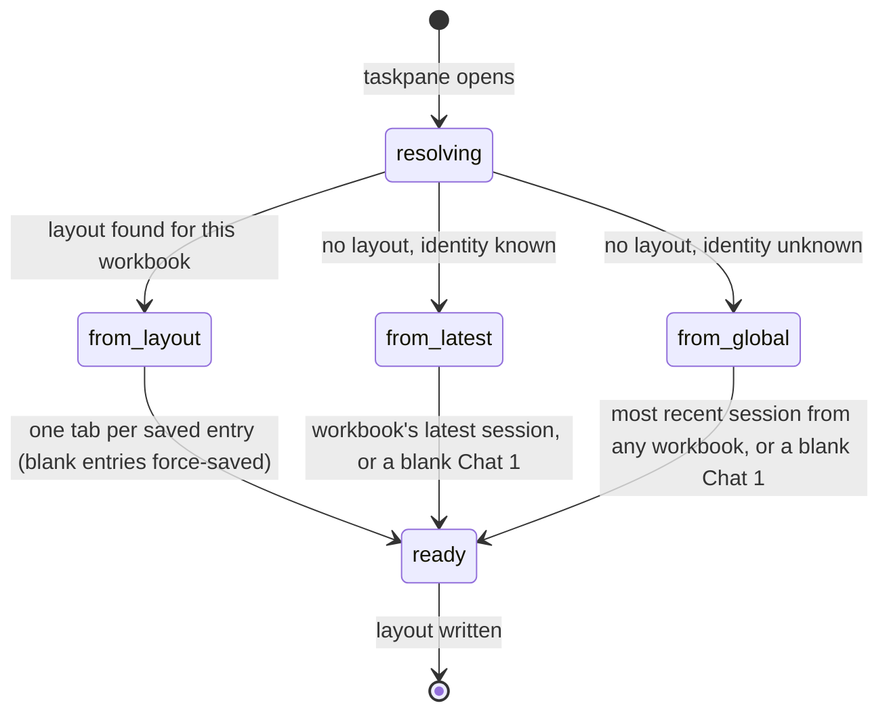

# Sessions and tabs

## Summary

A session is one saved conversation with Pi. A session tab is a session that is open in the taskpane's tab strip. This document owns what each of them is and how they relate: what a session stores, what each tab owns and what all tabs share, how tabs are labeled, how the busy dot and "Locking…" appear on a tab, how a session is linked to a workbook, how the product works out which workbook it is in, and what the taskpane restores when it opens. The tab operations themselves are described in [tabs](../sessions/tabs.md), [renaming a tab](../sessions/renaming-a-tab.md), [reopening closed tabs](../sessions/reopening-closed-tabs.md) and [resuming a session](../sessions/resuming-a-session.md). What is saved and when is owned by [persistence and restore](../cross-cutting/persistence-and-restore.md). Tabs and sessions need no provider and work the same on every host. The only exception is that workbook identity can be unknown: for a workbook that has never been saved on desktop, and, as seen in this project's Excel on the web session, for a workbook Excel on the web reports no address for (see [Workbook links and workbook identity](#workbook-links-and-workbook-identity)).

## The simple case

The user opens Pi and asks a question in "Chat 1". The session saves from that first user message, linked to this workbook when identity is available. "+" creates an independent "Chat 2". Both can run turns concurrently, serializing workbook mutations.

After reload, order, active tab, stable numbers, chosen titles, saved transcripts and per-session draft/Not sent rows return. No unsent text runs automatically.

## What a session is

A session is the saved form of one conversation. It holds:

- the messages: user messages, assistant messages, tool results, thinking, compaction summaries, and the hidden instructions Pi was given;
- the model and thinking level the conversation last used;
- the [saved title](../glossary.md#sessions-and-tabs), message count, token usage and cost, and creation and last-modified times;
- separately, its [workbook link](#workbook-links-and-workbook-identity).

Sessions belong to this browser profile and origin. Closing keeps them. Saving starts with the first user message, continues at completed messages, and also records draft/Not sent and metadata changes. Compaction saves immediately. See [persistence and restore](../cross-cutting/persistence-and-restore.md).

## What a tab owns

Each tab is an independent conversation. Switching tabs swaps everything in the first column of this table and leaves the second column as it is.

| Each tab has its own | Shared by all tabs in the taskpane |
| --- | --- |
| Transcript, session, composer draft and Not sent rows | Settings and connections |
| Model and thinking level (and so the status bar's model, thinking and context readouts) | Execution mode ("Auto" or "Confirm") |
| Steers, follow-ups and queued prompts and commands (the queue strip) | The [workbook lock](the-workbook.md) |
| Busy/responding state, Stop, working/compaction indicator and error banner | Shared notice area |
| Lock state ("Locking…") | Shared workbook mutation coordinator |
| Default number and chosen title | Files workspace, rules, settings, connections |

**The composer is per tab.** Switching loads that tab's draft and unsent rows. Draft saves are debounced by 400 ms; Stop holds each unused message separately as Not sent. Reload restores them without sending. See [the composer](../turn/the-composer.md).

A new tab starts with an empty transcript and a new session. It takes its model from the tab that was active when it was created, or the default model if there was none. Its thinking level is not inherited: it starts at High if the model can reason, and Off otherwise.

Several tabs can be busy at once. Each runs its own turns, while their mutations take turns at the shared workbook lock.

## Tab labels

A tab shows its [chosen title](../glossary.md#sessions-and-tabs) if it has one, otherwise its [default title](../glossary.md#sessions-and-tabs) "Chat N". Labels longer than about 110 px are cut off with an ellipsis. The full label is the tab's tooltip, and the tab's accessible name is "Open tab {title}".

N is assigned when a tab is created. Layout stores each number and the next number, so reload does not renumber or reuse closed numbers. Recently closed entries carry their old number for reopening when available. A newly resumed unnamed session gets a new number; chosen session titles survive resume, reopen and reload. See [renaming](../sessions/renaming-a-tab.md).

The saved title, which is what the [resume picker](../sessions/resuming-a-session.md) shows, is separate from the label. It is the chosen title if there is one, otherwise the first 80 characters of the first user message, otherwise "Untitled".

## Busy and locking indicators

Two small marks on a tab show what it is doing, whether it is active or not:

- **The busy dot.** A contrasting green dot (white with a ring on the active tab), shown while the tab is [busy](../glossary.md#the-turn): a turn is running, or a queued action such as `/compact` is running. It disappears when the tab is idle. It is decorative and is not announced to screen readers.
- **"Locking…"** A small monospace label after the title, shown while one of the tab's mutations is waiting for another tab's mutation to release the [workbook lock](the-workbook.md). It disappears when the mutation starts.

While a tab's mutation holds the lock, its × button is disabled with the tooltip "Wait for workbook changes to complete", and closing it is refused. Nothing else on the tab marks this state; the status bar's lock badge reads "lock…" while the active tab waits and "lock" while it holds. Confirmed in Excel on the web with two tabs writing at once: the second showed "Locking…" until the first finished, then held the lock itself (Technique: an 8-second delay added to `Excel.run` in the taskpane over DevTools, so each write held the lock long enough to watch).

## Workbook links and workbook identity

**Workbook identity.** Pi identifies a workbook by the address Excel reports for the open file: its URL on OneDrive or SharePoint, or its file path on disk. Pi removes any query string or fragment from the address and stores only a SHA-256 hash of it. The raw address is never stored. The identity is read again whenever the taskpane gains focus or becomes visible, so a workbook that is saved for the first time during a session gets an identity from then on.

The identity is unknown when Excel reports no address. That happens for a new workbook that has never been saved, in the standalone taskpane outside Excel, and when the host does not answer within 3 seconds and has no earlier answer. It also happened in Excel on the web for a OneDrive workbook opened through an "anyone with the link can edit" folder link while signed out: Excel reported an empty address both when the add-in started and when asked again, so that workbook had no identity, every session stayed unlinked, and the shared layout was used. Whether a signed-in user's workbook on Excel on the web reports an address has not been checked. A renamed, moved or "Save As" copy of a file has a different address, so it gets a new identity. Pi treats it as a different workbook.

Where the product shows which workbook it means (the resume picker), it uses the file name, then "Workbook ({first 18 characters of the identity}…)", then "Current workbook".

**Workbook link.** Each time a session is saved while the identity is known, the session is linked to that workbook, unless it is already linked. The first link is permanent. Resuming a session in a different workbook does not move it there. Sessions saved while the identity was unknown stay unlinked until a later save with a known identity. Each save also records the session as the workbook's *latest session*. Loading a session into a tab records it as the latest session too.

Links decide two things: which sessions the resume picker lists by default (linked to this workbook, or not linked at all), and which session the taskpane falls back to when there is no tab layout (see below).

**Tab layout.** Stores ordered session IDs, active session, tab numbers and the next number. It is written on tab operations and focus. Known identities have separate layouts; unidentified workbooks use a durable document token when available, with shared fallback. Draft/Not sent and chosen titles live with sessions, not layout.

## The interaction, event by event

Restore on open is the one interaction this document owns. The others are in the [sessions documents](#where-the-details-live).

### The taskpane opens

When the taskpane boots, Pi first works out the workbook identity. Then it reads that workbook's layout, using a document token for an identity-less workbook when available, and shared fallback otherwise. Which one is found decides everything else. The tab strip is not shown until restore finishes.

### Nothing to restore

If no layout is saved, or the saved one is empty or malformed, the taskpane opens a single tab:

- **Identity known:** the tab loads the workbook's latest session, if there is one. A newer session from another workbook is never used.
- **Identity unknown:** the tab loads the most recently modified session from any workbook. This is the global fallback.
- **Neither exists:** the tab is a blank "Chat 1".

If the stored layout exists but cannot be read, the taskpane also falls back to a single tab. In that case the unread layout is kept: it is not overwritten until the user next creates, closes, moves or switches a tab.

### Tabs are created

With a layout, tabs restore in order using their saved numbers and session IDs. Available session content, chosen title, draft/Not sent and model/level load; models resolve against the current registry. Missing sessions become durable blank tabs using the saved identity. The saved active tab returns, or the first if it is gone.

### While restoring

There is no visible progress. The tabs appear together once they are all loaded. Keyboard shortcuts start working after startup finishes. With extensions installed, that can take up to 5 seconds more.

### Restored

The active tab opens idle with its saved draft/Not sent rows and stable label. Completed messages remain; an interrupted stream is not resumed. Unsent text stays unsent. Layout is written after successful restore; no persisted provider failure is invented for a lost stream.

## Modifiers

| Modifier | Set before | Changed while busy |
| --- | --- | --- |
| Model and provider | A restored tab uses its session's saved model. A new tab inherits the active tab's model. With no provider connected, tabs still restore and open. | A tab's model cannot be changed while it is busy ("Wait for this tab to finish before changing models"). Other tabs are unaffected. |
| Thinking level | A restored tab uses its saved level. A new tab starts at High or Off depending on the model. | Applies to that tab only, from its next turn. |
| Execution mode | Shared by all tabs. It does not affect restore. | A change applies to every tab's next mutation. |
| Files in the workspace, or an overlay open | Files are shared by all tabs. No overlay can be open during restore. | No effect on tabs. |
| Tab state (new, restored, another tab busy) | Described above. Another tab being busy never blocks creating, switching or restoring. | Each tab's busy state is its own. |
| Host (desktop or web) | On desktop, a never-saved workbook has no identity and uses the shared layout. On Excel on the web the identity depends on whether Excel reports an address: in this project's signed-out guest session it did not, so the workbook had no identity and used the shared layout. | No effect. |

Changing a variant affects only the tab it belongs to, except execution mode, which is shared.

## Cancel and interrupt

In this table, "Before sent" means a tab that is idle and "While busy" means a tab that is busy.

| Event | Before sent | While busy |
| --- | --- | --- |
| Stop (button or Escape) | Escape with focus in the composer moves focus to the active tab in the strip (confirmed in Excel on the web). | Stops only the active tab's turn; other busy tabs carry on. See [turns](turns.md#stop). |
| The user sends something else | The active tab sends its own draft. | Enter steers that tab only. |
| Tab switched, created, closed or reopened | Switching swaps draft and owned state. | Background work continues. Closing a streaming or queued-action-busy tab asks "Stop and close this tab?" and settles a started write before removal. |
| An overlay or menu opens | No effect on tabs. | Turns keep running behind it. |
| Model or thinking level changes | Affects the active tab only. | Model change refused for that tab. |
| The provider fails | No effect on tabs. | Error belongs to that tab; another tab does not inherit it. |
| The taskpane goes away | Saved layout, chosen titles, drafts and Not sent persist. | Completed messages stay; in-flight streaming is lost. The first user message already saved. |
| The workbook changes underneath | Saving the workbook under a new name changes its identity. From the next focus, the layout and new links go to the new identity. | Same. Mutations keep queuing for the shared lock. |
| Focus moves to the grid or another window | No effect. On return, the identity is read again. | Turns keep running. |
| The context window fills | Compaction belongs to one tab. | Its activity and summary do not move to the active tab. |

## Interactions with other systems

**Persistence.** Sessions, links, layouts, recently closed, titles, numbers and draft/Not sent state persist in browser storage. See [persistence and restore](../cross-cutting/persistence-and-restore.md).

**Workbook changes and recovery.** Tabs share one workbook and one lock. Automatic backups belong to the workbook, not to a tab or session. See [the workbook](the-workbook.md).

**Other tabs and sessions.** Two taskpanes on the same workbook, for example two windows, keep separate tabs in memory but write the same layout, and the last one to write wins. See [several taskpanes](../cross-cutting/several-taskpanes.md).

**Execution mode and approvals.** Execution mode is shared. An approval dialog belongs to the tab whose mutation asked for it but covers the whole taskpane.

**Models and providers.** Model and thinking level are per tab. See [models and providers](models-and-providers.md).

**Offline and provider errors.** Error banners belong to their runtime and follow tab switches.

**Notifications.** The busy dot and "Locking…" are the only per-tab notifications. Background tabs make no sound and show no toast when they finish.

**Settings and preferences.** The model-switch preference can turn a model change into a new tab; see [models and providers](models-and-providers.md).

**Host differences.** Identity is unknown on desktop for never-saved workbooks, and in the standalone taskpane. See [host differences](../cross-cutting/host-differences.md).

**Language.** "Chat N", "Locking…" and the tab tooltips are translated. The "Untitled" saved title is hard-coded English.

**Accessibility and keyboard.** Tabs are buttons named "Open tab {title}". The busy dot is hidden from assistive technology, and "Locking…" is read as part of the tab's text.

## Where the details live

| Topic | Owner |
| --- | --- |
| Creating, switching, moving, duplicating, closing | [tabs](../sessions/tabs.md) |
| Chosen titles, `/name` | [renaming a tab](../sessions/renaming-a-tab.md) |
| Recently closed, undo, `/reopen` | [reopening closed tabs](../sessions/reopening-closed-tabs.md) |
| The resume picker, `/resume`, `/resume-here` | [resuming a session](../sessions/resuming-a-session.md) |
| `/export`, `/copy` | [export and copy](../sessions/export-and-copy.md) |
| When sessions are saved | [persistence and restore](../cross-cutting/persistence-and-restore.md) |

## Edge cases

- A blank tab is saved when it is closed or restored, so blank sessions build up in the resume picker as "Untitled", "1 messages".
- Resume/reopen focuses an already-open session in this taskpane, never a second runtime for it.
- Identity-less workbook layouts use a document token when available. A host without address or usable document settings can still fall back to shared layout.
- Copies of one file opened from different paths, such as a synced local folder and the web, have different identities.
- There is no limit on the number of tabs or saved sessions.
- A duplicated tab uses up a default number even though its label is "{title} copy": after duplicating "Chat 11", the next new tab was "Chat 13". Confirmed in Excel on the web.

## Open questions and verification

- Merged source inspection establishes per-runtime drafts/activity/errors, stable metadata and session deduplication. SESS-03/15 and old duplicate-session observations remain historical logs.
- Message counts include Pi's hidden instruction messages, so a blank session is listed with "1 messages". Confirmed in Excel on the web. The cause is `src/taskpane/sessions.ts:240`.
- Fork preference now checks real user/assistant conversation history, not a hidden initial workbook note; empty tabs switch in place.
- The old light-theme inactive-dot finding (SESS-18) is addressed by contrasting busy-dot colors in the merged CSS; no new desktop visual acceptance is claimed here.
- Workbook identity was unknown in Excel on the web for a OneDrive workbook opened signed out through an edit link: `Office.context.document.url` was empty, and so was the URL from `getFilePropertiesAsync` (`src/host/office-document-url.ts`). As a result the resume picker had no workbook filter and every session was unlinked. Whether a signed-in session reports an address is not known; until then, "web workbooks always have an identity" should not be assumed.
- Confirmed in Excel for Mac: a saved workbook has an identity from its file path as soon as the taskpane opens, the resume picker shows "Show sessions from all workbooks" with the file name, a never-saved workbook has none, and "Save As" gives a new identity without a reload; sessions from the old name then appear only with the filter ticked (SESS-14, WB-22, RESUME-12). Windows has not been checked.
- Checked in Excel on the web on 2026-10-26; see [the checklist](../verification/sessions-and-commands.md#foundationssessions-and-tabsmd).

Verified against pi-for-excel commit `1f51cf8` (source inspection; earlier host observations are dated above).
