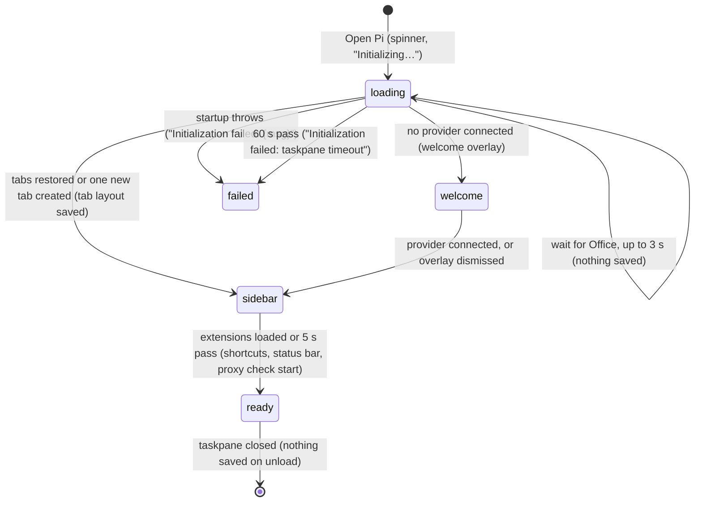

# The taskpane

## Summary

The taskpane is the whole of Pi for Excel as the user sees it: one panel docked beside the grid, holding the header, a scrolling transcript and the composer, with menus, overlays, toasts and banners drawn over or around them. This document owns the layout vocabulary every other document uses (which region is where, what each one is called, what draws on top of what) and what the user sees between clicking **Open Pi** and being able to type. It does not describe what happens inside each region; each region links to its owner. The taskpane is reached with **Open Pi** on the Home ribbon (see [docs/install.md](../../docs/install.md) for getting the button). It is ready when the composer has focus and the [status bar](../ui/the-status-bar.md) shows a model. It opens the same way whether or not a provider is connected (with none, the welcome overlay covers it), on Excel desktop and on Excel on the web. Its layout does not change while a tab is [busy](../glossary.md#the-turn); only the working indicator, the queue strip and the composer's buttons do.

## The simple case

The user clicks **Open Pi**. Excel docks an empty panel next to the grid and, after a moment, a spinner with the word "Initializing…" (shown in capitals) appears in its middle. A second or two later the spinner is replaced by the taskpane proper: a header with one tab, "Chat 1", a "+" button and a gear; the [empty state](../commands/empty-state-and-hints.md) with the π mark, the tagline and four starter hints; and at the bottom the [composer](../turn/the-composer.md), with the caret blinking in it, above the status bar.

If the user has worked in this workbook before, the header shows the tabs they had open last time and the transcript shows the active tab's conversation, scrolled to the bottom. See [sessions and tabs](sessions-and-tabs.md).

The user types and presses Enter. From then on the taskpane keeps its shape: the transcript grows and scrolls, the [working indicator](../glossary.md#the-taskpane) and [queue strip](../turn/steering-and-the-queue.md) appear above the composer when needed, and menus and overlays open over everything and close again.

## The interaction, event by event

The taskpane's own interaction is opening it. The five slots map onto startup: what is decided before anything is drawn, the ways startup ends without a usable taskpane, the moment the sidebar appears, what is still finishing after it appears, and where the user lands.

### Opening the taskpane

Excel loads the page and, before anything is drawn, Microsoft's Office.js script. Then the loading screen appears: a double ring spinning in the centre of the panel and "Initializing…" under it, in small spaced capitals. Nothing can be clicked yet.

Pi then waits for Office to say it is ready, for up to 3 seconds:

- **In Excel**, Office answers and startup continues with the workbook available.
- **When Office does not answer within 3 seconds**, startup continues anyway and still treats the host as Excel. The workbook is read later, when Pi first needs it.
- **Outside Excel** (the taskpane page opened in an ordinary browser), Office.js answers at once with no host, and startup continues without a workbook. The 3-second wait is only reached when Office.js is present but silent.

Next, before the sidebar is built, Pi reads the saved language, proxy and auto-compaction settings and looks up which [providers](models-and-providers.md) are connected (allowing up to about 9.5 seconds for stored credentials and cached model lists). If the CORS proxy is enabled with an address that is not on this computer, a toast warns "Security warning: proxy URL is not localhost — it can see your tokens and prompts."

### Ends at once

Startup ends without a usable taskpane when:

- **Startup fails.** The spinner disappears and a red box at the top of the panel says "Initialization failed: {msg}". There is no retry button; the user has to close and reopen the taskpane.
- **Startup takes more than 60 seconds.** The spinner disappears and the red box says "Initialization failed: taskpane timeout". At 12 seconds a warning, "Taskpane initialization taking longer than expected (>12s)", is written to the browser console only; the user sees nothing change.

Nothing is saved in either case. Both messages appear in the same place as the [error banner](#the-regions-top-to-bottom), above the header.

### The sidebar appears

The spinner is replaced by the sidebar. Pi restores the tabs recorded in the [tab layout](../glossary.md#sessions-and-tabs) for this workbook, or, if there is none, opens one tab and loads into it the latest session linked to this workbook if there is one (see [sessions and tabs](sessions-and-tabs.md)). The tab layout is saved straight away. From this moment the transcript and the composer are real: the composer takes keyboard focus, and the user can type.

If no provider is connected, the welcome overlay opens over the taskpane, with "Pi for Excel", "Connect an AI provider to get started" and a list of providers under "Select provider". It can open while the spinner is still showing, because the provider lookup finishes before the sidebar is built. See [welcome and login](../setup/welcome-and-login.md).

### While startup finishes

Two things are inserted above the transcript as soon as the sidebar exists:

- the [disclosure bar](#the-disclosure-bar), if at least one provider was connected at startup and it has never been dismissed in this add-in;
- the [proxy banner](#the-proxy-banner), hidden until the first proxy check answers.

Pi then loads extensions, waiting up to 5 seconds for them before going on (they keep loading in the background after that). In the default configuration there are none, so this is immediate. Only after that wait are the keyboard shortcuts installed, the status bar filled in, the command menu attached to the composer and the first proxy check started.

> Technical note: in the window between the sidebar appearing and extensions finishing, the status bar row is empty, Escape, F2, Shift+Tab and the other shortcuts do nothing, typing `/` opens no command menu, and Enter on text starting with `/` does nothing. Enter on ordinary text still sends. With no extensions installed the window is too short to notice.

### Arrived

Startup is over when the status bar shows the active tab's model, thinking level, context meter and execution mode. The user lands in the active tab with focus in the composer, unless an overlay that claims Escape (the welcome overlay, for example) is open, in which case the composer is not focused. Nothing about the startup itself is saved; the tab layout was saved when the sidebar appeared.

## The regions, top to bottom

The taskpane is one column. Excel draws its own title bar ("Pi for Excel", a `⋯` menu, a close button) above it; that bar is not part of the product. Under it, in order:

| Region | What it is | Shown when | Owner |
| --- | --- | --- | --- |
| Error banner | A red box with monospace text, full width, with a thin red line under it. No close button. | The last run of the active tab failed, or startup failed. | [sending and the response](../turn/sending-and-the-response.md) |
| Header | The tab strip on the left (tabs, "+", scroll arrows "‹" "›" when tabs overflow) and the utilities button (a gear, "Settings and tools") on the right, leaving room at the far right for the information button Office adds to taskpanes. | Always, once the sidebar exists. | [tabs](../sessions/tabs.md), [the utilities menu](../ui/the-utilities-menu.md) |
| Disclosure bar | A card: "Pi can search the web, use extensions, and connect to external services." with "Got it", "Customize" and "Change anytime in Settings". | Until dismissed once. | [this document](#the-disclosure-bar) |
| Proxy banner | An amber strip: "Proxy not running · Some features won't work." with "How to fix →". | The last proxy check failed. | [this document](#the-proxy-banner), [the proxy](../setup/the-proxy.md) |
| Transcript or empty state | The scrolling conversation of the active tab, or, if it has no messages, the empty state. Takes all remaining height. | Always. | [sending and the response](../turn/sending-and-the-response.md), [empty state and hints](../commands/empty-state-and-hints.md) |
| Working indicator | One line: a rotating phrase on the left, a rotating hint on the right. | The active tab is busy. | [sending and the response](../turn/sending-and-the-response.md) |
| Extension widget slot | Space for an extension's widget. | Never in the default configuration. | [the extensions hub](../extensions/the-extensions-hub.md) |
| Queue strip | Rows for waiting steers, follow-ups and queued items. | The active tab has something waiting. | [steering and the queue](../turn/steering-and-the-queue.md) |
| Composer | The Files button, the text area, the send or Stop button. | Always. | [the composer](../turn/the-composer.md) |
| Status bar | Model, thinking level, context meter, execution mode. | Always, once startup has finished. | [the status bar](../ui/the-status-bar.md) |

Everything except the transcript keeps its natural height; the transcript shrinks to make room. A taller composer, an open queue strip, the disclosure bar or the error banner therefore all take height from the transcript, never from each other.

There is one composer, one status bar, one error banner and one disclosure bar for the whole taskpane. Switching tabs swaps the transcript, the working indicator, the queue strip and the status bar's values to the new tab's, and leaves the rest alone. In particular the text in the composer stays as it is (see [Open questions](#open-questions-and-verification)).

### The disclosure bar

The disclosure bar appears under the header the first time the taskpane starts with a provider connected. "Got it" dismisses it for good. "Change anytime in Settings" dismisses it and opens [Settings](../setup/settings.md). "Customize" expands four switches, all on: "Web search & page fetch", "Extensions & plugins", "External services (MCP)" and "Skills", each with a one-line description; "Got it" becomes "Done" and the other two links hide. Clicking "Customize" again is not possible while expanded; "Done" dismisses the bar.

The dismissal is remembered in the add-in's browser storage, so it applies to every workbook. If the user connects their first provider from the welcome overlay, the bar does not appear until the taskpane is next opened, because the provider count is read once during startup.

### The proxy banner

The proxy banner is driven by a health check of the configured proxy address (or the default one), made when startup finishes and every 30 seconds after, with a 1.5-second timeout. It shows whenever the last check failed and hides as soon as one succeeds. "How to fix →" expands it in place: "Run this command in your terminal and keep the window open:", the command `npx pi-for-excel-proxy` with a copy button ("Copy command", then "Copied" for 1.4 seconds), "Open Terminal · paste · press Enter · keep open" and the link "No Node.js? See install guide →". The button then reads "Hide steps". The banner has no close button. See [the proxy](../setup/the-proxy.md).

## Layers over the taskpane

Five kinds of surface draw over the regions. From lowest to highest:

- **Banners** (the error banner, the disclosure bar, the proxy banner) are not layers: they sit in the column and push the regions under them down.
- **Popovers and menus.** The [utilities menu](../ui/the-utilities-menu.md) drops from the gear, right-aligned. The status-bar popovers open above their control. The [command menu](../commands/the-command-menu.md) opens above the composer. The [tab context menu](../glossary.md#the-taskpane) opens at the pointer and is drawn above everything else, overlays included. Menus have no backdrop; the taskpane under them stays visible and clickable, and a click elsewhere closes them (and still does what it was aimed at).
- **Overlays.** An overlay covers the whole taskpane with a dimmed, blurred backdrop and a card in the middle, about 340 px wide for the small ones and as wide as the pane allows for Settings. Overlays opened later sit on top of earlier ones, and the ones underneath stop responding until the top one closes. There is at most one overlay of each kind: asking for one that is already open replaces it, moves it to the requested page (Settings), or closes it (the resume picker), as its owning document describes. An overlay closes with its × button, with Escape (Settings goes back one page per Escape and closes from its first page), or with a click on the backdrop; clicks on the card do not close it. When an overlay closes, focus goes back to the composer.
- **Toasts.** One toast at a time, centred near the top of the taskpane, just under the header. A new toast replaces the current one, with one exception: an ordinary toast does not replace an [action toast](../glossary.md#the-taskpane) that is still showing, so the user does not lose its button; a toast that reads as an error does. Ordinary toasts last 2 seconds. Toasts whose wording contains words such as "failed", "error", "can't" or "unable" are shown in red, last 6 seconds and are announced to screen readers immediately. Action toasts last 7 seconds unless the feature sets otherwise (the close toast lasts 9). Only action toasts can be clicked; clicking their button runs the action and hides the toast at once.
- **Native dialogs.** The browser's own prompt (used only by the tab rename dialog) is drawn by the host above everything and blocks the whole taskpane until answered. On Excel on the web it does not appear at all. See [renaming a tab](../sessions/renaming-a-tab.md).

> Technical note: toasts and overlays share the same stacking level, so whichever was added to the page later is on top. The toast element is created the first time a toast is shown and then reused. An overlay opened after the first toast of a session is therefore drawn over every later toast, which shows only as a blur behind the backdrop. See [Open questions](#open-questions-and-verification).

## Modifiers

| Modifier | Set before | Changed while busy |
| --- | --- | --- |
| Model and provider | With no provider connected, the welcome overlay covers the taskpane on arrival and there is no disclosure bar. With one or more, the disclosure bar shows until dismissed. The proxy banner does not depend on the provider. | Connecting a provider in the welcome overlay closes it. The disclosure bar does not appear until the next startup. |
| Thinking level | No effect on the layout. | No effect on the layout. |
| Execution mode | No effect on the layout; the status bar shows "Auto" or "Confirm". | No effect on the layout. |
| Files in the workspace, or an overlay open | Files have no effect on the layout. An overlay covers every region; the composer keeps whatever text it had. | An overlay opened during a turn covers it; the turn keeps running behind the backdrop. |
| Tab state (new, restored, another tab busy) | A new or blank tab shows the empty state; a restored tab shows its transcript scrolled to the bottom. | Another tab being busy shows only as the dot on its tab. The working indicator and queue strip always belong to the active tab. |
| Host (desktop or web) | Excel sets the width and the user can resize it. On Excel on the web the native prompt is unavailable. Outside Excel, startup goes ahead without a workbook. | No effect. |

Changing a modifier never moves a region; at most it changes what a region shows.

## Cancel and interrupt

For the taskpane, "before sent" means during startup, before the sidebar appears; "while busy" means while a menu, overlay or toast is showing over a ready taskpane.

| Event | Before sent | While busy |
| --- | --- | --- |
| Stop (button or Escape) | Nothing can be stopped: there is no Stop button and Escape is not yet listened to. Startup cannot be cancelled except by closing the taskpane. | Escape closes the topmost menu or overlay, not the turn behind it, for the surfaces that claim Escape (see [turns](turns.md#stop)). The Stop button is under the backdrop and cannot be clicked. With focus still in the composer, the first Escape leaves the composer instead (see [Edge cases](#edge-cases)). |
| The user sends something else | The composer does not exist yet. | An overlay's backdrop blocks clicks on the composer and the starter hints. A menu does not: typing, sending and clicking a hint go on underneath, and the menu stays open until a click lands outside it. |
| Tab switched, created, closed or reopened | Not possible; the header does not exist yet. | Clicking a tab closes an open menu and switches. Overlays block the header. Ctrl/Cmd+Shift+T and the other tab shortcuts still work under a menu. |
| An overlay or menu opens | The welcome overlay can open over the spinner. | Opening the utilities menu closes the tab context menu and the other way round. Opening an overlay leaves an open menu where it was, under the backdrop. Overlays stack, newest on top. |
| Model or thinking level changes | Not possible. | From the status bar, which a menu leaves reachable and an overlay covers, or with Shift+Tab for the thinking level, which works under both. |
| The provider fails | Startup does not contact the provider; a failed model-list refresh is logged and does not stop startup. | The error banner appears at the top whatever is open; an open overlay stays over it. |
| The taskpane goes away | Startup simply stops. Nothing is saved. | Everything open over the taskpane is lost with it; overlays keep nothing after closing. See [persistence and restore](../cross-cutting/persistence-and-restore.md). |
| The workbook changes underneath | Not read during startup, except to identify the workbook for the tab layout. | No effect on the layout. When the taskpane regains focus, Pi re-reads which workbook it is in. |
| Focus moves to the grid or another window | Startup continues. | Menus and overlays stay open; nothing closes on losing focus. |
| The context window fills | Not applicable. | No effect on the layout; the context meter in the status bar changes colour. |

After any interrupt the regions are where they were. What is lost is only what was open in a menu or an unsaved overlay.

## Interactions with other systems

**Persistence.** The tab layout is saved as soon as the sidebar appears and whenever tabs change. The disclosure bar's dismissal is remembered in browser storage for the add-in, not per workbook. Nothing else about the layout is saved. See [persistence and restore](../cross-cutting/persistence-and-restore.md).

**Workbook changes and recovery.** No interaction. The taskpane's layout does not depend on the workbook.

**Other tabs and sessions.** All tabs share the header, the banners, the composer text and the status bar row. Only the transcript, the working indicator, the queue strip and the status bar's values belong to the active tab. See [sessions and tabs](sessions-and-tabs.md).

**Execution mode and approvals.** Approval dialogs are overlays and layer like any other. See [confirm mode and approvals](../workbook/confirm-mode-and-approvals.md).

**Models and providers.** Whether a provider is connected at startup decides between the welcome overlay and the disclosure bar. See [models and providers](models-and-providers.md).

**Offline and provider errors.** Startup does not need the network beyond loading the page and Office.js. A failed turn shows the error banner above the header. See [provider errors and offline](../cross-cutting/provider-errors-and-offline.md).

**Notifications.** The taskpane's notification surfaces are the toast, the action toast, the error banner, the proxy banner and the busy dot on a tab. There is no sound, badge or system notification.

**Settings and preferences.** The language and the light or dark theme are applied before the sidebar is drawn; changing the language from the welcome overlay reloads the taskpane. See [language and theme](../ui/language-and-theme.md).

**Host differences.** Excel decides the taskpane's size on every host. On Excel on the web the native prompt is unavailable. Office.js is loaded from Microsoft's servers on every host, so a taskpane opened offline cannot reach Excel. See [host differences](../cross-cutting/host-differences.md).

**Language.** The loading text, the fatal messages, the banners and the menus are translated. The four switch descriptions under the disclosure bar's "Customize" are hard-coded in English, and the page declares itself Chinese to assistive technology whatever the UI language (see [Open questions](#open-questions-and-verification)).

**Accessibility and keyboard.** F2 puts focus in the composer from anywhere. Escape with focus in the composer and the tab idle moves focus to the active tab. Overlays are marked as modal dialogs and make earlier overlays inert. Ordinary toasts are announced politely, red toasts assertively. The working indicator and the banners are not announced.

## Edge cases

- **Short pane (520 px tall or less).** The header, composer and transcript tighten their padding, the composer grows to at most 28% of the height instead of 40%, and the empty state hides the π mark and the hint previews.
- **Narrow pane.** The status bar wraps onto a second line. Below about 260 px of status-bar width the context meter drops its limit ("1%" instead of "1% / 500k"). Tabs scroll sideways with "‹" and "›". The utilities menu is at least 220 px wide and anchored to the right edge, so in a very narrow pane it can run past the left edge. Toasts wrap to the pane's width.
- **Overlay opened from the composer.** Overlays other than Settings do not take focus when they open. After `/files` (for example), focus is still in the composer behind the backdrop: the first Escape moves focus to the tab strip and leaves the overlay open, and a second Escape closes it. Keystrokes before that go into the hidden composer. Confirmed in the standalone taskpane.
- **Utilities menu opened with focus in the composer.** The first Escape leaves the composer and the menu stays open; a second Escape closes it. This happens on hosts where clicking a button does not move focus to it, which is WebKit's behaviour and so probably Excel on macOS; see [the utilities menu](../ui/the-utilities-menu.md).
- **Shift+Tab inside an overlay.** Shift+Tab changes the active tab's thinking level wherever focus is, overlays included, and so does not move focus backwards inside an overlay. Confirmed in the Settings overlay: focus stayed put and the level went from "High" to "Extra high".
- **Late startup.** If startup passes 60 seconds, the fatal message appears, but startup carries on, and the sidebar may then appear under "Initialization failed: taskpane timeout", which stays.
- **Two Excel windows.** Each has its own taskpane with its own layout, composer and error banner. See [several taskpanes](../cross-cutting/several-taskpanes.md).

## Open questions and verification

- Opened in an ordinary browser, the standalone taskpane booted in under a second: Office.js reports ready with no host rather than timing out, so the 3-second fallback was not observed. Checked in Chromium.
- The composer text is shared by all tabs: typing in "Chat 1", creating "Chat 2" and switching back left the same text in the composer throughout. Confirmed in the standalone taskpane. The glossary's *session tab* entry and [turns](turns.md) say each tab has its own composer text; one of the two needs correcting.
- Toasts are positioned near the top of the taskpane (56 px from the top, under the header), not the bottom as the glossary's *toast* entry says. Confirmed in the standalone taskpane.
- The error banner sits above the header, at the very top of the taskpane, not just above the transcript. Confirmed by rendering one in the standalone taskpane.
- The proxy banner is shown whenever the proxy health check fails, whatever provider is selected and whether or not the proxy is enabled (`src/taskpane/proxy-status.ts:68` polls unconditionally; `src/ui/proxy-banner.ts:142` shows on any "not-detected"). With the default settings and no local proxy running, it is therefore shown to most users, with no way to dismiss it. The glossary says it shows "when the selected provider needs the CORS proxy". May be worth treating as a bug.
- The four switches under the disclosure bar's "Customize" change nothing: they are created with no change handler (`src/ui/disclosure-bar.ts:70-74`), so turning one off neither disables the feature nor is saved. May be worth treating as a bug. Their descriptions are hard-coded English (`src/ui/disclosure-bar.ts:63-66`).
- A toast shown while an overlay is open is hidden behind the overlay's backdrop if any toast was shown earlier in the session: `.pi-toast` (`src/ui/theme/components/toasts.css:10`) and `.pi-welcome-overlay` (`src/ui/theme/components/welcome.css:8`) both use stacking level 200, and the toast element is created once and reused (`src/ui/toast.ts:59-84`). Confirmed in the standalone taskpane with Settings open. May be worth treating as a bug.
- Generic overlays do not move focus into themselves (`src/ui/overlay-dialog.ts`, `mount`), so an overlay opened from the composer leaves focus in the composer, and the composer's Escape handler (`src/taskpane/keyboard-shortcuts.ts:222`) takes the first Escape before the overlay sees it. Confirmed with `/files`. May be worth treating as a bug.
- Overlays built on the shared overlay helper carry the marker that the Escape guard checks (`.pi-welcome-overlay[data-claims-escape='true']` in `src/utils/escape-guard.ts:9`), so on reading the code, Escape over the Files workspace, the resume picker or a confirm dialog closes the overlay without stopping a responding turn. This differs from goal.md's established note that generic overlay dialogs do not claim Escape. Not checked with a live turn.
- Shift+Tab is taken by the thinking-level shortcut everywhere (`src/taskpane/keyboard-shortcuts.ts:377-383`, no check for overlays or text fields), so reverse focus navigation does not work in any overlay, and pressing it there silently changes the active tab's thinking level. Confirmed in the Settings overlay. May be worth treating as a bug.
- The 60-second timeout shows "Initialization failed: taskpane timeout" but does not stop startup (`src/taskpane/bootstrap.ts:69-80`); a late success mounts the sidebar under a fatal message that is never cleared (`src/taskpane/bootstrap.ts:84-86`). Read from code. May be worth treating as a bug.
- The ">12s" warning goes only to the console (`src/taskpane/bootstrap.ts:66`); the user sees nothing for a slow start. A product call.
- The page's language is hard-coded as Chinese (`<html lang="zh-CN">`, `src/taskpane.html:2`) and never updated to the UI language, so screen readers may read the English UI with Chinese pronunciation rules. May be worth treating as a bug.
- Whether the composer actually receives focus when Excel desktop opens the taskpane (rather than the grid keeping it) has not been checked on macOS or Windows.
- Whether the composer can take focus behind the welcome overlay (it focuses itself when first drawn, `src/ui/pi-input.ts:213`, without checking for overlays) has not been checked.
- The window in which shortcuts, the command menu and the status bar are not yet installed (while extensions load, `src/taskpane/init.ts:1860-1924`) was read from code; with no extensions it was too short to observe.

Verified against pi-for-excel commit `ec453df`.
