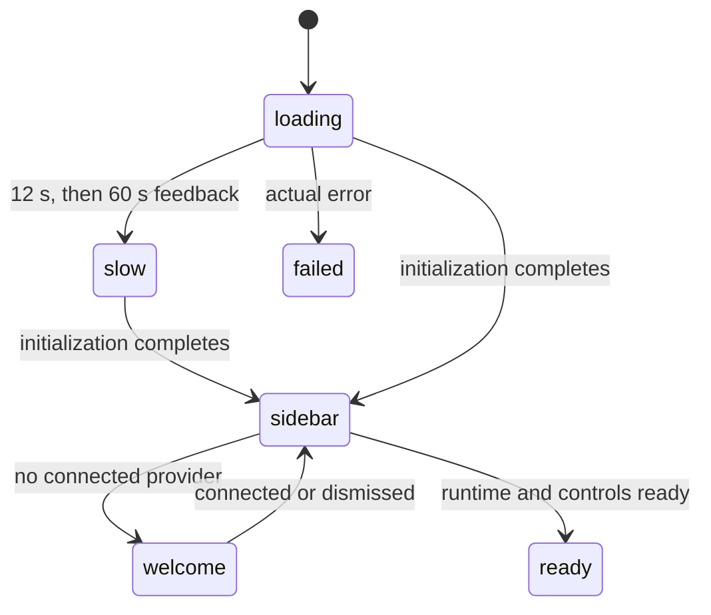

# The taskpane

## Summary

Pi lives beside Excel's grid in one taskpane: header/tabs, below-tab notices, transcript, working indicator, extension widgets, composer/queue and status bar. Modals cover the pane and trap focus; menus are keyboard-operated anchored surfaces. A running turn belongs to a tab even while another tab or modal is visible.

## The simple case

Open Pi, wait for Office/storage initialization and restored tabs, then type in the composer. With no provider a welcome modal offers connections. Otherwise the selected conversation appears. Send starts that tab's turn; Stop, per-tab draft/error state and workbook controls remain in the same pane.

## The interaction, event by event

### Opening the taskpane

Office readiness identifies the host, with a fallback for a silent Office.js. Storage opens, preferences/credentials restore and workbook scope selects the layout. A standalone development pane can boot without Excel but cannot use workbook tools. Credentials can restore after the initial welcome decision; a late connection closes welcome.

### Ends at once

An actual startup failure shows an initialization error. Slow startup does not fail merely because 60 seconds passed: the spinner explains the delay at 12 seconds and again at 60 and can still mount normally. Closing the pane is the way to abandon startup.

### The sidebar appears

The header and restored/fresh tab appear, followed by the transcript or empty-state hints. Runtime setup connects the command menu, keyboard shortcuts, model/status controls and extensions. A briefly incomplete startup is not a second persisted interaction state.

### While startup finishes

Storage persistence is requested best-effort; the browser may decline. Blocked database upgrades explain that an older pane must close. A version-change event closes the old connection and asks to reopen, rather than leaving an unexplained hang.

### Arrived

The selected tab's transcript, saved draft, Not sent rows, model and thinking level are visible. Focus goes to the composer unless a modal owns it. Streaming responses do not resume after startup; saved pending rows are not sent automatically.

## The regions, top to bottom

| Region | Contents |
| --- | --- |
| Header/tabs | Session tabs, new-tab action, Settings and tools gear |
| Notice area | Capability disclosure and enabled-proxy warning; stacked and dismissible |
| Transcript | Messages, thinking, grouped tool cards, inline turn errors with recovery actions and compaction summaries, or starter hints |
| Working area | Current activity and Stop; extension widget slot |
| Composer/queue | Active tab's draft, waiting messages/commands and Not sent rows |
| Status bar | Model, thinking, context, lock state and Auto/Confirm |

Fixed chrome takes height from the scrolling transcript. One set of DOM controls displays the active tab's state: switching saves/restores drafts and changes the visible error, queue and activity, not just the transcript. It does not carry one tab's unfinished text into another.

### The disclosure bar

Initial capability disclosure links to real settings rather than inert Customize switches. Dismissal is separate from disabling a capability. See [integrations](../extensions/web-search-and-mcp.md) and [permissions](../extensions/the-extensions-hub.md).

### The proxy banner

Only an enabled, unreachable proxy warns. It can be dismissed; settings changes trigger a recheck. When browser frame policy forbids localhost, advice explains that restriction rather than promising running a helper will solve it. See [the proxy](../setup/the-proxy.md).

## Layers over the taskpane

Menus focus the checked/first enabled item, support arrows/Home/End/typeahead and close on Escape/Tab with trigger focus restored. A new modal dismisses menus. Modals take focus, trap forward/reverse Tab and make underlying controls inert. Only the topmost surface handles Escape; it does not also Stop the turn. Text entry, rename and extension-name dialogs are in-pane rather than native browser prompts. Toasts remain above modal backdrops and use live announcements; warnings/errors have explicit dismissal.

## Modifiers

| Modifier | Set before | Changed while busy |
| --- | --- | --- |
| Model and provider | No provider shows welcome; model determines response controls. | Busy changes apply to the next turn; see the model picker. |
| Thinking level | Shown on status bar. | Running turn retains its level. Ctrl+Alt/Option+T cycles from the composer; Shift+Tab moves focus backwards. |
| Execution mode | Shared setting shown. | Subsequent approval decisions use it. |
| Files or overlay | Files affect prompt context; modal owns focus. | Runtime continues behind modal. |
| Tab state | Fresh hints or saved transcript/draft. | Background activity belongs to its tab. |
| Host | Office API, permissions and reserved keys vary. | Same pane interaction model. |

## Cancel and interrupt

| Event | Before sent | While busy |
| --- | --- | --- |
| Stop/Escape | Menu/modal handles first; idle composer Escape leaves input. | Unclaimed Escape uses shared Stop. |
| Another send | Composer send or local slash command. | Steer/follow-up/queue belongs to active runtime. |
| Tabs change | Target tab's draft restored. | Originating turn continues. |
| Overlay/menu | Focus enters surface; controls behind blocked. | Does not itself stop turn. |
| Model/thinking | Same per-tab controls. | Pending choices apply to the next turn, not the running one. |
| Provider failure | Connection dialog if needed. | Inline turn error and recovery actions stay in the originating conversation. |
| Pane disappears | Saved state remains, open surfaces lost. | Stream does not resume; submitted workbook call may land. |
| Workbook changes | Context gathered at requests. | Own coordinator does not lock user/co-author grid edits. |
| Focus leaves | Grid keys do not reach pane. | Turn continues. |
| Context fills | Meter warns by compaction budget. | Runtime compaction/recovery owns feedback. |

## Interactions with other systems

**Persistence.** See [restore](../cross-cutting/persistence-and-restore.md). **Workbook changes and recovery.** Tools own verification/backups. **Other tabs and sessions.** One session per open tab here, separate runtime state. **Execution mode and approvals.** Shared mode, queued focused dialogs. **Models and providers.** Welcome/settings connect; picker selects. **Offline and provider errors.** Inline errors remain in their originating transcript; see [provider failures](../cross-cutting/provider-errors-and-offline.md). **Notifications.** Below-tab notices, action toasts, activity and tab badges; no OS notification. **Settings and preferences.** Local storage, not workbook-synced preferences. **Host differences.** See [hosts](../cross-cutting/host-differences.md). **Language.** UI/root language follows preference. **Accessibility and keyboard.** Modal focus, live announcements and focus-visible tooltips; F2 cannot focus the composer behind a modal.

## Edge cases

- Short panes compress padding and let transcript/menu contents scroll.
- Narrow bars can wrap; live values do not freeze on hover.
- One unresponsive startup does not prove workbook or provider failure; feedback distinguishes stages.
- Several Excel windows can host independent panes sharing storage, not one shared workbook lock.

## Open questions and verification

Inspected bootstrap, modal/menu, notice and runtime ownership paths. In real Excel-web this pass observed focus inside Rules, Files and Resume, disabled unidentified-workbook Rules input, and disabled cross-origin folder connection. Historical two-Escape, above-header error, inert disclosure-switch and fatal slow-start observations are superseded. Full desktop/screen-reader acceptance was not rerun.

Baseline source and named live checks: `1f51cf8`. Later inline-error, thinking-shortcut and next-turn model wording is reconciled to merged #803/#805, not claimed as new live acceptance here.
