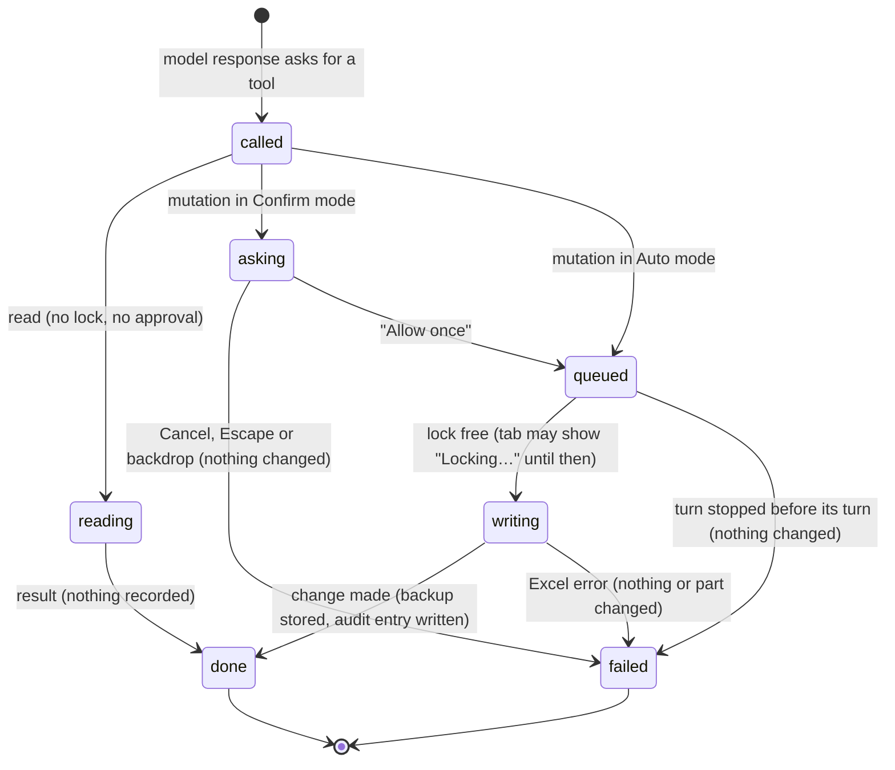

# The workbook

## Summary

The workbook is the Excel file open in the window that owns the taskpane, and the only thing in Excel that Pi touches. Pi reads and changes it through its tools, one tool call at a time, inside a [turn](turns.md). This document owns the facts every other document relies on: what Pi can read and what it can change, which tool calls count as a *mutation*, the *workbook lock* that keeps mutations from running at the same time, the automatic *backups* taken before mutations and when they disappear, the *execution mode* (Auto or Confirm), how Pi recognizes "the same workbook" from one session to the next, what Excel's own Undo does with Pi's changes, and what is different for a workbook that has never been saved. Nothing here has its own button: the user meets these rules through tool cards in the transcript, the "Locking…" label on a tab, the "Auto"/"Confirm" control in the status bar, approval dialogs, and the Backups dialog. All of it works with or without a provider connected (only a turn needs one), and on Excel desktop and Excel on the web, with the host differences listed below.

## The simple case

The user asks "Put a total under the Revenue column." Pi reads the sheet first: a tool card "Read Sheet1!A1:D20" appears, runs, and completes. Reading changes nothing and needs no permission. Pi then writes: a card "Edit Sheet1!D21 — 1 changed" appears. Before the value lands in the grid, Pi has recorded what D21 held, so the change can be reverted. The grid shows the new total as soon as the card completes. (Confirmed in Excel on the web.)

Pi did not ask before writing, because the execution mode is Auto by default. If the user had switched the status-bar control to "Confirm", a dialog "Allow workbook mutation in Safe mode?" would have appeared before the write and the turn would have waited for the answer (confirmed in Excel on the web).

If the total is wrong, the user types `/revert` or opens Backups from the [utilities menu](../ui/the-utilities-menu.md) and clicks "Restore": D21 goes back to what it held, after confirming any later edits that would be overwritten. Saving, AutoSave and taskpane reload do not clear backups on desktop or the web. See [Backups](#backups).

## What Pi can read and change

Pi's built-in workbook tools, as the user sees them on tool cards. Each is described in full in [reading](../workbook/reading.md) or [writing](../workbook/writing.md).

| Tool | What it does for the user | Read or mutation | Automatic backup |
| --- | --- | --- | --- |
| `get_workbook_overview` | Lists sheets, their size, header rows, tables, charts and named ranges, or details one sheet. | Read | Not applicable |
| `read_range` | Reads values (as a table or CSV), or values with formulas and number formats. | Read | Not applicable |
| `search_workbook` | Finds cells by value or formula text across visible sheets. | Read | Not applicable |
| `trace_dependencies` | Shows what a cell depends on, or what depends on it, as a tree. | Read | Not applicable |
| `explain_formula` | Explains one formula cell in plain words with its direct references. | Read | Not applicable |
| `write_cells` | Writes values and formulas from a start cell. | Mutation | Values and formulas |
| `fill_formula` | Puts one formula in the top-left cell and fills it across a range. | Mutation | Values and formulas |
| `modify_structure` | Inserts or deletes rows and columns; adds, deletes, renames, duplicates, hides or unhides sheets. | Mutation | The structure change, and deleted values and formulas within the size limit |
| `format_cells` | Fonts, fills, number formats, borders, alignment, wrap, column width, row height, merge. | Mutation | Those format properties |
| `conditional_format` | Adds or clears conditional formatting rules on a range. | Mutation | The range's rules |
| `comments` | Reads comments, or adds, edits, replies to, deletes, resolves or reopens one. | Read for "read", mutation otherwise | The comment thread |
| `charts` | Lists charts and captures a chart image, or creates, updates or deletes a chart. | Read for list and image, mutation otherwise | Create and update only; delete has none |
| `view_settings` | Reads, or changes gridlines, headings, freeze panes, tab color, sheet visibility, standard width, the active sheet. | Read for "get", mutation otherwise | None |
| `workbook_history` | Lists, restores, deletes or clears backups. | Mutation for restore only | Restoring creates a backup of what it overwrote |

Three more built-in tools, `instructions`, `conventions` and `skills`, change Pi's own saved settings (rules, formatting conventions, skills), not the workbook; they count as reads. A few tools outside the built-in set are also present in the default configuration and can change the workbook: direct Office.js execution (`execute_office_js`) and a Python transform that writes results back (`python_transform_range`). Both count as mutations; direct Office.js has no automatic backup. What they do is described in [experimental](../extensions/experimental.md).

Pi has no tool for named ranges, tables, pivot tables, data validation, page layout or printing. It sees named ranges, tables and object counts through the overview, and can only change those through direct Office.js.

> Technical note: classification is by tool name and, for `view_settings`, `comments`, `charts` and `workbook_history`, by the `action` input. A tool the classifier does not know is treated as a mutation.

## The interaction, event by event

Every tool call goes through the same gate. The user sees the states below on the tool card and the tab.

### The tool call arrives

A tool call is decided by the model, not the user. The moment it arrives, Pi classifies it as a read or a mutation from its name and inputs, and reads the current execution mode. Reads go straight to Excel. Mutations go to the approval step (Confirm mode only) and then to the workbook lock. Addresses without a sheet name ("A1:D10") are resolved against whichever sheet is active in Excel at the moment the tool runs, not when the turn started.

### Ends at once

A mutation ends without touching the workbook when:

- **The user declines an approval.** The tool call fails with "Mutation cancelled by user (Confirm mode)." The model sees the failure and the turn continues. See [confirm mode and approvals](../workbook/confirm-mode-and-approvals.md).
- **The turn was stopped while the mutation was waiting.** When its place in the lock comes up, it fails with "Aborted" and does nothing.
- **The tool's own check blocks it.** `write_cells` and `fill_formula` refuse to overwrite cells that hold values or formulas unless the model explicitly asked to overwrite ("⛔ Write blocked — … contains N non-empty cell(s)."). This is not a failure: the card completes with "— blocked" and the model is told to ask the user. A blocked write still went through approval and the lock.

Reads never end this way: they cannot be declined, do not wait, and record nothing.

### The change is made

A mutation commits when it reaches Excel. From then on:

- The change is in the workbook. It stays there whatever happens to the turn (Stop, a provider error, closing the taskpane).
- For tools that take backups, the state of the target before the change has been captured, and the backup is stored once the change succeeds. See [Backups](#backups).
- An entry is added to the local change audit log (exportable with `/export audit`; see [export and copy](../sessions/export-and-copy.md)).
- If the change altered structure (rows, columns, sheets, sheet visibility, chart creation or deletion), Pi refreshes its picture of the workbook before its next request. See [auto-context](../turn/auto-context.md).

### While a mutation runs

The tab is responding, as for any tool call; see [turns](turns.md). While this tab's mutation holds the workbook lock, the tab cannot be closed: its close button is disabled with the tooltip "Wait for workbook changes to complete", and closing it another way shows "Wait for workbook changes to finish before closing this tab". The status bar shows a small "lock" badge while the active tab holds the lock and "lock…" while it waits.

### Finishes

The tool card shows the result: for writes, a "Changes" table of before and after values; for every built-in mutation tool, an "Explain these changes" drawer; and " — no backup" in the card header when no backup could be taken. See [writing](../workbook/writing.md). If Excel rejected the change, the card shows the error and the model sees it. A change that Excel applied partly before failing is not rolled back and has no backup.

## The workbook lock

Only one mutation runs at a time in a taskpane, across all its tabs. Reads are never locked: a tab can read while another tab writes.

When a tab's mutation must wait because another mutation is running or already waiting, the tab shows "Locking…" next to its title until its mutation starts. The wait has no time limit. Mutations run in the order they asked for the lock. Restores started by the user (from the Backups dialog or `/revert`) take the same lock and are attributed to the active tab.

The lock lives in the taskpane's memory. Two taskpanes, for example the same workbook open in two Excel windows, do not share it. See [several taskpanes](../cross-cutting/several-taskpanes.md).

## Backups

A backup is a snapshot of what a mutation is about to change, saved by Pi so the user can [revert](../workbook/backups-and-revert.md) it. The UI calls them "Backups" ("Snapshots saved before Pi modifies data").

- **What is captured.** Depends on the tool (see the table above): for cell writes, the values and formulas of the target range; for formatting, the format properties Pi can set; for conditional formats, the range's rules; for comments, the thread; for charts, the chart's properties; for structure, enough to undo the change, including deleted values and formulas. A backup never captures cell formatting when the mutation was a write, so reverting a write does not undo formatting that Excel's fill copied.
- **When it is not taken.** No backup for `view_settings`, chart deletes, direct Office.js, or a mutation larger than 20,000 cells. No backup when the workbook has no identity and the host cannot store a document token (see [Unsaved and new workbooks](#unsaved-and-new-workbooks)). The tool card says " — no backup" and the result tells the model "ℹ️ Backup not created …".
- **Where it lives.** In local browser storage, never in the workbook file. Each backup is independent; listing, writing and deleting one do not load other backups' contents. The dialog and Pi's history tool page through lightweight summaries, showing only the current workbook. See [persistence and restore](../cross-cutting/persistence-and-restore.md).
- **Retention.** There is no count/age limit or "Keep at most" setting. The shared automatic-history ceiling is 512 MiB across all workbooks; only crossing it removes oldest backups, without a per-workbook floor. A single oversized backup is refused before any eviction. History is shown in 50-row pages; search/action counts apply only to the loaded page. See [backups and revert](../workbook/backups-and-revert.md#retention).
- **Saves and reloads.** Neither clears history. First save moves token-scoped history to the saved identity. Save As, rename and move observed while following the same open document move history without copying or wiping it; any existing destination history remains. Changes made while no pane observes both paths cannot be inferred safely.
- **Loss and failure.** Cache clearing or whole-origin storage eviction can erase backups together with chats, sign-ins and settings. The ceiling does not reserve disk space. A successful workbook change whose backup cannot be saved stays applied and is explicitly reported as not revertible from backups. Downloading a full workbook is the durable safety net.

## The execution mode

The execution mode decides whether Pi applies mutations immediately (**Auto**, the default) or asks before each one (**Confirm**). It is one setting for the whole add-in: all tabs, all workbooks, kept across reloads. It is changed with the status-bar control, the "Auto mode" switch in Settings, or `/yolo`; a change applies from the next mutation and Pi is told about it in its next request. Reads never ask. Some risky actions ask in either mode. All of this is owned by [confirm mode and approvals](../workbook/confirm-mode-and-approvals.md).

## Workbook identity

Pi recognizes a workbook by an identity derived from the file's location (a hash of its path or URL), never by storing the path itself. The identity links sessions, the tab layout, workbook rules, backups and manual backups to the workbook. Consequences the user can see:

- Renaming, moving or "Save As" gives the workbook a new identity. While Pi follows the same open document, automatic backups move to it without copying payloads. Offline location changes cannot be matched safely. Sessions/layout, rules and manual backups have their own contracts: see [sessions and tabs](sessions-and-tabs.md), [rules](../guidance/rules.md) and [manual backups](../workbook/manual-backups.md).
- Two copies of the same file in different folders are different workbooks.
- A workbook with no location (never saved) has no identity; see below.

## Unsaved and new workbooks

A workbook that has never been saved ("Book1") has no path-derived identity. On Excel on the web, a workbook opened through an "anyone with the link" sharing link without signing in has none either: Excel reports no location for it, so it behaves exactly like a never-saved workbook (confirmed in Excel on the web).

- **Automatic backups** work on Excel desktop and Excel on the web when the host can store a random document token. Reading history never creates it. First save moves existing token-scoped backups to the saved identity rather than clearing them. Reloading also preserves them. If a token cannot be stored safely, the change may proceed without a backup and is reported that way.
- **Manual backups** refuse: "Current workbook identity is unavailable; cannot create or restore manual full-workbook backups safely." (confirmed in Excel on the web). See [manual backups](../workbook/manual-backups.md).
- **Workbook rules** cannot be set ("Can't identify this workbook right now — try saving the file first."). See [rules](../guidance/rules.md).

## Excel's Undo

Pi's changes are made through Excel's add-in API, not through the grid. On Excel on the web they still join Excel's own Undo stack: Ctrl/Cmd+Z in the grid (or the Undo button) takes back Pi's writes and Pi's restores one step at a time, and Ctrl/Cmd+Y puts them back (confirmed in Excel on the web). Pi is not told: its backups still describe the change, and a later revert writes the captured state over whatever Undo left. In one run the stack stopped short of Pi's first write of the session, the one that created the document token, which suggests that saving the token clears Excel's Undo history; this is a hypothesis. Whether Excel desktop behaves the same has not been checked. A [revert](../workbook/backups-and-revert.md) remains the way to take back a specific Pi change regardless of what happened since. Ctrl/Cmd+Z inside the taskpane is not Excel's Undo: there it reopens the last closed tab (see [reopening closed tabs](../sessions/reopening-closed-tabs.md)).

## Modifiers

| Modifier | Set before | Changed while busy |
| --- | --- | --- |
| Model and provider | No effect on what tools can do. The model decides which tools to call. Tool output is cut at a smaller size for models with a context window under 128k tokens (see [reading](../workbook/reading.md)). | Model changes are refused while the tab is busy. |
| Thinking level | No effect. | No effect. |
| Execution mode | Auto: mutations run as called. Confirm: each mutation waits for an approval. | Applies from the next mutation; an approval dialog already open is not affected. |
| Files in the workspace, or an overlay open | Files are not part of the workbook. An open overlay does not pause tools, but an approval dialog replaces any other approval dialog. | No effect on tools already running. |
| Tab state (new, restored, another tab busy) | No difference between new and restored tabs. Another tab's mutation makes this tab's mutation wait ("Locking…"). | Reads are never delayed by another tab. |
| Host (desktop or web) | Saves and reloads retain backups on both. Workbooks without a path occur on desktop (never saved) and the web (anonymous link); backups can use a document token. Excel's Undo takes back Pi's changes on the web. | No save-triggered backup clearing. |

A modifier changed while a tool runs takes effect at the next tool call, never in the middle of one.

## Cancel and interrupt

| Event | Before sent | While busy |
| --- | --- | --- |
| Stop (button or Escape) | Not applicable: no tool call exists yet. | A read in progress finishes or is discarded. A mutation waiting for the lock fails with "Aborted" and does nothing; a mutation already in Excel completes and keeps its backup (confirmed in Excel on the web with six parallel writes: two completed, four "Aborted"). Escape with an approval dialog open closes the dialog (a decline) instead of stopping. |
| The user sends something else | Not applicable. | A steer is delivered after the running tools finish; it never interrupts a mutation. |
| Tab switched, created, closed or reopened | Not applicable. | Tools keep running in their tab. A tab holding the lock cannot be closed. |
| An overlay or menu opens | Not applicable. | Tools keep running. A second approval dialog closes the first one, which counts as a decline. |
| Model or thinking level changes | Not applicable. | Model change refused while busy; thinking level does not affect tools. |
| The provider fails | Not applicable. | Tools already running finish; their changes stay. |
| The taskpane goes away | Not applicable. | A mutation already sent to Excel may complete without its backup being stored. Waiting mutations are lost. The lock disappears with the taskpane. |
| The workbook changes underneath | Auto-context tells Pi about the user's edits at send time. | Pi's tools see the grid as it is when they run. Addresses without a sheet name follow the active sheet. A range restore previews later edits and asks before overwriting them; saves do not clear backups. |
| Focus moves to the grid or another window | Not applicable. | Tools keep running. If the user is editing a cell, Excel on the web rejects Pi's calls at once, reads included: the result says "Excel is in cell-editing mode. Please exit the edit mode by pressing ENTER or TAB or selecting another cell, and then try again." and Pi usually asks the user to finish the edit (confirmed in Excel on the web). |
| The context window fills | Not applicable. | No effect on the workbook; large tool output is cut before it reaches the conversation. |

Whatever interrupts a turn, workbook changes already made stay made. Any available backup remains usable until deletion, ceiling-driven eviction or storage loss; a save does not expire it.

## Interactions with other systems

**Persistence.** Backups and the change audit log are stored in the add-in's browser storage on this computer, separate from sessions. The execution mode is stored there too. Nothing Pi records is written into the workbook file, except the document token for never-saved workbooks. See [persistence and restore](../cross-cutting/persistence-and-restore.md).

**Workbook changes and recovery.** This document owns them. The user-facing recovery flows are in [backups and revert](../workbook/backups-and-revert.md) and [manual backups](../workbook/manual-backups.md).

**Other tabs and sessions.** All tabs share the workbook lock, the backup list and the execution mode. A backup is not tied to the tab or session that made it; any tab can revert it.

**Execution mode and approvals.** See [The execution mode](#the-execution-mode).

**Models and providers.** None, beyond the output-size scaling for small context windows.

**Offline and provider errors.** Tools talk only to Excel, so they keep working while the provider is unreachable; the turn that called them may fail afterwards.

**Notifications.** Tool cards, "Locking…" on tabs, the "lock" badge in the status bar, approval dialogs, and the "Reverted {address}" toast. Backup persistence failures are reported honestly; saves and taskpane loads no longer clear backups.

**Settings and preferences.** The "Auto mode" switch in Settings. Automatic-backup retention has no setting.

**Host differences.** Desktop Excel on macOS and Windows and Excel on the web run the same tools. Anonymous-link web workbooks may have no location; Excel on the web puts Pi's changes on its Undo stack and rejects calls during cell editing. Backup retention no longer depends on the host's saved-state signal. See [host differences](../cross-cutting/host-differences.md).

**Language.** Tool card headers are mostly English in every UI language (only "Overview" is translated); tool results are English because they are written for the model.

**Accessibility and keyboard.** Nothing here has its own shortcut. "Locking…" is part of the tab's text; the status-bar lock badges carry tooltips only.

## Edge cases

- A tab whose own model response asks for two mutations at once shows "Locking…" on itself while the first runs, and its close button becomes enabled during that time (confirmed in Excel on the web: one tab running six parallel writes showed "Locking…" with the status bar showing "lock", and the close button was enabled at moments while the lock was held).
- A no-op write (the same values written again) still takes a backup, with "0 changes".
- Reading a very hidden sheet works if Pi names it; search skips hidden sheets unless Pi names the sheet.
- Backups for workbook A count against the same 512 MiB ceiling as workbook B; enough activity in one workbook can evict another's entire history.
- Saving and reloading preserve `/revert` history; manual deletion, automatic eviction or storage loss may leave no backup.

## Open questions and verification

Backup behavior above is updated for main's merged fixes and [#809](https://github.com/tmustier/pi-for-excel/pull/809); current storage acceptance and remaining unknowns are recorded in [backups and revert](../workbook/backups-and-revert.md#open-questions-and-verification). The older observations below are historical, not a claim that save-clearing, stale-list overwrites or ignored retention still occur: main #794 fixed save/concurrent-list handling, and #809 replaces count retention with the indexed byte ceiling.

- Checked by hand in Excel on the web (orb session, anonymous-link workbook, `ec453df`), 26 October 2026; see [the workbook checklist](../verification/workbook.md). Desktop Excel has not been checked.
- **Confirmed bug (web).** Excel on the web reports `workbook.isDirty` as `false` at all times, even right after a write, so `src/workbook/save-boundary-monitor.ts:74` (`firstObservationIsAlreadySaved`) clears every backup on the first poll after each taskpane load, and, for a workbook without a location, again on the first poll after the first backup creates the document token. Saving never clears backups on the web. The warning "Backups will be cleared when this workbook is saved in Excel." is wrong there. WB-12 to WB-15.
- **Confirmed bug.** The "Keep at most" retention value is saved (`src/workbook/recovery/log-store.ts:64`) but never read when backups are stored: `src/workbook/recovery-log.ts:420` always caps the list at `MAX_RECOVERY_ENTRIES` (120), across all workbooks. With the field set to 5, 10 backups were kept. REVERT-21.
- **Confirmed bug.** Lock state per tab is set from the most recent coordinator event (`src/taskpane/init.ts:1501-1512`). A tab running several mutations at once shows "Locking…" on itself while it holds the lock, and its close button is enabled at moments mid-write. WB-08.
- **Refuted.** Excel's Undo does undo Pi's changes on Excel on the web (Ctrl+Z step by step, Ctrl+Y redoes). The glossary's "Excel's own Undo does not undo Pi's changes" is wrong at least on the web. Confirmed in Excel for Mac too: with the grid focused, Cmd+Z took back an add-in write and Cmd+Y put it back. WB-17, WB-18.
- **Refuted.** Excel does not hold add-in calls while a cell is in edit mode on the web; it rejects them at once with "Excel is in cell-editing mode…". WB-18.
- **Confirmed bug.** Two taskpanes in the same browser storage (here: the same workbook open in two browser tabs) each load the backup list once and then rewrite the whole list on every change (`src/workbook/recovery-log.ts:375-383` and `:420-421`). Pane B's backup of V1 was erased when pane A next wrote, and a backup that pane B had cleared on opening came back from pane A's stale copy. Opening the second pane also cleared every backup on its first check (the web save-state bug above). WB-21.
- **Confirmed.** `workbook_history` delete and clear are classified as reads (`src/tools/execution-policy.ts:73`): in Confirm mode Pi cleared all four backups with no approval dialog. Possibly intentional (they do not touch the workbook) but it removes the user's safety net silently. APPROVE-17.
- The README's scope says direct Office.js execution is off by default, but `createAllTools()` registers `execute_office_js` in every configuration (`src/tools/index.ts:50`) and the system prompt advertises it. This document follows the code.
- On the web, the workbook still had no location after a full reload of Excel (`Office.context.document.url` empty, though `workbook.name` was available), and its document token survived the reload. A document token does not give manual backups an identity. WB-26.
- Confirmed in Excel for Mac: `isDirty` is reported (unsaved after Pi's write, saved after a save), and saving cleared the backups within 6 seconds (WB-16). After Save As the taskpane picked up the new identity without a reload and the old file's backups were no longer shown (WB-22). A write made by Pi's tool marked the workbook unsaved, but an add-in write from the test bridge did not, so a save after such a write is not observed as a transition. Windows has not been checked.
- A write captured but not yet stored as a backup when the taskpane closes is lost. Read from code.

Verified against pi-for-excel commit `ec453df`.
