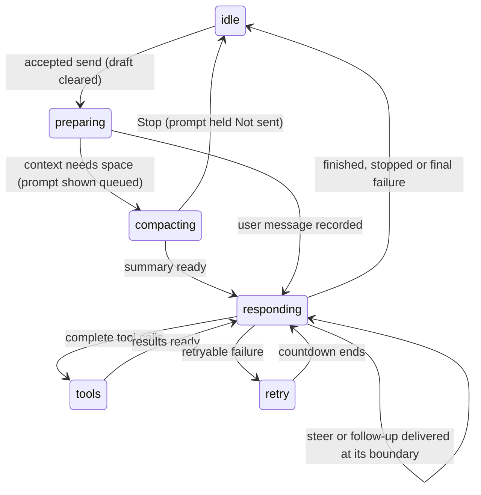

# Turns

## Summary

A turn runs from a user's send until the tab is idle: model responses stream, tools run, and further responses use their results. A turn can contain many model responses. Each tab owns its draft, queue, transcript, model, activity and error state. Several tabs can run independently; workbook mutations serialize through the taskpane's write lock.

## The simple case

Type a question and press Enter. The message appears, the composer clears, Send becomes Stop and a busy dot and working line appear. Pi streams text, perhaps calls tools, and answers. Completed messages save as they complete, starting with the first user message. At the end the tab is idle, ready for another send.

## The interaction, event by event

### Composing the message

Enter and Send share dispatch. Empty input does nothing. Known slash commands run locally; unknown or busy-refused commands report a toast and keep their text. Prefix slash text with a space to send it as a model message. Shift+Enter inserts a newline; IME composition Enter does not send. Hints append editable text without sending.

### Ends at once

No model request for empty text or a local command. A declined/cancelled local dialog changes nothing. The tab's draft remains its own across switches and reloads.

### Sent

An accepted message goes to the tab's action queue. Pre-prompt compaction holds it in a visible Queued row. On delivery it becomes a saved user message and is no longer editable. Auto-context adds durable notes and fresh selection. Missing credentials open "Connect {provider}" after the user message is recorded; dismissing reports "API key required for {provider}" without replacing it with a generic error.

### While Pi is busy

- Enter steers after the current response and all its tools. Alt/Option+Enter follows up when Pi would otherwise finish. Messages sent during compaction queue as new turns.
- Each waiting message has Edit and Remove. Alt/Option+Up edits the newest editable row only.
- Local inspection/configuration commands remain available according to [the command menu](../commands/the-command-menu.md). Busy model choices apply to the next turn; `/compact` queues in its own tab.
- Scroll, change thinking for the next turn, switch tabs or open overlays without stopping work. Modals own focus and disable shortcuts behind them.
- A retryable provider failure gets up to three retries after 2, 4 and 8 seconds, with a countdown. Stop cancels the wait.

### Finishes

**Done:** final answer remains and activity ends. **Aborted:** partial text remains with "Request aborted", no error banner. **Failed:** partial text and reason remain with inline recovery in that tab's transcript, including if it failed in the background. One context overflow can compact-and-retry; a second is final and does not promise another retry.

Undelivered text becomes separate saved Not sent rows, never implicit input to a later turn. Stop cancels queued commands and names them in a toast. Completed workbook changes stay applied.

## Stop

Stop button, unclaimed Escape and Stop and close share one cancellation path, covering model work, compaction and retry waits. Escape first goes to the topmost claiming surface, including menus and the tab menu. Approvals offer Stop Pi and withdraw when stopped. A submitted Excel batch cannot be recalled; checked writes report applied chunks or unknown outcomes. See [stopping](../turn/stopping.md).

## Modifiers

| Modifier | Set before | Changed while busy |
| --- | --- | --- |
| Model and provider | Used throughout the turn. Missing login prompts after delivery. | Choice applies to the next turn, not the running one. |
| Thinking level | Used for all responses in this turn. | Next turn only. |
| Execution mode | Auto runs changes; Confirm asks. | Applies to subsequent gates, not an already answered approval. |
| Files in the workspace, or an overlay open | Files are tool-readable, not attachments. Modal holds focus. | Imports become available; approval can pause tools. |
| Tab state (new, restored, another tab busy) | First user message saves. Restored history accompanies the request. | Other tabs continue independently. |
| Host (desktop or web) | Same turn contract; networking depends on host. | Host batches can finish after Stop. |

## Cancel and interrupt

| Event | Before sent | While busy |
| --- | --- | --- |
| Stop (button or Escape) | Idle Escape keeps draft and leaves composer. | One cancellation path; unused text held. |
| The user sends something else | Command or normal send dispatch. | Steer, follow-up or queued prompt. |
| Tab switched, created, closed or reopened | Swaps per-tab drafts. | Work stays in original tab; close waits for stop/host settlement. |
| An overlay or menu opens | Keeps draft. | Topmost surface owns keys. |
| Model or thinking level changes | Used at run start. | Model blocked, thinking next turn. |
| The provider fails | No request yet. | Retry if eligible; otherwise tab-specific failure. |
| The taskpane goes away | Saved draft returns. | Completed messages return; unfinished streaming may be lost. |
| The workbook changes underneath | Fresh context on request. | Next request sees notes/sample; no snapshot isolation. |
| Focus moves to the grid or another window | Draft stays. | Work continues; keys belong to focused host. |
| The context window fills | May compact first. | May compact between responses or recover one overflow. |

## Interactions with other systems

**Persistence.** [Storage](../cross-cutting/persistence-and-restore.md) saves messages from the first user message, drafts, held text and compaction. **Workbook changes and recovery.** Stop is not undo; backups recover supported changes. **Other tabs and sessions.** Independent turn state, shared mutation lock. **Execution mode and approvals.** Queued approvals before lock. **Models and providers.** Starting model/level stays for the run. **Offline and provider errors.** Classified separately from deliberate Stop. **Notifications.** Activity, queue, tab dot/attention and dismissible error. **Settings and preferences.** Auto-compaction defaults on. **Host differences.** Provider networking varies. **Language.** UI notices translate. **Accessibility and keyboard.** Keyboard paths respect modal focus and surface Escape ownership.

## Where the details live

[Composer](../turn/the-composer.md), [response](../turn/sending-and-the-response.md), [tool cards](../turn/tool-calls.md), [queue](../turn/steering-and-the-queue.md), [Stop](../turn/stopping.md), [thinking](../turn/thinking.md), [compaction](../turn/context-and-compaction.md), [auto-context](../turn/auto-context.md).

## Edge cases

Duplicate queued texts remain distinct. Unknown host write outcomes need a read-back before retry. No deliberate Stop resumes pending messages unasked.

## Open questions and verification

Code reviewed at `1f51cf8`; real GPT-6 Luna Excel-web read/write turn completed and independently read back formula/value. Historical defect runs are retained in verification, not repeated as the current contract here.

Verified against pi-for-excel commit `1f51cf8`.
