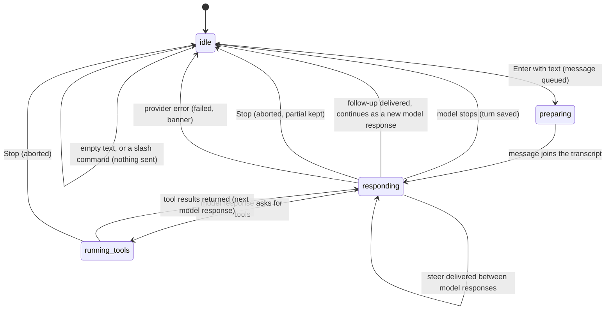

# Turns

## Summary

A turn is the unit of interaction in Pi for Excel: the user sends a message, and Pi works on it, streaming text, thinking, and running tools against the workbook, until it finishes, the user stops it, or it fails. This document owns the words every other document uses for a turn and its parts: *turn*, *model response*, *tool call*, *busy*, *responding*, *send*, *steer*, *follow-up*, *queued*, *Stop*, *aborted* and *failed*, and the rules for what happens when the user acts while a turn is running. It describes the shape of a turn and the rules that hold in every tab; the detailed behavior of each part lives in the [turn documents](#where-the-details-live). Turns happen per tab: each [session tab](sessions-and-tabs.md) runs its own turns independently, and several tabs can be responding at once.

## The simple case

The user types "What sheets do I have?" in the [composer](../turn/the-composer.md) and presses Enter. The message appears at the bottom of the transcript at once, the composer clears, the send button becomes a Stop button, a dot appears on the tab, and the [working indicator](../glossary.md#the-taskpane) starts above the composer ("Working…", then rotating phrases, with hints such as "Press Esc to stop").

Pi's answer streams into the transcript. Partway through, Pi may decide to read the workbook: a tool card appears ("Overview") with a spinner, the tool runs, its card shows the result, and Pi continues writing with what it learned. When Pi stops writing, the working indicator disappears, the Stop button turns back into the send button, the tab's dot goes away, and the conversation is saved.

The user is back where they started: an idle tab, focus in the composer, ready for the next message.

## The interaction, event by event

The diagram's `responding` and `running_tools` together are what the glossary calls *responding*; `preparing` and every state other than `idle` are *busy*.

### Composing the message

A turn begins in the composer. What the composer accepts, how it grows, and what Enter, Shift+Enter and the Files button do is owned by [the composer](../turn/the-composer.md). Three decisions are made the instant the user presses Enter:

1. **Is there anything to send?** Text is trimmed. Empty or whitespace-only text sends nothing.
2. **Is it a slash command?** Text that starts with `/` is never sent to the model by Enter. If it names a known command, the command runs locally (see [the command menu](../commands/the-command-menu.md)). If it does not, Enter inserts a newline into the composer while the tab is idle (nothing is sent); while the tab is responding, the unknown `/text` is steered to Pi as ordinary text.
3. **What is the tab doing?** If the tab is idle, the text is *sent*. If the tab is *responding*, Enter *steers* and Alt/Option+Enter sends a *follow-up* (see [While Pi is busy](#while-pi-is-busy)). If the tab is busy but not responding (for example during `/compact`), the text is *queued* behind the current action.

The model, thinking level and execution mode used for the turn are the tab's settings at the moment its first model request is made. See [Modifiers](#modifiers).

### Ends at once

Nothing reaches the model, nothing is added to the transcript, and nothing is saved when:

- the text is empty or only spaces (the send button is shown disabled when the composer is empty, but clicking it is simply ignored);
- the text starts with `/` and the tab is idle (a local command runs, or an unknown one gets a newline);
- there is no active tab ("No active session"), which only happens during startup or teardown.

A starter hint is not a send either: clicking one fills the composer and stops there.

### Sent

The turn is committed when the user's message joins the transcript. That happens almost immediately after Enter, with one possible wait in between:

- **Auto-compaction.** If the tab's context is nearly full, Pi compacts older messages first. The working indicator shows "Compacting context…" with the hint "Send messages and Pi will see them after compaction". See [context and compaction](../turn/context-and-compaction.md).

From the moment the message joins the transcript:

- The text is part of the conversation and will be sent with every later request until compaction summarizes it. There is no edit or delete for a sent message.
- The error banner, if one was showing, is cleared.
- Pi gathers [auto-context](../turn/auto-context.md) (the workbook blueprint, the selection, recent edits) and sends the request.
- The tab is busy until the turn ends.

If the tab's provider has no usable credential, Pi asks for one with a connection dialog only now, after the message is already in the transcript and the tab is responding. If the user dismisses it, the turn fails: the transcript shows "Error: Provider is not configured: {provider id}" and the banner "LLM error: Provider is not configured: {provider id}" (confirmed in Excel on the web; the code's intended "API key required for {provider}." is overwritten). See [models and providers](models-and-providers.md).

### While Pi is busy

A turn is a loop of model responses. Each model response streams text and, optionally, a thinking block and tool calls. If it asks for tools, they run (several can run at once when the model asks for several), and their results start the next model response. The loop ends when a model response asks for no tools and nothing is waiting to be delivered. [Sending and the response](../turn/sending-and-the-response.md) owns what the user sees as text streams; [tool calls](../turn/tool-calls.md) owns tool cards; [thinking](../turn/thinking.md) owns thinking blocks.

While a tab is responding, the composer stays usable and its placeholder changes to "Redirect reply (↵) · New question (⌥↵)". The user can:

- **Steer** with Enter. The text goes into the queue strip labeled "Steer" and the composer clears. It is delivered as a user message as soon as the current model response and all its tool calls have finished, before the next model response starts, so it changes what Pi does next. It never interrupts a running tool, and it is delivered even if Pi was about to finish: the turn then continues with one more model response. Several steers are delivered one per model response, in the order sent.
- **Follow up** with Alt/Option+Enter. The text goes into the queue strip labeled "Follow up". It is delivered only when Pi would otherwise have finished the turn, and the turn continues with it. Several follow-ups are delivered one at a time, each after the previous one's work finishes.
- **Restore queued** with Alt/Option+Up: everything waiting comes back into the composer for editing. See [steering and the queue](../turn/steering-and-the-queue.md).
- **Stop** with the Stop button or Escape. See [Stop](#stop) below.
- **Run a busy-allowed command** (`/compact`, `/new`, `/rules`, `/resume`, `/history`, `/reopen`, `/yolo`, `/extensions`, `/plugins`, `/skills`, `/files`, `/tools`). Every other built-in command is refused with "Can't run /{command} while Pi is busy". `/compact` is queued to run after the turn.
- **Switch tabs, open another tab, scroll the transcript, open settings, change the thinking level.** The turn keeps running in its tab. Changing the model is refused ("Wait for this tab to finish before changing models").

When a steered or followed-up message is delivered, it appears in the transcript as an ordinary user message and disappears from the queue strip.

### Finishes

A turn ends in one of three ways.

- **Done.** The last model response asked for no tools and nothing was waiting. The working indicator disappears, the tab's dot goes away, the Stop button becomes the send button, and the queue strip clears.
- **Aborted.** The user pressed Stop. The model response that was streaming stays in the transcript as far as it got, marked "Request aborted". No error banner. A stop that lands while a tool is running ends differently: after the tool returns, an empty model response shows the red line "Error: signal is aborted without reason" (still no banner). See [stopping](../turn/stopping.md#at-each-stage).
- **Failed.** The provider or the loop raised an error. Everything up to the failure stays in the transcript, the failing model response is marked with "Error:" and the reason, and, if the tab is the active tab, the error banner shows "LLM error: {reason}", or a more specific message for a context overflow or a likely CORS failure. A connection lost while the answer is streaming keeps the partial answer and shows "LLM error: network error"; a request that cannot reach the provider at all (for example the proxy is down) shows the CORS message. Confirmed in Excel on the web by stopping the proxy. With auto-compaction on, a context overflow triggers one compact-and-retry before the failure is final. See [provider errors and offline](../cross-cutting/provider-errors-and-offline.md).

In every case, each message is saved as it completes, once the session has had at least one answer from Pi; see [persistence and restore](../cross-cutting/persistence-and-restore.md). Changes Pi made to the workbook during the turn stay made, whatever the ending; each one has an [automatic backup](the-workbook.md) the user can revert.

If anything is still queued in the tab's action queue when the turn ends (a queued prompt or `/compact`), it starts next, and the tab stays busy.

## Stop

Stop is the user's explicit abort of the active tab's turn. It has two triggers, and they do not do the same thing:

| | Stop button | Escape |
| --- | --- | --- |
| Available | While the active tab is responding; the button replaces send. | While the active tab is responding, and no menu, popover, overlay (settings, the model picker, the Files workspace, any dialog), the command menu or an extension widget is open. Those claim Escape for themselves and close instead; only the tab context menu does not. Confirmed in Excel on the web with the Files workspace, the thinking popover and the tab context menu. |
| The streaming model response | Ends at once, kept as far as it got, marked "Request aborted". | Same. |
| A running tool | Pi waits for it to return; the Stop button and working indicator stay until then. The turn then ends with a red "Error: signal is aborted without reason" instead of "Request aborted", with no banner. Confirmed in Excel on the web with a 12-second Office.js call. | Same. Confirmed in Excel on the web. |
| Waiting steers and follow-ups | Removed from the queue strip but kept by Pi (*stranded*) and delivered in the next turn; see [Open questions](#open-questions-and-verification). Confirmed in Excel on the web. | Put back into the composer, above any text already there. Confirmed in Excel on the web. |
| Queued prompts | Stay queued and start as soon as the stopped turn has ended. | Put back into the composer with the steers and follow-ups. |
| Queued commands | Stay queued and run. | Dropped. |
| Text in the composer | Unchanged. | Unchanged; if it would otherwise be lost it is put back. |

Stop never affects other tabs. Escape while the tab is idle does not stop anything: with focus in the composer it moves focus out of the composer to the tab strip; elsewhere it closes whatever menu or overlay is open.

## Modifiers

| Modifier | Set before | Changed while busy |
| --- | --- | --- |
| Model and provider | The tab's model is used for every model response in the turn. With no connected provider for it, the message joins the transcript and a connection dialog opens over it (confirmed in Excel on the web). | Refused: "Wait for this tab to finish before changing models". The status-bar model picker still opens, and picking a model shows that toast and leaves the model unchanged; `/model` is refused the same way. Confirmed in Excel on the web. |
| Thinking level | Applies to every model response in the turn. | Takes effect from the next turn; the toast says "Thinking: {level} (next turn)". Every remaining model response in the running turn keeps the old level. |
| Execution mode | In Auto, mutations run as Pi calls them. In Confirm, each mutation waits for an [approval](../workbook/confirm-mode-and-approvals.md) and the turn pauses on it. | Takes effect from the next mutation. A change does not affect an approval dialog already open. |
| Files in the workspace, or an overlay open | Files in the [Files workspace](../files/the-files-workspace.md) are available to Pi's tools; they are not attached to the message. An open overlay holds focus, so Enter in the composer cannot happen until it closes. | Importing files during a turn makes them available to tool calls that start afterwards. Overlays opened during a turn do not pause it, except approval dialogs, which the turn waits on. |
| Tab state (new, restored, another tab busy) | A new tab sends its first message like any other; the session is first saved when Pi's first answer completes. A restored tab sends with its full restored history. Another tab being busy does not delay this one, except that mutations wait for the [workbook lock](the-workbook.md). | Switching away does not pause the turn; it keeps running in the background tab. |
| Host (desktop or web) | No difference in the turn itself. Some providers need the [CORS proxy](../setup/the-proxy.md) on some hosts. | No effect. |

Variants that change mid-turn take effect at the next boundary (the next turn for the thinking level, the next mutation for the execution mode), never in the middle of one.

## Cancel and interrupt

| Event | Before sent | While busy |
| --- | --- | --- |
| Stop (button or Escape) | Escape with focus in the composer moves focus out; nothing is sent and the text stays. There is no Stop button while idle. | The turn ends as aborted. See [Stop](#stop) for how the two triggers differ. |
| The user sends something else | A slash command runs instead, if it is known. Clicking a starter hint overwrites the whole draft with its prompt; nothing is sent. | Enter steers, Alt/Option+Enter follows up, a busy-allowed command runs or is queued, any other command is refused with a toast. |
| Tab switched, created, closed or reopened | The composer is shared by all tabs: the draft stays put and is sent to whichever tab is active when Enter is pressed. | The turn keeps running in its tab, which shows a busy dot. Closing a responding tab asks "Stop and close this tab?" ("Stop and close" / "Keep open"); "Stop and close" stops the turn and discards its waiting steers and follow-ups (confirmed in Excel on the web: the reopened session ended at the running tool call, with no steer); closing a tab whose mutation holds the workbook lock is refused. |
| An overlay or menu opens | No effect on the draft. | The turn keeps running behind it. While a menu, popover or overlay that claims Escape is open, Escape closes it instead of stopping. |
| Model or thinking level changes | Applies to the turn about to be sent. | Model change refused; thinking-level change applies from the next turn. |
| The provider fails | Not applicable; nothing has been sent. | The turn ends as failed. The error banner appears only if the tab is active when the turn ends. |
| The taskpane goes away | The draft in the composer is lost. | The turn ends without a record of its ending. Messages that had completed are saved; the model response that was streaming is lost. In a session Pi had never answered, nothing is saved at all. Workbook changes already made stay made. |
| The workbook changes underneath | Edits and selection changes are picked up by auto-context at send time. | Pi does not see edits made during the turn until its next request gathers auto-context. A tool that reads or writes cells the user is editing sees whatever Excel reports at that moment. |
| Focus moves to the grid or another window | The draft stays in the composer. | The turn keeps running. Returning focus refreshes Pi's view of the workbook. |
| The context window fills | Auto-compaction runs before the message is sent. | Auto-compaction runs between model responses; an overflow error triggers one compact-and-retry. |

After any interrupt, the user stays in the same tab (unless they switched), with whatever text was in the composer.

## Interactions with other systems

**Persistence.** Each completed message is saved to the session as it completes, once the session has received its first answer from Pi. A turn is never saved half-streamed. See [persistence and restore](../cross-cutting/persistence-and-restore.md).

**Workbook changes and recovery.** Every mutation in a turn is preceded by an automatic backup and runs under the workbook lock. Stopping or failing a turn does not undo mutations already made. See [the workbook](the-workbook.md).

**Other tabs and sessions.** Turns in different tabs are independent: separate transcripts, queues, models and Stop. They share the workbook lock and the error banner.

**Execution mode and approvals.** In Confirm mode a turn pauses at each mutation until the user answers the approval dialog. Declining fails that tool call, Pi sees the failure, and the turn continues.

**Models and providers.** The tab's model and thinking level are read at each model request. A missing credential opens the connection dialog at the first request of the turn.

**Offline and provider errors.** A failed request ends the turn as failed. Pi does not retry failed requests, including rate limits (429) and 5xx: no retry count is configured, so the first failure ends the turn. The only exception is internal to the OpenAI (ChatGPT) transport, which reconnects once when its WebSocket hits a connection limit or loses its continuation; the user does not see it. See [provider errors and offline](../cross-cutting/provider-errors-and-offline.md).

**Notifications.** The working indicator, the tab's busy dot, the queue strip and the error banner are the turn's notifications. There is no sound and no system notification when a turn finishes in a background tab.

**Settings and preferences.** Auto-compaction is on. There is no control for it in Settings; a stored preference can turn it off, and is read once when the taskpane opens. With it off, an overflow fails the turn without a retry.

**Host differences.** None in the turn itself.

**Language.** The composer placeholders, working indicator, queue strip labels and banners are translated. Some banners are hard-coded in English (the context-overflow and CORS messages and "API key required for {provider}.").

**Accessibility and keyboard.** The whole turn can be driven from the keyboard: Enter, Alt/Option+Enter, Alt/Option+Up, Escape, Shift+Tab for thinking level, Ctrl/Cmd+O to show or hide tool details, F2 to return to the composer. The working indicator is not announced to screen readers.

## Where the details live

| Part of the turn | Owner |
| --- | --- |
| Typing, Enter, Shift+Enter, files | [the composer](../turn/the-composer.md) |
| Streaming text, the working indicator, the finished response, the error banner | [sending and the response](../turn/sending-and-the-response.md) |
| Tool cards, grouping, Ctrl/Cmd+O | [tool calls](../turn/tool-calls.md) |
| Steer, follow-up, queued prompts and commands, Alt/Option+Up | [steering and the queue](../turn/steering-and-the-queue.md) |
| Stop and Escape at each stage | [stopping](../turn/stopping.md) |
| Thinking levels and blocks | [thinking](../turn/thinking.md) |
| The context meter and compaction | [context and compaction](../turn/context-and-compaction.md) |
| What Pi is told about the workbook | [auto-context](../turn/auto-context.md) |

## Edge cases

- A steer sent while the very last model response is streaming is still delivered: the turn continues with one more model response instead of ending.
- Sending an identical steer twice shows two rows in the queue strip; when the first is delivered, only one row disappears.
- Several tabs can be responding at once (confirmed in Excel on the web with writes from two tabs, the workbook calls slowed to 8 s each). Their mutations still run one at a time; a tab waiting for the lock shows "Locking…".
- A turn started in one tab keeps streaming if the user switches to another tab; on switching back, the transcript shows everything so far and the working indicator resumes.
- An error in a background tab is not shown as a banner, neither when it happens nor when the user switches to that tab; the only trace is the "Error:" line in its transcript.
- An error banner shown for one tab stays visible after switching to another tab, until the next send or the next successful run in the active tab.
- If the user sends while the tab is compacting, the message waits in the queue strip as "Queued" and goes out after compaction.

## Open questions and verification

- The Stop button and Escape treat waiting items differently: Escape restores steers, follow-ups and queued prompts into the composer and drops queued commands; the Stop button leaves queued prompts and commands to run immediately after the stopped turn. Read from code. Probably unintentional; a product call at least.
- After the Stop button, steers and follow-ups that had not been delivered disappear from the queue strip but stay in Pi's internal queue (they are *stranded*), and are delivered unasked in the next turn. Confirmed in Excel on the web (twice): after Stop, the next prompt "Reply with just OK." was followed straight away by the stranded steer "Then say BANANA." as a user message, Pi answered "BANANA" (and never answered "OK"), then the follow-up "Then say MANGO." was delivered and answered. After a provider error (simulated by making the request throw), the strip emptied and both items were still held, as after Stop; their delivery after an error was not observed because the taskpane was reloaded first. A bug.
- The error banner is shared by all tabs: it is not cleared on tab switch, and errors from background tabs never show one. Confirmed in Excel on the web with simulated provider errors: Chat 1's banner stayed after "+" opened Chat 2; Chat 2 then failed while Chat 1 was active and no banner appeared, neither then nor after switching to Chat 2. Sending from Chat 2 cleared Chat 1's banner. Probably a bug.
- Whether a workbook write already sent to Excel completes after Stop has not been confirmed.
- The composer draft is shared across tabs, so text typed in one tab is sent to another after a switch. Confirmed in the standalone taskpane and in Excel on the web. Probably a bug; see [sessions and tabs](sessions-and-tabs.md).
- Compaction cannot be stopped: the Stop button is not shown and Escape only moves focus out of the composer while only compaction is running. Confirmed in Excel on the web during `/compact`.
- Reloading the taskpane during the first turn of a new session loses the user's message because nothing is saved until Pi's first answer completes. Confirmed in Excel on the web: a tab opened with "+" and reloaded mid-answer came back empty. In a tab Pi had already answered, a reload mid-answer kept the user message and lost the answer, and the turn left no ending marker.
- A stop during a running tool ends with "Error: signal is aborted without reason" (`stopReason: "error"`) rather than "Request aborted": after the tool batch the loop starts another model request with the already-aborted signal (`agent-loop.js`, `runLoop`), and the provider rejects it with the browser's abort error. The banner is suppressed because the text contains "abort". Confirmed in Excel on the web with both the Stop button and Escape. Looks like a bug.

Verified against pi-for-excel commit `ec453df`.
