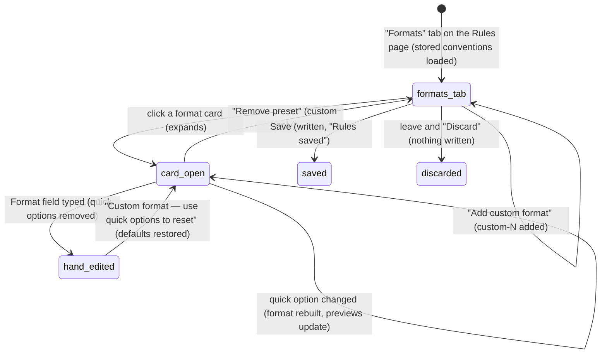

# Conventions

## Summary

Conventions are the house style Pi uses when it formats cells: what a "number", "currency", "percent" or "ratio" looks like (decimal places, how negatives and zeros show, the currency symbol), any custom formats the user has named, the header style, the font colors that mark hard-coded values and links to other sheets, and the default font. They exist so that "format this as currency" produces the same result in every workbook without the user spelling it out. The user edits them on the "Formats" tab of the "Rules" page in the Settings overlay (reached with `/rules`, the "Rules" item of the [utilities menu](../ui/the-utilities-menu.md), or "Rules & conventions" in [Settings](../setup/settings.md)); Pi can read and change them with its `conventions` tool. There is one set of conventions for this computer, used in every workbook. Out of the box they follow a financial-modelling style: thousands separators, negatives in parentheses, zeros as a dash. The editor opens while a tab is [busy](../glossary.md#the-turn), with no provider connected, and on Excel on the web.

## The simple case

The user asks Pi to "format the totals as currency". Pi formats the range with its "currency" style, and the cells show `$ 1,234.50`, `$ (1,234.50)` for a negative and `$ --` for zero, with the dollar sign pinned to the left edge of the cell and the numbers lined up on the decimal point. Nothing asked the user how to format it; the conventions decided.

To change that, the user types `/rules`, clicks the "Formats" tab, and expands "Currency". They change "symbol" to `€` and "dp" to `0`. The format line and the "Positive", "Negative" and "Zero" previews update at once. They click "Save"; a toast says "Rules saved". The next time Pi formats anything as currency, it uses euros with no decimals. Cells formatted earlier keep their old format.

## The interaction, event by event

The editor is the "Formats" tab of the Rules page, and opens, saves, cancels and guards unsaved changes exactly as [rules](rules.md#the-interaction-event-by-event) describes; one "Save" writes rules and conventions together. The diagram shows only what is particular to the tab.

### What the tab shows

The tab opens with the hint "Set preset formats, font colors, header style, and default font." and four sections:

- **"Number formats".** One collapsed card each for "Number", "Integer", "Currency", "Percent", "Ratio" and "Text", showing the name and the exact Excel format string. Custom formats follow, sorted by name, then the "Add custom format" button.
- **"Colors (font color)".** Two fields, "Hardcoded values" and "Cross-sheet links", each with a colour swatch and a text box that accepts `#RRGGBB`, `#RGB` or `rgb(r,g,b)`.
- **"Header style".** The fill and font colours as swatches labelled "Fill" and "Font", a three-column preview ("Revenue", "Cost of Goods Sold", "Margin") drawn in the current style, "Fill color" and "Font color" fields, and "Bold" and "Wrap text" switches showing "On" or "Off".
- **"Default font".** "Font name" and "Font size" (6 to 72).

### Editing a format

An expanded built-in card shows a "Format" field with the full format string, three preview chips ("Positive", "Negative", "Zero") formatting 1,234.5 and zero (for the default Currency: "$1,234.50", "$(1,234.50)", "$--"; the chips do not show the gap Excel puts after the symbol), and quick options: "dp" (0 to 4), "neg" ("(1,234)" or "-1,234"), "zero" ("--", "-", "0" or "blank"), and, for Currency only, "symbol". Changing a quick option rebuilds the format string and previews immediately. "Text" has no quick options; its format is `@`.

Typing in the "Format" field (the change applies when the field loses focus) replaces the format with exactly what was typed and removes the quick options, because Pi can no longer tell how the string was built. The previews then say "Custom". A link "Custom format — use quick options to reset" brings the quick options back with the built-in defaults for that format, not the user's previous choices.

"Add custom format" adds a card named "custom-1" (then "custom-2", …) with the default number format, a "Name" field, a "Description" field ("Optional"), a "Format" field, previews that all read "Custom", and a red "Remove preset" link. It has no quick options. Pi can use a custom format by name, and is told the name and description.

Colour fields accept the change when they lose focus. A value that is not a valid colour is ignored without a message and the field shows the previous colour again.

### Ends at once

Leaving the Rules page without saving discards every change on this tab, after the "Discard changes?" question if anything changed. Removing a custom preset and then discarding brings it back. Nothing is recorded until Save.

### Saving

"Save" on the Rules page writes the conventions together with the rules. Before writing, invalid parts are dropped silently: a custom preset with an empty format or empty name, a font size outside 6–72, a blank font name.

The new conventions are used by the next formatting Pi does, in every tab, even in the middle of a turn: each formatting call reads them when it runs. Pi's instructions, which tell it which values differ from the defaults and which custom names exist, are refreshed in every tab at the same time.

### While saving

There is no busy phase.

### After saving

The user lands on the "Settings" page, as for [rules](rules.md#after-saving). Existing cells do not change: conventions only affect formatting Pi does from now on. Conventions are stored in the add-in's browser storage on this computer, not in the workbook.

## The defaults

| Format | Format string | 1234.5 | −1234.5 | 0 |
| --- | --- | --- | --- | --- |
| Number | `#,##0.00_);(#,##0.00);--_)` | 1,234.50 | (1,234.50) | -- |
| Integer | `#,##0_);(#,##0);--_)` | 1,235 | (1,235) | -- |
| Currency | `$* #,##0.00_);$* (#,##0.00);$* --_)` | $ 1,234.50 | $ (1,234.50) | $ -- |
| Percent | `#,##0.0%_);(#,##0.0%);--_%_)` | 123,450.0% | (123,450.0%) | -- |
| Ratio | `#,##0.0x_);(#,##0.0x);--_x_)` | 1,234.5x | (1,234.5x) | -- |
| Text | `@` | stored as text | | |

The padding (`_)`) keeps positive numbers and dashes aligned with the closing parenthesis of negatives. In the Currency format the symbol sits at the left of the cell.

Other defaults: hard-coded values in blue (`#0000FF`), links to other sheets in green (`#008000`), formulas in black; headers with fill `#4472C4`, white bold text and wrapping; default font Arial 10. Pi also has fixed styles that are not editable: "total-row" (bold with a thin top border), "subtotal" (bold), "input" (yellow fill `#FFFD78`, for assumption cells) and "blank-section" (light grey `#F2F2F2`). Pi can combine them, for example a currency total row.

## What the user sees in Pi's formatting

- **Number formats and the header style are applied by the product.** When Pi formats with a style name ("currency", "header", a custom name), the format string comes from the conventions, not from the model. If Pi asks for a different number of decimals or another currency symbol on top of a built-in style, the rest of the convention (negatives, zeros, separators) is kept.
- **Font colours and the default font are guidance only.** Pi is told the colours and the font and is asked to use them, but nothing applies them automatically. Whether a hard-coded number ends up blue depends on the model doing it.
- **Raw format strings bypass conventions.** For dates and anything unusual Pi may pass an Excel format string directly; conventions do not affect it.
- **Reading.** When Pi reads cells in detail, formats that match a convention are reported by name ("currency", "custom-1 — {description}") rather than as raw strings, so Pi recognizes its own house style in the workbook.

## When Pi changes the conventions

Pi's `conventions` tool can view the conventions, change part of them, or reset them all to the defaults. Its [tool card](../turn/tool-calls.md) reads "View conventions", "Update conventions" or "Reset conventions". Expanded, an update lists what it touched ("Built-in presets", "Custom presets", "Remove presets", "Color conventions", …) and the result shows the full conventions with the values that differ from the defaults. An invalid colour makes the call fail with "Invalid conventions update:" and the reason; nothing is saved.

The tool is not a [mutation](../glossary.md#the-workbook): it needs no [approval](../workbook/confirm-mode-and-approvals.md) in Confirm mode and creates no backup. There is no toast. The new values are used by the next formatting call. Resetting is only possible through Pi; the editor has no "reset all" button.

## Modifiers

| Modifier | Set before | Changed while busy |
| --- | --- | --- |
| Model and provider | No effect on the editor or on the format strings. Whether font colours and the default font are followed depends on the model. | No effect. |
| Thinking level | No effect. | No effect. |
| Execution mode | No effect on conventions. In Confirm mode, formatting that uses them still asks for approval like any other mutation; the `conventions` tool itself does not. | No effect. |
| Files in the workspace, or an overlay open | No effect from files. The editor is itself on an overlay; see [rules](rules.md#modifiers). | No effect. |
| Tab state (new, restored, another tab busy) | Conventions are the same in every tab. | A save applies to the next formatting call in every tab, including one that is mid-turn. |
| Host (desktop or web) | No difference. | No effect. |

## Cancel and interrupt

The Formats tab shares its overlay, its exits and its interrupts with the Rules page; the [rules table](rules.md#cancel-and-interrupt) applies unchanged. Particular to conventions:

| Event | Before sent | While busy |
| --- | --- | --- |
| Stop (button or Escape) | Escape in a field takes focus out of it, which applies what was typed to the draft (not saved). A second Escape goes back, asking first if anything changed. | Not applicable. |
| The user sends something else | Not possible while the overlay is open. | Not applicable. |
| Tab switched, created, closed or reopened | Not possible while the overlay is open. | Not applicable. |
| An overlay or menu opens | As for rules. | Not applicable. |
| Model or thinking level changes | Not possible from the page. | Not applicable. |
| The provider fails | No effect. | Not applicable. |
| The taskpane goes away | Unsaved changes are lost. | Saved conventions are kept. |
| The workbook changes underneath | No effect. Conventions never change existing cells. | Not applicable. |
| Focus moves to the grid or another window | A field being edited loses focus, which applies its value to the draft (not saved). | Not applicable. |
| The context window fills | No effect. Conventions are part of Pi's instructions, not the conversation. | Not applicable. |

## Interactions with other systems

**Persistence.** One set of conventions per computer and browser profile, in the add-in's storage, kept across reloads and shared by every taskpane. See [persistence and restore](../cross-cutting/persistence-and-restore.md).

**Workbook changes and recovery.** Changing conventions changes no cells and creates no backup. Formatting Pi applies with them is an ordinary mutation with its own [backup](../workbook/backups-and-revert.md).

**Other tabs and sessions.** Shared by all tabs and all sessions. There is no per-workbook convention; a workbook that needs its own style needs [workbook rules](rules.md) that tell Pi so.

**Execution mode and approvals.** The `conventions` tool never asks for approval.

**Models and providers.** The format strings are applied by the product and are identical for every model. Values that differ from the defaults are listed in Pi's instructions.

**Offline and provider errors.** No interaction.

**Notifications.** "Rules saved" after Save. None when Pi changes conventions.

**Settings and preferences.** Conventions live on the "Formats" tab of the Rules page and are saved with the rules.

**Host differences.** None.

**Language.** Section titles, format names ("Number", "Currency", …), field labels and buttons are translated. The quick-option labels "dp", "neg", "zero" and "symbol", the preview labels "Positive", "Negative" and "Zero", the colour labels ("Hardcoded values", "Cross-sheet links", "Fill", "Font", "Fill color", "Font color"), the "On"/"Off" switch text and the header preview columns are English in every UI language. The previews always use English number formatting (comma thousands, dot decimals), whatever Excel's locale.

**Accessibility and keyboard.** The format cards are expandable sections that open with Enter or Space. The colour swatches are decorative and cannot be used to pick a colour; colours must be typed.

## Edge cases

- There is no control for the thousands separator in the editor. Pi can turn it off through its tool; the editor then shows the resulting format string.
- The Percent preview shows "1,234.5%" for 1,234.5, but Excel's percent format multiplies by 100; the cell would show 123,450.0%.
- Renaming a custom format to a name that already exists is ignored without a message; the card keeps its old name.
- A custom format named like a built-in one ("currency") does not replace the built-in.
- Hand-editing a built-in format and saving it means Pi's "decimal places" and "currency symbol" adjustments no longer apply to that format.
- Changing the header style affects only headers Pi formats afterwards with its "header" style.
- When Pi changes the conventions mid-conversation, the next formatting call uses the new values at once, but the list of non-default values in Pi's instructions is only refreshed at the next refresh (the taskpane regaining focus, or rules being saved).

## Open questions and verification

- Confirmed in Excel on the web (CONV checklist): the tab's hint and the six built-in cards with the default format strings above; the expanded Currency card (Format field, the three previews, "dp", "neg", "zero" and "symbol"); changing "dp" to 0 and the symbol to `€` rebuilding the string as `€* #,##0_);€* (#,##0);€* --_)`; Save writing it with "Rules saved"; Pi then formatting A1:A3 "with your currency style" and Excel getting exactly that string, showing "€1,235", "€(1,235)" and "€--"; a hand-typed Format removing the quick options and the previews reading "Custom"; the reset link restoring the built-in defaults; "Add custom format" adding "custom-1"; an invalid colour reverting without a message; a change on this tab raising "Discard changes?", and "Discard" leaving nothing saved.
- After the `conventions` tool saves, it announces the change with an event nothing listens for (`src/tools/conventions.ts:90-94`; no listener for `pi:conventions-updated` in `src/`). Pi's instructions keep the old list of overrides and custom names until something else refreshes them. Read from code; probably a bug. Not checkable by hand without reading Pi's instructions.
- The Ratio format's bare `x` (`#,##0.0x_)`, built in `src/conventions/format-builder.ts:70`) is accepted by Excel on the web: a cell with that format shows "1,234.5x", "(1,234.5x)" and "--" (CONV-07). Excel desktop was not tried.
- The Percent preview does not multiply by 100 (`src/commands/builtins/settings-pages/rules-page.ts:286-320`). Confirmed in Excel on the web (CONV-06): the preview reads "1,234.5%" while Excel shows 1234.5 in that format as "123,450.0%". Small, but misleading.
- Saving the Rules page writes the conventions read when the page opened, overwriting any change Pi made meanwhile; see [rules](rules.md#open-questions-and-verification).
- Whether models follow the font-colour and default-font guidance consistently was not checked.
- Custom formats used by name, the header style and the `conventions` tool's cards were read from code.

Verified against pi-for-excel commit `ec453df`.
