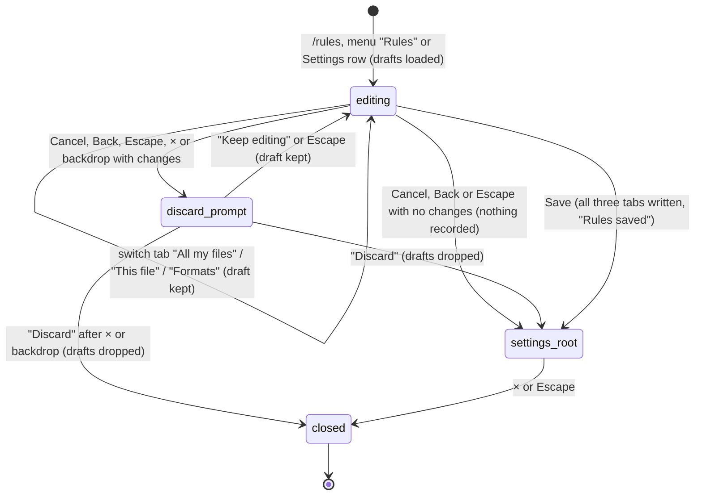

# Rules

## Summary

Rules are standing instructions that Pi follows in every conversation without being told again: preferences such as "always use EUR", or notes about one workbook's structure. There are two kinds. **User rules** ("All my files") apply in every workbook on this computer. **Workbook rules** ("This file") apply only while the current workbook is open. The user edits both on the "Rules" page of the Settings overlay, reached with `/rules`, the "Rules" item of the [utilities menu](../ui/the-utilities-menu.md), or the "Rules & conventions" row in [Settings](../setup/settings.md). The same page has a third tab, "Formats", for [conventions](conventions.md). Pi can also change the rules itself during a turn with its `instructions` tool, which shows up as a tool card. A change, from either side, reaches every open tab from its next model request. The page opens while a tab is [busy](../glossary.md#busy) (`/rules` is busy-allowed), with no provider connected, and on Excel on the web. Nothing marks that rules are active: no badge or status-bar item shows whether any rules are set.

## The simple case

The user types `/rules` and presses Enter. The Settings overlay opens on the "Rules" page, subtitled "Set guidance for all files, this workbook, and format conventions.", with the "All my files" tab selected and the cursor in an empty text box. The hint above it says "Guidance given to Pi in all your conversations. Pi can also update these when you tell it your preferences — e.g. "always use EUR".", and the counter under it says "0 / 2,000 chars".

The user types "Always use EUR for currencies" and clicks "Save". A toast says "Rules saved". The overlay does not close: it goes back to the "Settings" page, and a second click on × or a second Escape returns the user to the chat. From the next model request in every tab, Pi has the rule.

Alternatively the user just tells Pi in chat, "from now on, use EUR". Pi may call its `instructions` tool; a tool card labelled "Remember user rules" appears in the transcript, and the rule is saved without any dialog.

## The interaction, event by event

### Opening the editor

Every way in opens the Settings overlay directly on the "Rules" page, on the "All my files" tab, with focus in the text box. When the page opens it reads three things once: the stored user rules, the stored workbook rules for the workbook it identifies at that moment, and the stored [conventions](conventions.md). These become three drafts. Switching between "All my files", "This file" and "Formats" swaps what is shown but keeps every draft; nothing is saved by switching.

- **"All my files"** shows the user rules with the placeholder "Your preferences and habits, e.g. • Always use EUR for currencies • Format dates as dd-mmm-yyyy • Check circular references after writes" and a counter "{chars} / 2,000 chars".
- **"This file"** adds a line "Workbook: {label}" naming the workbook, the hint "Guidance given to Pi only when it reads this file.", the placeholder "Notes about this workbook's structure, e.g. • DCF model for Acme Corp, FY2025 • Revenue assumptions in Inputs!B5:B15 • Don't modify the Summary sheet" and a counter out of 4,000. If Pi cannot identify the workbook (typically a new workbook that has never been saved), the hint is instead "Can't identify this workbook right now — try saving the file first." and the line reads "Workbook: Current workbook"; the text box still accepts typing (see [Open questions](#open-questions-and-verification)).
- **"Formats"** shows the conventions editor, owned by [conventions](conventions.md).

The limits are soft. The counter turns to a warning style when the text passes 2,000 (user) or 4,000 (workbook) characters, but typing and saving are not blocked.

### Ends at once

Nothing is recorded when the user leaves without saving:

- **No changes.** "Cancel", the back arrow, or Escape go back to the "Settings" page; × or a click on the dimmed backdrop close the overlay. No dialog, no toast.
- **Unsaved changes.** Any of those exits asks first: "Discard changes?" with "You have unsaved changes to your rules. Discard them?", "Keep editing" and a red "Discard". "Keep editing" (or Escape) returns to the page with the drafts intact. "Discard" drops all three drafts and carries on with the exit the user chose. The check covers all three tabs, so a change on "Formats" also triggers it from "All my files".
- **Escape inside the text box.** The first Escape only takes focus out of the text box; the second one is the exit above.

### Saving

"Save" commits all three drafts at once: the user rules, the workbook rules (only if the workbook was identified), and the conventions, even the ones the user did not touch. Text is trimmed; an empty box clears that kind of rule. Then the toast "Rules saved" appears and the page goes back to the "Settings" page rather than closing the overlay.

From that moment every open tab is told about the new rules. Each tab's instructions to the model are rebuilt and take effect from its next model request; nothing is added to any transcript. A tab that is responding at the time picks the change up at its next model response.

### While saving

There is no busy phase. Saving is instantaneous from the user's point of view, the Save button is not disabled during it, and no spinner is shown.

### After saving

The user lands on the "Settings" page of the same overlay. Rules are stored in the add-in's browser storage on this computer, not in the workbook file: they do not travel with the workbook to another computer or another Excel profile, and other people who open the workbook do not get them. Workbook rules are keyed to the workbook's identity, which is derived from where the file is saved; a copy saved elsewhere, or the same file moved or renamed, starts with no workbook rules. See [persistence and restore](../cross-cutting/persistence-and-restore.md).

There is no undo or history. Rules cannot be reverted from [Backups](../workbook/backups-and-revert.md), because they are not part of the workbook.

## When Pi changes the rules

Pi has a tool, `instructions`, that saves rules directly. Pi is told to update user rules freely when the user states a lasting preference, and to show the exact text and ask in chat before changing workbook rules. That second step is a conversation, not a dialog: nothing in the product enforces it.

When Pi calls it, the transcript shows a [tool card](../turn/tool-calls.md) whose header reads "Remember user rules" or "Remember workbook rules" (adding a line) or "Set user rules" / "Set workbook rules" (replacing all of them). Expanded, the card lists "Scope", "Action" and "Content" (cut at 120 characters), and the result: "Updated user rules (N/2000 chars):" followed by the full new text, with a warning line if the text is over the soft limit. If the workbook cannot be identified, the card shows "Error: workbook identity unavailable. Can't update workbook rules right now."

The tool is not a [mutation](../glossary.md#the-workbook): it does not ask for [approval](../workbook/confirm-mode-and-approvals.md) in Confirm mode, does not take the workbook lock, and creates no backup. There is no toast. The change reaches every open tab exactly like a save from the page. The Rules page, if it is open at the time, does not refresh; see [Edge cases](#edge-cases).

## Modifiers

| Modifier | Set before | Changed while busy |
| --- | --- | --- |
| Model and provider | No effect on the page; it works with no provider connected. Every model receives the same rules text. | No effect. The page can be open while the model changes elsewhere. |
| Thinking level | No effect. | No effect. |
| Execution mode | No effect. Pi's `instructions` tool runs without approval in both Auto and Confirm. | No effect. |
| Files in the workspace, or an overlay open | No effect from files; rules are not files and do not appear in the [Files workspace](../files/the-files-workspace.md). Opening `/rules` while the Settings overlay is already open on another page moves it to "Rules", passing that page's own unsaved-changes check first. | Opening another overlay is not possible while the Settings overlay covers the taskpane. |
| Tab state (new, restored, another tab busy) | No effect; the page is not tied to a tab. Rules apply to every tab, including restored ones. | A responding tab keeps running behind the overlay. A save applies to it from its next model response. |
| Host (desktop or web) | Works the same on both. On a new, never-saved workbook, workbook rules are unavailable on every host. | No effect. |

Saving while a tab is mid-turn changes Pi's instructions between two model responses of that turn; Pi is not told that they changed.

## Cancel and interrupt

| Event | Before sent | While busy |
| --- | --- | --- |
| Stop (button or Escape) | Escape belongs to the overlay: it leaves the text box, then goes back (asking first if there are changes). It never stops a responding tab while the overlay is open. The Stop button is behind the overlay and cannot be clicked. | Not applicable: saving has no busy phase. |
| The user sends something else | The composer is behind the overlay; nothing can be sent until it closes. | Not applicable. |
| Tab switched, created, closed or reopened | The tab strip is behind the overlay and cannot be clicked. The page is not tied to a tab, so a tab that changes in the background (for example one that finishes a turn) does not affect it. | Not applicable. |
| An overlay or menu opens | An approval dialog from a tab working in the background can open over the Rules page. Answering it leaves the page and its drafts as they were. | Not applicable. |
| Model or thinking level changes | Not possible from the page. | Not applicable. |
| The provider fails | No effect. The page makes no network request. | Not applicable. |
| The taskpane goes away | Unsaved drafts are lost; there is no warning on reload or close. | Saved rules are kept. |
| The workbook changes underneath | Edits and selection changes do not affect the page. The workbook is identified once, when the page opens: saving a new workbook for the first time while the page is open does not make "This file" usable until the page is opened again. | Not applicable. |
| Focus moves to the grid or another window | The page and its drafts stay as they were. Returning to the taskpane refreshes every tab's view of the workbook, which re-reads the saved rules. | Not applicable. |
| The context window fills | No effect on the page. Rules are part of Pi's instructions, so they count towards every model request; [compaction](../turn/context-and-compaction.md) summarizes the conversation, not the rules. | Not applicable. |

After any interrupt the user is on the "Rules" page with the drafts as they were, unless the taskpane itself went away.

## Interactions with other systems

**Persistence.** User rules and workbook rules are stored in the add-in's browser storage, separately from sessions. They survive reloads and are shared by every taskpane on this computer. Clearing the add-in's storage removes them. See [persistence and restore](../cross-cutting/persistence-and-restore.md).

**Workbook changes and recovery.** No interaction. Rules are not stored in the workbook, saving them creates no backup, and Excel's Undo does not affect them.

**Other tabs and sessions.** Rules are not per tab or per session: one save updates every open tab. Two taskpanes on different workbooks share user rules and have their own workbook rules. A second taskpane does not learn of a change until its next refresh (focus, a save, or the next time it rebuilds its instructions); see [several taskpanes](../cross-cutting/several-taskpanes.md).

**Execution mode and approvals.** Pi's `instructions` tool is never gated by Confirm mode.

**Models and providers.** Rules are included in Pi's instructions for every model.

> Technical note: a change does not rewrite the instructions at the start of the conversation. Each open tab gets an updated copy of its instructions added at the end of its history, which keeps the earlier part of the conversation identical for the provider's prompt cache.

**Offline and provider errors.** No interaction. Saving works offline.

**Notifications.** "Rules saved" after Save. No toast when Pi changes rules; the tool card is the only trace.

**Settings and preferences.** The page is part of the Settings overlay. Its "Formats" tab holds [conventions](conventions.md), which are saved by the same Save button.

**Host differences.** None in the page. Workbook identity depends on the host reporting the file's location; a workbook Excel has not saved has none.

**Language.** Tab names, hints, placeholders, counter, buttons, the discard dialog and the toast are translated. The text of the tool card ("Remember user rules", "Updated user rules …") is English in every UI language. Rules are passed to Pi in whatever language the user wrote them.

**Accessibility and keyboard.** The three tabs are a labelled tab group named "Rules". Focus starts in the text box. Tab moves through the tabs, text box and buttons; Escape behaves as described above. There is no keyboard shortcut for Save.

## Edge cases

- Saving with the "This file" tab while the workbook cannot be identified saves the user rules and conventions, shows "Rules saved", and silently drops whatever was typed under "This file".
- Rules longer than the soft limit are accepted from both the page and the tool. The only consequences are the counter's warning style, the warning line in the tool result, and a larger prompt.
- Clearing a box and saving removes that kind of rule; Pi is then told "(No rules set.)".
- If user rules and workbook rules contradict each other, Pi is told to ask the user rather than pick one. Neither kind takes precedence.
- Pi appends with a line break and no bullet; rules written by Pi and by the user can look different in the editor.
- If Pi changes a rule while the Rules page is open, the page still shows the old text. Saving the page then writes the old text back over Pi's change, for both kinds of rule and for conventions, even if the user only edited one tab.
- `/rules` typed while the Settings overlay is closed opens it; there is no way to type it while the overlay is open.

## Open questions and verification

- Saving the page writes all three drafts, including tabs the user never touched, from the values read when the page opened (`src/commands/builtins/settings-pages/rules-page.ts:1035-1057`). A rule or convention that Pi saved while the page was open is overwritten. Read from code; looks like a bug.
- On an unidentified workbook the "This file" box accepts text, but Save skips it (`rules-page.ts:1040`) and still says "Rules saved". Looks like a bug; the box should probably be disabled.
- Save and Cancel go back to the "Settings" page instead of closing the overlay (`rules-page.ts:1032`, `1057`; confirmed in the standalone taskpane). Users who came from `/rules` or the utilities menu land on a page they did not ask for. Probably unintended.
- Nothing in the UI shows that rules are active. The taskpane tracks it internally (`src/taskpane/init.ts:363-369`) but nothing displays it.
- The "Discard changes?" message mentions only rules, although it also guards unsaved conventions.
- How quickly a second taskpane picks up a rules change was read from code, not tried.
- Whether a save during a running turn reaches the very next model response of that turn was read from code, not confirmed by hand.
- The page layout, the tab labels, the discard dialog and the return to "Settings" were confirmed in the standalone taskpane (no workbook, so "This file" showed the unidentified-workbook hint). Not tried in Excel.

Verified against pi-for-excel commit `ec453df`.
