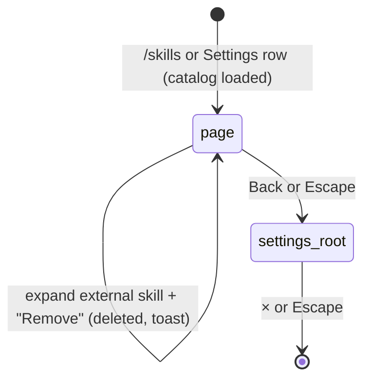

# Skills

## Summary

Skills are instruction documents Pi reads when a task calls for them: a playbook for a kind of work, written as a markdown file named `SKILL.md` with a name and a one-line description at the top. They teach rather than run ("Skills are instruction documents the AI reads on-demand to learn new workflows. They don't run code — they teach."). Pi is told the name and description of every enabled skill in every conversation, and reads the full text with its `skills` tool only when it decides one applies. Five skills ship with the product (*bundled*); the user can add more by pasting a `SKILL.md` (*external*), and Pi can add or remove external skills itself. The user manages them on the "Skills" page of the Settings overlay ("Task playbooks Pi can load on demand"), reached with `/skills`, the "Skills" row in [Settings](../setup/settings.md), or the Back button from another [extensions hub](../extensions/the-extensions-hub.md) page. `/skills` is busy-allowed; the page works with no provider connected and on Excel on the web. Nothing outside the page and the transcript signals that a skill is in use.

## The simple case

The user asks "how do I set up web search with a Tavily key?". Pi recognizes that its "web-search" skill matches, and a [tool card](../turn/tool-calls.md) appears in the transcript: "Read skill web-search (bundled)". The card's body holds the skill's full text. Pi then answers using it. If Pi needs the same skill again later in the same session, the card reads "Read skill web-search (bundled) (cached)".

To see what is available the user types `/skills`. The Settings overlay opens on "Skills" with a status line, "5 skills active (5 bundled, 0 external)", a "Bundled skills" list ("extending-pi", "mcp-gateway", "python-bridge", "tmux-bridge", "web-search"), each with its description, a "Bundled" badge and a switch, then "External skills" ("No external skills installed. Paste a SKILL.md below to add one.") and "Install skill". Escape goes back to the "Settings" page; a second Escape closes the overlay.

## The interaction, event by event

### Opening the page

The page reads the bundled catalog, the external skills found in the [Files workspace](../files/the-files-workspace.md), and the list of switched-off skills, then shows them. There are no drafts and no Save button: every action on the page is saved the moment it is taken. If external skills cannot be read, a warning line "External skills load failed: {error}" appears; if the on/off state cannot be read, "Skill activation state unavailable: {error}".

### Ends at once

- **"Install skill" with nothing pasted** shows "Paste a SKILL.md document first." and records nothing.
- **Leaving the page** records nothing; there is no unsaved state to lose except text in the install box, which is dropped without asking.
- **A click while an earlier action is still being saved** is ignored.

### Acting on a skill

- **Switching a skill off** saves at once and shows "Disabled skill: {name}" ("Enabled skill: {name}" when switched on). A switched-off skill disappears from what Pi is told and cannot be read with the `skills` tool; the switch is per name and applies to every workbook on this computer.
- **Installing** takes the pasted markdown. It must start with a `---` block containing `name:` and `description:`; otherwise the toast is "Extensions: Invalid SKILL.md document: expected frontmatter with name and description." A valid skill is saved as `skills/external/{name}/SKILL.md` in the Files workspace, replacing any external skill of the same name, and the toast says "Saved external skill: {name}". The box clears.
- **Removing** an external skill: expand its card (it shows "Location" and a red "Remove"), click "Remove". It is deleted at once, with no confirmation; the toast is "Removed external skill: {name}". Bundled skills cannot be removed, only switched off.

### While saving

Each action takes a moment; switches are disabled until the page re-renders. There is no other busy display.

### After an action

The page re-renders with the new state, and every open tab's instructions to Pi are refreshed, taking effect from its next model request. Nothing is added to any transcript.

## External skills and the Files workspace

External skills are ordinary files. Besides `skills/external/{name}/SKILL.md`, any file at `skills/{name}/SKILL.md` in the Files workspace is picked up as well, so uploading a skill folder or writing such a file adds a skill without visiting the page. Both kinds show under "External skills" with an "External" badge. Deleting the file in the Files workspace removes the skill. External skills appear in the Files workspace under "SKILLS". An external skill with the same name as a bundled one gets a "Shadowed" badge and a disabled switch: the bundled skill wins.

Pi is told to treat external skills as untrusted unless the user confirms the source.

## When Pi uses skills

The `skills` tool has four actions, each shown as a tool card:

| Card header | What happened |
| --- | --- |
| "List skills" | Pi listed the enabled skills. |
| "Read skill {name} (bundled)" / "(external)" | Pi loaded the full text. A repeat in the same session adds "(cached)"; a forced reload reads "Refresh skill {name}". |
| "Install skill {name}" | Pi saved an external skill, exactly as the page's install does. |
| "Uninstall skill {name}" | Pi removed an external skill; "(not found)" if there was none. |

Install and uninstall from Pi ask nothing in Auto mode. Bridge and integration errors sometimes end with "Skill: {name}"; Pi is told to read that skill before giving setup advice. A disabled or unknown skill fails the read with "Skill not found: …" and the list of available names.

> Technical note: the `skills` tool is not on the list of tools that only read, so the product treats every call to it, including list and read, as a workbook [mutation](../glossary.md#the-workbook). It waits for the [workbook lock](../foundations/the-workbook.md), and in Confirm mode each call asks "Allow workbook mutation in Safe mode?". See [Open questions](#open-questions-and-verification).

## Modifiers

| Modifier | Set before | Changed while busy |
| --- | --- | --- |
| Model and provider | No effect on the page. Whether and when Pi reads a skill is the model's decision. | No effect. |
| Thinking level | No effect. | No effect. |
| Execution mode | No effect on the page. In Confirm mode every `skills` tool call asks for approval (see the technical note). | A change applies from the next `skills` call. |
| Files in the workspace, or an overlay open | Files under `skills/` add external skills. The page is itself on the Settings overlay. | A skill file imported during a turn is offered to Pi from the next refresh of its instructions. |
| Tab state (new, restored, another tab busy) | Skills are the same in every tab. The "(cached)" read is per session; a new or restored tab reads afresh. | A change on the page reaches a responding tab from its next model response. |
| Host (desktop or web) | No difference. | No effect. |

## Cancel and interrupt

| Event | Before sent | While busy |
| --- | --- | --- |
| Stop (button or Escape) | Escape goes back to "Settings" (first leaving a text box). It does not stop a responding tab while the overlay is open. | A `skills` tool call stopped by Stop ends like any [tool call](../turn/stopping.md); an install half done either wrote the file or did not. |
| The user sends something else | Not possible while the overlay is open. | Not applicable. |
| Tab switched, created, closed or reopened | Not possible while the overlay is open; the page is not tied to a tab. | Not applicable. |
| An overlay or menu opens | An approval dialog from a background tab can open over the page. | Not applicable. |
| Model or thinking level changes | Not possible from the page. | Not applicable. |
| The provider fails | No effect; the page makes no network request. | Not applicable. |
| The taskpane goes away | Text in the install box is lost. Every completed action is already saved. | Not applicable. |
| The workbook changes underneath | No effect. | Not applicable. |
| Focus moves to the grid or another window | No effect. | Not applicable. |
| The context window fills | No effect on the page. A skill Pi read sits in the conversation and is summarized away by [compaction](../turn/context-and-compaction.md); Pi then reads it again (the session cache still answers "(cached)"). | Not applicable. |

## Interactions with other systems

**Persistence.** Which skills are switched off is stored in the add-in's browser storage. External skills are files in the Files workspace and live and die with it. See [persistence and restore](../cross-cutting/persistence-and-restore.md).

**Workbook changes and recovery.** Skills never change the workbook. No backups.

**Other tabs and sessions.** One catalog for every tab and workbook on this computer.

**Execution mode and approvals.** See the technical note above: in Confirm mode every `skills` call asks.

**Models and providers.** The list of skill names and descriptions is part of Pi's instructions for every model.

**Offline and provider errors.** No interaction.

**Notifications.** Toasts for each page action. None when Pi installs or removes a skill; the tool card is the trace.

**Settings and preferences.** The page is one of the three extensions pages of the Settings overlay; the [disclosure bar](../glossary.md#the-taskpane)'s "Skills" switch has no effect (see [web search and MCP](../extensions/web-search-and-mcp.md#the-disclosure-bar)).

**Host differences.** None.

**Language.** Section titles, badges "Bundled" and "External", hints and most toasts are translated. "Shadowed", "No bundled skills in this build.", the enable/disable/remove toasts, every tool card header, and the bundled skills' names and descriptions are English in every language.

**Accessibility and keyboard.** Switches and buttons are reachable with Tab. External skill cards expand with Enter or Space.

## Edge cases

- Installing a skill whose name contains `/` or `\` fails with "Extensions: Skill name cannot contain path separators."
- Pasting a second skill with the same name replaces the first without asking.
- Switching off a bundled skill also blocks a shadowed external skill of the same name, because the switch is by name.
- A switched-off skill is still listed on the page with its switch off; Pi neither sees nor can read it.
- Removing an external skill leaves its on/off state stored; installing one with the same name later inherits it.

## Open questions and verification

- Confirmed in Excel on the web (SKILLS checklist): `/skills` opening the page with "5 skills active (5 bundled, 0 external)", the five bundled skills with descriptions and "Bundled" badges, the empty external list and the install box; "Paste a SKILL.md document first."; the invalid-frontmatter and path-separator toasts; "Saved external skill: pd-test" with the box cleared and the count going to 6; "Disabled skill: {name}" / "Enabled skill: {name}" with the count following; the expanded external card ("Location" `skills/external/pd-test/SKILL.md`, "Remove"); "Removed external skill: {name}" with no confirmation; a reinstalled skill coming back switched off; an external "web-search" showing "Shadowed" with a disabled switch; the skill appearing in Files under "SKILLS"; Escape going back to "Settings" and then closing; Pi's "List skills" card.
- **Every `skills` call is treated as a workbook mutation.** Confirmed in Excel on the web (SKILLS-20, SKILLS-21): in Confirm mode both `skills:list` and `skills:read` opened "Allow workbook mutation in Safe mode?" (body "Allow workbook mutation in Confirm mode?", "Tool: skills:list"); Escape on the read returned "Mutation cancelled by user (Confirm mode)." to Pi and the card read "Read skill web-search" with no source suffix. The `skills` tool is missing from the read-only list in `src/tools/execution-policy.ts:11-31`, so `getToolExecutionMode` falls through to `mutate` (`execution-policy.ts:111`). Looks like a bug. The dialog's title still says "Safe mode" while its body says "Confirm mode".
- The bundled "web-search" skill's description, shown on this page, says "Works out of the box with Jina (default, no API key needed)", but every provider needs a key; see [web search and MCP](../extensions/web-search-and-mcp.md#open-questions-and-verification).
- External skill removal has no confirmation (`src/commands/builtins/extensions-hub-skills.ts:177-190`), unlike plugin uninstall (confirmed). A product call.
- Whether the workbook lock is taken by a `skills` call was read from code. The "(cached)" and "Refresh skill" cards and Pi's install/uninstall cards were read from code.

Verified against pi-for-excel commit `ec453df`.
