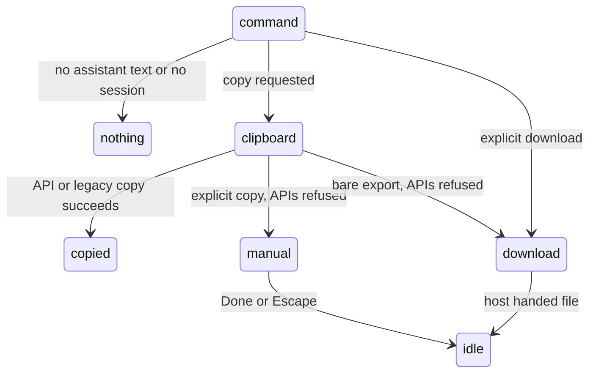

# Export and copy

## Summary

`/copy` copies the active tab's last assistant text. `/export` exports that tab's transcript, or the audit log, as JSON. Both work while busy because they read existing state; they do not wait for the turn to finish. `/share-session` remains a placeholder ("Session sharing coming soon") and is not busy-allowed. No provider is needed. Clipboard refusal now has a fallback instead of a silent failure.

## The simple case

After an answer, type `/copy`. If the host permits it, the clipboard receives markdown source and "Copied to clipboard" appears. If both clipboard APIs refuse, a dialog selects the text and asks the user to copy it manually with Ctrl/Cmd+C.

Bare `/export` tries clipboard copy, then downloads the JSON when copying is unavailable. `/export download` always starts a download. Explicit `/export clipboard` instead offers manual copy if necessary. The user stays in the same tab; neither workbook nor conversation changes.

## The interaction, event by event

### Choosing what to export

- `/copy` ignores arguments and takes text blocks from the most recent assistant message only, not thinking or tool calls. It does not search earlier assistant messages if the last one has no text.
- `/export audit` or `/export audit-log` exports up to 500 audit entries across workbooks. Its default is download; `clipboard` requests copy. This can contain addresses and values from other workbooks.
- Other `/export` arguments select transcript destination: exact `download`/`file`, exact `clipboard`, or default copy-with-download-fallback.
- `/share-session` only displays its placeholder notice.

Transcript JSON includes export time, model/provider, thinking level, chat-message count, a simplified transcript and full raw messages. Its `messageCount` matches the toast's chat-message count: hidden workbook-context notes do not inflate it. Full raw records are retained for debugging, so the raw array can be longer than that count. Simplified tool inputs/results are cut to 200/500 characters. Raw data can include workbook notes, tool results, thinking and attachments; review it before sharing.

### Ends at once

No session gives "No active session". `/copy` without last-assistant text gives "No assistant message to copy". `/share-session` gives "Session sharing coming soon" (or busy refusal). Nothing is added to history.

### Copied or downloaded

Copy first tries the async Clipboard API, then a hidden-textarea legacy copy. An explicit copy whose APIs both fail opens the translated manual-copy modal with selected read-only text. Done/Escape closes it without claiming that the clipboard was changed.

Downloads use a blob URL on one hidden link with a filename such as `pi-session-YYYY-MM-DD.json` or `pi-audit-log-YYYY-MM-DD.json`. They never open an extra browser tab first. The URL stays alive for 60 seconds for host Save UI. A download notice means the file was handed to the host; Pi cannot observe whether the user saved it.

### While exporting

No agent busy phase is created. During an existing turn only completed history currently held by the agent is exported/copied; this is not a future final answer. A manual-copy modal owns focus while open.

### Afterwards

Outcome notices distinguish copied, downloaded/instead-downloaded and errors. The shared notice stack does not suppress success just because a Closed/Undo notice is visible. Closing manual copy restores focus to its opener or composer fallback.

## Modifiers

| Modifier | Set before | Changed while busy |
| --- | --- | --- |
| Model and provider | Recorded in JSON; no connected provider needed. | Copy/export remain available. |
| Thinking level | Recorded in JSON; thinking only in raw messages. | Reads current state. |
| Execution mode | No approval; audit records its historical mode. | No effect. |
| Files in the workspace, or an overlay open | Workspace files are not exported. Modal owns keys. | Manual-copy dialog blocks underlying shortcuts. |
| Tab state (new, restored, another tab busy) | Active tab only; empty tab can have hidden notes but no copyable answer. | Existing turn continues; export is a snapshot. |
| Host (desktop or web) | Clipboard/Save UI varies; fallbacks apply on both. | User activation can affect copy. |

## Cancel and interrupt

| Event | Before sent | While busy |
| --- | --- | --- |
| Stop (button or Escape) | Unrun command stays a draft. | Escape dismisses manual copy, not the turn behind it. |
| The user sends something else | One command per invocation. | Modal prevents sends underneath. |
| Tab switched, created, closed or reopened | Invocation reads the active session. | No retrospective change to exported snapshot. |
| An overlay or menu opens | Topmost modal owns focus. | Manual-copy text remains until closed. |
| Model or thinking level changes | JSON records current values. | No effect on already built JSON. |
| The provider fails | No network dependency. | Existing failure text can be exported. |
| The taskpane goes away | No conversation mutation. | Host owns a file already handed over. |
| The workbook changes underneath | Audit includes recorded Pi changes, not arbitrary user edits. | Later changes need a later export. |
| Focus moves to the grid or another window | Can affect copy permission. | Manual-copy modal remains. |
| The context window fills | Export reads stored summary/kept and archived data as held. | No compaction triggered by export. |

## Interactions with other systems

**Persistence.** Reads memory and stored audit; no session mutation. **Workbook changes and recovery.** Audit is a record, not undo; use [backups](../workbook/backups-and-revert.md). **Other tabs and sessions.** Transcript is one active session; audit spans workbooks. **Execution mode and approvals.** No mutation. **Models and providers.** Metadata only. **Offline and provider errors.** Local export works offline. **Notifications.** Stacked outcome notices and manual-copy modal. **Settings and preferences.** No preference needed. **Host differences.** See [host differences](../cross-cutting/host-differences.md). **Language.** UI translates; filenames/JSON keys remain English. **Accessibility and keyboard.** Commands are keyboard paths; manual text is selected, focus is trapped and restored.

## Edge cases

Misspelled transcript destinations use the default path rather than validation. Same-day files share a suggested filename; the host decides collision handling. A tool-only/stopped last assistant message can leave nothing to copy despite an earlier answer. Download handoff is not proof that the host wrote a file.

## Open questions and verification

Read merged clipboard/export commands, `copy-text.ts`, busy policy and `download.ts`. Earlier silent clipboard failures and extra-tab/download failures remain historical checklist observations, not current expectations. Desktop Save-sheet acceptance was not run in this orb.

The P-141 regression exports one user message between two hidden context notes: `messageCount` is 1 and all three raw records remain. In Excel on the web, a live export counted 9 chat messages while retaining 19 raw records.

Verified against pi-for-excel commit `c8f7016` for the count fix in [#806](https://github.com/tmustier/pi-for-excel/pull/806); other export/copy behavior was reviewed at `1f51cf8`.
