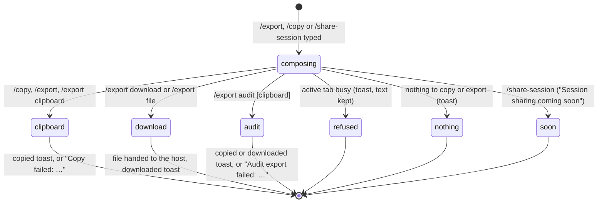

# Export and copy

## Summary

Export and copy take content out of Pi so the user can keep it, share it or paste it elsewhere. There are three commands, all typed in the [composer](../turn/the-composer.md) or chosen from the [command menu](../commands/the-command-menu.md):

- `/export` ("Export JSON (session transcript or audit log)") writes the active tab's conversation, or the log of Pi's workbook changes, as JSON, either to the clipboard or as a downloaded file;
- `/copy` ("Copy last agent message to clipboard") copies the text of Pi's last assistant message in the active tab;
- `/share-session` ("Share session as a link") does nothing yet except show "Session sharing coming soon".

All three act on the [active tab](../glossary.md#sessions-and-tabs) and finish at once, with a toast as the only sign. None of them is busy-allowed: while the active tab is [busy](../glossary.md#the-turn) each is refused with "Can't run /{command} while Pi is busy". None needs a provider. On Excel on the web the clipboard is blocked: `/copy` silently does nothing and `/export` to the clipboard fails with "Copy failed: …"; only `/export download` works there (confirmed; see [Open questions](#open-questions-and-verification)). Desktop has not been checked.

## The simple case

Pi has just answered a question. The user types `/copy` and presses Enter. The composer clears and a toast says "Copied to clipboard". The text of Pi's answer, as markdown source, is on the clipboard, ready to paste into a cell, an email or a document.

The user then types `/export` and presses Enter. The whole conversation is copied to the clipboard as JSON, and the toast says "Transcript copied ({count} messages, {size}KB)". `/export download` instead saves a file named `pi-session-{YYYY-MM-DD}.json` and says "Transcript downloaded ({count} messages)". In every case the user stays on the same tab with an empty composer, and nothing in the conversation or the workbook changes.

That is the behavior where the host allows clipboard access. On Excel on the web it does not, so the two clipboard paths fail and only the download works (see [Copied or downloaded](#copied-or-downloaded)).

## The interaction, event by event

### Choosing what to export

The command and its arguments decide everything at the moment Enter is pressed:

- **`/copy`** ignores any text after it. It looks at the active tab's most recent assistant message only, and takes its text blocks. Thinking and tool calls are left out.
- **`/export`** reads its first word:
  - `audit` or `audit-log` exports the **audit log**: the record of Pi's workbook changes (each mutation's tool, address, changed cells with before and after values and formulas, execution mode and workbook). The next word chooses the destination: `clipboard` copies; anything else, or nothing, downloads `pi-audit-log-{YYYY-MM-DD}.json`. The log holds at most the 500 most recent changes, across every workbook used on this machine, not only the current one.
  - Otherwise `/export` exports the active tab's **transcript**. The whole argument text decides the destination: exactly `download` or `file` downloads; anything else, including nothing and misspellings, copies to the clipboard.
- **`/share-session`** ignores its arguments.

The transcript export is the session as Pi holds it in memory, not the last save. It has the export time, the tab's model (id, name, provider), the thinking level, a message count, a simplified transcript (each message's role and text, with tool inputs cut to 200 characters and tool results to 500, plus token usage and stop reason for assistant messages), and the full raw messages. The raw messages include Pi's hidden instructions, the [auto-context](../turn/auto-context.md) it was given, tool results and thinking. Anyone the file is shared with sees all of it.

### Ends at once

- **The active tab is busy.** The command is refused with "Can't run /export while Pi is busy" (or `/copy`, `/share-session`). The command never ran, so its text stays in the composer.
- **`/copy` with nothing to copy.** If the tab has no assistant message, or its most recent assistant message has no text (for example one that only called tools, or was stopped before writing anything), the toast is "No assistant message to copy". It does not look further back. Confirmed in Excel on the web: after a stopped turn, with an earlier "OK" answer still on screen.
- **`/share-session`.** The toast is "Session sharing coming soon". Nothing else happens.
- **No active tab.** "No active session". This only happens during startup or teardown.

Nothing is recorded in any of these cases.

### Copied or downloaded

The command commits as soon as it runs. The composer clears.

- **To the clipboard.** The text replaces whatever was on the system clipboard. The toast is "Copied to clipboard" for `/copy`, "Transcript copied ({count} messages, {size}KB)" or "Audit log copied ({count} records, {size}KB)" for `/export`. The message count includes every message Pi holds, including hidden instructions and tool results, so it is larger than the number of bubbles in the transcript.

  On Excel on the web the add-in frame's permissions policy blocks the clipboard, so this path fails. Confirmed: `/export` showed "Copy failed: Failed to execute 'writeText' on 'Clipboard': The Clipboard API has been blocked because of a permissions policy applied to the current document. See https://crbug.com/414348233 for more details.", `/export audit clipboard` showed "Audit export failed: " with the same text, and `/copy` showed nothing at all. Because the clipboard is `/export`'s default, plain `/export` always fails there.
- **As a download.** The JSON is handed to the host as a file: Pi first tries to open it in a new window, and if the host blocks that, starts a download of the named file. The toast "Transcript downloaded ({count} messages)" or "Audit log downloaded ({count} records)" is shown as soon as the file is handed over, whether or not the host actually saved it. On Excel on the web (Chrome) both happened: a browser tab opened on the file's `blob:` address, the new-window call still reported failure, and so the fallback download also saved `pi-session-{date}.json` to the Downloads folder. The extra browser tab is left open.

Nothing is added to the transcript, nothing is sent to the model, and nothing is saved to the session.

### While exporting

There is no busy phase and no indicator. Building the JSON for a long session may take a moment; the user cannot notice it otherwise.

### Afterwards

The user stays on the same tab. If writing to the clipboard fails, `/export` shows "Copy failed: {error}" (transcript) or "Audit export failed: {error}" (audit log). `/copy` shows nothing on failure (see [Open questions](#open-questions-and-verification)).

## Modifiers

| Modifier | Set before | Changed while busy |
| --- | --- | --- |
| Model and provider | The transcript export records the tab's current model. Nothing needs a connected provider. | The commands are refused while busy, and so is changing the model. |
| Thinking level | Recorded in the transcript export. Thinking text is in the raw messages but not in `/copy`. | Refused while busy. |
| Execution mode | No effect on what is exported. Each audit entry records the mode it ran in. | Refused while busy. |
| Files in the workspace, or an overlay open | Files are not exported. An open overlay that holds focus prevents typing the command. | Refused while busy. |
| Tab state (new, restored, another tab busy) | A new tab still exports its hidden instructions and has nothing to `/copy`. A restored tab exports its full restored history. Another tab being busy does not matter: only the active tab is checked. | Refused while the active tab is busy, even though copying would be safe. Switching to an idle tab and exporting works. |
| Host (desktop or web) | On Excel on the web the clipboard is blocked, so `/copy` and the clipboard forms of `/export` fail; downloads work. On Excel for Mac the reverse: the clipboard works when the command comes from a key press or click, and downloads save nothing although the toast says they did (confirmed in Excel for Mac). Windows has not been checked. | No effect. |

A variant cannot change during the command, because it completes at once.

## Cancel and interrupt

| Event | Before sent | While busy |
| --- | --- | --- |
| Stop (button or Escape) | Escape with focus in the composer moves focus out; the typed command stays. | Not applicable: the commands have no busy phase and are refused while the tab is busy. |
| The user sends something else | Only one command runs per Enter. | Not applicable. |
| Tab switched, created, closed or reopened | The command acts on whichever tab is active when Enter is pressed. | Not applicable. |
| An overlay or menu opens | No effect on a typed command. | Not applicable. |
| Model or thinking level changes | The export records the values at the moment it runs. | Not applicable. |
| The provider fails | No effect. No network request is made. | Not applicable. |
| The taskpane goes away | Nothing is recorded. A file already handed to the host is not affected. | Not applicable. |
| The workbook changes underneath | No effect on the transcript. An audit export includes only changes Pi made, not the user's edits. | Not applicable. |
| Focus moves to the grid or another window | The clipboard write may be rejected when the taskpane does not have focus; not checked. | Not applicable. |
| The context window fills | The export contains what the session holds now: older messages replaced by [compaction](../turn/context-and-compaction.md) appear only as the summary. | Not applicable. |

After any of these the user is on the same tab with the composer as it was, or empty if the command ran.

## Interactions with other systems

**Persistence.** The commands read the session in memory and save nothing. The audit log is kept in the add-in's storage by the workbook tools, up to 500 entries. See [persistence and restore](../cross-cutting/persistence-and-restore.md).

**Workbook changes and recovery.** No change to the workbook. The audit log is a record, not a way back: to undo a change, use [backups and revert](../workbook/backups-and-revert.md).

**Other tabs and sessions.** Only the active tab's transcript is exported. There is no way to export a session that is not open, or several at once. The audit log covers every tab and every workbook.

**Execution mode and approvals.** No interaction, except that audit entries record the mode and whether a change was blocked.

**Models and providers.** The transcript export names the model. No interaction otherwise.

**Offline and provider errors.** No interaction. A failed turn's error text is part of the exported messages.

**Notifications.** One toast per outcome, as listed above. While a "Closed {title} · Undo" toast is showing, ordinary toasts such as "Copied to clipboard" and "Transcript copied (…)" are suppressed, so the command works silently. Failure toasts and the busy refusal still show.

**Settings and preferences.** None.

**Host differences.** Clipboard writes and the new-window-then-download fallback depend on the webview (WKWebView on macOS, WebView2 on Windows, the browser frame on Excel on the web). On Excel on the web the clipboard is blocked by the frame's permissions policy and downloads work, leaving an extra browser tab. See [host differences](../cross-cutting/host-differences.md).

**Language.** The toasts and command descriptions are translated. The file names, the JSON keys and the role names are English.

**Accessibility and keyboard.** All three are keyboard commands. Their only feedback is a toast, announced politely (failures assertively).

## Edge cases

- `/export` never says "No messages to export" in practice: every tab holds at least one hidden instruction message, so even a blank tab exports a file with one message.
- `/export clipboard please` copies, but so does `/export dowload`: a misspelled destination silently copies instead of downloading.
- `/export audit download` and `/export audit` both download; only `/export audit clipboard` copies.
- `/copy` after Stop may report "No assistant message to copy" even though an earlier answer is visible, if the stopped model response had written no text.
- Two exports on the same day get the same file name; the host decides whether to rename or overwrite.
- Image attachments are not exported in the simplified transcript; they are in the raw messages as data.

## Open questions and verification

- `/copy` does not handle a failed clipboard write: `navigator.clipboard.writeText(...)` has a `.then` but no `.catch` (`src/commands/builtins/clipboard.ts:43-45`), so on failure nothing is shown and the rejection is unhandled. Confirmed in Excel on the web (EXPORT-05): `/copy` after an "OK" answer showed no toast and raised an unhandled `NotAllowedError`. Looks like a bug; `/export` catches the same failure.
- The download toast is shown whether or not a file was saved (`src/commands/builtins/export.ts:91-110`, `498-499`): `window.open` on a blob URL may open an empty window or nothing in Office webviews. On Excel on the web it opened a browser tab and also downloaded the file (EXPORT-08). Confirmed in Excel for Mac: "Transcript downloaded (11 messages)" with no file, no window and no save dialog, with Excel in front or not (EXPORT-11). Windows not checked.
- The audit export is not limited to the current workbook (`src/commands/builtins/export.ts:115` lists all entries). Read from code. Possibly intended, but it can include addresses and cell values from other workbooks.
- `/copy` and `/export` are refused while the active tab is busy (`src/commands/busy-command-policy.ts:11-24` does not list them), although both only read. Confirmed in Excel on the web for `/copy`, `/export` and `/share-session`. Probably a product call.
- `/copy` only checks the most recent assistant message (`src/commands/builtins/clipboard.ts:13-22`). Read from code.
- The exported message count includes hidden instructions and tool results. Read from code; consistent with the resume picker's "1 messages" for a blank session.
- `navigator.clipboard.writeText` is not permitted in Excel on the web's add-in frame (the frame has no `clipboard-write` permission), so `/copy` and the clipboard forms of `/export` cannot work there, and plain `/export` fails by default (EXPORT-04, EXPORT-06, EXPORT-07). Looks like a bug: a fallback (`document.execCommand('copy')`, a download, or defaulting `/export` to download on that host) would be needed. Desktop webviews have not been checked.
- Checked in Excel on the web on 2026-10-26; see [the checklist](../verification/sessions-and-commands.md#sessionsexport-and-copymd).

Verified against pi-for-excel commit `ec453df`.
