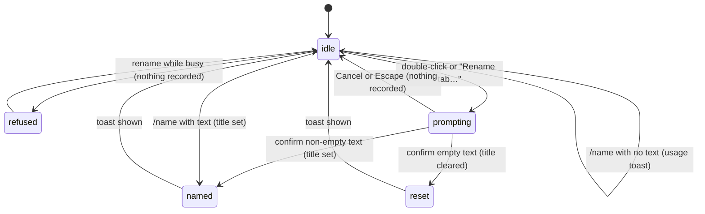

# Renaming a tab

## Summary

Renaming gives a session tab a title the user chose instead of the default "Chat N". The chosen title replaces the tab label, becomes the session's title in the [resume picker](resuming-a-session.md), and is used in the close and reopen toasts. There are three ways in: double-click the tab, right-click the tab and choose "Rename tab…", or type `/name My title` in the [composer](../turn/the-composer.md). The first two open a native browser prompt titled "Rename tab"; `/name` renames at once with no dialog. All three refuse to run while the tab is [busy](../glossary.md#the-turn). None of them needs a provider to be connected. On Excel on the web, and wherever Office.js stubs out browser dialogs, the double-click and "Rename tab…" paths do nothing at all (see [Open questions](#open-questions-and-verification)); `/name` is the only path that works there.

## The simple case

The user types `/name Q3 budget review` in the composer and presses Enter. The composer clears, the tab label changes to "Q3 budget review" (cut off with an ellipsis after about 110 px, with the full title in the tab's tooltip), and a toast says "Session named: Q3 budget review". Confirmed in Excel on the web, including the tooltip and the accessible name "Open tab {title}". The tab stays active and focus stays in the composer.

On a host where the native prompt works, the user can instead double-click the tab, or right-click it and choose "Rename tab…". A prompt titled "Rename tab" appears, prefilled with the tab's current label. The user edits the text and confirms. The label changes and a toast says "Renamed to Q3 budget review". Clearing the text and confirming removes the chosen title instead: the label goes back to "Chat N" and the toast says "Tab name reset".

## The interaction, event by event

### Choosing to rename

The rename targets one tab, chosen by how the user starts:

- **Double-click** targets the tab that was double-clicked. The first click of the double-click also selects that tab, so by the time the prompt opens the target is the active tab.
- **"Rename tab…"** in the tab's context menu targets the tab that was right-clicked, which need not be the active tab. Right-clicking does not switch tabs.
- **`/name`** always targets the active tab.

Before anything else, the target is checked for busy: if Pi is responding in it, or it is running a queued action such as `/compact`, the rename is refused (see [Ends at once](#ends-at-once)).

For the two dialog paths, the prompt is prefilled with the text the user would expect to edit: the chosen title if the tab has one, otherwise the label currently shown ("Chat 2"). The prefill is not selected; the caret position is the browser's default for native prompts.

### Ends at once

The rename ends without recording anything when:

- **The tab is busy.** The dialog paths show the toast "Wait for this tab to finish before renaming" (confirmed in Excel on the web for both double-click and "Rename tab…": the busy check runs before the prompt, so on a busy tab the user does see this toast even where the prompt itself would fail). `/name` goes through the [command busy policy](../commands/the-command-menu.md) instead and shows "Can't run /name while Pi is busy". The text the user typed after `/name` is kept in the composer because the command never ran.
- **The prompt is cancelled.** Cancel or Escape in the native prompt closes it. No toast, no change.
- **`/name` has no text.** `/name` on its own, or followed only by spaces, shows the toast "Usage: /name My Session Name" and changes nothing. The composer is cleared.
- **The tab no longer exists.** If the tab closed between the click and the prompt, the toast is "Session not found".

### Committing the title

The rename commits the moment the prompt is confirmed or `/name` runs with text. The text is trimmed of leading and trailing spaces. From then on:

- A non-empty title becomes the tab's chosen title. The label switches to it immediately and stays on it instead of "Chat N".
- An empty title (dialog path only; `/name` cannot produce one) clears the chosen title. The label goes back to "Chat N", where N is the number the tab was given when it was created. Numbers are not reused or renumbered when other tabs close, so a tab that was "Chat 3" goes back to "Chat 3" even if it is now the only tab.

Renaming does not touch the conversation. No message is added to the transcript, nothing is sent to the model, and the model is not told the session's name.

### While the title is applied

There is no busy phase. Applying the title is instantaneous from the user's point of view. The tab does not show the busy dot, and the composer stays usable.

### After renaming

The toast confirms the result: "Session named: {title}" for `/name`, "Renamed to {title}" for the dialog, "Tab name reset" when the dialog cleared the title. The tab stays where it was in the tab strip, and the active tab does not change.

The title is saved with the session only if the session has already been saved, which happens once Pi has answered at least once in it (see [persistence](../cross-cutting/persistence-and-restore.md)). In a tab where Pi has not yet answered, the title lives in memory and is saved together with the session after the first response.

> Technical note: whether or not it was saved, the chosen title does not survive a reload of the taskpane. When the taskpane reopens, each tab's session is reloaded with its title but without the flag that says the title was chosen, so the label falls back to "Chat N". The saved title still appears in the resume picker. Confirmed in Excel on the web; see [Open questions](#open-questions-and-verification).

## Modifiers

| Modifier | Set before | Changed while busy |
| --- | --- | --- |
| Model and provider | No effect. Renaming works with no provider connected. | Renaming is refused while busy, and so is changing the model ("Wait for this tab to finish before changing models"). |
| Thinking level | No effect. | No effect. |
| Execution mode | No effect. Renaming never touches the workbook. | No effect. |
| Files in the workspace, or an overlay open | No effect from files. An overlay that covers the tab strip (settings, resume, the model picker) prevents double-clicking or right-clicking a tab; `/name` cannot be typed while an overlay holds focus. | No effect. |
| Tab state (new, restored, another tab busy) | A new tab that Pi has not answered keeps the title in memory only until the first response. A restored tab shows "Chat N" even if it was named before the reload. Another tab being busy does not block renaming this one. | Refused while this tab is busy; see [Ends at once](#ends-at-once). |
| Host (desktop or web) | On Excel on the web, double-click and "Rename tab…" do nothing because the native prompt is unavailable. `/name` works on every host. | No effect. |

A variant cannot change mid-interaction in a way that matters: the dialog is modal and `/name` completes instantly.

## Cancel and interrupt

| Event | Before sent | While busy |
| --- | --- | --- |
| Stop (button or Escape) | Escape in the native prompt cancels it; nothing is recorded. Escape with the tab context menu open closes the menu. If Pi is responding in the active tab at that moment, Escape stops the response instead and the menu stays open, because the tab context menu is not one of the surfaces that claim Escape. | Not applicable: renaming has no busy phase, and renaming is refused while the tab is busy. |
| The user sends something else | The native prompt is modal; nothing else can be sent until it closes. `/name` is itself a send. | Not applicable. |
| Tab switched, created, closed or reopened | The native prompt blocks the taskpane, so no tab can change while it is open. With the context menu open, clicking another tab closes the menu and switches tabs; no rename happens. | Not applicable. |
| An overlay or menu opens | Opening the utilities menu closes the tab context menu. | Not applicable. |
| Model or thinking level changes | No effect. | Not applicable. |
| The provider fails | No effect. Renaming makes no network request. | Not applicable. |
| The taskpane goes away | Closing the taskpane with the prompt open discards the rename. | After a successful rename, a reload shows "Chat N" again; the title is only visible in the resume picker. |
| The workbook changes underneath | No effect. | Not applicable. |
| Focus moves to the grid or another window | The native prompt keeps focus. The context menu stays open until the next click inside the taskpane. | Not applicable. |
| The context window fills | No effect. The title is not part of the conversation. | Not applicable. |

After any interrupt the user is back on the tab they started from, with the composer as it was.

## Interactions with other systems

**Persistence.** The title is saved with the session once Pi has answered in it. The tab layout (which sessions are open, in which order) is saved separately and does not record titles. See [persistence and restore](../cross-cutting/persistence-and-restore.md).

**Workbook changes and recovery.** No interaction. Renaming does not read or change the workbook and creates no checkpoint.

**Other tabs and sessions.** Each tab is renamed independently. Two tabs may have the same title; nothing prevents or flags it. [Duplicating a tab](tabs.md) gives the copy "{title} copy"; renaming the original afterwards does not rename the copy. The [resume picker](resuming-a-session.md) lists the session under its saved title; a session that was never named is listed under the first 80 characters of its first message.

**Execution mode and approvals.** No interaction.

**Models and providers.** No interaction, except that when the model-switch preference is set to fork, changing the model of a tab that has messages opens a copy in a new tab with the chosen title "{source title} ({model id})".

**Offline and provider errors.** No interaction.

**Notifications.** One toast per rename outcome, as listed under [After renaming](#after-renaming). The toast uses the default duration and has no action button; there is no undo for a rename.

**Settings and preferences.** No interaction.

**Host differences.** The native prompt is the only rename dialog. Office.js replaces `window.prompt` with a function that throws on Excel on the web, so double-click and "Rename tab…" fail silently there. Excel for Mac is worse: no prompt appears, whether Excel is in front or not, and the call never returns, so the taskpane freezes (no clicks, no keys) until the user closes it and opens Pi again (confirmed in Excel for Mac, RENAME-09). Windows (WebView2) has not been checked.

**Language.** The toasts and the context-menu label are translated. The prompt's title, "Rename tab", is hard-coded in English and is not translated in the Chinese UI. The default label "Chat N" is translated.

**Accessibility and keyboard.** There is no keyboard path to the dialog: double-click and right-click need a pointer, and focusing a tab and pressing Enter selects it rather than renaming it. `/name` is the keyboard path. The tab button's accessible name is "Open tab {title}" and updates with the new title.

## Edge cases

- A very long title is accepted whole. The label truncates with an ellipsis after about 110 px; the tooltip and the resume picker show the full text.
- A title made only of spaces is treated as empty: from the dialog it resets the label to "Chat N"; from `/name` it shows the usage toast.
- Renaming a tab to exactly "Chat 2" makes "Chat 2" a chosen title. It looks identical to the default, but it is what the resume picker shows and it does not change if the tab's number would differ.
- `/name` applies the text after the first space verbatim (after trimming), including any further slashes or quotes: `/name "Draft"` produces the title `"Draft"` with the quotes.
- Renaming the same tab twice in a row replaces the title each time; there is no history of titles.
- In a tab Pi has not answered, renaming and then closing the tab loses the title along with the empty session.

## Open questions and verification

- Double-click and "Rename tab…" call the browser's native `window.prompt`, which Office.js replaces with a function that throws "Function window.prompt is not supported." Confirmed in Excel on the web: double-clicking a tab, and "Rename tab…" on an idle tab, do nothing, with no toast and no error shown. This makes two of the three rename paths dead on that host and likely on others; it may be worth treating as a bug rather than documenting. The repo already has an in-taskpane text dialog (`requestTextInputDialog`) that would fit.
- A chosen title does not survive a reload: the label falls back to "Chat N" because the restored session is loaded without the "chosen title" flag. Confirmed again in Excel on the web on 2026-10-26: "Q3 budget" came back as "Chat 1", while the resume picker still listed the session as "Q3 budget" and resuming it gave a tab "Chat 4" with the toast "Resumed in new tab: Q3 budget". Looks like a bug.
- In a tab where Pi has not answered yet, the title is not saved until the first response. Read from code, not confirmed by hand.
- The "Rename tab" prompt title is hard-coded English. Read from code.
- Confirmed in Excel for Mac: "Rename tab…" shows no prompt and freezes the taskpane until it is reopened; this may be worth treating as a bug, since renaming by dialog now works on no confirmed host. Windows has not been checked.
- Checked in Excel on the web on 2026-10-26; see [the checklist](../verification/sessions-and-commands.md#sessionsrenaming-a-tabmd).
- The toast wording differs between paths ("Session named: …" vs "Renamed to …"), and the busy refusal wording differs too ("Wait for this tab to finish before renaming" vs "Can't run /name while Pi is busy"). Probably unintentional; a product call.

Verified against pi-for-excel commit `ec453df`.
