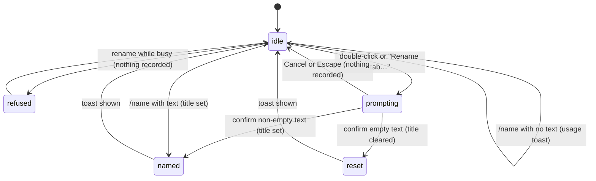

# Renaming a tab

## Summary

Renaming gives a session tab a chosen title instead of "Chat N". It appears in the [resume picker](resuming-a-session.md) and close/reopen notices. Double-click the tab, choose "Rename tab…" from its context menu, or type `/name My title` in the composer. The first two open a translated in-taskpane text dialog on desktop and web; `/name` applies immediately. All refuse while the target tab is busy. No provider connection is needed.

## The simple case

The user types `/name Q3 budget review` in the composer and presses Enter. The composer clears, the tab label changes to "Q3 budget review" (cut off with an ellipsis after about 110 px, with the full title in the tab's tooltip), and a toast says "Session named: Q3 budget review". Confirmed in Excel on the web, including the tooltip and the accessible name "Open tab {title}". The tab stays active and focus stays in the composer.

The user can instead double-click the tab or choose "Rename tab…". The text dialog selects its prefilled current label. Confirming changes the label and shows "Renamed to Q3 budget review". Clearing it resets the stable "Chat N" label and shows "Tab name reset".

## The interaction, event by event

### Choosing to rename

The rename targets one tab, chosen by how the user starts:

- **Double-click** targets the tab that was double-clicked. The first click of the double-click also selects that tab, so by the time the prompt opens the target is the active tab.
- **"Rename tab…"** in the tab's context menu targets the tab that was right-clicked, which need not be the active tab. Right-clicking does not switch tabs.
- **`/name`** always targets the active tab.

Before anything else, the target is checked for busy: if Pi is responding in it, or it is running a queued action such as `/compact`, the rename is refused (see [Ends at once](#ends-at-once)).

The selected prefill is the chosen title or current "Chat N". The dialog takes and traps focus, then returns it to the opener.

### Ends at once

The rename ends without recording anything when:

- **The tab is busy.** The dialog paths show the toast "Wait for this tab to finish before renaming" (confirmed in Excel on the web for both double-click and "Rename tab…": the busy check runs before the prompt, so on a busy tab the user does see this toast even where the prompt itself would fail). `/name` goes through the [command busy policy](../commands/the-command-menu.md) instead and shows "Can't run /name while Pi is busy". The text the user typed after `/name` is kept in the composer because the command never ran.
- **The prompt is cancelled.** Cancel or Escape closes the text dialog. No toast, no change.
- **`/name` has no text.** `/name` on its own, or followed only by spaces, shows the toast "Usage: /name My Session Name" and changes nothing. The composer is cleared.
- **The tab no longer exists.** If the tab closed between the click and the prompt, the toast is "Session not found".

### Committing the title

The rename commits the moment the prompt is confirmed or `/name` runs with text. The text is trimmed of leading and trailing spaces. From then on:

- A non-empty title becomes the tab's chosen title. The label switches to it immediately and stays on it instead of "Chat N".
- An empty title (dialog path only; `/name` cannot produce one) clears the chosen title. The label goes back to "Chat N", where N is the number the tab was given when it was created. Numbers are not reused or renumbered when other tabs close, so a tab that was "Chat 3" goes back to "Chat 3" even if it is now the only tab.

Renaming does not touch the conversation. No message is added to the transcript, nothing is sent to the model, and the model is not told the session's name.

### While the title is applied

There is no busy phase. Applying the title is instantaneous from the user's point of view. The tab does not show the busy dot, and the composer stays usable.

### After renaming

The toast confirms the result: "Session named: {title}" for `/name`, "Renamed to {title}" for the dialog, "Tab name reset" when the dialog cleared the title. The tab stays where it was in the tab strip, and the active tab does not change.

The title and the fact that the user chose it are saved with the session. Reload, resume and reopen preserve it. Session saving starts with the first user message, not the first answer; see [persistence](../cross-cutting/persistence-and-restore.md).

## Modifiers

| Modifier | Set before | Changed while busy |
| --- | --- | --- |
| Model and provider | No effect. Renaming works with no provider connected. | Renaming is refused while busy, and so is changing the model ("Wait for this tab to finish before changing models"). |
| Thinking level | No effect. | No effect. |
| Execution mode | No effect. Renaming never touches the workbook. | No effect. |
| Files in the workspace, or an overlay open | No effect from files. An overlay that covers the tab strip (settings, resume, the model picker) prevents double-clicking or right-clicking a tab; `/name` cannot be typed while an overlay holds focus. | No effect. |
| Tab state (new, restored, another tab busy) | Saved chosen titles survive restore. Another busy tab does not block renaming this one. | Refused while this tab is busy. |
| Host (desktop or web) | Same in-taskpane dialog on both. | No effect. |

A variant cannot change mid-interaction in a way that matters: the dialog is modal and `/name` completes instantly.

## Cancel and interrupt

| Event | Before sent | While busy |
| --- | --- | --- |
| Stop (button or Escape) | Escape dismisses the text dialog or context menu, without stopping a turn underneath. | Not applicable: no busy phase. |
| The user sends something else | The text dialog is modal; no send behind it. `/name` is itself a send. | Not applicable. |
| Tab switched, created, closed or reopened | Tab shortcuts do not act behind the dialog. Clicking a tab closes an open context menu. | Not applicable. |
| An overlay or menu opens | Opening the utilities menu closes the tab context menu. | Not applicable. |
| Model or thinking level changes | No effect. | Not applicable. |
| The provider fails | No effect. Renaming makes no network request. | Not applicable. |
| The taskpane goes away | An unconfirmed rename is discarded. | A saved chosen title survives reload. |
| The workbook changes underneath | No effect. | Not applicable. |
| Focus moves to the grid or another window | The dialog stays open; focus is trapped within it inside the pane. | Not applicable. |
| The context window fills | No effect. The title is not part of the conversation. | Not applicable. |

After any interrupt the user is back on the tab they started from, with the composer as it was.

## Interactions with other systems

**Persistence.** Chosen titles are session metadata and stable tab numbers are layout metadata; both survive reload. See [persistence and restore](../cross-cutting/persistence-and-restore.md).

**Workbook changes and recovery.** No interaction. Renaming does not read or change the workbook and creates no checkpoint.

**Other tabs and sessions.** Each tab is renamed independently. Two tabs may have the same title; nothing prevents or flags it. [Duplicating a tab](tabs.md) gives the copy "{title} copy"; renaming the original afterwards does not rename the copy. The [resume picker](resuming-a-session.md) lists the session under its saved title; a session that was never named is listed under the first 80 characters of its first message.

**Execution mode and approvals.** No interaction.

**Models and providers.** No interaction, except that when the model-switch preference is set to fork, changing the model of a tab that has messages opens a copy in a new tab with the chosen title "{source title} ({model id})".

**Offline and provider errors.** No interaction.

**Notifications.** One toast per rename outcome, as listed under [After renaming](#after-renaming). The toast uses the default duration and has no action button; there is no undo for a rename.

**Settings and preferences.** No interaction.

**Host differences.** No native browser prompt is used. Desktop acceptance of the shared dialog remains separate from this orb's web checks.

**Language.** Dialog, toasts, context menu and "Chat N" are translated; user titles are not.

**Accessibility and keyboard.** There is no keyboard path to the dialog: double-click and right-click need a pointer, and focusing a tab and pressing Enter selects it rather than renaming it. `/name` is the keyboard path. The tab button's accessible name is "Open tab {title}" and updates with the new title.

## Edge cases

- A very long title is accepted whole. The label truncates with an ellipsis after about 110 px; the tooltip and the resume picker show the full text.
- A title made only of spaces is treated as empty: from the dialog it resets the label to "Chat N"; from `/name` it shows the usage toast.
- Renaming a tab to exactly "Chat 2" makes "Chat 2" a chosen title. It looks identical to the default, but it is what the resume picker shows and it does not change if the tab's number would differ.
- `/name` applies the text after the first space verbatim (after trimming), including any further slashes or quotes: `/name "Draft"` produces the title `"Draft"` with the quotes.
- Renaming the same tab twice in a row replaces the title each time; there is no history of titles.
- A genuinely empty tab has no conversation to recover; saved session metadata is distinct from a conversation turn.

## Open questions and verification

- Merged code uses `requestTextInputDialog` and persists chosen-title metadata. The old native-prompt and reload failures remain historical observations in the [checklist](../verification/sessions-and-commands.md#sessionsrenaming-a-tabmd), not the current contract.
- The toast wording differs between paths ("Session named: …" vs "Renamed to …"), and the busy refusal wording differs too ("Wait for this tab to finish before renaming" vs "Can't run /name while Pi is busy"). Probably unintentional; a product call.

Verified against pi-for-excel commit `1f51cf8` (code inspection; see historical checklist for earlier host runs).
