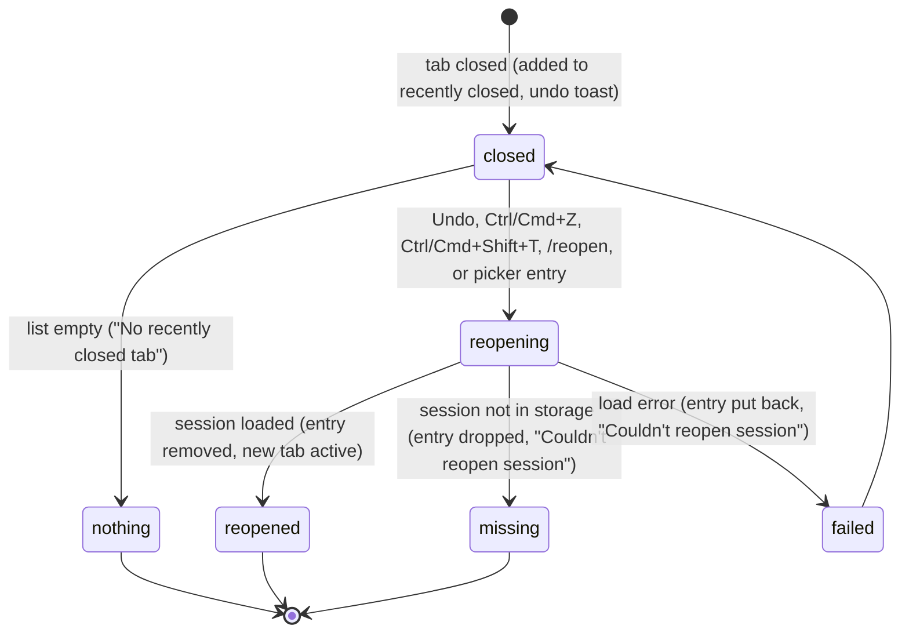

# Reopening closed tabs

## Summary

Reopening brings back a tab the user closed in this taskpane, with its whole conversation, as a new tab. Every close adds the tab to the [recently closed](../glossary.md#sessions-and-tabs) list. There are five ways back:

- "Undo" on the "Closed {title}" toast;
- Ctrl/Cmd+Z;
- Ctrl/Cmd+Shift+T;
- `/reopen`;
- the "Recently closed" section of the [resume picker](resuming-a-session.md).

The first four reopen the most recently closed tab. The picker lets the user choose any of the six most recent. The list lives in memory, holds the last 10 closed tabs, and is lost when the taskpane reloads. All five paths work while other tabs are busy, never touch the active tab, and need no provider. Ctrl/Cmd+Z only reopens a tab when it would not take an undo away from a text field (see [Choosing what to reopen](#choosing-what-to-reopen)). On Excel on the web the browser keeps Ctrl+Shift+T for itself (it reopens a closed browser tab), so that path does not work there.

## The simple case

The user closes "Chat 2" by mistake. A toast near the top of the taskpane says "Closed Chat 2" with an "Undo" button. The user clicks "Undo" within 9 seconds. A new tab appears at the right end of the strip with the conversation exactly as it was saved, and becomes active. The toast changes to "Reopened: Chat 2". Focus goes to the composer.

The user can do the same later with Ctrl/Cmd+Shift+T or `/reopen`, as long as the taskpane has not been reloaded. The new tab's label is the next free "Chat N", for example "Chat 3", not the label the tab had before (see [tab labels](../foundations/sessions-and-tabs.md#tab-labels)).

## The interaction, event by event

### Choosing what to reopen

When a tab closes, it is added to the top of the recently closed list with the label it had at that moment ("Chat 2", or its chosen title), the time, and the current workbook identity. A tab closed with "Close other tabs" is added the same way, but no undo toast is shown. The list keeps the 10 most recent entries; an eleventh close drops the oldest.

Each path picks its target differently:

- **"Undo"** on the toast reopens the tab that toast is about. A second close replaces the toast, so only the latest close can be undone this way.
- **Ctrl/Cmd+Z** (without Shift or Alt) reopens the most recent entry. It acts only if the list is not empty and one of these is true:
  - the undo toast is showing;
  - focus is not in a [text field](../glossary.md#input);
  - focus is in a text field that is empty.

  With text in the composer or another field, and no undo toast showing, Ctrl/Cmd+Z is left to the field as an ordinary text undo. When the list is empty, Ctrl/Cmd+Z is always left alone.
- **Ctrl/Cmd+Shift+T** reopens the most recent entry from anywhere in the taskpane, including from the composer with text in it.
- **`/reopen`** reopens the most recent entry. It is allowed while the active tab is busy.
- **The resume picker's "Recently closed" section** lists up to 6 entries, newest first. Each is shown under its label, with "Closed {date} · Reopens in new tab". Clicking one reopens that entry, whatever target button is selected in the picker.

None of the paths check the active tab's state, so reopening works while the active tab is busy, and always opens a new tab.

### Ends at once

- **The list is empty.** Ctrl/Cmd+Shift+T and `/reopen` show "No recently closed tab". Ctrl/Cmd+Z does nothing and is passed on as a text undo. The picker hides the "Recently closed" section.
- **The entry is gone.** Clicking "Undo" after the same tab was already reopened another way does nothing visible. The code shows "Session is no longer in recently closed", but that toast is dropped because the undo toast is still on screen when it is raised. Confirmed in Excel on the web; see [Open questions](#open-questions-and-verification).
- **Ctrl/Cmd+Z in a text field with text, and no undo toast showing.** No reopen. The field's own undo runs.

Nothing is recorded in these cases.

### Reopened

The entry is taken off the list, and its session is loaded from storage. The session was saved when the tab closed, so the latest messages are there even if Pi had never answered. A new tab is added at the right end of the strip and becomes active, with:

- the session's transcript, model and thinking level;
- the next free "Chat N" label. A chosen title is not restored;
- an empty queue. Steers, follow-ups and queued items that were waiting when the tab closed are gone;
- the composer unchanged, because it is [shared by all tabs](../foundations/sessions-and-tabs.md#what-a-tab-owns).

The toast says "Reopened: {title}", where the title is the label the tab had when it closed. Confirmed in Excel on the web: "Undo" on "Closed Chat 7" gave a tab "Chat 8" and "Reopened: Chat 7"; the draft in the composer was unchanged. The tab layout is saved. The session becomes the workbook's latest session.

### While reopening

Reopening takes the time needed to read one session from storage, usually too short to notice. There is no indicator, and the user can keep working.

### After reopening

The reopened tab is an ordinary tab. Closing it again adds a new entry to the top of the list.

If the session is not in storage, the toast is "Couldn't reopen session" and the entry is dropped. If reading it fails for another reason, the toast is the same, but the entry is put back at the top of the list so the user can try again.

## Modifiers

| Modifier | Set before | Changed while busy |
| --- | --- | --- |
| Model and provider | The reopened tab uses the session's saved model, looked up again in the current model list. No provider is needed to reopen. | No effect on reopening. A busy tab's model cannot be changed. |
| Thinking level | The reopened tab uses the session's saved level. | No effect. |
| Execution mode | No effect. Reopening does not touch the workbook. | No effect. |
| Files in the workspace, or an overlay open | Files: no effect. An overlay covers the toast's "Undo" button. Ctrl/Cmd+Shift+T still reopens behind the overlay, and so does Ctrl/Cmd+Z when focus is not in a field with text. The picker's own section is one of the paths. | No effect. |
| Tab state (new, restored, another tab busy) | Only tabs closed since the taskpane opened can be reopened. Tabs that were open before a reload never enter the list. A busy active or background tab does not block reopening. | Reopening never interrupts a busy tab. It opens a new one. |
| Host (desktop or web) | On Excel on the web the browser takes Ctrl+Shift+T and reopens its own last closed browser tab; Pi does not see it. Ctrl/Cmd+Z, `/reopen`, "Undo" and the picker work. | No effect. |

A variant cannot change mid-reopen in a way that matters, because loading is near-instant.

## Cancel and interrupt

| Event | Before sent | While busy |
| --- | --- | --- |
| Stop (button or Escape) | Escape does not dismiss the undo toast. If the active tab is responding, Escape stops it, and the toast stays. | Not applicable: reopening has no busy phase. |
| The user sends something else | Sending a message does not affect the list or the toast. | Not applicable. |
| Tab switched, created, closed or reopened | Closing another tab replaces the undo toast with the new one. The earlier entry stays on the list and is still reachable with Ctrl/Cmd+Shift+T, `/reopen` or the picker. | Not applicable. |
| An overlay or menu opens | The toast stays up for its 9 seconds, but its button may be covered. | Not applicable. |
| Model or thinking level changes | No effect. | Not applicable. |
| The provider fails | No effect. No network request is made. | Not applicable. |
| The taskpane goes away | The recently closed list is lost. The closed sessions are still saved and can be found in the resume picker's "Saved sessions". | Not applicable. |
| The workbook changes underneath | No effect. Saving under a new name changes the workbook identity, so the picker's filter may then hide earlier entries. The shortcut paths still reach them. | Not applicable. |
| Focus moves to the grid or another window | Ctrl/Cmd+Z in the grid is Excel's undo, not a reopen. The toast still disappears after 9 seconds. | Not applicable. |
| The context window fills | No effect. A reopened session keeps any compaction summaries it had. | Not applicable. |

After any interrupt the closed tab's session is still saved. Only the shortcut to it may be lost.

## Interactions with other systems

**Persistence.** The list is in memory only. The sessions it points to are saved when the tab closes. See [persistence and restore](../cross-cutting/persistence-and-restore.md).

**Workbook changes and recovery.** No interaction. Closing and reopening do not change the workbook or its [backups](../workbook/backups-and-revert.md).

**Other tabs and sessions.** If the session being reopened is already open in another tab, for example because it was also resumed from the picker, reopening opens a second tab on the same session. Both tabs then save to it, and the last save wins (see [Open questions](#open-questions-and-verification)).

**Execution mode and approvals.** No interaction.

**Models and providers.** The saved model is restored. If its provider is no longer connected, the tab opens anyway, and a login is asked for at the next send; see [models and providers](../foundations/models-and-providers.md).

**Offline and provider errors.** No interaction.

**Notifications.** "Closed {title}" with "Undo" (9 seconds), "Reopened: {title}", "No recently closed tab", "Session is no longer in recently closed", "Couldn't reopen session". While the undo toast is up, ordinary toasts are suppressed, so a reopen done with Ctrl/Cmd+Z or Ctrl/Cmd+Shift+T during those 9 seconds shows no "Reopened" toast.

**Settings and preferences.** No settings. The keyboard shortcuts page lists ⌘ ⇧ T / Ctrl+Shift+T as "Reopen closed tab". It does not list Ctrl/Cmd+Z.

**Host differences.** On Excel on the web the browser keeps Ctrl+Shift+T for itself (confirmed with a real key press in Chrome on Linux: it reopened a closed browser tab and no Pi tab came back). See [host differences](../cross-cutting/host-differences.md).

**Language.** The toasts and picker text are translated. The title in them is the tab's label, which for a tab without a chosen title is the translated "Chat N".

**Accessibility and keyboard.** Ctrl/Cmd+Shift+T, Ctrl/Cmd+Z and `/reopen` are keyboard paths. The toast's "Undo" button can be clicked. The toast is announced politely as a status message. Reaching the button by keyboard has not been checked.

## Edge cases

- Closing eleven tabs drops the first-closed one from the list. Its session is still in "Saved sessions".
- After "Close other tabs", Ctrl/Cmd+Shift+T reopens the rightmost of the closed tabs first, because it was closed last.
- The picker shows entries from other workbooks only with "Show sessions from all workbooks" checked. The shortcuts and `/reopen` ignore workbook identity. In practice every entry is from this workbook unless it was renamed or saved for the first time during the session.
- Reopening a tab whose label was "Chat 2" when another "Chat 2" is now open produces "Reopened: Chat 2" and a tab labeled with a new number.
- A blank tab that was closed reopens as a blank tab.

## Open questions and verification

- Reopening with Ctrl/Cmd+Z or Ctrl/Cmd+Shift+T while the undo toast is visible leaves the stale "Closed {title} · Undo" toast up, because the "Reopened" toast is suppressed (`src/ui/toast.ts:190`, called from `src/taskpane/init.ts:1218`). Confirmed in Excel on the web (REOPEN-05, REOPEN-06). Clicking that stale "Undo" then does nothing visible at all: `reopenRecentlyClosedById` (`src/taskpane/init.ts:1226-1231`) raises "Session is no longer in recently closed", but the toast's action handler runs before the action toast is hidden (`src/ui/toast.ts:141-147`), so the plain toast is dropped by the same suppression. Looks like a bug.
- The reopened tab gets a new "Chat N", while the toast names the old label. Confirmed in Excel on the web: "Reopened: Chat 7" on a tab labeled "Chat 8". Probably unintentional.
- Reopening does not check whether the session is already open in another tab (`src/taskpane/init.ts:1209-1224`), so the same session can end up in two tabs. Read from code for this path; confirmed for the resume path.
- Ctrl/Cmd+Z with the toast showing overrides a text undo even when the composer has text (`src/taskpane/keyboard-shortcuts/guards.ts:29`). Confirmed in Excel on the web: with "draft text" in the composer, Ctrl+Z reopened the closed tab and left the draft as it was. This is deliberate in the guard, but a user undoing typing within 9 seconds of closing a tab gets a reopened tab instead.
- Checked in Excel on the web on 2026-10-26; see [the checklist](../verification/sessions-and-commands.md#sessionsreopening-closed-tabsmd).

Verified against pi-for-excel commit `ec453df`.
