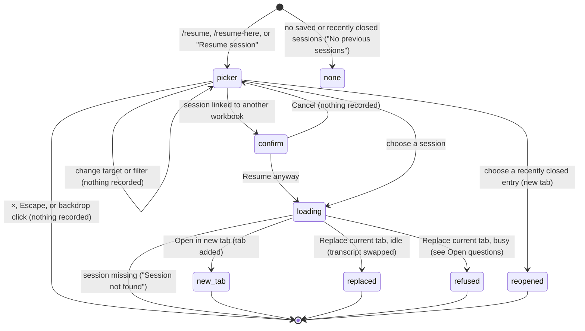

# Resuming a session

## Summary

Resuming opens a saved [session](../foundations/sessions-and-tabs.md#what-a-session-is) again, so the user can pick up any earlier conversation, in this workbook or another. It happens in the resume picker, an [overlay](../glossary.md#the-taskpane) titled "Resume session". There are three ways in:

- `/resume`, which opens the picker with "Open in new tab" selected;
- "Resume session" in the [utilities menu](../ui/the-utilities-menu.md), which does the same;
- `/resume-here`, which opens it with "Replace current tab" selected.

The picker lists recently closed tabs and up to 30 saved sessions. By default it shows only sessions linked to this workbook or not linked to any. `/resume` and the menu work while the active tab is busy. `/resume-here` is refused while the active tab is busy, and so is "Replace current tab" chosen inside the picker. No provider is needed.

## The simple case

The user types `/resume` and presses Enter. The picker opens over the taskpane. It shows "Open in new tab" highlighted, the hint "Default action: Open in new tab", a "Show sessions from all workbooks" checkbox with the workbook's file name, and a "Saved sessions" list. Each entry shows the session's saved title and "{count} messages · {date}", for example "12 messages · 2h ago". The most recently modified sessions come first.

The user clicks an entry. The picker closes, a new tab appears at the right end of the tab strip with that conversation, and it becomes active. The toast says "Resumed in new tab: {title}", and focus is in the composer. The user carries on the conversation from where it ended, with the session's model and thinking level.

## The interaction, event by event

### Opening the picker

When the picker opens, it reads the list of saved sessions once and works out the current [workbook identity](../foundations/sessions-and-tabs.md#workbook-links-and-workbook-identity). Then it shows these parts, top to bottom:

- **Header.** "Resume session", with the subtitle "Select a session to resume in a new tab or current tab." and a × button ("Close resume session").
- **Target buttons.** "Open in new tab" and "Replace current tab". One is highlighted, and the hint below names it ("Default action: {action}"). `/resume` and the menu preselect "Open in new tab"; `/resume-here` preselects "Replace current tab". Clicking a target button changes the selection and does nothing else.
- **Workbook filter.** "Show sessions from all workbooks", unchecked, followed by the workbook's label (its file name, see [workbook identity](../foundations/sessions-and-tabs.md#workbook-links-and-workbook-identity)). This row appears only when the workbook identity is known. When it is unknown, every session is shown and there is no checkbox. In this project's Excel on the web session the identity was unknown, and the picker had no checkbox (confirmed).
- **"Recently closed".** The hint "Reopen recently closed tabs directly in a new tab.", then up to 6 tabs closed in this taskpane, newest first. With the filter unchecked, entries from other workbooks are hidden. The section is hidden when empty. See [reopening closed tabs](reopening-closed-tabs.md). Clicking an entry reopens it in a new tab even when "Replace current tab" is selected (confirmed in Excel on the web).
- **"Saved sessions".** Up to 30 entries, each with its [saved title](../glossary.md#sessions-and-tabs) (or "Untitled") and "{count} messages · {date}". The date reads "just now", "{n}m ago", "{n}h ago", "{n}d ago", or a calendar date after a week. With the filter unchecked, sessions linked to this workbook come first, newest first, followed by sessions with no workbook link, newest first. Checking the filter shows every session, newest first. If nothing matches, the list says "No available sessions for this workbook."

Sessions that are already open in a tab, including the active tab's own session, are listed like any other.

### Ends at once

- **Nothing saved at all.** If there are no saved sessions and nothing recently closed, no picker opens. The toast says "No previous sessions".
- **Dismissed.** The ×, Escape or backdrop closes the picker without opening a session. Focus starts inside the dialog, stays there through Tab/Shift+Tab, and returns to the opener or composer on close. Typing and shortcuts cannot act behind it; Escape dismisses only the topmost overlay.
- **Cross-workbook confirmation cancelled.** If the chosen session is linked to a different workbook, a confirmation opens over the picker. Its title is "Resume session from another workbook?" and its message is "This session was created for a different workbook. Resume anyway in a new tab?" or "This session was created for a different workbook. Resume anyway and replace the current chat?", depending on the target. "Cancel" or Escape returns to the picker. Nothing is recorded. Confirmed in Excel on the web with the workbook address stubbed to two different OneDrive addresses (the real session reports none): the dialog, its new-tab wording, Escape returning to the picker, and "Resume anyway" opening the session in a new tab.
- **`/resume-here` while busy.** The command is refused with "Can't run /resume-here while Pi is busy", and no picker opens.

### Resumed

The commitment is the click on an entry, or "Resume anyway". The session is read from storage. If it is no longer there, the toast is "Session not found" and the picker closes. Otherwise the picker closes and one of these happens:

- **Already open.** Pi switches to that session's existing tab and says "Already open: {title}"; it does not create a duplicate or reload the session over itself.
- **Open in new tab.** A tab is added and activated with the saved transcript, model and thinking level. A chosen title is retained; otherwise the stable Chat number supplies the label. The toast says "Resumed in new tab: {title}".
- **Replace current tab, while idle.** The target tab loads the session and its saved title, model, thinking, draft and Not sent rows. The previous session remains saved. The toast says "Resumed in current tab: {title}".
- **Replace current tab, while busy.** Nothing is replaced. The busy refusal leaves the picker open and does not show a success toast.

In both success cases the session becomes this workbook's latest session, and the tab layout is saved. If the session was not linked to any workbook, it is now linked to this one. A session linked to another workbook keeps that link, so the confirmation appears again next time.

### While loading

The picker stays open while loading. An in-flight guard prevents repeated clicks from starting duplicate resumes.

### After resuming

The user is in the resumed tab with focus in the composer. Its own saved draft and Not sent rows appear; draft, error and activity state belong to the tab, not the old active tab. Nothing in the workbook changes. The conversation continues from its saved messages.

## Modifiers

| Modifier | Set before | Changed while busy |
| --- | --- | --- |
| Model and provider | The resumed tab takes the session's saved model, not the current one. If that provider is not connected, the tab opens and a login is requested at the next send. | Replacing a busy tab is refused, so its model is never swapped mid-turn. |
| Thinking level | The resumed tab takes the session's saved level. | Not applicable. |
| Execution mode | No effect. The mode is shared and is not stored with sessions. | No effect. |
| Files in the workspace, or an overlay open | Files: no effect. The picker is an overlay. Opening it closes no other overlay, but only one picker can be open. | The cross-workbook confirmation opens over the picker. |
| Tab state (new, restored, another tab busy) | "Open in new tab" works whatever any tab is doing. "Replace current tab" needs the active tab to be idle. Another tab being busy does not matter. | `/resume` and the menu still open the picker while the active tab is busy. Use "Open in new tab". |
| Host (desktop or web) | The workbook filter is shown only when the workbook identity is known: for saved workbooks on desktop, and on Excel on the web when Excel reports the file's address. In this project's signed-out Excel on the web session it reported none, so there was no filter and every session was listed. A never-saved workbook on desktop has no filter either. | No effect. |

The list is a snapshot taken when the picker opens. Sessions saved by other tabs while it is open appear only the next time it opens.

## Cancel and interrupt

| Event | Before sent | While busy |
| --- | --- | --- |
| Stop (button or Escape) | Escape closes the topmost confirmation or picker, not the response behind it. | Loading is not a model turn to stop. |
| The user sends something else | Modal focus prevents sending behind the picker. | Not applicable. |
| Tab switched, created, closed or reopened | Modal handling suppresses tab shortcuts behind the picker. | Busy replacement is rechecked at commitment. |
| An overlay or menu opens | The cross-workbook confirmation is the only overlay expected on top. | Not applicable. |
| Model or thinking level changes | Not reachable while the picker is open. | Not applicable. |
| The provider fails | No effect. Resuming makes no network request. | Not applicable. |
| The taskpane goes away | Nothing is recorded. | A resume in progress is lost. The session in storage is unchanged. |
| The workbook changes underneath | No effect. The identity used for the filter and the confirmation is the one read when the picker opened. | No effect. |
| Focus moves to the grid or another window | The picker stays open. | No effect. |
| The context window fills | No effect. A resumed session that is near its context limit compacts on its next send; see [context and compaction](../turn/context-and-compaction.md). | Not applicable. |

After a cancelled picker the user is back on the tab they started from, with the composer unchanged.

## Interactions with other systems

**Persistence.** The picker only reads. Resuming updates the workbook link (only if the session has none), the latest-session pointer and the tab layout. See [persistence and restore](../cross-cutting/persistence-and-restore.md).

**Workbook changes and recovery.** No interaction. A resumed session does not bring back the workbook state it was used with, and its old [backups](../workbook/backups-and-revert.md) belong to the workbook, not the session.

**Other tabs and sessions.** Opening an already-open session switches to its tab. A session is open at most once in this taskpane. Cross-taskpane saves use revision conflict handling, not this in-memory de-duplication.

**Execution mode and approvals.** No interaction.

**Models and providers.** The session's model is restored even if it differs from the active tab's. See [models and providers](../foundations/models-and-providers.md).

**Offline and provider errors.** No interaction.

**Notifications.** "Resumed in new tab: {title}", "Resumed in current tab: {title}", "Reopened: {title}", "No previous sessions", "Session not found", "Current tab is busy — use open in new tab or wait for it to finish".

**Settings and preferences.** None.

**Host differences.** See the Host row above and [host differences](../cross-cutting/host-differences.md).

**Language.** The picker text is translated. In the success toast, the words "new tab" and "current tab" are hard-coded English. The "Untitled" saved title stored with sessions is English too.

**Accessibility and keyboard.** The modal takes and traps focus and restores it on close. Entries and target buttons are buttons; target selection exposes `aria-pressed`. Tab moves through controls; the bounded card and list scroll within the available pane height.

## Edge cases

- Only the 30 most recent sessions that pass the filter are listed. Older sessions cannot be reached from the picker, and sessions are never deleted.
- Blank tabs that were closed or restored appear as "Untitled" with "1 messages", because message counts include Pi's hidden instructions.
- With the filter unchecked, a recent unlinked session appears below every linked session, however old they are.
- Choosing an already-open session activates it without reloading over its live state.
- A session saved while the workbook had no identity is unlinked and appears in every workbook's picker.
- The modal prevents typing another `/resume` into the composer behind it.

## Open questions and verification

The observations below are the **historical 26 October run on `ec453df`**, not the current contract. Merged source at `1f51cf8` fixes duplicate opens, chosen-title loss, busy-replacement success feedback, double-click races, modal focus/shortcuts and short-pane sizing. This pass opened `/resume` in real Excel on the web: focus was inside the dialog, its height was bounded to 622 px, and typing did not reach the composer. Full desktop and cross-workbook acceptance was not repeated. The original observations are retained here for traceability.

- "Replace current tab" on a busy tab shows "Current tab is busy — …", but the picker then closes and shows "Resumed in current tab: {title}" even though nothing was replaced. `src/taskpane/init.ts:1166-1170` returns without signalling failure, and `src/commands/builtins/resume-overlay.ts:389-397` always closes and shows the success toast. Confirmed in Excel on the web (RESUME-08). Looks like a bug.
- Resuming does not check whether the session is already open in another tab. Confirmed in the standalone taskpane: "Open in new tab" on a session that was open as "Chat 3" produced "Chat 4" with the same session, and the saved tab layout listed the session ID twice. After a reload, the first of the two became active instead of the one that had been. Confirmed again in Excel on the web (RESUME-07, SESS-09). Looks like a bug. `findRuntimeBySessionId` exists in `src/taskpane/session-runtime-manager.ts:234` but is not used here.
- The resumed tab shows "Chat N", not the session's saved title, because loading clears the chosen-title flag (`src/taskpane/sessions.ts:296`). Consistent with [renaming a tab](renaming-a-tab.md). Probably unintentional.
- The picker carries the overlay Escape claim (`src/ui/overlay-escape.ts:31` sets `data-claims-escape`, matched by `src/utils/escape-guard.ts:9`), so Escape closes it rather than stopping a responding tab. This matches goal.md, but only when focus is outside the composer. After `/resume` focus stays in the composer, the composer's own Escape handler sees no claim on its target, and the first Escape stops the turn (`src/ui/pi-input.ts:104-108`). Confirmed in Excel on the web (RESUME-17). Looks like a bug, a consequence of the picker not taking focus.
- The picker leaves focus in the composer when opened by command, so typing goes behind it and Enter would send. Confirmed in Excel on the web: text typed after `/resume` landed in the composer, Escape had to be pressed twice, and a message sent with Enter started a turn behind the open picker. `createOverlayDialog` in `src/ui/overlay-dialog.ts:190-271` never moves focus into the card. Looks like a bug, likely shared by other overlays.
- A double click on an entry can start two resumes, because there is no in-flight guard (`src/commands/builtins/resume-overlay.ts:325-398`). Read from code, not confirmed.
- Message counts in the list include hidden instruction messages. Confirmed: a blank session shows "1 messages".
- In a short taskpane the list of entries is tiny. With the pane about 340 px tall, the picker card is cut off at the bottom (it does not scroll) and the list inside it is 28 px tall, so only the top strip of one entry shows; the rest has to be scrolled into that strip with the wheel. Clicks below the strip land on the card and do nothing. This explains the failed clicks in the first pass (RESUME-16), which aimed at the middle of an entry. Confirmed in Excel on the web (RESUME-18). Looks like a bug: the card should scroll or the list should get the remaining height.
- The resume picker exposes an "Untitled" entry for blank sessions created by closing or restoring blank tabs; see [sessions and tabs](../foundations/sessions-and-tabs.md#edge-cases).
- "No previous sessions" confirmed in Excel on the web after clearing the saved sessions. `/resume` typed while the picker is open was not run.
- Checked in Excel on the web on 2026-10-26; see [the checklist](../verification/sessions-and-commands.md#sessionsresuming-a-sessionmd).

Verified against pi-for-excel commit `1f51cf8` (source inspection and the live modal check above; dated observations retained).
