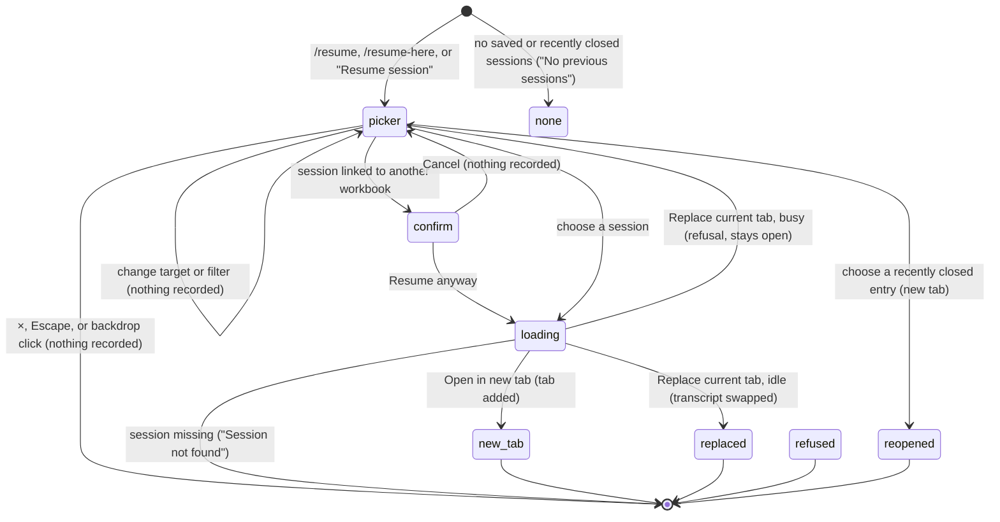

# Resuming a session

## Summary

As of [PR #805](https://github.com/tmustier/pi-for-excel/pull/805) (CL-10), `/resume` and "Resume session" in the utilities menu open the same picker. Choosing a session focuses or opens a tab automatically. There are no target buttons, "Replace current tab" mode, default-target hint or `/resume-here` command.

Resume works while Pi is busy and needs no connected provider. It never replaces a conversation that is already in a tab.

## Choosing a session

The picker lists recently closed tabs and up to 30 saved sessions. Entries show the saved title (including model-written titles), visible chat-message count and modification date. Hidden bookkeeping messages do not count. The list is a snapshot taken when the picker opens.

When the workbook identity is known, "Show sessions from all workbooks" defaults off: linked sessions for this workbook and unlinked sessions are shown. With no known identity, all sessions are shown and the filter is absent. An entry linked to another workbook asks "Resume session from another workbook?" before loading. The confirmation does not promise a replacement target.

<<<<<<< Updated upstream
Clicking a saved entry follows this order:
=======
The user clicks an entry. The picker closes and the conversation becomes active, with its saved model, thinking level, chosen title and unsent text. A new tab opens unless that session is already open, in which case Pi focuses it rather than duplicating it. The toast distinguishes those outcomes. Focus returns to the opener, or the composer if the opener no longer exists.
>>>>>>> Stashed changes

1. If that session is already open, focus its existing tab, even if that tab is busy. Do not reload it or overwrite its live state.
2. Otherwise, reuse the active tab only if it is idle and has no visible conversation messages. Hidden setup instructions do not make a tab non-empty.
3. Otherwise, open a new tab and activate it. A busy empty tab is not reused.

<<<<<<< Updated upstream
The saved model, thinking level and title are restored when a session is loaded. The same session cannot be open twice. Recently closed entries use the reopen path and likewise focus an already-open session rather than duplicate it.
=======

>>>>>>> Stashed changes

## After resume

The picker closes, focus returns to the composer, and the outcome toast distinguishes an opened, reused or focused tab. The layout and latest-session pointer are saved. An unlinked session is linked to the current workbook; an existing link to another workbook is preserved.

The workbook itself is not restored or changed. Old backups belong to the workbook rather than to this conversation. The next message continues the stored conversation, and later saves use the same session identity.

<<<<<<< Updated upstream
## Cancel and failure
=======
Already-open sessions remain listed; choosing one focuses its existing tab.
>>>>>>> Stashed changes

- No saved or recently closed sessions: "No previous sessions".
- A missing saved entry: "Session not found"; no conversation is replaced.
- Close button, backdrop or Escape: dismiss without resuming; cancelling the cross-workbook confirmation returns to the picker.
- Loading is local storage work, not a provider request. Provider failure does not prevent opening a saved session.
- Closing the taskpane before choosing records nothing.

<<<<<<< Updated upstream
The picker uses the common modal focus/Escape handling; tab shortcuts and other overlay rules are owned by the keyboard and overlay documents.
=======
- **Nothing saved at all.** If there are no saved sessions and nothing recently closed, no picker opens. The toast says "No previous sessions".
- **Dismissed.** ×, Escape or backdrop closes it without a resume. The picker takes and traps focus; typing and shortcuts do not act on the composer behind it. Escape dismisses only the topmost surface, not a running turn. Focus returns to the opener or composer fallback.
- **Cross-workbook confirmation cancelled.** If the chosen session is linked to a different workbook, a confirmation opens over the picker. Its title is "Resume session from another workbook?" and its message is "This session was created for a different workbook. Resume anyway in a new tab?" or "This session was created for a different workbook. Resume anyway and replace the current chat?", depending on the target. "Cancel" or Escape returns to the picker. Nothing is recorded. Confirmed in Excel on the web with the workbook address stubbed to two different OneDrive addresses (the real session reports none): the dialog, its new-tab wording, Escape returning to the picker, and "Resume anyway" opening the session in a new tab.
- **`/resume-here` while busy.** The command is refused with "Can't run /resume-here while Pi is busy", and no picker opens.
>>>>>>> Stashed changes

## Verification

<<<<<<< Updated upstream
PR #805 has public runtime tests distinguishing focus-existing, idle-empty reuse and new-tab opening from a non-empty tab. Its Excel-web evidence exercises real saved sessions. This replaces the earlier observations about duplicate tabs, explicit replacement, busy replacement refusals and false replacement success toasts.
=======
The commitment is the click on an entry, or "Resume anyway". The session is read from storage. If it is no longer there, the toast is "Session not found" and the picker closes. Otherwise the picker closes and one of these happens:

- **Already open.** Focus that session's existing tab, with an already-open notice; do not reload or duplicate its runtime.
- **Open in new tab.** Add a tab at the right, carrying saved transcript, resolved current model, thinking level, chosen title and unsent text. An unnamed session uses a new default number. Show "Resumed in new tab: {title}".
- **Replace current tab, idle.** Load the selected session and its title, model, thinking and unsent state into the current tab. The previous session remains saved; it is not added to recently closed. Show "Resumed in current tab: {title}".
- **Replace current tab, busy.** Refuse with "Current tab is busy — use open in new tab or wait for it to finish"; keep the picker open and do not show a success toast.

In both success cases the session becomes this workbook's latest session, and the tab layout is saved. If the session was not linked to any workbook, it is now linked to this one. A session linked to another workbook keeps that link, so the confirmation appears again next time.

### While loading

The picker stays open and exposes `aria-busy` until the load finishes. Repeated clicks are ignored while an open is in progress.

### After resuming

The user is in the resumed tab with its own composer/Not sent rows and per-tab error state. No workbook state is restored by resuming a conversation. The next save writes to the same session.

## Modifiers

| Modifier | Set before | Changed while busy |
| --- | --- | --- |
| Model and provider | The resumed tab takes the session's saved model, not the current one. If that provider is not connected, the tab opens and a login is requested at the next send. | Replacing a busy tab is refused, so its model is never swapped mid-turn. |
| Thinking level | The resumed tab takes the session's saved level. | Not applicable. |
| Execution mode | No effect. The mode is shared and is not stored with sessions. | No effect. |
| Files in the workspace, or an overlay open | Files: no effect. The picker is an overlay. Opening it closes no other overlay, but only one picker can be open. | The cross-workbook confirmation opens over the picker. |
| Tab state (new, restored, another tab busy) | "Open in new tab" works whatever any tab is doing. "Replace current tab" needs the active tab to be idle. Another tab being busy does not matter. | `/resume` and the menu still open the picker while the active tab is busy. Use "Open in new tab". |
| Host (desktop or web) | The workbook filter is shown only when the workbook identity is known: for saved workbooks on desktop, and on Excel on the web when Excel reports the file's address. In this project's signed-out Excel on the web session it reported none, so there was no filter and every session was listed. A never-saved workbook on desktop has no filter either. | No effect. |

The list is a snapshot taken when the picker opens. Sessions saved by other tabs while it is open appear only the next time it opens.

## Cancel and interrupt

| Event | Before sent | While busy |
| --- | --- | --- |
| Stop (button or Escape) | Escape closes only the top confirmation/picker, not the turn underneath. | Loading is not cancellable. |
| The user sends something else | Modal focus prevents sending behind the picker. | Not applicable. |
| Tab switched, created, closed or reopened | Modal blocks tab shortcuts behind it. | Not applicable. |
| An overlay or menu opens | The cross-workbook confirmation is the only overlay expected on top. | Not applicable. |
| Model or thinking level changes | Not reachable while the picker is open. | Not applicable. |
| The provider fails | No effect. Resuming makes no network request. | Not applicable. |
| The taskpane goes away | Nothing is recorded. | A resume in progress is lost. The session in storage is unchanged. |
| The workbook changes underneath | No effect. The identity used for the filter and the confirmation is the one read when the picker opened. | No effect. |
| Focus moves to the grid or another window | The picker stays open. | No effect. |
| The context window fills | No effect. A resumed session that is near its context limit compacts on its next send; see [context and compaction](../turn/context-and-compaction.md). | Not applicable. |

After a cancelled picker the user is back on the tab they started from, with the composer unchanged.

## Interactions with other systems

**Persistence.** The picker only reads. Resuming updates the workbook link (only if the session has none), the latest-session pointer and the tab layout. See [persistence and restore](../cross-cutting/persistence-and-restore.md).

**Workbook changes and recovery.** No interaction. A resumed session does not bring back the workbook state it was used with, and its old [backups](../workbook/backups-and-revert.md) belong to the workbook, not the session.

**Other tabs and sessions.** At most one runtime per session in a taskpane. Resume/reopen focuses an existing tab. This does not prevent another taskpane opening the same session.

**Execution mode and approvals.** No interaction.

**Models and providers.** The session's model is restored even if it differs from the active tab's. See [models and providers](../foundations/models-and-providers.md).

**Offline and provider errors.** No interaction.

**Notifications.** "Resumed in new tab: {title}", "Resumed in current tab: {title}", "Reopened: {title}", "No previous sessions", "Session not found", "Current tab is busy — use open in new tab or wait for it to finish".

**Settings and preferences.** None.

**Host differences.** See the Host row above and [host differences](../cross-cutting/host-differences.md).

**Language.** Picker and outcome toasts are translated; stored/user text is not rewritten.

**Accessibility and keyboard.** Modal dialog with focus entry, trapped Tab and focus restoration. Entries and target controls are buttons; target uses `aria-pressed`. The card/list can scroll in a short pane. Tab moves through entries; no list search is supplied.

## Edge cases

- Only the 30 most recent sessions that pass the filter are listed. Older sessions cannot be reached from the picker, and sessions are never deleted.
- Blank tabs that were closed or restored appear as "Untitled" with "1 messages", because message counts include Pi's hidden instructions.
- With the filter unchecked, a recent unlinked session appears below every linked session, however old they are.
- Choosing the active tab's session focuses it without reloading its saved copy.
- A session saved while the workbook had no identity is unlinked and appears in every workbook's picker.
- The picker is single-instance; the modal prevents typing another command behind it.

## Open questions and verification

- Merged `openSession`, resume-overlay and shared modal code establish deduplication, truthful refusal, saved title, focus and in-flight guard behavior. Earlier failures remain historical checklist evidence.
- Message counts in the list include hidden instruction messages. Confirmed: a blank session shows "1 messages".
- Short-pane scrolling needs acceptance at each host's actual pane size; the shared card is now scrollable.
- The resume picker exposes an "Untitled" entry for blank sessions created by closing or restoring blank tabs; see [sessions and tabs](../foundations/sessions-and-tabs.md#edge-cases).
- "No previous sessions" confirmed in Excel on the web after clearing the saved sessions. `/resume` typed while the picker is open was not run.
- Checked in Excel on the web on 2026-10-26; see [the checklist](../verification/sessions-and-commands.md#sessionsresuming-a-sessionmd).

Verified against pi-for-excel commit `1f51cf8` (source inspection; earlier live runs are historical).
>>>>>>> Stashed changes
