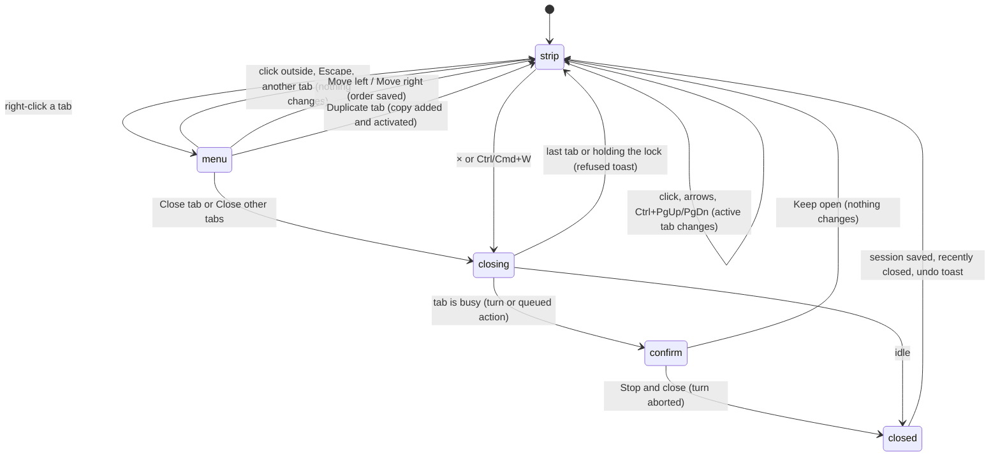

# Tabs

**CL-08/CL-11 update:** [PR #805](https://github.com/tmustier/pi-for-excel/pull/805) gives tabs their saved conversation title (model-written or user-chosen), with stable "Chat N" only when no title exists. See [renaming a tab](renaming-a-tab.md) for generation and manual precedence. New tabs inherit both the active model and its thinking level, clamped to model support. Model switches always stay in place and can be chosen while busy for the next turn; there are no model-switch forks.

## Summary

Tabs let the user keep several independent conversations with Pi side by side in one taskpane and move between them. This document covers what the user does with [session tabs](../foundations/sessions-and-tabs.md): creating one ("+", Ctrl/Cmd+T, `/new`), switching (a click, the arrow keys, Ctrl+PageUp/PageDown, Cmd+Shift+[ / ]), moving and duplicating (the [tab context menu](../glossary.md#the-taskpane)), and closing (the × button, Ctrl/Cmd+W, "Close tab", "Close other tabs"). It also covers the scroll arrows that appear when the tab strip overflows. Renaming is in [renaming a tab](renaming-a-tab.md), bringing a closed tab back is in [reopening closed tabs](reopening-closed-tabs.md), and what a tab owns is in [sessions and tabs](../foundations/sessions-and-tabs.md#what-a-tab-owns). Creating, switching and moving work while tabs are busy. Duplicating is refused while the source tab is busy. Closing asks first if the tab is responding, and is refused if the tab holds the workbook lock. None of it needs a provider. On Excel on the web the browser takes Ctrl/Cmd+T, Ctrl/Cmd+W and Ctrl+PageUp/PageDown for its own tabs, so those shortcuts never reach Pi there (see [Host differences](#interactions-with-other-systems)).

## The simple case

The user clicks "+" at the end of the tab strip. A new tab, "Chat 2", appears at the right end and becomes active, showing the [empty state](../glossary.md#the-taskpane). Focus goes to the composer. The model is the same as in the tab the user came from.

The user clicks "Chat 1" to go back. Its transcript, model and queue come back exactly as they were, and a turn that was running there has kept running. The user then clicks the × on "Chat 2". The tab disappears, "Chat 1" stays active, and a toast near the top of the taskpane says "Closed Chat 2" with an "Undo" button for 9 seconds.

## The interaction, event by event

### Choosing an action

What is targeted depends on how the user starts:

- **Creating** adds a tab at the right and activates it. "+" ("New tab"), Ctrl/Cmd+T and `/new` are equivalent; `/new` works while another tab is busy. Modal overlays block shortcuts behind them. Browser-reserved shortcuts may not reach Pi on the web.
- **Switching** targets a tab by position. A click selects that tab and puts focus in the composer. From the keyboard:
  - ArrowLeft/ArrowRight go to the previous or next tab, wrapping around at the ends. They work only when focus is not in a [text field](../glossary.md#input), for example after Escape has moved focus out of the composer to the tab strip.
  - Ctrl+PageUp/Ctrl+PageDown (any platform) and Cmd+Shift+[ / Cmd+Shift+] (macOS) do the same. They also do nothing in a text field.

  Confirmed in Excel on the web, with the keys sent to the page: arrows wrap from the last tab to the first, and Ctrl+PageUp/PageDown and Cmd+Shift+[ switch tabs from the page body but not from the composer. On Excel on the web the browser takes Ctrl+PageUp/PageDown before the page sees them (see [Host differences](#interactions-with-other-systems)).

  After a keyboard switch, focus lands on the newly active tab, not in the composer. Holding a key down does not cycle through tabs, except with plain arrows while a tab has focus.
- **Context-menu actions** target the right-clicked tab, which need not be the active one. Right-clicking does not switch tabs. The tab gets a highlighted outline while its menu is open.
- **Ctrl/Cmd+W** targets the active tab. The × button targets its own tab.

### Ends at once

These end without changing anything except a toast:

- **Closing the last tab.** The × button is not shown when only one tab is open, and "Close tab" is disabled. Ctrl/Cmd+W shows "Can't close the last tab". Confirmed in Excel on the web; with one tab, "Move left", "Move right" and "Close other tabs" are disabled too.
- **Closing a tab that holds the workbook lock**, meaning one of its mutations is running. Its × is disabled with the tooltip "Wait for workbook changes to complete", and "Close tab" is disabled. Ctrl/Cmd+W shows "Wait for workbook changes to finish before closing this tab". Confirmed in Excel on the web (with a delay added to `Excel.run` so the lock was held long enough to act).
- **"Keep open"** in the stop-and-close confirmation. Nothing changes and the turn carries on.
- **Duplicating a busy tab.** The toast is "Wait for this tab to finish before duplicating".
- **Moving past the end.** "Move left" is disabled on the first tab and "Move right" on the last.
- **"Close other tabs" with one tab.** The item is disabled.
- **Switching with one tab**, or to the tab that is already active. Nothing happens.
- **Dismissing the context menu.** A click outside it, Escape, opening the [utilities menu](../ui/the-utilities-menu.md), or clicking another tab closes it without acting. Escape belongs to the topmost menu; it does not stop the turn underneath.

### Committing

- **New tab.** New session, next stable "Chat N", empty draft and saved layout. The first user message saves without waiting for an answer; draft-only state also persists. Creation failure shows "Couldn't open a new tab: {message}".
- **Switch.** Layout records the active tab. Transcript, status, queue, activity, Stop, error banner and composer all switch to that tab's owned state. A draft does not follow the user into another tab.
- **Move.** The tab swaps places with its neighbour. The toast "Moved tab left" or "Moved tab right" shows briefly (confirmed in Excel on the web), and the new order is saved to the layout. The active tab and tab numbers do not change.
- **Duplicate.** A copy is added at the right end of the strip and becomes active. It has a copy of the transcript, the same model and the same thinking level, and the chosen title "{label} copy", for example "Chat 1 copy". It does not copy queued items or the composer. The copy is a new session, saved at once and linked to the current workbook. The toast is "Duplicated {label}". Confirmed in Excel on the web, including the refusal on a busy tab.
- **Close.** The steps run in this order:
  1. If the tab is busy with a turn or queued action, the confirmation dialog "Stop and close this tab?" appears, with the buttons "Stop and close" (red) and "Keep open".
  2. On "Stop and close", the turn is [aborted](../glossary.md#endings).
  3. The session is saved, even if Pi never answered and even if the tab is blank.
  4. The tab goes into [recently closed](../glossary.md#sessions-and-tabs) under its current label.
  5. The settled tab is removed. Stop has held unused messages as saved Not sent rows and cancelled pending commands with a notice.
  6. If it was the active tab, the tab to its left becomes active, or the new first tab if it was first.
  7. An action toast says "Closed {label}" with "Undo" for 9 seconds (see [reopening closed tabs](reopening-closed-tabs.md)).

  Confirmed in Excel on the web: the dialog, its wording, "Keep open" and Escape (both leave the turn running), "Stop and close", the left neighbour or new first tab becoming active, and the undo toast.

  Queued-action busy states, including compaction, also ask. After confirmation Pi uses the shared Stop path and waits for the agent to settle before saving/removing the runtime. A write that acquired the lock while the dialog was open settles with its result/backup before removal; it does not silently land after the tab disappears.
- **Close other tabs.** Every other tab goes through the same close steps, from left to right. Each responding tab asks for confirmation in turn. A tab that holds the lock is skipped, with its "Wait for workbook changes…" toast. No undo toast is shown. The right-clicked tab becomes active, and a final toast says "Closed {count} other tabs", or "No tabs were closed" if every close was refused or kept open. Confirmed in Excel on the web with four idle tabs ("Closed 4 other tabs").

### While tabs change

Only closing has a waiting phase: the confirmation dialog. While it is open the turn keeps running, and the dialog covers the taskpane. Every other action is instant.

When many tabs are open, the tabs first shrink. In a taskpane about 350 px wide, eleven tabs shrank to about 17 px each, showing only their × buttons and no title, and the last tab's × overlapped the "+" button; the strip never overflowed, so no scroll arrows appeared (confirmed in Excel on the web). Only when tabs cannot shrink further does the strip overflow: then ‹ ("Scroll tabs left") and › ("Scroll tabs right") appear, each only when there is more to see in that direction, and each click scrolls by about one tab. The "+" button scrolls with the tabs, so it can be out of view when the strip overflows.

### Afterwards

Layout preserves order, active tab and numbers across reload. Recently closed is durable too; see [restore](../foundations/sessions-and-tabs.md#the-interaction-event-by-event). Tab operations do not roll back workbook changes.

## Modifiers

| Modifier | Set before | Changed while busy |
| --- | --- | --- |
| Model and provider | A new tab inherits the active tab's model. A duplicate keeps its source's model. Nothing here needs a connected provider. | A chosen model applies next turn; the current run retains its original model. Creating, switching and moving are unaffected. |
| Thinking level | A new tab inherits the active tab's level, clamped to the model. A duplicate keeps its source's level. | No effect on tab actions. |
| Execution mode | No effect. The mode is shared by all tabs. | No effect. |
| Files in the workspace, or an overlay open | Files are shared. Modal blocks pointer and shortcuts to tabs behind it. | Stop-and-close is itself modal. |
| Tab state (new, restored, another tab busy) | A new tab that is closed before Pi answers is still saved, as a blank or unanswered session. Restored tabs behave like any other. Another tab being busy blocks nothing here. | A responding tab asks before closing. A busy tab cannot be duplicated. A tab holding the lock cannot be closed. |
| Host (desktop or web) | On Excel on the web (Chrome) the browser takes Ctrl+T (opens a browser tab), Ctrl+W (closes the Excel browser tab, or the whole window if it is the only tab) and Ctrl+PageDown/PageUp; none reaches Pi. Use "+", `/new`, the × and the context menu there. | No effect. |

After confirmation, Pi rechecks the runtime and last-tab condition and settles any already-started mutation before removal.

## Cancel and interrupt

| Event | Before sent | While busy |
| --- | --- | --- |
| Stop (button or Escape) | Escape dismisses context menu/confirmation without stopping a turn underneath. | Stop alone does not close; Stop and close waits for settlement before removal. |
| The user sends something else | Each tab sends its own draft. Modal prevents sends behind close confirmation. | Other tabs are independent. |
| Tab switched, created, closed or reopened | Each acts at once. Opening the context menu on another tab replaces the open one. | A busy tab keeps running when the user switches away. Closing it is covered above. |
| An overlay or menu opens | Opening the utilities menu closes the tab context menu. Overlays block pointer access to the strip. | The close confirmation stays open until answered. |
| Model or thinking level changes | No effect on the tab strip. | Choices apply from the next turn. |
| The provider fails | No effect. Tab actions make no network request. | A turn that fails leaves the tab idle, so it can then be closed without confirmation. |
| The taskpane goes away | Saved layout, drafts, Not sent rows, chosen titles, numbers and recently closed persist. | Completed messages persist, not an in-flight stream. |
| The workbook changes underneath | No effect. | No effect on tabs. A tab's mutation keeps its lock until it finishes. |
| Focus moves to the grid or another window | Keystrokes go to Excel, so tab shortcuts do nothing. The context menu stays open until the next click in the taskpane. | Turns keep running. |
| The context window fills | No effect. | Compacting tab asks before close; summary is stopped or already saved, never transferred to another tab. |

After any interrupt the user is on whichever tab is active, with the composer text unchanged.

## Interactions with other systems

**Persistence.** Layout saves on tab operations; sessions save from first user message and own unsent state. Closing/duplicating force-save. See [persistence and restore](../cross-cutting/persistence-and-restore.md).

**Workbook changes and recovery.** No tab action changes the workbook. Closing a tab does not undo its changes, and its [automatic backups](../workbook/backups-and-revert.md) remain.

**Other tabs and sessions.** Tabs are independent apart from what they [share](../foundations/sessions-and-tabs.md#what-a-tab-owns). A duplicate is a separate session from then on. Model switching does not create a tab.

**Execution mode and approvals.** An approval dialog for a background tab's mutation still covers the taskpane. A tab waiting on an approval is responding, so closing it asks first.

**Models and providers.** New tabs inherit the model and duplicates copy it. See [models and providers](../foundations/models-and-providers.md).

**Offline and provider errors.** Banners belong to each runtime; switching displays only that tab's error.

**Notifications.** Close/Undo, duplicate, move and refusal notices stack below the tab strip. An Undo notice no longer suppresses ordinary notices; reopening dismisses its matching action.

**Settings and preferences.** No tab settings. The keyboard shortcuts page lists ⌘ T / Ctrl+T, ⌘ W / Ctrl+W, ⌘ ⇧ T / Ctrl+Shift+T, "← →" ("Switch tabs (exit input first)") and ⌘ ⇧ [ / ⌘ ⇧ ] / Ctrl+PgUp / PgDn.

**Host differences.** On Excel on the web, the browser reserves Ctrl/Cmd+T, Ctrl/Cmd+W and Ctrl+PageUp/PageDown for its own tabs. Confirmed with real key presses in Chrome on Linux: Ctrl+T opened a new browser tab, Ctrl+W closed the browser window that held Excel (it was the only tab), and Ctrl+PageDown left Pi's tabs unchanged. See [host differences](../cross-cutting/host-differences.md).

**Language.** Menu items, tooltips, the confirmation and the toasts are translated, except the direction word in "Moved tab left/right" and the " copy" suffix, which stay English.

**Accessibility and keyboard.** Each tab is a button named "Open tab {title}". The × is named "Close tab", and the context menu is a `menu` named "Actions for tab {title}". Creating, switching and closing have keyboard paths. Moving, duplicating and closing other tabs need the context menu, and there is no keyboard shortcut for that menu. The menu has no arrow-key navigation, so Tab moves between its items. Unlike most overlays, the "Stop and close this tab?" confirmation takes focus when it opens (its × button is focused), so Escape cancels it at once (confirmed in Excel on the web).

## Edge cases

- Tab numbers only go up: create "Chat 2", close it, create again, and the new tab is "Chat 3".
- Duplicating a duplicate can give "Chat 1 copy copy". The chosen title survives reload.
- Closing a blank tab adds a blank "Untitled" session to the resume picker.
- Closing the active first tab activates the tab that was second.
- "Close other tabs" on a tab while several others are responding shows one confirmation per responding tab, one after another.
- A new tab created by clicking "+" in an overflowing strip may be scrolled out of view. The strip does not scroll to it. In a 350 px taskpane the strip did not overflow even with eleven tabs (see [While tabs change](#while-tabs-change)).
- A duplicate uses up a default number: after "Chat 11" was duplicated, the next new tab was "Chat 13".
- The tab context menu can be open for a background tab while a different tab is active.

## Open questions and verification

- Merged close code confirms queued-action busy state, stops through the shared queue, waits for agent idle, saves and only then removes the runtime. Old TABS-22/23/28 failures are historical observations.
- Explicit tab-cycle chords also work from a focused tab when the host delivers them; plain arrows remain owned by the strip. The earlier TABS-08 failure is historical.
- Modal guards now prevent tab shortcuts behind overlays.
- On Excel on the web the browser keeps Ctrl+T, Ctrl+W and Ctrl+PageDown for itself (confirmed with real key presses in Chrome on Linux). A user who presses Ctrl+W expecting to close a Pi tab closes Excel instead. Excel desktop on Windows and macOS has not been checked.
- With the command menu open, clicking another tab switched to it but left focus on the tab instead of the composer (seen once in Excel on the web). Minor.
- Escape now dismisses the top menu instead of stopping the underlying turn.
- In a 350 px taskpane, five tabs already hide their titles and show only ×.
- Undo notices no longer suppress other notices.
- Whether the keyboard's context-menu key or Shift+F10 opens the tab context menu has not been checked.
- Checked in Excel on the web on 2026-10-26; see [the checklist](../verification/sessions-and-commands.md#sessionstabsmd).

Verified against pi-for-excel commit `1f51cf8` (source inspection; old dated observations are not new acceptance results).
