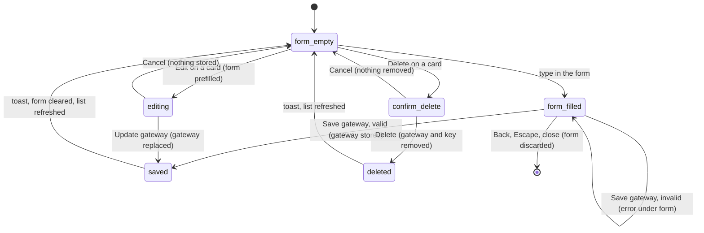

# Custom gateways

## Summary

A custom gateway lets Pi use a model behind any OpenAI-compatible endpoint: a company's LLM gateway, or a local server such as llama.cpp, Ollama or LM Studio. Each gateway the user adds becomes its own [provider](../foundations/models-and-providers.md), named "Gateway · {name}", with exactly one model. Gateways are managed on the Settings page "Custom OpenAI-compatible gateway" ("For corporate LLM gateways or local OpenAI-compatible servers."), reached from the Settings root row "Custom gateway" ("OpenAI-compatible endpoints") or from the welcome overlay's "Use a custom OpenAI-compatible gateway" (see [settings](settings.md) and [welcome and login](welcome-and-login.md)). The page has a form at the top and the list "Configured gateways" below it. Adding a gateway works with no other provider connected and on every host; it is allowed while a tab is busy, but a busy tab is never moved onto or off a gateway until it is idle. Nothing is sent to the gateway when it is saved.

## The simple case

The user opens Settings, clicks "Custom gateway", and fills the form: "Name" "Warehouse", "Endpoint" `https://llm.example.com/v1`, "Model" `gpt-oss-120b`, and the company's key under "API key". They click "Save gateway". The toast says "Saved gateway Warehouse.", the form empties, and a card appears under "Configured gateways":

> Warehouse · Gateway · Warehouse · Endpoint: https://llm.example.com/v1 · Model: gpt-oss-120b · Max context: 16,384 tokens · Max output: 4,096 tokens · API key: configured · Connection: proxy when enabled

They close Settings, click the model control, and pick "gpt-oss-120b" (tagged "Gateway · Warehouse") in [the model picker](the-model-picker.md). The next message goes to the gateway.

## The interaction, event by event

### Filling the form

The form fields, in order:

- **"Name"** ("Gateway name (optional)"). Left blank, the name is the endpoint's host and port (for example "localhost:8080").
- **"Endpoint"** ("https://your-gateway.example.com/v1"). The base URL; Pi appends the OpenAI paths itself. Required.
- **"Model"** ("model-id"). The exact model id the gateway expects. Required. One gateway holds one model; to use two models on the same endpoint the user adds two gateways.
- **"Max context tokens"** (placeholder "16384") with the hint "Leave blank to use registered model limits, or 16,384 tokens for an unknown model. Enter a value to override."
- **"Max output tokens"** (placeholder "4096") with the hint "Leave blank to use registered model limits, or 4,096 tokens for an unknown model. Raise this to your provider's output limit if long replies or tool calls get cut off."
- **"API key"** ("API key (optional for local servers)"), hidden as typed.
- **"Connect directly"** ("Skip the proxy for this gateway. The endpoint must use https:// and allow CORS from the add-in. Excel for Mac also blocks http://localhost."), off by default.

"Registered model limits" means: if Pi's built-in catalogue already has a model with exactly this endpoint, id and API style, the gateway borrows its context window, output limit, reasoning support, thinking levels, accepted inputs and prices. Otherwise the gateway's model is plain text-only, does not reason (so its only thinking level is "Off"), and uses the 16,384 / 4,096 defaults.

### Ends at once

Nothing is stored when:

- **Validation fails.** The message appears under the form in warning color and the form keeps its contents: "Endpoint URL is required.", "Endpoint URL must be a valid http:// or https:// URL.", "Endpoint URL must use http:// or https://.", "Model ID is required.", "Max context tokens must be a whole number.", "Max context tokens must be at least 1024.", "Max output tokens must be a whole number.", "Max output tokens must be at least 1.", and, for "Connect directly" with a plain `http://` endpoint on another machine, "Direct connections need an https:// endpoint. Excel blocks plain http:// requests to other machines. Serve the endpoint over HTTPS, or turn off Connect directly to use the proxy." These messages are English-only.
- **The user leaves the page** with Back, Escape, × or the backdrop. A half-filled form is dropped without asking.
- **"Cancel"** while editing (the button only appears while editing) clears the form back to an empty "Save gateway".
- **The delete confirmation is cancelled.**

### Saving

"Save gateway" disables both buttons while it stores the gateway, then:

- the endpoint is normalized (trailing slash and any `#fragment` removed);
- the output limit is clamped to the context window;
- the provider name is "Gateway · {name}"; if another gateway already has that name (ignoring case), " (2)", " (3)" … is appended;
- the toast says "Saved gateway {name}." (or "Updated gateway {name}." when editing), using the name as typed, without any " (2)"; the list re-sorts alphabetically by name, and the form clears.

The gateway is now a connected provider, even without an API key: a keyless gateway sends a placeholder key, which local servers ignore. Pi refreshes the provider list; any idle tab whose provider is not connected may move to the [default model](../foundations/models-and-providers.md#the-default-model), and if the gateway is the only provider, that default is the gateway's model.

### Editing and deleting

**"Edit"** on a card fills the form with the stored values, including the API key (hidden), shows "Cancel", turns the button into "Update gateway", and focuses "Name". Saving replaces the gateway in place.

**"Delete"** asks "Delete custom gateway?" ("Delete gateway "{name}"? This removes its stored API key from this add-in.") with a red "Delete". Confirming removes the gateway, its key and its cached model list, shows "Deleted gateway {name}.", and clears the form if that gateway was being edited. A failure shows "Failed to delete gateway: {message}".

### How its model appears and is used

The gateway's single model appears in [the model picker](the-model-picker.md) with its id and the tag "Gateway · {name}", after the built-in providers. Pi does not ask the gateway for its list of models; only the configured model is offered.

Requests go to the endpoint by one of two routes:

- **Proxy (default).** If the [proxy](the-proxy.md) is enabled, requests go through it ("Connection: proxy when enabled"). If it is disabled, they go straight to the endpoint. A local proxy refuses loopback and private-network targets unless it was started with `ALLOW_LOOPBACK_TARGETS=1` or `ALLOW_PRIVATE_TARGETS=1`, and refuses hosts not on its allowlist; those refusals reach the user as an error banner.
- **Direct** ("Connect directly" on, "Connection: direct"). Requests skip the proxy even when it is enabled; the endpoint must serve HTTPS with CORS for the add-in.

If the endpoint cannot be reached at all (nothing listening, wrong host), the turn fails with "Error: Connection error." in the transcript and "LLM error: Connection error." in the error banner (confirmed with the proxy off and an endpoint at `https://localhost:3999/v1`), not the CORS-worded banner.

Without the proxy, a plain `http://` endpoint on another machine fails before sending with an explanation ("{provider} uses a plain http:// endpoint ({url}). Excel blocks http:// requests from the add-in to other machines, …") in the error banner.

### While saving, and after

There is no busy phase beyond the moment the buttons are disabled. Saving, editing or deleting never interrupts a running turn: a busy tab keeps its model until idle and is re-checked then.

## Modifiers

| Modifier | Set before | Changed while busy |
| --- | --- | --- |
| Model and provider | A gateway is a provider. Deleting or renaming one disconnects it, so idle tabs on it move to the default model. | A busy tab on the gateway keeps using its model until the turn ends; a deleted gateway then fails or is swapped. |
| Thinking level | An unknown gateway model offers only "Off"; a matched one offers the registered levels. | No effect. |
| Execution mode | No effect. | No effect. |
| Files in the workspace, or an overlay open | No effect from files. The delete confirmation opens over Settings. | No effect. |
| Tab state (new, restored, another tab busy) | Restored tabs find their gateway model by provider name. | No effect on the busy tab. |
| Host (desktop or web) | Excel on the web and Windows accept `https://` and loopback endpoints directly; Excel for Mac also blocks `http://localhost` (per the hint). | No effect. |

Edits take effect for each tab at its next idle point.

## Cancel and interrupt

| Event | Before sent | While busy |
| --- | --- | --- |
| Stop (button or Escape) | Escape leaves a field, then goes back to the Settings root page, dropping the form. Escape in the delete confirmation cancels it. | Not applicable: saving is instantaneous. |
| The user sends something else | The composer is covered by Settings. | Not applicable. |
| Tab switched, created, closed or reopened | Not possible while Settings is open. | Not applicable. |
| An overlay or menu opens | An approval or connection dialog from a running turn opens over the page; the form keeps its contents. | Not applicable. |
| Model or thinking level changes | Saving may move idle tabs to a new default model. | Not applicable. |
| The provider fails | Nothing is checked at save time; a wrong endpoint, model or key shows up as an error on the next turn. | Not applicable. |
| The taskpane goes away | An unsaved form is lost; saved gateways persist. | Not applicable. |
| The workbook changes underneath | No effect. | No effect. |
| Focus moves to the grid or another window | The form keeps its contents. | No effect. |
| The context window fills | A wrong "Max context tokens" makes the context meter and compaction wrong for that model. | Not applicable. |

After any interrupt the user is on the gateway page with the form as it was, unless they left the page.

## Interactions with other systems

**Persistence.** Gateways, including their API keys, are stored per machine in the add-in's storage, not in the workbook. Sessions store their gateway model by provider name. See [persistence and restore](../cross-cutting/persistence-and-restore.md).

**Workbook changes and recovery.** No interaction.

**Other tabs and sessions.** A gateway is available to every tab. Deleting or renaming one affects every idle tab using it.

**Execution mode and approvals.** No interaction.

**Models and providers.** A gateway is a provider with one model; see [models and providers](../foundations/models-and-providers.md).

**Offline and provider errors.** Saving works offline. Failures appear as turn errors; see [provider errors and offline](../cross-cutting/provider-errors-and-offline.md).

**Notifications.** Save, update and delete toasts; validation errors inline.

**Settings and preferences.** The Settings root row shows the gateway count or "None". The "Model providers" count does not include gateways.

**Host differences.** Mixed-content and CORS rules differ by webview, as above.

**Language.** Labels, hints and toasts are translated; validation and transport errors are English-only.

**Accessibility and keyboard.** All fields are reachable with Tab. Enter in a field does not save; the user must activate "Save gateway".

## Edge cases

- Two gateways named "Warehouse" and "warehouse" become "Gateway · Warehouse" and "Gateway · warehouse (2)"; the card titles read the names as typed and the toast says "Saved gateway warehouse.".
- A gateway saved with no key is listed "API key: none" and still counts as connected.
- Clearing the API key while editing removes the stored key.
- Context below 1,024 is refused; an output limit above the context window is silently clamped (an output of 99999 with the default context was stored as 16,384).
- The picker rounds the limits: a 32,768-token gateway shows "33k ctx · 4k out".
- The only way to change a gateway's model is to edit it; the model picker never lists other models the endpoint serves.

## Open questions and verification

- Confirmed in Excel on the web: the form's fields and placeholders, every validation message ("Endpoint URL is required.", "Endpoint URL must use http:// or https://." for `ftp://x`, "Endpoint URL must be a valid http:// or https:// URL.", "Model ID is required.", "Max context tokens must be at least 1024.", "Max context tokens must be a whole number.", "Max output tokens must be at least 1.", and the "Direct connections need an https:// endpoint. …" message for `http://example.com/v1`), the endpoint's trailing slash and `#fragment` removed, the output limit clamped, a blank name becoming "localhost:9090", the " (2)" suffix, a direct `http://localhost` endpoint being accepted, the card lines, "Edit" prefilling every field including the hidden key with focus in "Name" and "Cancel"/"Update gateway", the delete confirmation and Escape cancelling it, every save, update and delete toast, the gateway model in the picker, the root row count and the "Model providers" count leaving gateways out, and the form dropped silently on Back.
- Renaming a gateway changes its provider name, so tabs and saved sessions using it lose it and are moved to the default model at the next refresh. Confirmed in Excel on the web for an open idle tab (GATEWAY-14): "gpt-oss-120b" became "GPT-6.1 Sol" with no toast when "Warehouse" was renamed "Depot". Restored sessions are matched by provider name only (`src/taskpane/sessions.ts:54`); `resolveCustomProviderModel` (`src/auth/custom-gateways.ts:405`), which matches by endpoint and model id, is tested but never called. Looks like a bug.
- The save toast names the gateway as typed rather than its stored name, so two saves of "Warehouse" both say "Saved gateway Warehouse." although the second is "Warehouse (2)". Minor.
- Validation and transport messages are hard-coded English (`src/auth/custom-gateways.ts:67-133`, `src/auth/stream-proxy.ts:97`).
- A half-filled form is lost without a question (Settings guards only the Rules page). Confirmed.
- How a proxy refusal of a loopback or private target is worded in the error banner was not confirmed; no turn was sent through the proxy to a gateway.

Verified against pi-for-excel commit `ec453df`.
