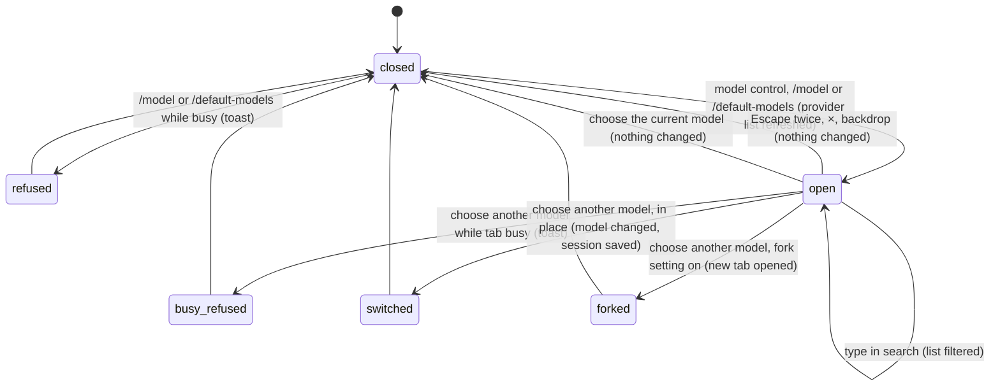

# The model picker

## Summary

The model picker is how the user chooses which model the active tab uses. It is an overlay titled "Select model": a search field ("Search models…") over a list of every model from the user's connected [providers](../foundations/models-and-providers.md), with the tab's current model first and marked with a check ("Current model"). It is reached three ways: clicking the model control at the left of the [status bar](../ui/the-status-bar.md) (the π mark and the model's name, tooltip "Switch the AI model for this session."), typing `/model` ("Switch AI model"), or typing `/default-models`, which opens the same picker despite its description, "Switch models with Ctrl+P". There is no Ctrl+P shortcut. The status-bar control opens the picker even while the tab is busy, but choosing a different model is then refused; the two commands are refused outright while busy. With no provider connected the picker opens empty. It behaves the same on Excel desktop and Excel on the web.

## The simple case

The user clicks "GPT-6.1 Sol" in the status bar. The picker opens over the taskpane with the cursor in the search field. The first row is the current model, "gpt-6.1-sol", with a check, the provider tag "openai-codex" and "500k ctx · 128k out" under it; below come the other models of the connected providers.

They type "luna". The list narrows to the models whose provider, id or name contains those letters in order. They press Down to highlight "gpt-6-luna" and press Enter. The picker closes, the status bar shows "GPT-6 Luna", and the next message in this tab goes to that model. Focus is back in the composer, and nothing else changed: same tab, same conversation, same thinking level.

## The interaction, event by event

### Opening the picker

At the moment the picker opens, two things are fixed:

- **The target tab** is the active tab. Whatever the user does afterwards, the choice applies to that tab.
- **The current model** is that tab's model, which gets the check mark.

Pi then re-reads the configured providers from storage, without going to the network, closes any open status-bar popover, and shows the overlay with focus in the search field. Right after, it asks every connected provider for its latest model list in the background; when answers arrive the open list updates in place.

The list contains only models of connected providers. Each row shows the model's id (for example "claude-opus-4-7", not its display name), a check if it is the current model, the provider's id as a tag ("anthropic", "openai-codex", "openai", "google", "Gateway · Warehouse"), and its context window and output limit ("200k ctx · 64k out").

Without a search, the order is:

1. The current model.
2. A short list of featured models, provider by provider in the order Anthropic, OpenAI (ChatGPT), OpenAI (API), the Google providers, GitHub Copilot, then the rest alphabetically: for Anthropic the newest Fable, then the newest Sonnet and Opus (Sonnet first only when its version is at least Opus's); for each OpenAI provider the newest general GPT and the newest Codex model (whichever is newer first); for Google Gemini (API) the newest Pro; for the Google sign-in providers the newest stable Pro; for any other provider its single best model.
3. Every other model, grouped by provider in the same order, then by family (for example Opus before Sonnet before Haiku), newest first.

### Searching

Typing filters as the user types. A model matches when every typed letter appears, in order, somewhere in its provider id, model id and name; spaces in the search are ignored and case does not matter. Matches are ordered by how tightly the letters cluster, with the current model floated to the top if it matches. Each keystroke moves the highlight back to the first row. If nothing matches, the list says "No matching models".

### Ends at once

The picker closes, or never opens, without changing anything when:

- **The command is refused.** `/model` and `/default-models` are not allowed while the tab is busy: "Can't run /model while Pi is busy" (see [the command menu](../commands/the-command-menu.md)). With no active tab, "No active session".
- **The user closes it.** Escape inside the search field first leaves the field; a second Escape closes the picker. The × button ("Close dialog") and a click on the dimmed backdrop close it at once.
- **The user chooses the current model.** The picker closes and nothing happens, not even a toast. If the provider has since described that model differently (a new context window, for example), the new description is applied and saved.

In every case focus returns to the composer.

### Choosing a model

Click a row, or move the highlight with Up and Down (it stops at both ends) and press Enter. The highlight follows the mouse only after the mouse actually moves, so arrowing through a long list is not disturbed by a pointer resting over it. Choosing closes the picker immediately; then one of three things happens to the target tab:

- **The tab is busy.** The toast says "Wait for this tab to finish before changing models" and the model does not change. The user has to wait for the turn to end and open the picker again.
- **In place** (the default). The tab switches to the chosen model, the status bar shows its name, and the session is saved, even if the tab has no messages yet. The conversation and thinking level are kept.
- **Fork** ("Fork model switch into new tab" on in [settings](settings.md)). The tab is left alone and a copy opens as a new active tab, titled "{source title} ({model id})", with the same messages and thinking level and the chosen model. The toast says "Opened {title} in a new tab". This also happens in a tab with no messages (see [Open questions](#open-questions-and-verification)).

The full rules, including what happens to the thinking level, are in [models and providers](../foundations/models-and-providers.md#changing-the-model).

### While the picker is open

Nothing runs in the target tab because of the picker. A turn already running in it, or in another tab, keeps running behind the overlay. The list can change under the user as background refreshes arrive; the highlight stays on the same position, not the same model.

### After choosing

The user is back in the composer of the active tab, which is the target tab for an in-place switch and the new tab for a fork. The model takes effect from the next model request. If the chosen model has a smaller context window, the [context meter](../turn/context-and-compaction.md) changes at once.

### Ctrl+P and `/default-models`

The command menu describes `/default-models` as "Switch models with Ctrl+P". Neither part holds: `/default-models` opens the ordinary picker (the code marks it as a placeholder for a future "scoped models" dialog), and no Ctrl+P or Cmd+P shortcut exists in Pi. The keyboard shortcuts page does not list one. Pressing Ctrl/Cmd+P in the taskpane is left to the host, which on most webviews means the print command.

## Modifiers

| Modifier | Set before | Changed while busy |
| --- | --- | --- |
| Model and provider | Only connected providers' models are listed; with none connected the list is empty. The current model is marked if its provider is still connected. | Choosing a different model is refused with a toast. |
| Thinking level | Kept on an in-place switch, copied to a fork; not shown in the picker. | Not changed by the picker. |
| Execution mode | No effect. | No effect. |
| Files in the workspace, or an overlay open | No effect from files. Opening the picker replaces an earlier picker and closes status-bar popovers; it opens above other overlays. | The picker opens over a running turn; an approval dialog that opens later appears above it. |
| Tab state (new, restored, another tab busy) | A new tab already copies the active tab's model. A busy other tab does not affect choosing for this one. | The status-bar control still opens the picker; the choice is refused. |
| Host (desktop or web) | No difference. | No difference. |

Because the target tab and current model are captured when the picker opens, changes made elsewhere while it is open (another login, a gateway saved) update the list but not the check mark.

## Cancel and interrupt

| Event | Before sent | While busy |
| --- | --- | --- |
| Stop (button or Escape) | Escape leaves the search field, then closes the picker. Escape does not stop a turn while the picker is open, because the picker claims it. | Not applicable: choosing is instantaneous. A refused choice leaves the turn running. |
| The user sends something else | The composer is covered while the picker is open. | Not applicable. |
| Tab switched, created, closed or reopened | The tab strip is covered. If the target tab is closed anyway (for example by a keyboard shortcut), choosing shows "Session not found". | Not applicable. |
| An overlay or menu opens | A connection or approval dialog that opens on top takes focus; the picker stays underneath until closed. | Not applicable. |
| Model or thinking level changes | An automatic model swap in the target tab while the picker is open is not reflected in the check mark. | Not applicable. |
| The provider fails | A failed background refresh leaves the list as it was. | Not applicable. |
| The taskpane goes away | Nothing chosen, nothing saved. | An in-place choice was already saved. |
| The workbook changes underneath | No effect. | No effect. |
| Focus moves to the grid or another window | The picker stays open; focus returns to it. | No effect. |
| The context window fills | Not applicable. | Not applicable. |

After closing the picker the user is in the composer of the tab they started from, or of the forked tab.

## Interactions with other systems

**Persistence.** An in-place choice saves the session at once, which also saves a session that had no messages. A fork saves the new session. See [persistence and restore](../cross-cutting/persistence-and-restore.md).

**Workbook changes and recovery.** No interaction.

**Other tabs and sessions.** The choice applies only to the target tab. A fork creates a new tab after the others and makes it active; see [tabs](../sessions/tabs.md).

**Execution mode and approvals.** No interaction.

**Models and providers.** The picker lists what [models and providers](../foundations/models-and-providers.md) defines as connected.

**Offline and provider errors.** The picker works offline from the cached model lists; the background refresh simply fails.

**Notifications.** "Wait for this tab to finish before changing models", "Opened {title} in a new tab", "Can't run /model while Pi is busy". An in-place switch has no toast; the status bar is the confirmation.

**Settings and preferences.** "Fork model switch into new tab" decides in place versus fork. There is no setting for which models are listed.

**Host differences.** None.

**Language.** The title, placeholder, empty message and toasts are translated. Model ids and provider ids are never translated.

**Accessibility and keyboard.** The list is a listbox; rows are options whose accessible name includes "Current model" for the current one. Up, Down and Enter work from the search field. There is no keyboard shortcut to open the picker other than typing `/model`.

## Edge cases

- With no provider connected the picker shows only "No matching models", even though the status bar names a model.
- The status bar shows the model's display name ("GPT-6.1 Sol"); the picker shows ids ("gpt-6.1-sol") and provider ids. The same model from two providers appears twice, distinguishable only by the tag.
- Seen in the standalone taskpane: when the tab's model was swapped by a provider refresh at the same moment the picker opened, no row had the check mark, and the status bar's context size changed from "272k" to "500k" behind the overlay.
- Custom gateways appear with their single model and the tag "Gateway · {name}".
- Opening the picker again while it is open replaces it with a fresh one.
- `/model` followed by text ignores the text; the picker does not prefill the search.

## Open questions and verification

- Confirmed in the standalone taskpane (Chromium, no Excel): the picker's layout and row format, two-step Escape, the fuzzy filter and "No matching models", and the empty list with no provider. The busy refusal and the fork toast were read from code; the fork itself was confirmed (see below).
- `/default-models` is a placeholder that opens the ordinary picker (`src/commands/builtins/model.ts:36-44`), and its description "Switch models with Ctrl+P" (`en.json` key `command.model.cycle`) promises a shortcut that does not exist. Looks like a bug in either the command or its description.
- The current model is captured before the provider refresh that opening triggers (`src/taskpane/init.ts:1607`), so a model swapped by that refresh is not checked. Seen once, as described in Edge cases. Minor bug.
- Forking happens even in an empty tab: confirmed, a new tab "Chat 1 (gpt-5.3-codex-spark)" opened from an empty "Chat 1". Cause: `src/taskpane/session-runtime-manager.ts:201` counts the hidden system message. Looks like a bug.
- The status-bar control opens the picker while busy and refuses at choice time, while `/model` refuses before opening. Probably unintentional inconsistency; a product call.
- Whether tab-switching shortcuts reach the tab strip while the picker has focus was not checked.

Verified against pi-for-excel commit `ec453df`.
