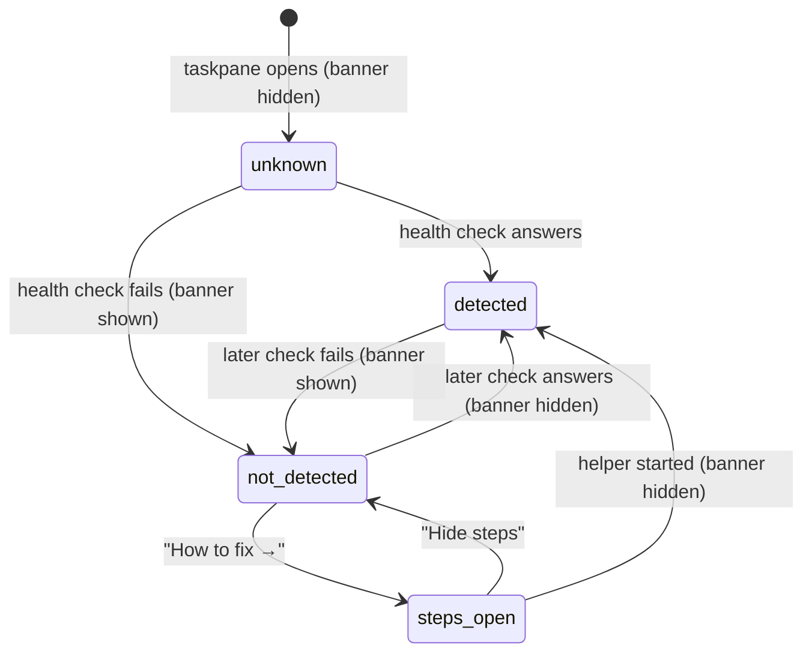

# The proxy

## Summary

The [CORS proxy](../glossary.md#models-and-providers) is a small HTTPS helper that relays requests the Office webview is not allowed to make itself. Several logins and providers need it: OAuth for Anthropic, OpenAI (ChatGPT), Google Code Assist, Google Antigravity and GitHub Copilot, and model requests to OpenAI (ChatGPT), the two Google sign-in providers, Anthropic when logged in by OAuth, and custom gateways not set to connect directly. API-key providers (OpenAI (API), Google Gemini (API), Anthropic with an API key, and the rest) do not need it. Normally the user runs it on their own machine with `npx pi-for-excel-proxy`, at "https://localhost:3003"; an organisation can host one centrally ([docs/central-proxy.md](../../docs/central-proxy.md)). The user meets it in four places: Settings → "Proxy" (the setting), the *proxy banner* above the transcript ("Proxy not running · Some features won't work."), the welcome overlay's proxy panel and the "One more step before login" gate ([welcome and login](welcome-and-login.md)), and the CORS error banner after a failed turn. Pi checks whether the proxy is reachable when the taskpane opens and every 30 seconds after that, on every host, busy or not.

## The simple case

The user connects OpenAI (ChatGPT). Before the login opens, Pi says the login "needs a small helper running on your Mac" and shows `npx pi-for-excel-proxy`. They run it in Terminal, wait for "Proxy listening", and click "Retry". Pi turns the proxy setting on and the login continues.

Later they open Settings → "Proxy" and see the "Proxy" switch on, "URL" `https://localhost:3003`, and a green "✓ Proxy connected at https://localhost:3003". Every ChatGPT request now goes through the helper.

The next day they open Excel without starting the helper. Within a moment the proxy banner appears above the transcript: "Proxy not running · Some features won't work." with "How to fix →". They click it, copy the command, run it, and within 30 seconds the banner disappears by itself.

## The interaction, event by event

The setting itself (on or off, and the URL) is a second, independent state; see [Changing the setting](#changing-the-setting).

### What is decided when the taskpane opens

- **A default URL is stored** if none is: "https://localhost:3003", or the organisation's URL in a central build. The switch itself stays as it was (off on a fresh install).
- **The welcome overlay**, if shown, turns the switch on when a local proxy already answers at the URL.
- **A security warning** appears as a toast when the switch is on and the URL is not on this machine: "Security warning: proxy URL is not localhost — it can see your tokens and prompts." This check happens only when the taskpane opens.
- **Status polling starts.** Pi asks the stored URL's health endpoint (1.5 s timeout) once at once and every 30 seconds. The result is "detected" or "not detected"; before the first answer it is unknown and the banner stays hidden.

### Which requests use it

The switch decides whether the proxy is used at all. With it on and a valid URL, Pi routes through it only the requests that need it: the providers listed in the [Summary](#summary), OAuth token exchanges, and gateways and extension providers (unless a gateway is set to "Connect directly"). Everything else goes directly. With it off, or with a URL that fails validation, every request goes directly, and the ones that needed the proxy fail.

### The proxy banner

The banner shows whenever the last check failed, and hides as soon as one succeeds. It has no close button. "How to fix →" expands it in place:

- "Run this command in your terminal and keep the window open:"
- the command `npx pi-for-excel-proxy` with a copy button ("Copy command"; its icon turns to a check, "Copied", for 1.4 seconds; if copying is blocked, the command text is selected instead);
- "Open Terminal · paste · press Enter · keep open";
- "No Node.js? See install guide →", opening the install guide in a browser.

The button becomes "Hide steps". When the proxy is detected the banner hides and collapses, so it reappears collapsed next time.

> Technical note: the banner reflects only the health check of the stored URL. It does not consider whether the switch is on or whether the active tab's provider needs a proxy, so a user who only uses API keys and never ran the helper sees it permanently. See [Open questions](#open-questions-and-verification).

### Changing the setting

Settings → "Proxy" has one card:

- **"Proxy"** ("Route API calls through a local proxy", or "Route API calls through your organisation's proxy" in central builds), a switch. It saves the moment it changes: "Proxy enabled." or "Proxy disabled."; on failure "Failed to save proxy settings." and the switch flips back.
- **"URL"**, saved when the field loses focus or on Enter. An empty field means the default. The URL is checked first; a rejected URL is not saved, the status line shows the reason in warning color, and the toast says "Proxy URL not saved: {error}". Reasons: not a full URL ("Invalid Proxy URL: "{url}". Expected a full URL like https://localhost:3003"), or `http://` from an add-in served over HTTPS ("Proxy URL is HTTP ({url}) but the add-in is served over HTTPS. Office webviews may block this as mixed content. Use https://localhost:3003 and run an HTTPS proxy. See …"). A valid new URL shows "Proxy URL saved."; the same URL shows nothing.
- **A status line**: "Proxy disabled." when off; "✓ Proxy connected at {url}" when on and detected; "⚠ Proxy is enabled at {url} but is not currently reachable." when on and not detected; "Checking proxy {url}…" before the first check.
- **A hint**: "Recommended URL: https://localhost:3003. Keep this on localhost. Install and setup guide." (central builds: ". This is your organisation's proxy. ").

The welcome overlay's proxy panel stores the same two values with less checking; see [welcome and login](welcome-and-login.md#the-proxy-panel-on-the-welcome-overlay).

### Ends at once

Nothing changes when the URL is rejected, when the same URL is re-entered, or when the user expands and collapses the banner. The banner never stores anything.

### When the proxy is missing at the moment it is needed

- **OAuth login**: the gate "One more step before login", or, if the gate passes but the request still fails, "Login couldn't connect — this provider needs a helper running on your Mac. …" under the provider row.
- **A turn**: the request fails and, if the active tab ran it, the error banner reads "Network error (likely CORS). If you're using OAuth, enable /settings → Proxy with https://localhost:3003 and retry. Guide: https://github.com/tmustier/pi-for-excel/blob/main/docs/install.md#oauth-logins-and-cors-proxy". This text is shown for any error that looks like a network or CORS block, including plain loss of network.
- **GPT-5.6 Luna on OpenAI (ChatGPT)** needs a recent helper: with no proxy the turn fails with "GPT-5.6 Luna currently requires the latest Pi for Excel proxy for ChatGPT WebSocket transport. Enable Proxy in Settings and run: npx -y pi-for-excel-proxy@latest", and with an older helper "GPT-5.6 Luna requires a newer Pi for Excel proxy with ChatGPT WebSocket support. …".

## Modifiers

| Modifier | Set before | Changed while busy |
| --- | --- | --- |
| Model and provider | Decides whether requests need the proxy; the banner ignores it. | A turn reads the setting at each model request; turning the proxy off mid-turn affects the next request. |
| Thinking level | No effect. | No effect. |
| Execution mode | No effect. | No effect. |
| Files in the workspace, or an overlay open | No effect from files. The banner sits above the transcript, under any overlay. | Polling continues behind overlays. |
| Tab state (new, restored, another tab busy) | One setting and one banner for the whole taskpane. | Polling is independent of tabs. |
| Host (desktop or web) | Office serves the add-in over HTTPS on every host, so the proxy must be HTTPS. The helper's command and wording assume a Mac and Terminal on every host. | No effect. |

A change to the setting applies from the next request that needs the proxy.

## Cancel and interrupt

| Event | Before sent | While busy |
| --- | --- | --- |
| Stop (button or Escape) | Escape on the Proxy page saves a pending URL edit as the field loses focus, then goes back. The banner does not react to Escape. | Stopping a turn does not touch the proxy. |
| The user sends something else | A send that needs a missing proxy fails as above. | No effect. |
| Tab switched, created, closed or reopened | No effect; the banner is shared. | No effect. |
| An overlay or menu opens | Covers the banner; polling continues. | Same. |
| Model or thinking level changes | Switching to a provider that needs the proxy does not re-check it. | Not applicable. |
| The provider fails | A CORS-like failure shows the network-error banner. | Same. |
| The taskpane goes away | The setting persists. Polling stops and restarts on open. | A request already sent through the proxy is lost with the turn. |
| The workbook changes underneath | No effect. | No effect. |
| Focus moves to the grid or another window | Polling continues; a pending URL edit is saved. | No effect. |
| The context window fills | Not applicable. | Not applicable. |

Stopping the helper while Pi runs shows the banner within 30 seconds and fails the next request that needs it.

## Interactions with other systems

**Persistence.** The switch and URL are stored per machine in the add-in's storage; the detected state is not stored.

**Workbook changes and recovery.** No interaction.

**Other tabs and sessions.** One setting and one banner for all tabs.

**Execution mode and approvals.** No interaction.

**Models and providers.** Which providers need the proxy is listed in the [Summary](#summary); gateways can opt out with "Connect directly" ([custom gateways](custom-gateways.md)).

**Offline and provider errors.** Offline, the banner appears (the health check fails) and failed turns show the CORS-worded banner; see [provider errors and offline](../cross-cutting/provider-errors-and-offline.md).

**Notifications.** The banner, the startup security toast, and the Proxy page toasts.

**Settings and preferences.** Settings → "Proxy"; the root page shows "On" or "Off".

**Host differences.** Excel for Mac (WKWebView) is strictest about mixed content; the proxy must be HTTPS everywhere.

**Language.** The banner, the Proxy page and toasts are translated. The URL validation messages, the CORS error banner and the Luna messages are English-only.

**Accessibility and keyboard.** The banner's buttons are reachable with Tab; the copy button has an accessible name. The banner's appearance is not announced to screen readers.

## Edge cases

- With the switch off, the banner still appears whenever no helper answers at the stored URL.
- Setting a remote URL in Settings shows no security warning until the taskpane next opens.
- After changing the URL, the status line keeps the last check's result, now shown against the new URL, until the next 30-second check.
- A URL with a trailing slash is saved without it.
- Typing the default URL into an empty field and saving shows nothing if it was already the stored value.

## Open questions and verification

- Confirmed in the standalone taskpane: the Proxy page with "✓ Proxy connected at https://localhost:3003", the rejection of `http://example.com` with the mixed-content message in the status line and the "Proxy URL not saved: …" toast, and the banner and its expanded steps when the helper was blocked. The CORS banner, the gate and the Luna messages were read from code.
- The banner ignores the switch and the provider: `src/taskpane/proxy-status.ts:45-58` checks the stored URL unconditionally and `src/ui/proxy-banner.ts:142` shows it on any failed check. This contradicts the glossary's "shown when the selected provider needs the CORS proxy". API-key-only users see a permanent warning. Looks like a bug; the glossary entry may need correcting instead.
- The Proxy page does not re-check after a URL change (`src/commands/builtins/settings-pages/proxy-page.ts` only listens for state changes from polling), so it can claim "Proxy connected at {new url}" for up to 30 seconds based on the old URL's check. Looks like a bug.
- The security warning is only checked at startup (`src/taskpane/init.ts:253-260`). Probably should also fire when saving a remote URL.
- The welcome panel saves an unvalidated URL (`src/taskpane/welcome-login.ts:274`); an `http://` URL saved there makes every proxied request silently go direct. Looks like a bug.
- The CORS error banner is hard-coded English and shown for any "failed to fetch"-style error (`src/taskpane/init.ts:1056`, `src/taskpane/runtime-utils.ts:104`), including plain loss of network and API-key providers that do not use the proxy. Misleading.
- The banner's command is `npx pi-for-excel-proxy`, while docs and the Luna error use `npx -y pi-for-excel-proxy@latest`; an older cached helper may be reused. Not confirmed.
- Proxy guidance says "on your Mac" and "Terminal" on Windows too.

Verified against pi-for-excel commit `ec453df`.
