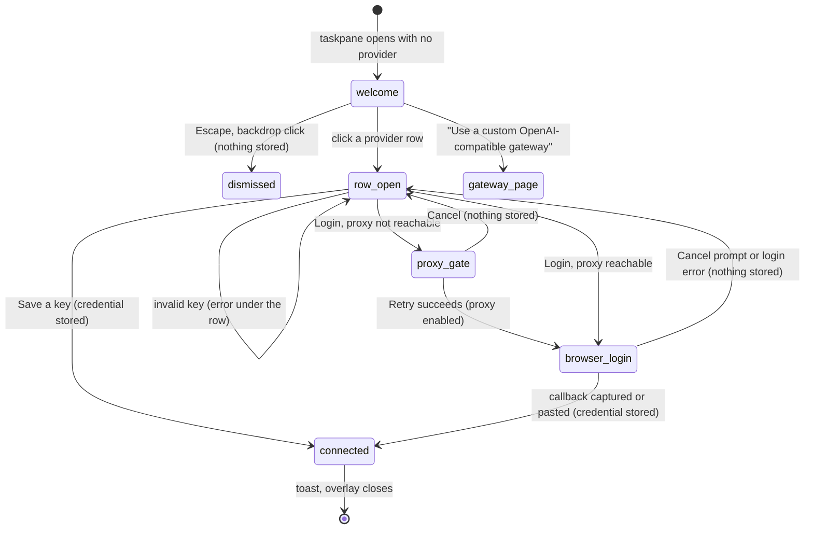

# Welcome and login

## Summary

Logging in connects Pi to a [provider](../foundations/models-and-providers.md) so that it has a model to answer with. The user meets it in three places that share one design: the *welcome overlay* that greets a taskpane with no provider ("Pi for Excel", "Connect an AI provider to get started", "Select provider"), Settings → "Model providers" (reached with `/login`, see [settings](settings.md)), and the *connection dialog* "Connect {label}" that a turn opens when its model's provider has no credential. Each provider is a row; expanding it offers "Login with {label}" for providers that support OAuth and an API-key field with "Save" for all. The welcome overlay appears only when the taskpane opens with no provider connected, on every host; it is not available on demand. Logging in does not need the tab to be idle, but the connection dialog only exists inside a turn. Nothing here sends anything to a model.

## The simple case

The user opens Pi for the first time. After a moment the welcome overlay covers the taskpane: a "English" / "中文" language switch, the π mark, "Pi for Excel", "Connect an AI provider to get started", a one-line introduction, and under "Select provider" a scrolling list of providers, each with "set up →".

They click "OpenAI (API)". The row expands with a key field ("Enter API key") and "Save", and the field takes focus. They paste their key and press Enter. The button reads "Testing…" for an instant, the row shows "✓ connected", a toast says "OpenAI (API) connected — try "Explain this workbook"", and the overlay closes. Focus is in the composer and the status bar names the [default model](../foundations/models-and-providers.md#the-default-model) for that provider.

With a subscription instead, they click "OpenAI (ChatGPT)" and then "Login with OpenAI (ChatGPT)". A browser window opens on the OpenAI sign-in page, and Pi shows a dialog waiting for the result. When the sign-in finishes, the local proxy hands the result back, the dialog says "Callback captured — finishing login…", and the same toast and closing follow.

## The interaction, event by event

### Arriving at the welcome overlay

The welcome overlay is decided once, while the taskpane opens. Pi first restores stored logins (waiting up to about ten seconds); if no provider is connected after that, the overlay is shown over the empty tab. If a slow restore connects a provider later, the overlay closes by itself. Disconnecting the last provider later does not bring it back; it returns only the next time the taskpane opens with no provider.

Before it appears, Pi prepares the proxy so that OAuth can work before the user ever sees Settings: if no proxy URL is stored it stores the default ("https://localhost:3003"), and if the proxy is off but a local proxy answers at that URL, Pi turns it on. See [the proxy](the-proxy.md).

The card offers:

- **"English" and "中文"**, which switch the language and reload the taskpane at once. See [language and theme](../ui/language-and-theme.md).
- **The provider rows** under "Select provider", in the order listed in [models and providers](../foundations/models-and-providers.md#connecting-a-provider). OAuth providers carry a short description ("Claude Pro/Max", "Plus/Pro subscription", "Gemini via Google account", "Gemini/Claude/GPT-OSS"); the two Google and OpenAI API rows say "API key".
- **"Use a custom OpenAI-compatible gateway"**, which closes the overlay and opens Settings on the gateway page ([custom gateways](custom-gateways.md)). If Settings cannot open, the toast says "Cannot open custom gateway settings".
- **"Having login trouble? Configure local proxy"**, a toggle that reveals the proxy panel (described below) and becomes "Hide proxy settings".

### Expanding a provider row

Clicking a row expands it and collapses any other expanded row; clicking it again collapses it. Focus moves to the key field. The expanded row contains, top to bottom: "Disconnect {label}" (only in Settings, for a connected provider), "Login with {label}" and the divider "or enter API key" (OAuth providers only), the key field and "Save". The key field's placeholder depends on the provider: "sk-ant-api… or sk-ant-oat…" for Anthropic, "ChatGPT OAuth access token" for OpenAI (ChatGPT), "Google OAuth credential JSON" for the two Google OAuth rows, "Enter API key" otherwise. The field hides what is typed.

### Ends at once

Nothing is stored when:

- **The user dismisses the welcome overlay** with Escape or a click on the backdrop. There is no close button. The welcome overlay does not take focus: when it appears, focus stays in the composer behind it, so the first Escape only moves focus out of the composer and the second closes the overlay; focus then returns to the composer. The taskpane underneath is fully usable without a provider (see [Edge cases](#edge-cases)).
- **"Save" is pressed with an empty field.** Nothing happens, not even an error.
- **The key is rejected before saving.** A leading "Bearer " is removed silently. Pasting something that looks like an OAuth result instead of a key shows an error under the row and keeps the row open: for Anthropic "That looks like an OAuth authorization code (code#state). Use “Login with Anthropic” and paste it when prompted (don’t Save it as an API key)."; for OpenAI (ChatGPT), the Google OAuth rows and Google Gemini (API), the matching "That looks like an OAuth redirect URL/code. …" message.
- **The user cancels an OAuth step**: "Cancel" in the proxy gate, "Cancel" or Escape in the login prompt. The row returns to "Login with {label}" with no message. A browser window that was already opened stays open.

### Committing a credential

**API key.** "Save" (or Enter in the field) stores the key as typed, after the checks above. The button says "Testing…" while it is stored, but Pi does not contact the provider; a wrong key is accepted and fails on the first turn. If storage fails, the error is "Failed to save key: {msg}".

**OAuth.** "Login with {label}" turns into "Opening login…" and then runs the provider's flow:

1. **The proxy gate.** For Anthropic, OpenAI (ChatGPT), Google Code Assist, Google Antigravity and GitHub Copilot, Pi first checks that the proxy answers. If it does not, the dialog "One more step before login" explains "This login method needs a small helper running on your Mac. Open the Terminal app and paste this command:", shows `npx pi-for-excel-proxy` with "Copy" ("Copied!"), and the hint "Wait until you see “Proxy listening” in Terminal, then click Retry." with "Step-by-step guide →". "Retry" ("Checking…") turns the proxy setting on and continues if the proxy now answers; otherwise the hint becomes "Helper not detected yet — make sure it says “Proxy listening” in Terminal, then try again.". Organisation builds with a central proxy show the remote wording instead.
2. **The browser window.** Pi opens the provider's sign-in page in a new browser window (on desktop Excel, the system browser). The taskpane does not move.
3. **The login prompt.** For providers that redirect back, a dialog titled "Login with {label}" shows the provider's instruction, the helper "After login, Pi for Excel will try to capture the local callback automatically. If it does not continue, copy the final callback URL from your browser address bar and paste it here.", an "Open login page" link and "Copy login link" ("Copied!", or "Select URL below" if copying fails), a read-only "Login URL (select and copy if buttons don't work)", a status line, a paste field, and "Cancel" / "Continue". With the local proxy enabled the status line says "Waiting for the browser callback via the local proxy…"; Pi checks every three-quarters of a second for up to two minutes, and when the browser lands on the callback the line says "Callback captured — finishing login…" and the prompt submits itself. If capture is not possible the line says "Automatic callback capture did not complete. Paste the callback URL below to continue." and the user pastes the address from the browser and presses "Continue" or Enter.
4. **GitHub Copilot** uses a device code instead (in the standalone taskpane the login failed at once with the CORS error described under [Connected, or failed](#connected-or-failed), even with the local proxy enabled and running, so this dialog was not seen): Pi opens the verification page and shows "Finish sign-in in your browser", "Enter this code on the verification page that just opened:", the code with "Copy", and "If no window opened, visit {uri} and enter the code there.". This dialog has no buttons; it closes by itself when the login completes or fails.

While the flow runs, the login button shows the provider's progress messages. When it succeeds the credential is stored, the row shows "✓ connected" and collapses.

### While a login is in progress

There is no busy state in the tab. Until a login prompt opens over them, the provider rows stay clickable; starting a second login while one is waiting replaces the first's prompt dialog, which counts as cancelling the first. On the welcome overlay the user can still switch language or open the proxy panel. Focus can go to the browser window and back without affecting the flow.

### Connected, or failed

**On the welcome overlay** a success shows the toast "{label} connected — try "Explain this workbook"" for a little over three seconds and closes the overlay; focus goes to the composer. Pi refreshes the provider list, and idle tabs on a disconnected provider move to the new default model (see [models and providers](../foundations/models-and-providers.md#when-a-provider-is-disconnected)).

**In Settings → "Model providers"** the toast is "{label} connected" and the page stays open. "Disconnect {label}" ("Disconnecting…") removes the credential; the toast is "{label} disconnected", or the row shows "Failed to disconnect: {msg}".

**In the connection dialog** a success closes the dialog with no toast, and the turn that asked continues with the new credential.

A failed OAuth login leaves the row open with an error under it. A network failure that looks like a CORS block says "Login couldn't connect — this provider needs a helper running on your Mac. Open Terminal and run: `npx pi-for-excel-proxy`, then try again." with "Step-by-step guide →"; anything else shows the provider's message, or "Login failed".

### The connection dialog

When a turn needs a credential for its model's provider and has none, Pi opens "Connect {label}" with the subtitle "This model needs a login or API key to continue." and the provider's row already expanded, with focus in the key field. The user's message is already in the transcript and the tab is busy (the Stop button shows) while the dialog waits. Connecting closes the dialog with no toast and the turn continues with the new credential. Closing it (×, Escape twice, or the backdrop) fails the turn: the transcript shows "Error: Provider is not configured: {provider id}" and the error banner "LLM error: Provider is not configured: {provider id}" (for example `openai`); see [turns](../foundations/turns.md#sent). Providers added by an extension never open this dialog: the error banner says "No API key available for provider "{provider}"." instead.

### The proxy panel on the welcome overlay

"Having login trouble? Configure local proxy" reveals "Local HTTPS proxy" with an "Enabled" checkbox, the URL field and "Save", and the hint "Needed only when OAuth login is blocked by CORS. Keep this URL at https://localhost:3003, run a local HTTPS proxy, then enable this toggle. Step-by-step guide.". Ticking the checkbox saves immediately; "Save" stores the URL and the checkbox together. Both show "Proxy settings saved" or "Failed to save proxy settings". The full proxy behavior is in [the proxy](the-proxy.md).

## Modifiers

| Modifier | Set before | Changed while busy |
| --- | --- | --- |
| Model and provider | The welcome overlay appears only when no provider is connected. The connection dialog targets the provider of the tab's model. | A connection dialog holds its turn until answered. |
| Thinking level | No effect. | No effect. |
| Execution mode | No effect. | No effect. |
| Files in the workspace, or an overlay open | No effect from files. The welcome overlay opens over anything else at startup; the OAuth prompts and proxy gate open above it. | A connection dialog opens over whatever is showing. |
| Tab state (new, restored, another tab busy) | The welcome overlay covers whatever tabs were restored. Connecting moves every idle tab on a disconnected provider to the default model. | Busy tabs keep their model until idle. |
| Host (desktop or web) | Same rows on every host. OAuth opens a separate browser window; on desktop that is the system browser. The proxy wording says "on your Mac" on every host. | No effect. |

A login started in one place (the welcome overlay, Settings or the connection dialog) completes in that place even if the user does other things meanwhile.

## Cancel and interrupt

| Event | Before sent | While busy |
| --- | --- | --- |
| Stop (button or Escape) | Escape leaves a text field first, then closes the topmost dialog: the login prompt (cancelling the login), the proxy gate (cancelling), the device-code dialog (the login keeps polling), or the welcome overlay. On the welcome overlay the field that has focus is usually the composer behind it. | In the connection dialog, the first Escape leaves the key field and the second dismisses it; the turn fails. |
| The user sends something else | The composer is covered while an overlay is open. | The composer is covered by the connection dialog. |
| Tab switched, created, closed or reopened | Not possible while the overlay covers the tab strip. | Not possible while the connection dialog is open. |
| An overlay or menu opens | "Use a custom OpenAI-compatible gateway" closes the welcome overlay and opens Settings. | Not applicable. |
| Model or thinking level changes | A model chosen before connecting stays; connecting may swap idle tabs to the default model. | Not applicable. |
| The provider fails | An OAuth failure shows an error under the row; nothing is stored. | The connection dialog stays open until connected or dismissed. |
| The taskpane goes away | A pending OAuth login is lost; the browser window stays. Stored credentials survive. | The turn ends unrecorded, as in [turns](../foundations/turns.md). |
| The workbook changes underneath | No effect. | No effect. |
| Focus moves to the grid or another window | The OAuth flow continues; capture works while the taskpane is in the background. | Same. |
| The context window fills | Not applicable. | Not applicable. |

After a cancelled login the user is back on the expanded row with the key field empty or as they left it.

## Interactions with other systems

**Persistence.** Credentials are stored per machine in the add-in's storage; OAuth logins are restored and, if expired, refreshed when the taskpane opens. See [models and providers](../foundations/models-and-providers.md#where-credentials-live).

**Workbook changes and recovery.** No interaction.

**Other tabs and sessions.** A new connection applies to every tab; idle tabs whose provider is not connected are moved to the default model.

**Execution mode and approvals.** No interaction.

**Models and providers.** Logging in changes the default model; see [models and providers](../foundations/models-and-providers.md#the-default-model).

**Offline and provider errors.** Saving an API key works offline because nothing is checked. OAuth needs the network and usually the [proxy](the-proxy.md).

**Notifications.** Toasts on connect and disconnect (except in the connection dialog), errors inline under the row.

**Settings and preferences.** The welcome overlay may turn on the proxy setting by itself; the proxy gate's "Retry" turns it on too.

**Host differences.** OAuth windows open in the system browser on desktop and in a new browser tab on Excel on the web. The proxy gate and CORS error text mention a Mac and Terminal on every host.

**Language.** All welcome and login wording is translated except "Hide proxy settings", which is hard-coded English. Provider labels are brand names and not translated.

**Accessibility and keyboard.** The welcome overlay is a labelled dialog ("Pi for Excel"). Every row and button is reachable with Tab; Enter in a key field saves; Enter in the login prompt continues.

## Edge cases

- Dismissing the welcome overlay leaves a working taskpane with no provider: the status bar names a fallback OpenAI model, "Select model" lists nothing ("No matching models"), and the first message opens "Connect OpenAI (API)", whatever provider the user meant to use.
- No disclosure bar is shown while no provider is connected, and connecting from the welcome overlay does not bring it in during that session.
- The welcome overlay can close itself without any click if a stored login finishes restoring after it appeared.
- A second "Login with {label}" started before the first one's prompt appears starts a second flow; whichever prompt opens last replaces the other.
- Saving an API key for a provider that already has one replaces it.
- The connection dialog's title uses the provider's label when known ("Connect Anthropic") and its internal id otherwise.

## Open questions and verification

- Confirmed in Excel on the web (logged in with OpenAI (ChatGPT)): Settings → "Model providers" with its rows and "✓ connected", an expanded row focusing "Enter API key", the Google Gemini (API) redirect-URL error, a key pasted as "Bearer …" saved with the prefix removed, the "{label} connected" and "{label} disconnected" toasts, and "Disconnect {label}" only inside a connected row.
- Confirmed in the standalone taskpane with a fresh browser profile and the dev server's pre-login blocked (the no-provider case cannot be shown in the Excel session without logging it out): the welcome overlay and its rows, focus staying in the composer behind it, two Escapes to dismiss, "No matching models", the Anthropic "code#state" error, empty "Save" doing nothing, the API-key path with the welcome toast and focus in the composer, the Anthropic login prompt and its two-Escape cancel (the browser tab stays open), the proxy panel with "Hide proxy settings", the gateway link opening Settings on the gateway page with Back to the root, and the connection dialog's connect and dismiss paths.
- Not run: the proxy gate (skipped in development builds), a completed OAuth login (it would need a real account; the shared ChatGPT credential must not be replaced), the device-code dialog (see below), and where the login window opens on desktop. On the standalone taskpane in Chromium it opened in a new browser tab.
- GitHub Copilot's login failed at once in the standalone taskpane with "Login couldn't connect — this provider needs a helper running on your Mac. …" while the local proxy was enabled and answering (LOGIN-21). Whether Copilot's device-code requests are sent through the proxy at all was not traced; it may be a bug.
- "Testing…" does not test the key (`src/ui/provider-login.ts:1018`): confirmed, a made-up OpenAI key was saved and the next turn failed with a 401 (LOGIN-12). Probably worth fixing or relabelling.
- "Hide proxy settings" is hard-coded English (`src/taskpane/welcome-login.ts:255`).
- The welcome proxy panel saves the URL without validation (`src/taskpane/welcome-login.ts:274`), unlike Settings → Proxy. Confirmed: `http://example.com:3003` was saved with "Proxy settings saved" (LOGIN-24). Such a URL is then silently ignored when requests are made. Looks like a bug.
- A success in the connection dialog shows no toast (`src/ui/api-key-dialog.ts:62`), unlike the other two places. Confirmed (LOGIN-29). Probably unintentional.
- The connection dialog takes focus (the key field), unlike other overlays except Settings.
- The proxy gate and CORS error say "on your Mac" and "Terminal" on Windows too (`provider.proxy_gate.message`, `provider.cors_error` in `en.json`). A wording bug on Windows.
- The device-code dialog has no Cancel; closing it with Escape leaves the login polling in the background, and a later success still shows the toast. Read from code.
- Dismissing the connection dialog: confirmed that the banner is "LLM error: Provider is not configured: openai", not "API key required for {provider}." as [turns](../foundations/turns.md) says (LOGIN-31).

Verified against pi-for-excel commit `ec453df`.
